# AI-PET-WORLD 业务与技术架构

更新时间：2026-11-10 12:51:31 +08:00

状态：long-term-architecture-reference

文档版本：`AI-PET-WORLD-ARCHITECTURE-1.20`

生效日期：`2026-11-10`

替代版本：`AI-PET-WORLD-ARCHITECTURE-1.19`

文档状态：`active_normative_target`

程序符合状态：`program_adoption_pending`

Codex等外部执行智能体不得超出当前用户任务范围；本地程序在生效业务、安全和机器合同内自主运行，不从聊天或本句推导逐步Owner审批。

> 本文保留长期产品架构。模块安排只记录在 `docs/game-world-generation/CURRENT_EXECUTION_GUIDE_20260710.md`，不得从长期架构推导执行授权。紫微斗数是人格数据子系统，必须通过正式契约连接 AI 管家人格映射。

本地自研AI如何逐步获得项目知识、任务规划、软件工程、训练验证、审核和运营能力，以及Codex如何逐项退出执行链，由`docs/LOCAL_SELF_DEVELOPED_AI_CAPABILITY_AND_CODEX_MIGRATION_ARCHITECTURE.md`统一定义。该文件是本架构下的能力迁移主体架构，不是项目总体架构，也不产生执行授权。

本文定义 MVP 与长期主线的业务架构、技术架构、数据流、模块边界和禁止事项。模块状态与运行事实不在本文维护。

## 0. 本地智能核心与外部员工解耦架构

本地系统是正式判断、执行状态、审核状态、发布状态和长期记忆的唯一载体。世界事实、任务状态、机器结论、异常升级请求、业务决定、复审结果、容量登记和下一门禁必须全部以本地不可变文件为证据，并由本地SQLite提供查询索引。聊天和外部智能体记忆不属于系统状态。

统一AI控制台属于该本地系统的观察与有界控制入口，其产品结构、页面层级、数据字典、时间语义、状态投影、人工控制边界和版本化接口只由`docs/ai-console/`正式规格定义。控制台不得成为任务身份、训练身份、审核结论或发布身份的权威来源；页面展示和人工输入不得改写WorldFacts、机器证据、Checkpoint或状态机，也不得把历史记录投影为当前任务。总体架构只规定这些边界，不保存控制台版本号、页面编号、刷新周期、主题Token或单次实现状态。

正式运行链固定为：

```text
本地事实与能力版本读取
-> 本地任务规划与执行
-> 自动验证、机器审核与失败分类
-> 发布 / 回退 / 失败关闭
-> 本地不可变保存、事件与SQLite索引
-> 触及长期业务、许可或安全边界时生成policy-boundary-report并失败关闭
```

Codex只作为外部受控执行与检查员工，不得成为系统编排器、长期记忆、正式证据源或授权机关。它的具体任务范围由当前外部任务约束确定，不写入长期架构。本地自研AI负责正式判断和流程编排；移除Codex或丢失聊天历史不得破坏本地流程连续性。

机器可读长期合同由AI Painter正式主体规格登记。训练、能力版本变更、生成、验证、审核、发布、回退或失败关闭均由本地程序在生效合同内自主执行；触及长期业务、外部许可、付费资源或不可恢复操作时禁止越界动作，保存`policy-boundary-report`并写入事件总账与SQLite。Owner职责只由`GOV-OWNER-001`定义，不进入执行链。`latest.json`只是查询指针。

## 0.1 当前批准训练数据容量基线

当前批准数据发布版本采用两级容量目标，不改变AI Painter、WorldFacts、World Director、23通道、审核或Runtime边界。这里的容量版本属于数据发布身份，不代表模型家族、能力版本或项目产品代际：

| 级别 | 完整地图数量 | split | 作用 |
|---|---:|---|---|
| 首次MVP训练门槛 | 64 | `48/8/4/4` | 尽快启动第一轮正式MVP训练并验证本地模型闭环 |
| 后续正式增强目标 | 128 | `96/16/8/8` | 扩大构图、季节、生态和挑战集覆盖，提高泛化稳定性 |

64张门槛要求每条记录绑定独立完整地图世界事实、World Director、正式23通道、原生RGB、来源许可、机器审核、数据版本机器发布身份、hash和不可变存储；扩容目标不改变单条质量与完整地图门槛。实际容量、活动版本和split以不可变数据包及Dataset最终选择为准。

来源总索引与批准训练容量是两个不同身份。当前来源索引可以同时保存容量样本、历史来源和其他治理记录，因此顶层`sampleCount`不得被解释为批准训练数量；当前64份批准容量只能由容量子集身份及其独立计数字段确认，并继续按`48/8/4/4`使用。任何读取器都必须先验证顶层索引Schema，再从正式容量子集取样，禁止把顶层对象当作样本数组或把总索引数量硬编码为64。

## 0.2 自主能力变更与机器发布信任边界

模型、Loss、数据选择、审核实现、训练计划、能力版本和生产构建等变更必须在首次高风险写入前完成可验证的自主变更控制链：

```text
本地规划器依据生效项目合同形成能力变更候选
-> 不可变变更包绑定范围、代码、数据、模型、阈值和回归
-> 独立程序验证身份、版本、载荷、资源和输出命名空间
-> 建立不可覆盖的消费与执行记录
-> 执行变更、训练、验证和机器能力发布或回退
```

历史冷启动研发运行使用过的Ed25519签名与Owner消费记录只保留为历史证据，不得成为当前或未来本地AI能力变更的前置条件。当前变更包仍必须绑定实际动作、程序、数据、模型、目标和规范化载荷，但由本地系统根据常驻合同创建并用内部幂等票据执行；票据不表示人工许可。

本地编排器必须核对任务合同、scope、具体动作、资源预算和输出边界，并在训练或能力发布等高风险写入前原子登记。普通CPU检查、自动机器审核、只读分析、失败关闭、监控和治理记录属于系统自身职责，不得被错误归类为新的人工授权事项。

生产构建和新能力发布必须有独立变更身份，任一中间步骤失败都保持上一正式版本。正式能力发布后，Runtime任务按版本化合同自主执行；不能从一次业务运行反向获得修改模型、数据或阈值的权限。

新训练能力在进入GPU之前还必须把以下内容收口为同一个不可变能力身份：

- 完整Loss计算公式、规一化/聚合/遮罩语义、数值权重、实现路径与程序SHA-256；
- 机器审核合同的版本、路径、程序SHA-256、全部阈值、单位、比较符和失败码映射；
- `datasetReleaseIdentity`及其`manifest.json`、`source-index.json`的路径和SHA-256，以及四个split的实际选中行；
- 项目基础Autoencoder的资产角色、发布身份、路径、SHA-256、状态哈希和冻结合同；
- 每个可训练责任的训练目标与正式语义审核项之间的可执行对齐证据。

上述绑定只规定能力身份必须记录什么，长期架构不硬编码某次运行的SHA、阈值或Loss数值。任一绑定缺失或哈希不一致时禁止训练，不得用文档名称、配置别名或历史稳定性代替实际证据。

能力发布身份不能由调用方布尔字段或外部口头声明成立。发布器必须从真实不可变证据重新计算数据版本、模型产物、审核合同、Runtime接口合同、23通道条件合同、测试报告和程序血缘的SHA-256，验证全部机器门后原子追加发布注册记录；只有注册记录完整有效时才能签发一次性内部任务票据。消费票据时必须再次计算票据SHA-256并核对当前发布记录。注册表中的实际发布状态属于机器事实，不在长期架构文档硬编码。

被后继合同替代的历史合同必须保留原始字节用于复核旧运行，但必须由替代索引登记为`historical_read_only_not_valid_for_new_work`。正式文档和当前程序不得使用历史合同启动新任务。

## 0.3 AI Painter连续执行与后台运行架构

AI Painter 长任务必须由独立于Codex窗口的本地持续执行器承担。研发期的一次训练计划可以打包Smoke、Stage 0、Stage 1和Stage 2；正式运行期的视觉任务可以打包生成、验证、审核、发布和回退。包内状态、次数、程序血缘和停止条件必须在启动前确定。

```text
本地系统物化精确执行计划与能力版本
-> 持续执行器验证任务包、程序血缘、输入证据和新输出目录
-> 建立本地状态、日志、事件和SQLite记录
-> 当前阶段预检
-> 执行训练或生成
-> 同包自动执行固定复现、验证、机器审核与证据保存
-> 写入Manifest、Finalization和唯一成功或失败终态
-> 成功才进入下一阶段；失败则关闭并保持上一正式版本
```

固定验证、机器审核和终态记录属于当前阶段的完成条件，不是训练或生成完成后临时发起的新业务任务。程序不得在这些内部步骤间等待聊天确认。只有新的模型/数据/阈值/训练计划、真实失败路线重启或业务范围变化才进入能力版本变更流程。

Stage 1和Stage 2在启动前尚不知道前一阶段实际Checkpoint哈希，因此执行计划不得绑定模糊的“任意父Checkpoint”。它必须绑定前序成功终态路径、要求状态和Checkpoint字段选择规则；执行器只允许从同一计划的不可变成功终态解析实际路径与SHA。旧失败Run、`latest.json`或聊天内容均不得替代该派生关系。

持续执行器不得依赖Shell命令字符串或Codex会话，只能调用机器合同允许的运行器及参数数组；不得无限自动重试或跨过机器审核。旧冷启动签署工具只用于历史运行复核，不得继续生成当前本地AI握手券。AI Painter具体边界见[正式主体规格](game-world-generation/AI_PAINTER_FORMAL_IMPLEMENTATION_SPEC.md)。

## 0.4 AI Painter内部任务票据与三层自主状态机

内部任务票据是本地系统的幂等和证据机制，不是Owner授权的替代品或派生权限。票据必须绑定`ticketId`、签发程序身份、机器签发密钥身份、执行包ID与SHA、能力版本、状态图、输入证据SHA集合、程序血缘、动作身份、尝试序号、随机nonce、有效期和唯一输出目录。规范化票据载荷必须由操作系统保护的本地机器密钥签名；消费方必须验证签名并重新计算载荷SHA。Owner职责只由`DOCUMENT_AUTHORITY_INDEX.md`中的`GOV-OWNER-001`定义。

票据消费必须跨进程和重启持久防重放：执行器在同一SQLite事务中对`ticketId + capabilityReleaseIdentity + action + attempt`建立唯一消费记录、追加事件并登记目标输出身份，唯一约束冲突即失败关闭。文件证据先写入同目录临时文件、刷新后原子改名；进程中断时只能按事务日志恢复到未消费或已消费的唯一状态，不得根据内存、PID消失或文件部分存在重新消费。

三个状态层级固定为：

### 0.4.1 能力生命周期

```text
change_candidate
-> isolated_implementation
-> cpu_contract_verified
-> readonly_gpu_qualified（需要GPU时）
-> controlled_smoke_completed
-> formal_stage_validation_completed
-> independent_regression_completed
-> machine_release_adjudicated
-> released / rejected / rolled_back
```

能力生命周期回答“某个能力版本能否成为正式能力”。`rejected`和`rolled_back`都是不可变终态；新尝试必须建立新的能力版本身份。

生命周期节点表示已经有成功证据的资格，不表示“曾经尝试过”。筛查、Smoke或正式阶段失败后，裁决任务沿用最后有成功证据的节点，不得因执行结束而填写`formal_stage_validation_completed`。实际失败步骤另存`failedActionId`、`failedTrainingStage`和来源终态；无法验证已达节点时返回`unknown_or_stale`，不得推断成功。

### 0.4.2 单次执行生命周期

```text
package_materialized
-> preflight
-> executing
-> validating
-> reviewing
-> adjudicating
-> finalizing
-> completed

任一状态 -> failed_closed
触及冻结政策边界 -> blocked_policy_boundary
```

执行生命周期回答“某个执行包当前进行到哪里”。`failed_closed`和`blocked_policy_boundary`都不是等待Owner批准；前者终止当前执行，后者禁止越界动作并保存政策边界报告。

### 0.4.3 机器审核生命周期

```text
review_pending
-> review_running
-> review_passed / review_failed / review_evidence_conflict
```

机器审核生命周期回答“当前候选证据是否满足冻结审核合同”。状态映射唯一为：

| 审核终态 | 单次执行映射 | 能力生命周期映射 |
|---|---|---|
| `review_passed` | `reviewing -> adjudicating` | 允许继续后续机器资格，不直接等于`released` |
| `review_failed` | 来源审核执行`reviewing -> failed_closed`；编排器随即以新修订物化`failure_boundary_adjudication`当前任务 | 审核失败阻止发布；只有后续裁决才能将能力候选置为`rejected`或建立新`change_candidate` |
| `review_evidence_conflict` | `reviewing -> failed_closed` | 不得形成发布裁决；新证据必须使用新执行身份 |
| `blocked_policy_boundary` | 当前执行失败关闭并保存政策报告 | 能力保持上一正式版本，不产生Owner等待状态 |

内部票据覆盖：读取和核验证据、资源预检、进度与心跳、执行包声明的训练或生成、固定预览复现、机器审核、冻结规则因果裁决、Manifest/Finalization/终态、任务胶囊/事件账本/SQLite同步，以及能力版本合同允许的有限基础设施恢复。状态不得跳跃；票据不得补充执行包和能力版本没有的动作。

模型、Loss、数据、划分、阈值、Checkpoint来源或选择规则、程序或依赖血缘、新模型家族和新训练路线发生变化时，必须停止当前运行实例并形成新的隔离能力版本；本地系统可以自主进入该版本的设计、测试、训练和发布流程。裁决不唯一时失败关闭当前路线并保存证据，不得伪造唯一答案。触及长期业务、许可、付费或不可恢复操作边界时禁止越界动作、生成政策边界报告并选择合同内安全替代路线或停止，不得进入Owner等待状态。

自主裁决器初期以确定性规则引擎为正式门，本地模型可以提出候选解释，但必须由机器合同验证。每个裁决保存输入证据、规则版本、命中条件、被排除选项和唯一结果；不唯一时当前路线进入`failed_closed`并登记`failureCode=evidence_ambiguous`，本地系统只能选择合同已声明的替代路线或停止。

## 0.5 当前执行身份与状态投影架构

本地系统必须将运行事实与页面查询选择分离。下列四个身份属于不同状态空间，不得合并为一个“当前Run”：

```text
currentProjectTask       项目当前应继续推进的任务
activeExecution          当前真实活动的执行实例
latestTrainingTerminal   最近一次训练的不可变终态
selectedHistoricalRun    只读界面当前选中的历史记录
```

`currentProjectTask`由本地能力生命周期编排器在合法状态转换成功后更新。训练失败后形成的审核、裁决或下一候选规划可以成为新的项目当前任务，但不改写该训练的失败终态。审核失败不允许把原执行从`failed_closed`改写为运行中；编排器必须建立一个新的`failure_boundary_adjudication`任务。该任务保持来源能力最后有成功证据的资格节点，不把失败筛查或未成功的正式阶段写成`formal_stage_validation_completed`；其独立执行初始状态为`package_materialized`，并通过`supersedes`引用来源失败终态；裁决实际启动后，只有`executionState`按`adjudicating -> finalizing -> completed / failed_closed`推进。裁决确认需要能力变更时才另建`change_candidate`，不得把`adjudicating`写入能力生命周期字段。`activeExecution`必须同时满足任务锁、进程和心跳身份一致且未过期；不满足时为空。`selectedHistoricalRun`只是查询参数，不参与任何状态转换。

`nextMachineAction`不是页面推荐文案。它必须由同一编排器在当前执行登记中与任务、能力版本、先决证据、注册入口和程序血缘一起写入并验证。控制台只可投影该字段；它不得根据页面顺序、失败文案或历史目录生成下一动作。

当前执行登记采用单写者、追加事件和单调修订。每次更新必须绑定能力版本、执行包、任务、Run、状态、事件序号、终态或任务胶囊的路径与SHA-256。文件指针、追加事件和SQLite索引在同一个可恢复事务中提交；并发修订冲突必须失败关闭，不得覆盖。

控制台和GET聚合器只读取已验证的当前执行登记及其指向的不可变证据。它们不得扫描Smoke、Stage、审核或裁决目录并使用代码顺序、目录名或来源类型优先级推测“当前”。指针不完整或证据不一致时必须返回`unknown_or_stale`并保存冲突证据，不得回退到某个可读取的历史命名空间。

本节定义总体架构。字段、事务、排序、失效和控制台投影规则由`REVIEW_AUTOMATION_AND_STORAGE_SPEC.md`第11节定义。

## 1. 架构原则

系统边界固定为：AI-PET-WORLD 是像素风格自主世界游戏；本地小 AI 是跨世界理解、导演、推理、角色自主、失败学习和视觉表达的游戏智能核心。AI Painter 位于视觉表达边界，只是本地小 AI 的一个子系统。它不能代替 World Runtime、世界事实、角色决策或游戏规则，也不能反向根据图片发明世界事实。

| 原则 | 说明 |
|---|---|
| 世界事实优先 | 世界事实是源头，视觉不能决定世界事实。 |
| 结构先于画面 | 先有可玩的结构地图，再有视觉表达。 |
| AI Painter 负责完整视觉生产 | AI Painter 在世界事实、导演结果和地图结构约束下生成完整世界视觉及持续更新；局部材料只是内部能力。它不负责 Runtime、碰撞、交互和世界规则。 |
| 地图不是单图 | 正式游戏地图由地图块、视觉单元、对象层、可走层、碰撞层、交互层和状态层组成。 |
| 管家决定建设行为 | 初始世界不预设家园位置或未来道路；管家根据人格、记忆、目标和世界事实自主选址、建设与修路，合法结果再写入 WorldFact。 |
| `/world` 只展示 RuntimeFrame | 训练图、候选图、失败图、局部图只进训练页和归档页。 |
| 训练与正式隔离 | 训练产物不能绕过 RuntimeFrame 和 VisualJudge。 |
| 禁止程序直绘最终画面 | 程序可以生成结构、Mask、校验、合成，不能手写玩家最终画面。 |
| 机器审核是正式运行闸门 | 第一版和后续能力均由训练、验证、VisualJudge、历史回归、资源和RuntimeFrame机器门决定能否发布；Owner不承担逐版本验收。 |
| 参考图只定方向 | 当前最高局部图只作为质感基准，不能绕过 RuntimeFrame，也不能作为 `/world` 成果。 |
| 第一版像素视觉契约 | 正式模型原生生成 `1024×768` 高分辨率像素风完整地图；禁止从低分辨率图、tile、sprite 或局部材料放大/拼接得到正式候选。 |

### 2.0.1 服务器世界演化与记忆执行边界

本节实现业务规格WORLD-AUTO-001至004。世界执行权在受控服务器，客户端会话和连接数不控制世界生命周期；复用既有世界执行、锁、事务和存储，不建立依赖浏览器或Codex会话的第二运行后台。已部署能力按资源合同在服务器推进，模型及运行器缺失时明确报告未接入，不以空转或静态画面伪装演化。

执行链为：读取同一世界已提交状态及相关历史记忆 → 按服务端时间与版本化调度策略形成有界演化任务 → 本地AI模型计算候选状态差量 → Validator／SafeApply核验 → 原子提交新状态及事件／记忆 → 派生变化后的视觉事实 → 已发布Painter生成及审核 → RuntimeFrame发布。世界状态提交与视觉帧发布分别记录，失败视觉不得反向修改世界事实，旧帧须保留其真实tick与陈旧状态，不冒充当前画面。

世界演化能力合同必须声明输入状态、环境、相关历史、时间跨度及模型／能力身份，输出差量、状态原因和适用范围；程序校验身份、前态摘要、时间、参数边界和重复消费。复用现有任务幂等和存储事务机制，不能只凭模型自报合理或JSON格式正确就应用变化。预测及原因说明是模型产物，不自动成为自然科学事实。

记忆读取按任务声明选择有界事件或摘要，并保留实际输入身份；长期历史可索引或摘要，但须保留来源和连续性，不能每步无界重读全部历史。运行证据绑定前后状态、事件范围、实际模型输入／输出及代码／模型版本。服务器重启按最后有效提交恢复时间、事件位置、随机状态和记忆；已提交步骤不得重复执行，未完成步骤按合同恢复或安全停止。客户端下线无需补算；服务器维护后的时间处理另由版本化运行策略定义，不伪造停机期间的实际执行。

基础合法性约束与模型推理分别实现；不得为声称自主而删除确定性校验，也不得用全部手写演化公式冒充模型推理。采用本节需要相应模型、时序数据、运行合同与独立验收证据；现有存档结构、Painter训练或首帧生成不自动取得该资格。

项目架构必须始终保持两条一级主线：

| 一级主线 | 输入 | 核心处理 | 输出 |
|---|---|---|---|
| AI 管家人格与角色自主 | 紫微斗数、八字、用户选择的映射模式 | 性格数据标准化、现实自我正向映射、平行世界反向紫微映射、记忆与自主决策 | 可持续行动的 AI 管家 |
| 类地球世界自主运行与生长 | 类地球参数、时间、环境、世界事实及相关历史记忆 | 本地AI计算生成／演化，服务器Runtime校验执行并持久保存状态和记忆 | 客户端离线仍由服务器推进的持续世界 |

两条主线通过“管家感知世界事实”和“管家行为写入合法世界变化”连接。视觉系统只负责表达该闭环产生的事实。管家的初始记忆可以为空；紫微斗数为主、八字为辅的人格映射提供初始判断倾向，但不会预写具体家园位置。家园选址、建筑和道路变化必须由运行时决策与世界规则共同产生。

按业务规格第3.2节分段交付时，首个自然世界能力不依赖房屋、人工路网、动物或角色模型；人格与人物最小行动能力不依赖动物或建设能力。共享WorldFacts、实体身份、Validator／SafeApply、存档和Runtime发布边界保持不变；未接入模块显式不可用，不伪造其通过。自然通行与人工道路分开建模，保留PathGraph／WalkableGraph并不要求初始世界预建道路。后续建设只能由合法行动改变事实，再由相应已发布视觉能力表达。

世界生成身份层固定为：

```text
PlayerIdentity
-> WorldIdentity(worldId)
-> DeterministicWorldSeed
-> EarthLikeWorldProfile
-> Terrain / Climate / Hydrology / Ecology / Time
-> WorldFacts
```

长期生成器必须允许不同 `playerId` 绑定不同世界种子和世界档案。MVP 使用 `mainland-southeast-asia-tropical-monsoon-natural-home-v1` 作为兼容参考档案，并以 `sakaerat-wang-nam-khiao-mvp-reference-v1` 作为当前新增数据的具体事实锚点。新路线允许从有明确许可、版本和来源的真实高程、土地覆盖、气候与土壤测量中派生自然世界事实和自然拓扑，但必须先剔除建筑、城市、工程道路、耕地地块、人工水体与其他人类开发痕迹，再归一化到游戏坐标；不得把外部RGB或地图瓦片视觉作为训练图或生成器图片参考。`playerId`、`worldId`、`worldSeed` 和 `worldProfileId` 四个字段仍必须保留，避免第一版完成后重写世界身份架构。气候、水文、地形和物种事实必须绑定来源、版本、许可、采集时间、hash与派生步骤；外部测量来源不自动授予图片训练权。

上述泰国锚点只属于当前MVP区域。长期架构必须在WorldIdentity与WorldFacts之间增加版本化真实地球区域来源层：

```text
WorldIdentity
-> RealEarthRegionIdentity
-> RealEarthRegionSourcePackage
-> DerivedNaturalWorldFacts
-> RegionGraph / Terrain / Climate / Hydrology / Soil / Ecology
-> WorldFacts
```

`RealEarthRegionSourcePackage`按真实国家或地区独立建立，不能由一个全局泰国包服务所有世界。它必须包含区域范围和地理参考，以及高程、土地覆盖、气候、土壤、水文、生态、连接数据的来源对象、许可、版本、采集时间、hash和派生清单。新区域缺少自己的合格包时必须阻断，不能退回泰国数据或由生成器补造事实。

### 1.1 RealEarthRegionSourcePackage正式结构

```text
RealEarthRegionSourcePackage
├─ identity
│  ├─ realEarthRegionId
│  ├─ countryOrTerritory
│  ├─ namedArea
│  ├─ spatialBounds
│  ├─ coordinateReference
│  └─ observationPeriod
├─ sourceLayers
│  ├─ elevationAndTerrain
│  ├─ landCover
│  ├─ climateAndSeason
│  ├─ soilAndMoisture
│  ├─ hydrology
│  ├─ ecologyAndSpecies
│  └─ regionalConnectivity
├─ sourceProvenance
│  ├─ provider / product / version
│  ├─ license / attribution
│  ├─ acquisitionUrlOrObjectId
│  ├─ acquiredAtUtc / acquiredAtAsiaShanghai
│  └─ rawSha256
├─ derivation
│  ├─ humanDevelopmentClassification
│  ├─ removalOrNaturalization
│  ├─ measurementAggregation
│  ├─ anonymousGameCoordinateNormalization
│  └─ derivationManifestSha256
└─ output
   ├─ DerivedNaturalWorldFacts
   ├─ regionalConnectivityFacts
   ├─ sourcePackageSha256
   └─ auditStatus
```

### 1.2 区域包生命周期

```text
本地系统在长期区域策略、来源许可和资源预算内选择真实地区和范围
-> 注册适用来源、许可和版本
-> 获取并不可变保存原始对象与hash
-> 核对空间覆盖、时间覆盖和无数据范围
-> 识别人类开发与不适用事实
-> 按当前世界阶段执行移除或自然化
-> 派生地形/气候/土壤/水文/生态事实
-> 建立该地区自己的RegionGraph与连接实例
-> 归一化到游戏坐标并保存派生关系
-> 编译WorldFacts、World Director和23通道
-> 来源、完整地图、连接、唯一性和存储审核
-> 才能进入完整RGB生成门
```

MVP区域来源为泰国Sakaerat / Wang Nam Khiao包。未来区域可以由本地系统在长期业务目标、来源许可、网络与资源预算内自主建立独立来源包；若需要未登记付费来源、接受不明确许可或改变产品地区范围，必须禁止越界动作、失败关闭并生成政策边界报告，不等待审批。

### 1.3 真实空间与游戏坐标关系

真实空间身份和测量值必须保留在来源层；游戏坐标是经记录的视觉/运行坐标派生层。两者关系固定为：

```text
真实地区与测量数据
-> 可追溯自然事实和空间关系
-> 经审核的游戏坐标归一化
-> WorldFacts与结构条件
-> AI Painter视觉表达
```

不得把真实地图RGB当作游戏画面，也不得因“匿名游戏坐标”丢失真实地区、来源范围或事实谱系。匿名化只防止直接复制现实导航/工程几何，不允许把真实地球依据改成随机想象。

## 2. 业务架构图

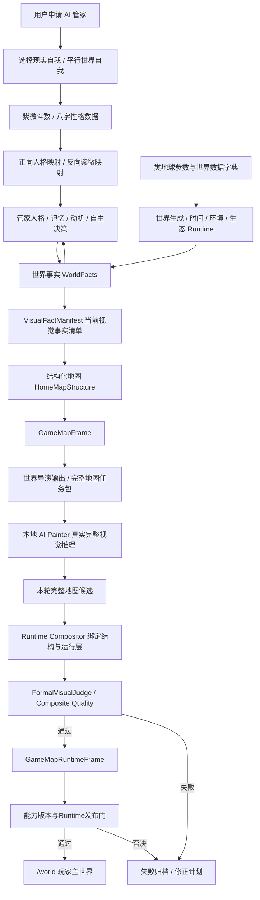

### 2.1 全业务线与子系统导航

本图梳理现行文档已经定义的业务责任及关系，不新增业务、模型、人格算法或执行权限，也不是全部功能已实现的证明。设计状态与实现／验收状态分离：节点表示已有规范职责，实际完成范围只查[唯一模块计划表](game-world-generation/CURRENT_EXECUTION_GUIDE_20260710.md)及对应机器证据，缺失保持未知。八字后备链、现实动物、房屋／社区等既有后续范围不倒置为当前自然地图训练前置条件。

人格子系统当前图示以紫微斗数资料、排盘解释及可追溯映射为主；紫微解释与人格／行为映射分开，已有八字后备边界仍以业务规格第2.1节为准，本次不建设该链。五维性格为后续退役方向，不作为本次图示的人格架构，也不声称已删除或已完成替代迁移；不改动现有数据、算法或无关的控制台五维字段合同。

```mermaid
flowchart LR
  subgraph UserBusiness["用户与人格业务"]
    U["用户申请AI管家"] --> Mode["现实自我或平行世界映射模式"]
    Mode --> Birth["合法出生输入与精度边界"]
    Birth --> Ziwei["紫微排盘与结构化命盘"]
    Dictionary["紫微资料字典及算法来源"] --> Ziwei
    Ziwei --> Analysis["星宫关系及动态盘证据解释"]
    Dictionary --> Analysis
    Analysis --> Mapping["人格映射及独立初始外貌档案"]
    Mapping --> Actor["管家人格及动机偏好"]
    Memory["角色记忆与长期目标"] --> Decision["感知与自主决策"]
    Actor --> Decision
  end
  subgraph WorldBusiness["类地球世界与有规律生长"]
    Earth["合格现实地区来源及自然参数"] --> Facts["WorldFacts与区域空间连接"]
    Tick["世界时间与持久运行规则"] --> Ecology["地形气候水文生态与生命周期"]
    Facts --> Ecology
    Ecology --> Facts
    Facts --> Expansion["RegionGraph及规则约束区域扩展"]
    Expansion --> Facts
    Decision --> Action["人物行动及交互结果"]
    Facts --> Decision
    Action --> Facts
    Action --> Memory
    Facts --> Visual["VisualFactManifest及完整地图结构条件"]
  end
  subgraph Learning["本地绘图能力建设"]
    Originals["原图来源许可及结构事实"] --> Dataset["版本化数据与train及验证用途隔离"]
    Dataset --> Preparation["本地准备与同包资源准入"]
    Preparation --> Training["Painter训练及学习记录"]
    Training --> Checkpoint["Checkpoint重载与固定验证"]
    Checkpoint --> ModelReview["机器审核及能力裁决"]
    ModelReview --> Capability["合格不可变能力版本"]
    ModelReview --> Failure["失败证据与有界后继规划"]
  end
  subgraph Production["世界视觉生产与运行发布"]
    Visual --> Task["World Director与完整视觉任务包"]
    Capability --> Painter["本地Painter正式视觉推理"]
    Task --> Painter
    Painter --> Candidate["当前事实对应RGB候选"]
    Candidate --> Review["视觉语义及完整地图机器审核"]
    Review --> Approved["ApprovedFrame及结构运行层合成"]
    Review --> Failure
    Approved --> RuntimeFrame["RuntimeFrame身份及发布门"]
    RuntimeFrame --> World["玩家世界展示与持续运行"]
    World --> Facts
  end
  subgraph Operations["本地编排与运维支撑"]
    LocalAI["本地AI确定流程及分工迁移"] --> Preparation
    LocalAI --> Task
    Failure --> LocalAI
    Events["真实事件及执行登记"] --> Console["控制台只读状态与证据查询"]
    Training --> Events
    ModelReview --> Events
    RuntimeFrame --> Events
    Events --> Storage["分层文件存储与本地SQLite索引"]
    Storage --> Backup["声明范围备份与独立恢复验证"]
    Events --> Work["按功能与执行窗口工作台账"]
    Docs["权威文档与唯一模块计划"] --> LocalAI
    Docs --> Work
    Work --> Management["本地数据管理工作台"]
    Backup --> Management
    Docs --> Management
    Code["经预览的精确代码变更"] --> Git["独立Git提交与推送结果"]
    Git --> Management
  end
```

图中资格节点均须取得各自真实证据：模型审核通过不等于Runtime发布，训练结束不等于画质合格，备份复制结束不等于独立恢复通过。图的页面只读，不承担运行调度、授权或业务状态数据库职责。

| 视图与责任 | 既有详细定义 |
|---|---|
| 用户、人格、正向／反向模式及后备边界 | [业务规格第2.1节](BUSINESS_SPEC.md#21-核心业务一ai-管家人格与角色自主)及[紫微入口](ziwei/README.md) |
| 紫微资料分层、读盘与解释 | [资料架构](ziwei/DATA_DICTIONARY_ARCHITECTURE.md)、[分析流程](ziwei/DATA_DICTIONARY_ANALYSIS_FLOW.md)、[算法合同](ziwei/ALGORITHM_CONTRACTS.md) |
| 世界事实、区域扩展及Runtime | 本文第1、3.2、4及后续Runtime相关章节；具体能力范围以对应规格和唯一计划为准 |
| 绘图数据、训练、审核及能力版本 | [Painter主体](game-world-generation/AI_PAINTER_FORMAL_IMPLEMENTATION_SPEC.md)、[数据与来源](game-world-generation/TRAINING_DATA_AND_SOURCE_POLICY.md)、[审核存储](game-world-generation/REVIEW_AUTOMATION_AND_STORAGE_SPEC.md) |
| 本地流程与外部执行职能迁移 | [能力迁移架构](LOCAL_SELF_DEVELOPED_AI_CAPABILITY_AND_CODEX_MIGRATION_ARCHITECTURE.md)；未迁移能力不得伪装为已自主 |
| 控制台、备份、工作台账及Git边界 | [控制台架构](ai-console/AI_CONSOLE_ARCHITECTURE_SPEC.md)、[本地管理模块](LOCAL_BACKUP_AND_WORK_LEDGER_SPEC.md)及[目录结构](DIRECTORY_STRUCTURE.md) |

业务全景是一张入口总图，系统、子系统、数据、时序与流程视图按各自原文单独查阅；所有子图同样保留来源、版本、适用范围和未知实现状态。不从一张总图反向推定未定义算法、所有模块已接通或当前MVP已经闭环。

## 3. 技术架构图

```mermaid
flowchart LR
  subgraph Personality["Butler Personality and Autonomy"]
    Astrology["Ziwei / Bazi Structured Data"]
    Mapping["Self Mapping / Reverse Ziwei Mapping"]
    ButlerCore["Personality / Memory / Motivation / Decision"]
  end

  subgraph Runtime["World Runtime"]
    Earth["Earth-like Parameters"]
    WF["WorldFacts"]
    Tick["World Tick"]
    Growth["Environment / Ecology / Growth"]
  end

  subgraph Map["Game Map System"]
    HMS["HomeMapStructure"]
    GMF["GameMapFrame"]
    Layers["terrain/object/walkable/collision/interaction/state"]
    Slots["VisualUnitSlots"]
  end

  subgraph Painter["Local AI Painter"]
    FactManifest["VisualFactManifest"]
    Director["World Director Output"]
    Task["Complete World Visual Task Package"]
    Model["Local Staged Complete-World Visual System"]
    Output["Fresh Complete-Map Candidate"]
    Archive["Generated Results Archive"]
  end

  subgraph Judge["Visual Judge"]
    VJ0["VJ-0 来源/绑定"]
    VJ1["VJ-1 视觉质量"]
    VJ2["VJ-2 语义/游戏地图"]
    CQ["Composite Quality"]
  end

  subgraph Display["Display"]
    RF["GameMapRuntimeFrame"]
    ReleaseGate["Machine Capability Release / Runtime Publish Gate"]
    WorldPage["/world"]
  end

  Astrology --> Mapping --> ButlerCore
  Earth --> Tick --> Growth --> WF
  ButlerCore --> WF
  WF --> ButlerCore
  WF --> FactManifest --> HMS --> GMF --> Slots --> Director --> Task --> Model --> Output --> Archive
  Output --> VJ0 --> VJ1 --> VJ2 --> CQ
  CQ --> RF --> ReleaseGate --> WorldPage
  GMF --> RF
```

### 3.1 视觉知识、训练数据与推理架构

原图库是训练来源层，不是运行时地图层。五类目录按主要知识职责并行保存原图和证据；审核通过后由统一登记器写入正式样本注册表，再由数据包构建器按 hash、结构和来源隔离为统一完整世界数据包。正式推理只有一个完整世界入口，内部能力可以由一个或多个自有模块实现，但不得让任何分类目录或局部模型取得主入口地位。

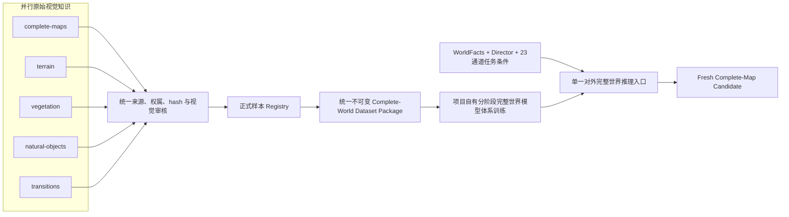

“单一对外入口”不等于内部只能存在一个不可分辨模型。AI Painter 的长期内部责任顺序固定为：

```text
authoritative_world_structure_binding                  [非训练权威绑定]
-> terrain_route_hydrology_spatial_realization        [可训练责任边界]
-> per_class_object_semantic_realization              [可训练责任边界]
-> global_visual_harmonization_and_native_complete_rgb_decode [可训练责任边界]
-> Fresh Complete-Map Candidate
```

四个责任阶段必须绑定同一 `worldId`、`regionId`、`tick`、`factHash`、`VisualFactManifest` 和23通道条件包。后三个可训练责任边界可以由一个模型、声明共享关系的共享底座或参数隔离组件实现；具体能力版本必须登记`responsibilityImplementationMode`，稳定值仅允许`single_model`、`declared_shared_substrate`或`parameter_isolated_components`，并登记每段责任对应的输入、输出、参数或共享映射、Checkpoint映射、审核和终态证据。共享实现不得伪装成参数隔离，单模型也不得省略逐责任可验证输出。后一责任只能消费同一执行包前序责任的成功证据和输出身份。该内部责任链不得与 `Stage 0/1/2` 的训练分辨率阶段混淆，也不得退化为 tile、patch、sprite、局部拼接、低分辨率放大或规则程序直绘。

可训练实现还必须满足以下空间与责任保真边界：

1. 23通道先在原生条件空间保持通道身份，再按通道类型分别重采样。离散掩码只能使用nearest-neighbor，连续场只能使用能力合同登记的bilinear规则；禁止先混合通道再统一缩小。
2. 道路与footprints、tree、rock、vegetation必须各有可识别的语义承载通路、责任输出和反例响应证据。它们可以共享已登记底座，但不得只依赖一组对所有特征通道广播的共享空间权重。
3. 最终RGB解码边界必须显式消费前序责任输出和对应条件身份，并通过单一条件反事实实验证明最终RGB仍保留该责任。仅依赖通用潜变量解码不构成条件责任证明。
4. 空间缩小的正反回归必须覆盖最小离散对象、单像素/单连通域保留、连续场插值和跨通道不污染。“缩小后尺寸正确”不能代替语义保真。

模型工厂只负责按版本化能力身份调度实现，不得在一个无版本隔离的条件分支集合中同时维护历史失败候选、当前候选和未来候选的行为。被拒绝或被后继实现替代的架构身份只保留不可变的历史适配器和证据解析能力；任何会改变条件采样、责任通路、参数图或RGB解码的修复都必须使用新模型能力身份和独立实现模块。

固定禁止关系：

```text
五类目录 != 五个训练阶段
五类目录 != 五个 Runtime 图层
五类目录 != 五个必须独立存在的神经网络
五类原图 != 程序机械拼接后的完整地图
```

语义分类图可以保留完整环境上下文；只有用于明确标注、条件构建或审核证据时才允许生成可追溯裁切。旧 256×192 材料槽、无父图引用的孤立裁片和重复噪声变体不能替代完整世界训练数据。

第一版正式路线使用原生 `1024×768` 高分辨率像素风画布：正式输出覆盖整个地图并绑定当前任务包、全部结构条件、模型谱系和审核记录。旧 `256×192` 材料槽和任何低分辨率局部输出只作历史证据，不得放大或拼接进入正式路线。23 通道结构条件必须通过可审计的条件编译生成与原生画布严格对齐的条件张量；训练可以使用渐进分辨率，但正式候选、审核和 Runtime 只认原生 `1024×768` 输出。

### 3.2 大世界空间连接架构

第一版自然家园是未来类地球大世界中的第一个连接区域。`1024×768` 是当前完整区域视觉画布，不是整个长期世界的固定边界。区域连接必须先由World Runtime依据结构化世界事实和正式连接合同产生，再由 AI Painter 表达；图片、提示词和模型输出没有拓扑决策权。

连接架构必须严格区分“模式契约”和“实例蓝图”：

```text
natural-home-large-world-connectivity-v1
  = 所有区域共同遵守的数据结构、配对和审核规则

mainland-southeast-asia-earth-reference-natural-home-region-0001-v1
  = region-0001自身的一个具体连接实例
```

模式契约不得携带固定北/南/东/西构图。具体实例可以锁定自身的方向和端口，但其作用域只能是对应`regionId`。V7训练槽位和其他自主生成区域必须建立独立`regionId`及其RegionGraph、EdgePort、PathGraph、HydrologyGraph和WalkableGraph；除非任务明确绑定同一运行区域，否则禁止引用`region-0001`的北入南出、东侧共享水道、南侧道路口作为训练边界。水体不存在、封闭水体、内部湿地和不同跨区域水文必须按当前世界事实表达。

“独立区域连接实例”仍须落在同一个连通世界图中。每个区域节点至少包含一组与相邻区域双向配对的边界通行口，并由PathGraph/WalkableGraph证明可达；水系存在时由HydrologyGraph证明上下游或跨界关系，生态与海拔过渡由相邻事实证明连续。任何无邻接、端口未配对或仅用图片接缝证明连接的区域都不能进入自主世界或独立训练容量。

完整地图唯一性必须使用两个相互独立的结构身份：

| 身份 | 至少包含 | 作用 |
|---|---|---|
| `themeArchitectureIdentity` | RegionGraph关系、EdgePort类型/方向、水文与道路拓扑、水路相对关系、生态/空间分区、自然边界和阅读层级 | 阻断同一世界主题骨架重复 |
| `instanceDetailIdentity` | 河岸/道路具体轨迹、分支和水域轮廓、分区轮廓、对象实例位置与簇、密度节奏、空隙及局部过渡 | 阻断换皮、轻微位移或细节复用 |

两者都必须对全部历史执行直接、镜像、旋转和变形比较。hash不同、测量窗口不同或主题名称不同不能替代结构唯一性证明。

上述全历史创作唯一性在单一原始自然世界先行MVP按业务规格第3.2节及数据规格第9.1节阶段隔离：保留审核实现与历史证据，不作为该作用域的训练／候选／发布阻断项，也不得记录为已通过。数据泄漏隔离与当前数据集内部去重仍执行。新作用域必须随新数据／能力／执行身份绑定；未完成机器适配的旧入口维持原行为，不得直接过滤旧失败码冒充新资格。

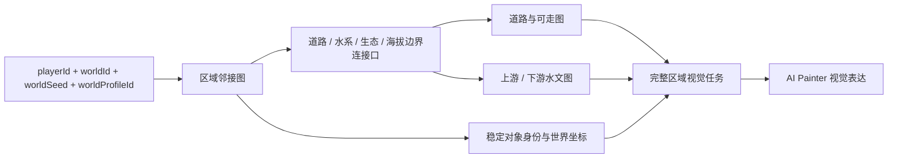

| 结构 | 职责 | 固定边界 |
|---|---|---|
| RegionGraph | 保存区域身份、全局范围和双向邻接关系 | 不由 RGB 或导演自由生成 |
| EdgePort | 保存道路、水系、生态和海拔在区域边界的配对关系 | 未配对出口必须阻断，不能伪装成已连接 |
| PathGraph / WalkableGraph | 证明入口、中心和批准出口可走连通 | 任何碰撞变化都必须重新校验 |
| HydrologyGraph | 保存流向、上游、下游、海拔和跨区域水口 | 水岸视觉不能替代水文事实 |
| ObjectIdentitySet | 保存跨 tick 和跨区域对象身份 | 视觉变体不得改变对象事实 |

机器可读模式契约是 `natural-home-large-world-connectivity-v1`，固定位置为 `data/world-samples/world-connectivity/world-connectivity-contract-v1.json`。具体实例蓝图 `mainland-southeast-asia-earth-reference-natural-home-region-0001-v1` 只定义其对应区域的连接事实，不批准其他训练区域复制。具体迁移、tick、审核和hash由世界运行证据保存；连接事实审核通过也不等于图片具备连接训练资格。

### 3.3 训练数据存储与目录索引架构

AI Painter训练、推理、审核、失败回写和Runtime证据采用文件权威、数据库索引的冷热分层架构：

```text
F:\ai-pet-world                       项目代码、文档和轻量逻辑入口
D:\AI-PET-WORLD-DATA\hot\runtime     当前运行和仍需直接访问的热文件
D:\AI-PET-WORLD-DATA\cold\runs       已完成运行的不可变冷归档
D:\AI-PET-WORLD-DATA\catalog         SQLite目录索引与只读查询快照
D:\AI-PET-WORLD-DATA\migrations      迁移清单、数量/字节/hash校验和切换证据
```

数据库只保存run、artifact、event、审核状态、URI、大小、时间戳和SHA-256，不取代图片、checkpoint和原始JSON文件。项目逻辑路径`.runtime`在无损迁移完成后通过目录联接继续保持兼容，避免现有世界事实、训练和审核身份发生变化。完成运行进入冷层时必须保留不可变归档、原始相对路径和hash；控制台通过SQLite分页查询，不得为显示页面递归扫描整个物理目录。

存储迁移必须由不可变迁移清单保存源、目标、数量、字节、逐文件hash、切换和回退证据。实际迁移状态、备份位置和SQLite计数只从机器记录读取，不写入架构文档。

已完成热层迁移所保留的旧物理备份，应移出代码检出目录。此类离线备份允许在源卷的项目外独立归档根保存，以同卷目录重命名保留文件身份；它不是新的热层、可写世界根或训练来源。必须先确认无活动引用、生成逐文件摘要清单，迁移后复核摘要和数量，并在既有存储catalog登记新位置、原位置及恢复映射。原迁移记录保留原字节，以追加的迁移记录表达位置变化；不得直接改写历史证明或删除唯一副本。日常已完成Run仍使用上述D盘冷层，不混用两类归档。

世界初始化的公共实现由`scripts/lib/natural-world-geospatial-generator.mjs`、`natural-world-visual-manifest.mjs`、`natural-world-visual-task.mjs`及`natural-world-condition-compiler.mjs`承担。Runtime直接调用这些模块；原`scripts/`命令入口只负责CLI兼容调用与导出，不再作为业务模块的依赖。源码绑定必须覆盖公共实现及入口，迁移不自动赋予历史事实或模型新的资格。

世界演化的Node运行模块装载由`scripts/lib/world-evolution-runtime-loader.mjs`承担，按项目根目录分别缓存，仅解析明确列出的Runtime模块；运行代码不得依赖测试辅助实现。测试目录可保留兼容导出，历史证据仍验证其原始源码字节，不随重构重新绑定。

受管进程身份查询及有界心跳文件发布分别由`scripts/lib/windows-process-identity.mjs`和`scripts/lib/training-heartbeat-publication.mjs`提供。调用这些公共操作不得引入整套历史训练入口；原入口保留兼容导出，发布重试上限及原失败语义保持，心跳不代表训练或验收通过。

能力作用域的登记结构检查由`scripts/lib/ai-painter-capability-scope-admission.mjs`承担，不导入天气发布和环境证据实现。裁决、天气发布及环境证据依赖这一公共读取层；结构检查不替代能力发布的原始证据复核。

## 4. RuntimeFrame 数据结构边界

RuntimeFrame运行证据按`working -> candidates -> accepted frame / rejected frames`流转。工作区只保存生成和合成中的身份，候选区只保存等待审核的记录；二者都不能被`/world`读取。由有效能力版本生成且通过机器审核与发布门的记录进入正式RuntimeFrame存储，失败记录进入不可变拒绝存储；第一版和后续版本使用同一机器发布规则。

正式 GameMapRuntimeFrame 必须至少包含：

| 层 | 作用 | 是否世界事实 |
|---|---|---:|
| identity | worldId、ownerId、tick、sourceFactIds | 是 |
| mapStructure | 地图结构、入口/出口、区域、自然通行、水岸；建设后才可包含家园与新道路 | 是 |
| terrainLayer | 草地、水体、水岸、道路等地形定义 | 是 |
| objectLayer | 自然对象及已接入的人物、动物实例身份与位置 | 是 |
| visualLayer | 同一世界任务的已审核原生完整RGB引用 | 否。它是事实的表达，不反向建立事实。 |
| walkableLayer | 可走区域 | 是 |
| collisionLayer | 不可穿越区域 | 是 |
| interactionLayer | 可查看、可点击、可建设、可采集区域 | 是 |
| stateLayer | 生命周期、建造状态、资源状态、天气影响 | 是 |
| audit | VisualJudge、hash、时间戳、模型版本、失败记录 | 否，但必须存在。 |
| capabilityRelease | 由数据、模型、审核、Runtime、条件和测试证据形成的机器能力发布身份 | 是；不需要逐版本或逐帧人工验收。 |

### 4.1 完整MVP生命实体与视觉接口

以下为正式目标接口，新增字段需要版本化机器Schema与程序迁移，不表示现有类型已实现。生命扩展复用既有世界、人格、Runtime、Painter和发布入口，不另建动物后台或平行存档。

| 对象 | 必需身份与内容 | 唯一责任边界 |
|---|---|---|
| 出生资料快照 | 出生日期、历法、时区、时辰完整度、映射模式、来源版本；原始敏感字段访问受限 | 创建／人格链校验；Painter仅接收派生档案及受限来源引用，不接收无关出生隐私 |
| CharacterAppearanceProfile | `entityId`、`profileVersion`、`mappingRuleVersion`、来源模式、来源摘要hash、形态参数及单位、缺失项、生成seed、内容hash | 人格映射链生成初始外貌；性别呈现与人格映射模式分离；不得由Painter补定义 |
| AnimalRoster | `rosterVersion`、五个`animalTypeId`、各类型真实`speciesId`及来源、适用生境、支持状态、完整度、hash | 世界生态数据链；类型不是模型数量，同一类型多张图片不增加类型计数 |
| EntityStateSnapshot | `worldId`、`regionId`、`entityId`、`tick`、`stateVersion`、`profileHash`、物种、位置／朝向、动作、健康／营养／疲劳状态、状态原因、前态hash | Runtime按规则形成世界事实；状态转移不得改写稳定身份 |
| 生命视觉事实扩展 | `VisualFactManifest`绑定实体快照及hash、可见体征、遮挡／接地、变化事实集合和不允许改变的身份特征 | 世界导演派生；Painter只能表达清单内事实 |
| EntityVisualBinding | `candidateId`、实体ID、轮廓／占用范围、状态引用、完整RGB及审核引用 | Painter提供表达证据，审核器验证身份、状态与空间一致性；不决定生命状态 |

数值参数由各版本规则表定义单位、闭区间、缺失语义、量化精度和合法组合。不存在权威值时显式不可用；`null`、0、健康、静止不能互相代替。档案生成同输入、规则、seed可复现；同出生资料的不同世界实例仍使用独立实体ID。

当前23通道只覆盖其已登记的自然地图语义。人物、动物、体征和身份一致性不能偷占`object_tree`、`object_rock`或`object_vegetation`通道；必须发布显式生命条件扩展、兼容规则、责任映射与测试，继而建立新的能力身份。23通道自然地图能力可以作为有谱系的基础能力，不能自动宣称已支持生命实体。

Runtime以同一`worldId + tick + expectedStateVersion`提交状态、行动结果、资源变化和事件，再产生视觉任务。状态提交与视觉候选发布是两个有引用关系的事务：视觉失败不回滚合法世界事实，也不冒充新tick画面。当前tick无合格帧时按展示闸门阻断；旧帧只能作为标明旧tick的历史记录，不能被当作当前帧。保存恢复必须连同档案、实体状态、事件位置及随机状态恢复，防止重复行动、重复耗费或逐帧换人。

### 4.2 自然世界先行存档接口

`natural-world-runtime-save-v1`是自然世界持久化记录版本，不继承旧`v2.6-runtime-00`人物存档资格，也不改变其必填字段。复用现有Runtime Store、本地`data/world-runtime/`及生产配置根、`<ownerId>/<worldId>.json`路径、同一文件锁与事务；不得另建存储后台。新入口要求显式ownerId/worldId，不读写旧全局latest指针，不构造人物、家园或默认世界。旧格式与新格式禁止相互覆盖。

记录保存ownerId、playerId、worldId、worldSeed、worldProfileId、regionId、tick、stateVersion、savedAt，以及完整worldFacts/worldState快照、ruleVersion、eventCursor、randomState和来源绑定。事实与状态封套均绑定worldId/regionId/tick。事实封套版本固定`natural-world-facts-snapshot-v1`，payload使用`terrainRegions`、`objectFootprints`、`walkableRegions`、`collisionRegions`四个对象数组；terrainRegions与walkableRegions非空，其他数组允许事实性为空。状态封套版本固定`natural-world-state-snapshot-v1`，payload使用`environment`对象、`objects`和`resources`对象数组；至少environment有明确字段，未知值须由生产者显式表达，不伪造天气、资源或对象状态。这里约束保存结构，不授予任何事实生产者来源、许可、语义或发布资格；现有世界事实生产者接入时仍须独立验证与版本绑定。存储本身不得生成或改变地形。

randomState仅允许`captured`（实际algorithmId/algorithmVersion/state）或`not_consumed`（明确reason）；未知随机状态不得伪装为未消费。快照只能使用普通JSON，数字有限，整数安全，嵌套深度不超过64；序列化后的完整存档最多4MiB。来源绑定至少一项，保存role/uri/fileSha256供上层核验；仅通过SHA格式不代表来源合格。

writer在首个异步步骤前固定输入快照，重算worldFactsPayloadSha256（完整事实封套）、statePayloadSha256（状态封套、随机状态、ruleVersion、eventCursor、tick/stateVersion及六项稳定身份）与recordContentSha256（完整记录除自身摘要）。摘要采用UTF-8递归键排序JSON，数组顺序保持；文件摘要fileSha256另指实际写入字节。reader重算全部内容摘要并核对请求身份及可选预期tick/stateVersion/fileSha256/playerId，错误返回invalid且不交付记录。旧存档摘要算法不改。

新写入强制expectedTick、expectedStateVersion、expectedFileSha256三项CAS：初创为-1/-1/null且存储确实不存在，初态tick/stateVersion为0；更新持同一锁重读并校验，stateVersion恰加1、tick不倒退，六项稳定身份不得变化。损坏、未知格式、未完成事务都不能当成空槽。保留原prepared、fsync、rename、committed与锁归属保护；替换后收尾失败必须如实记录已替换，并阻断不完整事务，不自动删失败证据。存储并不替代Runtime合法状态转移判断。

两个现有文件适配器提供显式自然读写能力；旧读写类型保持，未实现自然能力的适配器明确失败。正反验证须包含独立进程保存与重读、完整身份/事实/状态/随机状态恢复、并发CAS、错hash/world/tick拒绝、跨格式覆盖拒绝、真实路径保护及写入故障。自然存储组件通过不代表世界演化、来源许可、模型、RuntimeFrame、/world或完整MVP通过；合格视觉仍走既有独立发布门。

### 4.3 自然世界首次事实与条件生成

首次生成按显式身份与新世界种子，从合格测量来源重新生成WorldFacts、匿名游戏几何和连接，再形成VisualFactManifest、世界导演、完整任务与23通道条件。输入不要求已有RGB或RuntimeFrame，也不读取旧全局latest、人物或homeMap来补事实。训练样本只能定位合法测量来源；不得读取其蓝图几何、任务空间层、条件像素或RGB后更换worldId冒充新生成。实现复用现有测量生成器、来源治理、事实/任务构建器、条件编译器及Runtime Store，不建立第二后台。

当前生产者使用`data/ai-painter/system-governance/ai-painter-natural-world-bootstrap-contract-v2.json`冻结输入、来源角色、身份、随机状态和失败边界；v1原件仅用于历史复核。v2直接绑定机器来源和数据合同，控制器报告不再是生产输入。来源每项必须具有真实字节、版本、许可、署名及实际采集证据；重新获取的气候资料使用独立身份，重新计算相应事实，不回填旧来源的未知时间。气候均值只作长期背景，当前天气未知时如实记录；显式初始季节情景可用作游戏场景条件，但不得声称为实测当天天气。生成器捕获实际随机末态与调用次数，保存恢复必须能继续相同序列。

完整测量、自然化、连接、导演和生成证据保留为不可变侧车；存档事实与状态采用第4.2节结构。新事实封套摘要成为该任务factHash，任务不依赖尚未存在的存档文件摘要；先编译条件，再把真实侧车摘要加入存档并以初创CAS提交，避免哈希循环。发生错误保留已经产生的证据，不发布半成品或自动重试。

自然运行条件显式声明`natural_world_runtime_v1`作用域。23通道的几何、类型、顺序、尺寸和采样规则沿用当前张量合同；datasetReleaseIdentity仅标明模型训练知识版本，不表示新世界属于训练数据集，不继承旧样本包装兼容资格。新事实资格必须由程序对真实来源、生成规则和产物重新验证，并绑定独立sourceFactRelease证据；调用方passed或格式正确SHA不得赋权。不支持该作用域的消费者明确拒绝。首次输入组件及存档通过不授予模型、能力发布、正式帧或/world资格。

#### 4.3.1 固定自然世界的基线执行与读取

本节落实唯一计划第3.1节的同世界基线，复用第4.2—4.3节生产者、来源核验和Runtime Store。独立本地入口可完成初创、退出后的独立进程恢复、证据固化与选择投影；它不依赖Codex报告、测试夹具或聊天内容，也不创建第二世界运行后台。没有已登记的正式帧或演化能力时，只能交付初始世界基线。

本地MVP交付可以使用明确隔离的owner/player/world/region身份；这些身份只表示本地交付命名空间，不证明公网玩家所有权，不授客户端访问。既有测试世界不得改名为新生成的世界，已有生产世界不得被默认覆盖。实际账号接入由认证与所有权规则另行建立。

**LOCAL-PLAY-ACCESS-001　本地首区的客户端身份与访问范围**

1. 首次进入。受控服务器的本地发行入口为指定世界登记一份限时、一次性的入场邀请。邀请绑定允许访问的世界身份和权限。玩家在同源游戏页面用邀请创建本地游戏账号并设置登录口令。服务器以一笔事务完成邀请消费、账号建立和该世界访问权登记。得到的权限限于阅读同一世界的玩家可见状态及通过正式审核的画面。创建邀请、账号、会话或访问记录均不修改世界事实、存档游标或世界所有权。
2. 再次进入。玩家关闭页面、下线或显式退出后可用原账号登录。服务器恢复该账号已有的世界访问权，按当前存档读出模拟日期、最近有效事件和可展示画面的状态。创建和撤销会话均不启动、暂停或重置服务器演化。重启后从服务器持久保存的授权记录恢复账号与世界的对应关系。
3. 身份校验。凭证通过受保护的同源请求传递。本地回环调试可使用回环连接，其余部署须使用安全传输。服务器只持久化邀请与高熵会话凭证的摘要以及加盐的口令派生值。会话采用限时、HttpOnly、SameSite 严格的 Cookie，退出立即失效。入口限制请求大小、登录尝试与发放频率。日志和业务证据仅保存非秘密身份、时间、状态及失败类别。客户端提供的 worldId 用于选择世界，服务端以已验证会话和权限表作裁决。控制台操作者会话、访问来源地址及首个访问者身份均不能授予游戏权限。
4. 画面与动作。游戏页和两个原生图片入口共用同一个世界读取范围。已登录且拥有访问权的玩家可以读取当前逻辑时间与天气。尚无合格当前帧时，游戏页说明当前画面不可用。图片入口需另外核验同一世界、当前快照、模型能力、原生图像摘要与语义审核。查询、登录或点击页面均不能提交任意世界变化。
5. 验收。以真实本地游戏账号完成首次进入、退出、服务器推进后的再次登录和独立进程恢复，比较两次访问所见的世界、时间与事件。验证邀请重复消费、无效或过期会话、撤销授权、跨世界访问及未发布帧均被拒绝。本项范围为本地首区游戏访问。公开注册、第三方账号与跨设备所有权另按对应部署合同接入。

**初创与恢复：**入口先核验六项身份、受控产物目录、存储槽及来源合同。已有槽或不完整产物不当作空槽；不能重试覆盖。初创使用原Store的-1/-1/null CAS，保存真实事实、状态、RNG及23条件引用。创建进程正常退出后，由另一个进程读取同一owner/world并重新核验来源事实、条件、存档完整身份及摘要；compare必须含事实、状态、规则、tick、stateVersion、eventCursor和RNG。实际已保存但恢复失败时记录saved_unverified及证据，后继只允许明确验证或原事务恢复，不再创建同一个世界。

**机器结果：**`natural-world-baseline-result-v1`由固定`natural-world-baseline-program-v1`生产。结果保存runId、command、status、六项identity、identityScope、creation、readback、source、conditions、counts、timing、codeBindings及qualification。creation包含真实槽位预检、bootstrap结果引用、writer进程及退出/时间、实际存档路径和文件/记录/事实/状态摘要；readback包含不同reader进程、退出/时间、不可变回执及比对值。source绑定实际来源合同、sourceFactRelease、sourcePackage及generatedFacts；conditions绑定manifest、package和全部23个通道身份/实际SHA/尺寸/类型。引用统一为受控逻辑path、实际sha256与bytes；count和时间从真实产物和执行计算，不能由调用方填passed代替。

结果位于既有`.runtime/ai-painter/`内的`natural-world-baselines/<worldId>/runs/<runId>/result.json`，不可变；生成侧车归同一world的受控目录，存档仍由原Store决定。初创、失败和验证尝试各保留自身时间与证据。资源沿自然bootstrap合同：CPU最多2、无GPU/网络调用、总产物不超过134217728字节；每个受管子调用含退出与回执最多120秒、输出字节有界、自动重试0。失败不改变既有训练登记或模型资格。

**选择投影：**`.runtime/local-backup/project-progress/current-world-baseline.json`固定使用`natural-world-baseline-selection-v1`，含deliveryId、proofRef、identity、selectedAtUtc。deliveryId必须对应当前正式交付对象；proofRef只能指上述固定world/run位置。它仅选定工作台要读取的世界基线，不是WorldFacts、Runtime最新状态、账号授权或能力发布权威。发布者须重新核验实际结果与依赖，首次以独占方式写入；同一选择幂等读取，不覆盖不同世界或失败结果。换世界必须另行明确选择与预期旧选择身份，不从目录时间推断。

工作台GET使用既有受限只读读取器，核验选择、结果、实际存档摘要、来源和条件引用、独立恢复回执以及生产源码身份；不得执行生成、进程启动、修复或登记。当前显示必须标出读取时点、机器验证时点和实际复核范围；GET并不重新执行独立恢复或模型资格检查。保持原文件/总字节/耗时预算，不能为显示成功跳过错误引用或放宽限制。

来源完整重放由独立恢复程序执行：原始来源单件上限128MiB，来源清单总读取上限256MiB；输出仍受上述128MiB上限约束，输入读取不能被记成输出。工作台GET仍保持16MiB总读取预算，核对存档、23通道、生成侧车、独立恢复回执及预算内的来源原件。超过单次页面读取范围的大型原始栅格，只核对其路径/字节数/SHA与生成记录及独立恢复回执的严格对应，不在GET重读原件；返回未重读的精确引用清单及机器核验时点，并明确rawSourceBytesRehashed=false。此时baseline_verified仅表示已绑定的机器初始基线证据成立，不证明大型原件在当前页面读取时仍未变化；需要当前完整来源判断时执行独立验证，不以页面GET代替。回执中的来源、条件与生产代码清单须与结果逐项相等；父进程观察的成功退出及先写后读时序须绑定实际观察文件，不能仅比较子进程自报时间。

没有选择记录为not_registered；来源不可读、身份/摘要冲突、版本不支持或预算耗尽为unverifiable；只有读取能力未接入才称not_connected。可核验初始基线为baseline_verified，但modelExecuted、framePublished、evolutionVerified、worldEntryEligible及publicOwnershipVerified仍各自依真实独立资格判断；本入口不能授予它们。页面展示worldId及实际内容/保存恢复结果，不从四步骤数量或此状态推算整体MVP完成率。

验收包括真实来源新世界初创、退出进程后独立恢复、重复创建保护、已有/损坏槽拒绝、保存后失败留证、跨世界或篡改proof/source/条件/存档/源码拒绝、伪造passed无效、缺选择与读取失败区分、GET零写、原世界及全局latest不变。基线通过与正式画面、持续演化、客户端离线运行及完整产品分别验收。


### 4.4 世界演化任务、时间与可恢复提交接口

本节落实WORLD-AUTO-001至004及BIZ-07，不改变第4.2节存档摘要算法、初创协议或第4.3节tick0来源资格。下列领域封套及生产适配是规范目标，不表示已有程序采用。代码可解析普通JSON，不等于已支持世界演化协议。

#### 4.4.1 生产链与既有入口

生产链为：正式能力及运行配置核验→显式读取同一世界→形成时间区间与有界历史输入→真实模型候选→领域Validator→原Store提交→派生视觉任务。服务器调度不依赖客户端、控制台、工作台账或Codex会话，不建立第二世界后台。

存储复用world-runtime-store-adapter.ts的readNaturalWorldRuntimeSaveRecord、writeNaturalWorldRuntimeSaveRecord及两个现有文件适配器。生产根仍由AI_PET_WORLD_RUNTIME_STORE_ROOT决定；ownerId/worldId显式传入，不读全局latest，不创建默认人物或家园。当前自然读取器对prepared journal返回不完整错误；生产恢复须先实现并登记本节恢复协议，不能宣称现有读取函数已经完成恢复。

world-runtime-tick-runner.ts及validateButlerRuntimeIntent处理旧人物/建设语义，不自动承担自然领域Validator。verifyNaturalWorldFactRelease及natural-world-model-input.mjs的tick0/初始环境重放不能认证演化后的快照。可复用文件锁、JSON校验与CAS，领域语义、事件和动态视觉接入须另验。

#### 4.4.2 配置注册与生产消费

运行配置采用严格对象，schemaVersion固定为world-evolution-policy-v1；未知字段拒绝。以下名称为待实施领域协议标识，须由现行能力登记及其受信读取器增加明确支持，不能仅放一个JSON文件即获得生产资格，不另建发布注册表。

| 字段 | 类型、单位和约束 |
|---|---|
| policyId、policyVersion、scopeId、ruleVersion | 非空字符串；版本不可变，scopeId限定可改变的领域 |
| identity | ownerId/playerId/worldId/worldSeed/worldProfileId/regionId六个非空字符串，与存档逐项一致 |
| capabilityRef、modelRef、validatorRef、inputSchemaRef | 精确版本及真实内容SHA引用；能力须已发布且明确支持world_evolution，不能消费Painter视觉资格代替 |
| domainFields | 非空数组，字段ID唯一；每项含类型、单位、合法域、缺失语义、允许操作及规则来源引用；未定义字段不能写 |
| timePolicy | simulationEpochUtc、stepSeconds、scheduleIntervalSeconds、modelHorizonSeconds、downtimeMode、maxCatchupSteps、maxCatchupLogicalSeconds |
| historyPolicy | selectorId/version、maxEvents、maxBytes、minimumContextEvents、summaryMode及其证据引用 |
| executionPolicyRef、resourceContractRef | 审核存储第8.2节及现行资源准入的精确引用；本节不另设资源默认、重试上限或审核阈值 |
| maintenancePolicy | compatibleFromVersions、migrationEvidenceRef、resumeRule；不适用迁移时显式none及原因 |
| registrationEvidenceRefs | 当前源码、模型/数据/领域Schema、配置、正反回归及生产接入证据的真实摘要集合 |
| contentSha256 | 本配置除自身摘要外的规范化内容摘要 |

stepSeconds、scheduleIntervalSeconds、modelHorizonSeconds为有限正数，单位秒；演化时stepSeconds必须等于实际任务跨度、modelHorizonSeconds及模型合格跨度。不同尺度只能经已登记、独立验证的适配器转换，不能由执行器暗自插值。maxCatchupSteps为安全非负整数，其他跨度为有限非负秒数；downtimeMode=freeze时两个追赶上限必须为0，bounded_catchup时均须为正且与原执行预算相容。没有实测依据不规定日步、帧率或加速倍数。

maxEvents/maxBytes为安全正整数；minimumContextEvents为0至maxEvents的整数。summaryMode只允许none或registered_summary，后者必须绑定摘要器版本和来源验证规则。全部历史输入还受原总输入预算约束。数字缺失、NaN、无穷、非法组合、时间尺度不兼容或引用缺失均拒绝注册/启动；0不能代替未知。

domainFields每项严格包含fieldId、adapterFieldId、dataType、unit、constraints、missingPolicy、allowedOps及evidenceRefs。dataType只允许number/integer/boolean/string/enum；数值约束给已登记的有限min/max且min≤max，enum给非空去重集合，其他类型不得混入数值范围。unit为明确单位，非量纲值显式dimensionless；missingPolicy为reject或explicit_unavailable，后者值固定为status=unavailable及非空reason，不能带伪造value。replace要求前态字段存在，set只用于Schema声明可初始化字段；不支持delete/move。adapterFieldId只解析为已登记适配器的字段，不是任意路径。类型、单位或范围无依据则不登记该字段。

受信注册器重算实际字节、来源及证据身份，验证领域类型、模型范围、资源准入、回归与生产消费者支持后，才能原子登记。调用方passed、格式正确SHA、旧文档和历史成功不授资格；注册器尚不支持该作用域时返回unsupported_scope。资格状态、登记动作和本轮任务执行分别记录。

#### 4.4.3 输入、候选与领域差量

演化任务封套schemaVersion为world-evolution-task-v1；生产者为既有受管执行器，消费者为登记模型适配器、Validator及提交器。所有对象先在首个异步步骤前固定快照并验证普通JSON；字段严格，数字有限，计数为安全整数。SHA为64位小写十六进制；UTC采用可往返规范化的毫秒精度ISO格式，跨度乘1000为安全整数并与端点毫秒差相等。路径只能是服务端解析的受控引用。

| 字段组 | 必需内容及判定 |
|---|---|
| identity、taskKind、taskId、businessKey、attempt | 六身份；taskKind枚举evolution/maintenance（维护差异见4.4.6）；非空任务ID；64位小写SHA业务键；attempt为安全正整数，受原执行政策限定 |
| before | expectedTick、expectedStateVersion、expectedFileSha256及worldFactsPayloadSha256/statePayloadSha256/recordContentSha256；更新场景均不得缺失 |
| interval | logicalStartUtc、logicalEndUtc、durationSeconds；UTC带Z。evolution左闭右开且差值等于正跨度，maintenance端点相同且跨度0；两者起点均等于最后已提交逻辑终点 |
| policyRef、capabilityRef、modelRef或maintenanceContext | policyRef为当前配置；evolution必填已发布capabilityRef/modelRef且禁止maintenanceContext。maintenance禁止模型推理及其伪造证据，必填maintenanceContext（目标policy/规则/模型引用、migrationEvidenceRef、受信维护执行器身份）；不能引用latest或任意父权重 |
| currentSnapshotRef、externalInputRefs | 当前快照及实际环境输入的Schema、内容/文件SHA与来源用途，不允许未来目标混入 |
| historyInputRef | 已固定事件/摘要列表及其实际输入SHA、截止游标、覆盖区间、selector身份 |
| randomBefore、executionContextRef | 实际RNG算法/状态或有依据not_consumed；原锁/执行/资源合同身份，不由调用者伪造清理权 |

businessKey按规范化对象计算：任务Schema、taskKind、六身份、完整before、interval、policyRef及分支身份（evolution的capability/model；maintenance的完整maintenanceContext）、外部输入摘要及historyInput摘要；attempt、执行起止时间和候选结果不参与。相同业务键的内容必须一致；重试不能换输入仍称同一次业务动作。对已提交业务键返回原回执；无法核实原回执时返回冲突/未知，不再次应用或无界扫描历史。

候选封套schemaVersion为world-evolution-candidate-v1，必须绑定taskId、businessKey、before、interval及实际模型身份，evolution保存真实前向输入/输出证据、randomAfter和原因引用；maintenance不构造此模型候选，使用维护迁移产物及其独立校验报告。结果仅允许changes或no_change；changes为领域字段ID、操作、原值摘要、新值及原因的有限列表，禁止任意JSON Pointer、文件/SQL/脚本及整份存档替换。tick、版本、游标、摘要和保存时间由程序计算，不接受模型写入。

领域Validator按domainFields逐项检查类型、单位、范围、缺失、前态和原因，并生成完整下一快照。缺值用明确unavailable状态及reason；仅当模型及字段规则支持缺值输入时可继续。null、0、健康和静止不能互代；未知值不得静默截断或填零。拒绝不改正式状态，no_change也须真实推理/原因证据；只增加tick不证明模型有效。

环境作用域只能登记实际来源与模型资格覆盖的变量、测量高度/区域、单位和统计期。日统计期不等于服务器调度频率；不同测量高度的风速、风向、空气湿度、土壤水分不可相互替代。仅有气象变量资格的版本不得改地形、对象、通行、碰撞、资源或多年climate原件，也不能据此宣称植物、水文或完整生态能力。具体变量在资料与模型合同中选择，不将未验收实验默认值提升为长期业务要求。

#### 4.4.4 时间、历史与缺失输入

tick仅为已提交演化序号，不是秒数、图像帧或心跳。接受一项演化后tick恰加1、stateVersion恰加1；维护性修订可保持tick，但须有独立维护事件和前态条件，不能冒充演化。savedAt及执行UTC是审计时间，不代替逻辑时间。进程内时长/超时用单调计时；墙钟前跳不批量虚增tick，倒退不重放旧区间。

客户端离线不改变运行资格。服务器维护、故障或主动暂停按downtimeMode处理：freeze不补逻辑时间；bounded_catchup逐区间真实推理、验证和提交，同时受追赶数量、逻辑跨度和原执行预算限制；任一上限到达保留实际积压。不得把停机日期补写成已执行事件。恢复时先核最后有效提交，再建立启动锚点，不凭UTC间隔决定业务是否已消费。

历史选择只能读取截止当前已提交eventCursor的有序事件，禁止未来、重复、乱序、断链和跨世界引用。摘要须绑定覆盖首末游标、原事件根摘要、摘要方法/版本和实际内容SHA；窗口外原件保留，不因输入截断删除历史。外部归档上下文与本世界已发生事件分开标记。缺少最短上下文仅在能力明确验证cold_start时可运行，否则阻断。

模型输入证据必须与实际前向消费的历史内容及顺序相符。历史作用验收固定当前状态、模型、外部输入及随机条件，切换预先声明相关历史并核对冻结断言；无关历史为负对照，不强求差异。只存日志、空模型调用或随机差异不能算记忆有效。

外部观测分别记录periodStartUtc/periodEndUtc、统计方式、acquiredAtUtc及publishedAtUtc或unknown。期末不证明已发布；发布时间未知只能支持明确标注的回溯假设，不得称运营as-of可用。目标期及未来数据不进入历史、摘要、归一化或模型选择。多年气候只作其许可用途的背景，不冒充当天天气。

#### 4.4.5 摘要、不可变事件与无环提交

内容摘要统一采用现有自然存档的UTF-8递归键排序JSON，数组保持顺序；文件SHA另指实际落盘字节。保留现有三个范围：worldFactsPayloadSha256覆盖完整事实封套；statePayloadSha256覆盖六身份、状态封套、RNG、规则、游标、tick及stateVersion；recordContentSha256覆盖完整记录除自身摘要、包括前两项摘要。不得偷换旧算法。

后继领域运行元数据置于worldState.payload.environment.evolution，须由领域Schema定义，不向第4.2节闭集根对象偷偷加字段。evolution.commit集中保存本次businessKey、eventId、eventSha256及历史头引用。为防止“事件含新stateSHA、状态又含eventSHA”的循环，提交顺序固定如下：

1. Validator生成下一领域快照、时间、RNG和计数，尚不填evolution.commit。计算domainAfterSha256，投影为六身份、完整worldFacts、去除evolution.commit后的完整worldState、ruleVersion、randomState、eventCursor、tick、stateVersion；没有其他可忽略字段。
2. 构造不可变事件world-evolution-event-v1：eventKind(evolution/maintenance)、businessKey、前态完整摘要、逻辑区间、变化/原因、domainAfterSha256及previousEventSha256；evolution必填真实模型/输入输出证据并禁止维护迁移证据，maintenance必填maintenanceContext/迁移产物/独立验证引用并禁止模型前向证据。eventSha256覆盖事件除自身摘要。事件不绑定尚未形成的最终recordContentSha256/fileSha256。
3. 将事件实际SHA和历史头写入evolution.commit，再按原seal函数生成完整存档三摘要及拟写文件字节。这样事件→状态引用有向无环；读取方须重算领域投影并与事件一致。
4. 在原同世界锁内重读并验证三项CAS，原prepared事务清单绑定最终记录及所有不可变侧车的身份/实际SHA。侧车先flush、原子定名，再替换状态；只有同事务提交可验证后才算已发生历史。
5. 提交回执绑定businessKey、最终文件/记录摘要、事件SHA及结果，保存在同受控证据根；它不回填参与该事件或记录摘要。查询按服务端派生的固定业务键引用定位，不接受任意路径。

每次演化有且仅有一个已提交领域事件，eventCursor恰加1，事件含fromTick/toTick及前一事件摘要。失败尝试另记执行证据，不进入世界已发生链。根RNG沿用实际captured状态；确实未消费才允许not_consumed，不能以未知伪装。事件/模型/候选原件不可覆写；快照不装无界全历史，原4MiB、深度64和JSON限制保持。

上述侧车/journal联动须作为原Store协议的明确版本适配登记：原journal基础身份、recordKind=natural_world、latestPath=null和锁归属保留，扩展协议身份、必需侧车清单、业务键/事件约束及恢复裁决必须由当前writer/reader共同支持。未支持消费者明确拒绝，不能只让旧读取器忽略新增字段便宣称原子性；不原地改写旧journal或重建第二世界权威。

#### 4.4.6 并发、维护与逐切点恢复

更新必须使用expectedTick、expectedStateVersion、expectedFileSha256三项CAS；初创仍为-1/-1/null且真实不存在。六稳定身份不得变；前态冲突拒绝旧候选，基于新前态重算是新任务，不得强贴旧差量。持久化/台账/画面错误不能触发再次模型应用或扣资源。

| 中断位置 | 恢复判定 |
|---|---|
| 模型未产候选 | 旧提交有效；按原执行政策关闭或有限重试，不新增事件 |
| 候选存在、状态未替换 | 重核同任务/输入/模型/前态；只允许同事务续接或关闭，不按目录新旧猜成功 |
| 侧车已写、状态未替换 | 侧车为未提交证据，不推进游标；不得作为模型的已发生历史 |
| 状态已rename、journal未完成 | 核同transactionId、新文件及侧车后完成同一修订；不确定时阻断，不再次应用 |
| journal已提交、回执/投影失败 | 重建同提交的受控回执或投影；世界状态和事件不得重放 |
| 记录损坏、事件断链或版本不支持 | 返回invalid/blocked，保留原新旧件与journal；不默认新世界，不由GET修复 |

恢复器只能完成原协议证明的同修订或回到证明完整的旧修订；只有证明新修订从未完成提交且未被作为已提交状态消费，才可恢复原旧修订；已提交修订不得静默回滚，业务回退必须另建合法维护事件。当前源码不具备该证明时停止并保留证据。恢复成功、继续演化成功及视觉恢复分别记录。

维护任务为同一封套以taskKind判别的maintenance分支：before/CAS和预算仍必填，maintenanceContext及迁移验证产物替代模型候选；不消费的externalInputRefs为空数组，historyInputRef仅引用迁移实际读取的有界历史或显式none及原因，不借用演化的cold_start资格；区间start=end、durationSeconds=0仅此变体合法。维护提交stateVersion和eventCursor各加1、tick不变，事件eventKind=maintenance；RNG保持或提供真实迁移证据，不冒充模型演化。

配置/规则/模型升级通过独立维护任务核对旧版本、兼容集合和迁移正反证据；暂停新提交并耗尽/关闭旧任务后才切换。维护修订与其事件保留原身份和旧历史，更新版本后按原CAS提交；回退也须兼容性证明，不能用旧模型重新解释已提交历史。没有兼容或迁移证据时保持旧配置或阻断，不增加Owner日常审批。

#### 4.4.7 视觉交接、验收与原计划映射

已提交状态形成新的Manifest/导演/条件，绑定当前world/region/tick/stateVersion及完整事实/状态摘要、演化提交引用。动态来源资格从该合法提交重新核验，不伪造tick0 bootstrap发布。Painter及审核发布沿既有合同；本节不重设审核阈值。视觉失败不回滚合法事实；当前无合格帧阻断游戏交互，旧图仅标原时刻历史阅读，不配当前碰撞或动作层。

正反测试必须覆盖：配置缺值/非法组合/未知scope拒绝；真实模型及历史输入身份；未来/断链/摘要篡改拒绝；同业务键重复与并发CAS；每一提交切点的独立进程恢复；时钟前跳/倒退与两种停机策略；RNG连续；坏输出、资源耗尽和无当前帧不污染状态；无任何客户端会话的受管推进。受控假时钟/CPU组件与真实运行证据分列，不能合成为未经验证的生产闭环；no_change不能单独证明演化学习。

本节细化ARCH-DETAIL-07-04至11及业务BIZ-ACC-01至05、11；原计划仅引用既有模块7对应交付项，并与模块1/3可靠执行、模块2视觉、实际消费生命时模块4/5/6衔接。模块8/9只观察。原134交付项与48产品检查点不变，不以新增Schema、测试数或文档完成率代替产品进度。

#### 4.4.8 初始世界与时序输入的诊断接线

演化能力未发布时，允许本地准备程序生成`natural-world-evolution-input-diagnostic-v1`，用于核验真实输入接线。它不是第4.4.3节的生产任务、模型候选或已提交事件，不调用模型、不改存档、不递增tick，不登记能力。所有正式资格保持未取得，不能将诊断完成解释为模型已经参与世界演化。

输入分为三个不可混用的部分：

| 部分 | 内容与边界 |
|---|---|
| 世界关联元数据 | 固定基线选择、实际存档六身份、前态三摘要、文件SHA、tick/stateVersion/eventCursor及实际未知环境项；仅用于追溯，不作为早于世界创建时点的历史预测特征 |
| 模型输入诊断 | 从原始逐期来源字节及精确采集回执重新校验，固定字段顺序、单位、历史期起止、预测跨度、数值矩阵及其内容SHA；只包含截止诊断区间前的完整历史，不含目标期数值 |
| 准备状态 | 列明来源用途、数据/能力登记、逻辑时间与世界历史是否满足生产要求，保存实际读取依据和未知项；诊断入口一律productionReady=false，不具生产授权或自动推进功能 |

外部气象归档必须标记为`external_archival_context`，不能标为本世界已发生事件。来源统计期末不等于实际发布时间；发布时点未知时只声明回溯诊断假设。当前世界的长期气候背景可能包含历史目标期之后的资料，不能混入历史预测矩阵；模型输入必须能独立验证没有消费这些元数据。没有世界逻辑时钟或已提交事件时，明确标记未初始化与空历史，不以存档保存UTC或外部历史日期补造世界时间。

时间序列读取器先严格验证原字节、回执、日期、单位、缺失值及规范字段，再生成受控快照。窗口构造只接受该读取器拥有的完整性绑定，拒绝手工/序列化后自称可信的DTO；跨进程恢复重新读取原始绑定字节。调用方新增未来字段、修改数值/单位/SHA或自行重算摘要不能绕过边界。构造前核算窗口数、复制行数和保守输出上界，输出须有实际字节限制；资源上限不能被调用方调大。

诊断配置须在执行前固定来源及回执SHA、空间/时间/字段、历史长度、划分与窗口选择方式、输入输出和耗时上限。输出保存同一世界绑定、实际输入矩阵、来源与源码身份、准备状态和边界，结果独占写入既有`.runtime/ai-painter/`运行证据目录；不写世界Store、训练登记、能力发布表或活动世界选择。不读取未声明的未来数据用于特征、归一化或选择；测试夹具和真实来源结果分别记录。对应原PLAN-07-005/006/007/010的输入准备部分，不代表这些工作项全部完成。

## 5. 关键对象

| 对象 | 作用 | 关键字段 |
|---|---|---|
| WorldFact | 世界事实源头 | `factId`、`worldId`、`tick`、`type`、`payload`、`source` |
| VisualFactManifest | 视觉所需事实清单 | `sourceFactIds`、主事实、支撑事实、环境事实 |
| CompleteWorldVisualTaskPackage | 当前完整地图推理任务 | `worldId`、`tick`、`dictionaryVersion`、`visualFactManifestId`、导演输出、结构输入、失败记忆、禁止内容 |
| CompleteWorldVisualCandidate | 本轮真实完整地图候选 | `taskPackageId`、`modelVersion`、`checkpoint`、`seed`、`imageHash`、`generatedAt`、`reusedExistingImage=false` |
| HighResolutionPixelStyleFrame | 第一版高分辨率像素风画面契约 | `nativeWidth=1024`、`nativeHeight=768`、`completeMap=true`、`generatedDirectly=true`、`lowResolutionUpscale=false`、`mechanicalComposition=false`、`addsVisualFacts=false` |
| HomeMapStructure | 自然家园结构 | 入口/出口、水岸、自然通行、自然边界；家园与建设道路仅在后续事实存在时出现 |
| GameMapFrame | 可合成地图帧 | layers、slots、layout、camera |
| VisualUnitSlot | 视觉单元槽位 | `slotId`、`kind`、`bounds`、`layer`、`sourceFactIds` |
| RegionTexture | AI 生成的区域视觉材料 | `textureId`、`slotId`、`imageHash`、`reviewStatus` |
| ObjectVisualUnit | AI 生成的对象视觉材料 | `unitId`、`objectKind`、`imageHash`、`alphaMaskHash` |
| Approved Material Pack | 已审核视觉材料包 | `packId`、`worldId`、`tick`、`qualityReport`、`materials` |
| GameMapRuntimeFrame | 正式世界画面记录 | `frameId`、`worldId`、`tick`、`runtimeLayers`、`visualLayers`、`audit` |

## 6. AI Painter 内部边界

| 模块 | 职责 |
|---|---|
| Dataset Builder | 准备训练图、Mask、来源记录、用途记录。 |
| Training Runner | 本地训练，验证完整Loss合同、数据发布身份和基础资产冻结状态，记录 GPU、耗时、loss、输出。 |
| Authoritative World Structure Binding | 非训练地绑定 WorldFacts、VisualFactManifest、23通道条件和任务身份，不生成或修改世界事实。 |
| Terrain / Route / Hydrology Responsibility Boundary | 承担地形、道路和水文空间实现；无论采用单模型、共享底座或隔离组件，都必须保存该责任的独立输出身份、审核证据和终态映射。 |
| Per-Class Object Semantic Responsibility Boundary | 承担 footprints、tree、rock、vegetation 语义实现，不修改批准对象掩码；必须保存逐类输出与审核证据。 |
| Global Visual Harmonization Responsibility Boundary | 承担全局视觉协调和原生完整RGB解码，是唯一允许通过能力版本登记的解码边界形成最终RGB的责任边界；不得消除前序责任语义。 |
| Inference Runner | 对外只提供一个完整世界推理入口，按固定顺序编排同包责任边界及其登记实现并生成本轮完整地图新候选；局部材料推理只可作为内部从属能力。 |
| Refiner | 细化局部视觉材料。 |
| Candidate Store | 保存候选结果，不进入 `/world`。 |
| Result Archive | 保存成功、失败、耗时、时间戳、GPU 信息、质量分数。 |

`Dataset Builder` 必须统一消费五类合格记录和完整任务条件，输出同一个版本化完整世界数据包。`Refiner` 只负责模型内部或候选后的受控细化，不得把五类原图按坐标贴合、缩放或拼接后宣称为 AI Painter 完整地图生成。

项目基础Autoencoder和训练候选Denoiser必须分属不同资产角色。前者可以作为已批准的`project_foundation_asset`被新能力显式绑定和加载，但构造系统必须自行执行`eval`、将所有参数设为不可训练，并在前后向与训练终态重算状态哈希。外部Trainer再次冻结只是防御性验证，不能代替模型自保证。历史失败Denoiser、其Checkpoint和部分权重始终是`failed_candidate_asset`，不得因项目基础Autoencoder合法复用而被连带加载。

AI Painter 禁止承担：

| 禁止职责 | 原因 |
|---|---|
| 决定地图里有什么 | 这是世界事实和 Runtime 的职责。 |
| 决定玩家能不能走 | 这是可走层和碰撞层的职责。 |
| 直接写 `/world` | 必须经过 RuntimeFrame 和 VisualJudge。 |
| 接入第三方在线绘图 API | 当前正式链路必须本地自研。 |

## 7. `/world` 展示闸门

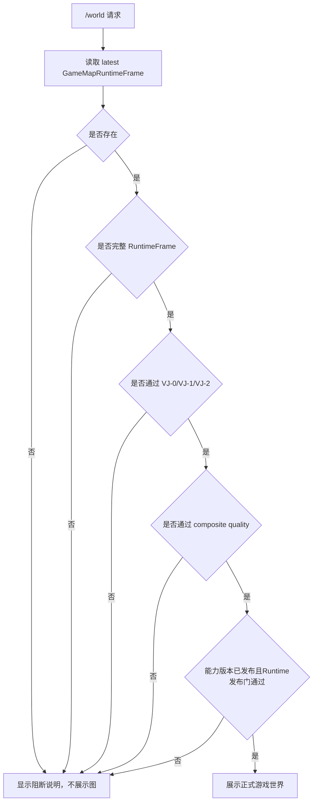

`/world` 不能读取：

| 内容 | 原因 |
|---|---|
| 训练图片 | 中间产物。 |
| 失败图片 | 只能归档和复盘。 |
| 候选图片 | 未正式通过。 |
| 局部素材 | 不是完整游戏地图。 |
| 单张 ApprovedFrame | 只是视觉素材凭证，不是 RuntimeFrame。 |
| 程序占位图 | 不是正式 AI 视觉结果。 |
| 能力发布或Runtime发布门否决图 | 即使部分审核通过也不能展示，必须进入失败归档和修复链。 |

## 8. 架构结论

系统必须采用“视觉事实清单 + 世界导演 + 结构化游戏地图 + 本地模型完整视觉推理 + RuntimeFrame 绑定”。AI Painter 负责完整视觉表达，局部材料只是内部能力。游戏是否可玩、对象是否存在、道路是否连通、碰撞是否正确、世界是否自主，全部由结构化数据和 Runtime 决定。

正式展示链路必须收口为：

```txt
VisualFactManifest + 世界导演 + 结构化游戏地图
+ 本地 AI Painter 本轮完整地图新候选
+ RuntimeFrame 结构与运行层绑定
+ VisualJudge / composite quality
+ 能力版本机器发布门 / Runtime发布门
= /world 正式游戏世界
```

能力版本机器发布证据不完整，或Runtime发布门否决时，不能把任何 RuntimeFrame 当成正式游戏成功结果。

## 9. 视觉模型实现关系

`complete-world-ai-assisted-cold-start-v7`是AI Painter视觉生产子系统中已经退役的完整地图条件去噪迁移实现。其配置仅保留为历史证据，不得作为当前编译器、条件构建器、训练器或入口解析器的默认输入；需引用的合法事实或资产必须先成为独立、不可变、显式登记的新合同或资产绑定。AI-PET-WORLD产品代际、数据发布版本、模型能力版本和该历史配置名称是四种独立身份；任何一项均不得由另一项名称推导。所有现行或后继模型仍必须消费正式世界事实、世界导演和版本化条件，输出经过机器审核、能力发布和RuntimeFrame绑定，并且不能生成或修改世界事实。

代码合同、CPU回归、数据容量、GPU训练、Checkpoint、训练后验证、正式推理和游戏世界完成是相互独立的状态。任何前置状态都不能被描述为后续能力通过；实际模型状态只从训练、验证和资格机器证据读取。

## 10. 全项目模块详细执行与验收合同

本章将既有业务和模块规格按唯一执行指南的九个建设模块展开，作为任务拆分、实现、审查和验收的详细依据，不是仅供展示的概念框架。它不新增模块计划、工期、运行状态或完成比例；稳定交付项及依赖仍以唯一指南为准，产品验收场景仍以主体规格第18节及WORLD-AUTO-001至004为准。AI管家为自主角色当前暂名，不限定最终职业。

每项任务应引用本章对应ARCH-DETAIL编号及下游正式条款，绑定当前版本/源码/数据/资源/验收范围。执行者按输入→处理→输出实现，并使用对应正反条件验收。适用机器Schema、模型版本、参数、来源或运行策略尚未定义时，先在相应正式规格和版本化合同内补齐；不得自行猜值、替换路线、减少验收或以文案存在认定已实现。合同发生冲突时按权威顺序处理，不以本章概述覆盖更高层业务或偷偷修改原合同。

**阅读方式：**总图说明业务之间的关系；本章逐模块说明内部责任、接口和异常分支；相关模块规格提供完整Schema、阈值及专用细节。真实实现、测试、部署与验收结果从工作记录和机器证据读取，不写进本章。模块标题和图中的节点均为目标定义，不能当作进度状态。

建设模块与产品能力的对应关系为：模块1保障可靠性与文档合同；模块2提供世界及后续生命视觉；模块3提供本地执行流程；模块4提供人格/初始外貌；模块5提供五类现实动物与生命数据；模块6提供行动、生命状态、记忆反馈与动态表达；模块7负责世界状态、持续运行、发布与整体集成；模块8负责AI控制台；模块9负责数据、备份、工作记录和文档/进度查询。自然首区、出生外貌、动物、多态身份、行动反馈、时序存档、训练隔离和展示发布等产品场景跨多个建设模块，不将两种分组重复计数。

各模块使用相同的交接原则：传递实际身份与不可变内容绑定；接收方重新核验适用性；失败保留原件；依赖未满足不能用默认值伪成功。下面的子组件是详细责任，不是新增进度叶子、额外审批步骤或默认训练授权。

### 10.1 文档治理与运行可靠性

**业务职责：**让现行合同、精确身份、单写事务、真实活动判定及有界恢复可追溯；分别判断程序流程、模型资格及产品验收。

**责任边界：**

- Owner定义目标、观察、主动暂停/急停，不进入正常运行审批状态。
- 总控维护正式文档；外部执行智能体只在当前任务边界内建设。
- 唯一指南为唯一计划；data/.runtime/SQLite为运行事实，Markdown非实时DB。
- 本模块不授绘图/世界模型/MVP资格。


**权威记录与状态：**

- normative：AUTH→业务/总体架构→迁移→指南→模块规格；旧合同仅复核原历史。
- machine：受信能力发布身份须程序重算并原子登记；current registry不是能力发布的替代。
- lifecycles：能力、单次执行、机器审核分层；review_passed不直接等于released。


#### 10.1.1 子组件输入、执行、输出与验收

##### ARCH-DETAIL-01-01 现行文档与任务对齐

**输入：**当前任务、HEAD与dirty；适用条款、文件/资源边界及验收

**处理顺序：**

1. 按权威阅读链定位条款
2. 重算版本/SHA
3. 记录已有实现及缺口
4. 范围变化重新对齐

**输出：**机器任务对齐记录；唯一指南引用

**验收与反例：**只在字节未变且当前任务适用时复用已读摘要；不把旧合同当权限；保留原有改动

**失败与恢复：**冲突报告并停止依赖动作；无关授权事项可继续

**依赖：**正式文档与GOV-OWNER-001

**条款依据：**[AUTH 2.1 权威顺序](DOCUMENT_AUTHORITY_INDEX.md)；[POL 5. 修改流程](DOCUMENTATION_POLICY.md)

##### ARCH-DETAIL-01-02 能力候选与受信发布身份

**输入：**能力版本；实际数据/模型/审核/条件/Runtime/测试产物

**处理顺序：**

1. 重算真实字节和血缘
2. 核验冻结门槛/独立回归
3. 本地程序原子发布、拒绝或回退

**输出：**受信release identity；不可变版本与裁决记录

**验收与反例：**caller布尔值、格式SHA、聊天与旧合同不能授当前资格；current执行登记不能替代能力发布登记

**失败与恢复：**缺失/冲突失败关闭；保留上一正式版本；变化模型/Loss/数据/阈值建立新版本

**依赖：**模型/审核模块及受信release writer

**条款依据：**[ARCH 0.2 自主能力变更与机器发布信任边界](ARCHITECTURE.md)；[ARCH 0.4 AI Painter内部任务票据与三层自主状态机](ARCHITECTURE.md)

##### ARCH-DETAIL-01-03 内部票据与防重原子消费

**输入：**ticket/action/attempt、包SHA/能力身份/nonce/期限；机器密钥身份

**处理顺序：**

1. 验签及规范化载荷SHA
2. 校验动作范围
3. 同SQLite事务唯一消费、事件和输出登记
4. 文件flush后原子改名

**输出：**唯一消费事实；可恢复提交状态

**验收与反例：**重复/并发/重启不能重复执行；票据不扩大包或能力动作；内存及PID消失不能决定重新消费

**失败与恢复：**唯一约束/过期/修订冲突失败关闭；只按同事务日志恢复

**依赖：**秘密保护；单写writer与固定协议

**条款依据：**[ARCH 0.4 AI Painter内部任务票据与三层自主状态机](ARCHITECTURE.md)；[REVIEW 11.3 唯一写入者与原子事务](game-world-generation/REVIEW_AUTOMATION_AND_STORAGE_SPEC.md)

##### ARCH-DETAIL-01-04 四身份与真实活动判定

**输入：**currentProjectTask/activeExecution/latestTrainingTerminal/selectedHistoricalRun；锁/创建身份/心跳

**处理顺序：**

1. 四状态空间独立核验
2. 合法writer单调更新revision
3. 活动执行需锁+进程+心跳一致
4. 历史选择只作查询

**输出：**可信快照；登记的nextMachineAction或null/unknown_or_stale

**验收与反例：**审核失败建立新裁决任务，不复活原失败训练；不扫目录猜当前；nextMachineAction不由页面推导

**失败与恢复：**读取失败/过期/冲突保留原因；禁止GPU占用/PID存在兜底

**依赖：**官方registry、精确不可变终态、只读bridge

**条款依据：**[ARCH 0.5 当前执行身份与状态投影架构](ARCHITECTURE.md)；[MIG 7.10 当前任务身份管理](LOCAL_SELF_DEVELOPED_AI_CAPABILITY_AND_CODEX_MIGRATION_ARCHITECTURE.md)

##### ARCH-DETAIL-01-05 事件、指针与SQLite一致提交

**输入：**expectedRevision/事件序号；精确胶囊/终态路径SHA；暂存与事务日志

**处理顺序：**

1. 单写者核对前态
2. 准备不可变证据
3. 按事务协议提交指针/事件/索引
4. 读取同修订与hash

**输出：**一致新修订；明确未提交或待恢复事务

**验收与反例：**并发不能覆盖；任一面漂移不能显示成功；原终态不改写

**失败与恢复：**只恢复同事务身份；持久化失败不重跑业务；冲突失败关闭

**依赖：**本地FS/SQLite与原子日志

**条款依据：**[REVIEW 11.3 唯一写入者与原子事务](game-world-generation/REVIEW_AUTOMATION_AND_STORAGE_SPEC.md)；[REVIEW 11.7 读取失败与中断恢复](game-world-generation/REVIEW_AUTOMATION_AND_STORAGE_SPEC.md)

##### ARCH-DETAIL-01-06 受管Job、流与可靠清理

**输入：**同调用descriptor与原生owner/Job；PID创建身份/source closure/guard

**处理顺序：**

1. 启动前核来源和占用
2. 保留真实调用句柄
3. 正常/失败/stop后取得空Job和流回执
4. 仅释放自身guard

**输出：**创建事实；清理事实；guard保持/释放原因

**验收与反例：**进程创建不等于闭环；磁盘JSON/PID不存在不能授清理权；不得终止无关任务

**失败与恢复：**首错优先；句柄遗失/未知guard保持阻断；不自动清未知占用

**依赖：**Windows原生执行器；资源/输出预算

**条款依据：**[REVIEW 11.9 原生执行器启动前失败与遗留占用审计](game-world-generation/REVIEW_AUTOMATION_AND_STORAGE_SPEC.md)；[REVIEW 11.13 有界停止流程的源码闭包一致性](game-world-generation/REVIEW_AUTOMATION_AND_STORAGE_SPEC.md)；[REVIEW 11.15 本地操作者入口与同调用安全停止](game-world-generation/REVIEW_AUTOMATION_AND_STORAGE_SPEC.md)

##### ARCH-DETAIL-01-07 跨内核重启与中断恢复

**输入：**原启动闭包、MachineGuid、内核事件12/CIM boot时间；旧source/binary/guard

**处理顺序：**

1. 证明同机真实内核重启
2. 核对旧执行完整身份
3. 按专门恢复合同裁决遗留占用
4. 保留历史

**输出：**限定旧占用恢复证明；保持失败或合法恢复状态

**验收与反例：**PID缺失/服务重启不是内核重启；不能为验收触发系统重启

**失败与恢复：**证据/日志权限缺失则blocked/unknown；保留guard；不越权重放

**依赖：**系统只读日志与原启动证据

**条款依据：**[REVIEW 11.11 已启动执行的跨内核重启占用恢复](game-world-generation/REVIEW_AUTOMATION_AND_STORAGE_SPEC.md)；[MIG 7.9 项目记录与恢复](LOCAL_SELF_DEVELOPED_AI_CAPABILITY_AND_CODEX_MIGRATION_ARCHITECTURE.md)

##### ARCH-DETAIL-01-08 有界失败裁决与修复

**输入：**原首错/日志；冻结确定规则；允许补丁范围/预算/回滚条件

**处理顺序：**

1. 区分设施/训练/画质/政策边界
2. 保存排除选项与唯一结果
3. 仅执行合同允许有限恢复
4. 策略变化建新版本

**输出：**失败边界报告；修复提案或新候选；限定回归结果

**验收与反例：**歧义不可编唯一根因；不降门槛；CPU不证明画质；未知诊断不能写已迁移

**失败与恢复：**evidence_ambiguous终止；预算耗尽停止；保留所有失败，不无限重试

**依赖：**模块冻结规则/版本及工程回归

**条款依据：**[MIG 7.8 审核、失败学习与修复](LOCAL_SELF_DEVELOPED_AI_CAPABILITY_AND_CODEX_MIGRATION_ARCHITECTURE.md)；[ARCH 0.4 AI Painter内部任务票据与三层自主状态机](ARCHITECTURE.md)

##### ARCH-DETAIL-01-09 文档检查与程序符合分层

**输入：**文档元数据/合同SHA；portable CPU与真实本地资产检查证据

**处理顺序：**

1. 查链接/枚举/现行与历史隔离
2. 输出限定范围
3. 分别报告文档/源码/生产/模型/MVP

**输出：**文档检查报告；范围化符合证据引用

**验收与反例：**文档检查不授能力发布；repository_portable_cpu qualificationGranted=false；旧基线不可静默替换

**失败与恢复：**总控修文档；源变化重验；保留失败及未覆盖

**依赖：**现行checker及正式回归合同

**条款依据：**[POL 7. 文档与机器合同验收](DOCUMENTATION_POLICY.md)；[AUTH 6. 文档基线验收与程序符合状态](DOCUMENT_AUTHORITY_INDEX.md)

#### 10.1.2 接口与交接条件

- contract：ARCH §0.4；input：签名内部ticket/包SHA/能力身份/动作尝试/nonce/期限；output：同事务消费/事件/输出身份，唯一约束，非人工审批
- contract：REVIEW §11.2/11.3；input：单调预期revision与前态，胶囊/终态路径和SHA；output：current registry/追加事件/SQLite一致修订
- contract：REVIEW §11.9/11.13；input：同调用descriptor+原生owner/Job+精确创建身份；output：可靠空Job/流关闭回执；仅本次guard清理
- contract：POL §7；input：正式文档/当前与历史合同原字节；output：范围化文档/CPU符合报告，不授资格

上述入口名称用于定位既有责任；实施时仍须核对当前注册版本、源码及正式机器合同，不从名称或本章文案推导运行资格。执行请求、实际执行、验证、审核、发布和部署采用分别记录。

#### 10.1.3 详细流程与异常分支

图表示正式目标及责任，不表示当前所有节点已经实现或验收。

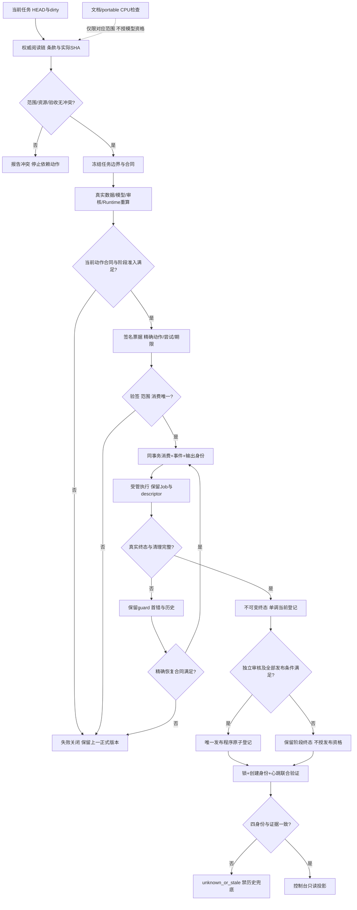

### 10.2 世界视觉生产、学习与审核（AI Painter）

**业务职责与范围：**把同一世界已经成立的事实表达为原生完整像素风画面，并形成学习、验证、审核、发布或拒绝的证据链。自然地图是先行能力，不代表动物、人物或动态状态已经支持；Painter不定义世界拓扑、资源、碰撞或病情。

**输入身份及字段：**

- 世界任务：worldId、regionId、tick、factHash、VisualFactManifest、worldDirectorPlan、dictionaryVersion。
- 条件：conditionPackagePath与实际SHA、23通道合同身份/顺序/类型/尺寸、明确unavailableChannels。
- 学习资料：经发布的数据身份、来源/许可、48 train/8 validation/4 challenge/4 regression各自用途；完整RGB及对应事实/条件，不从目录猜当前数据。
- 能力与执行：modelCapabilityVersion、Checkpoint与父权重身份、冻结基础资产、Loss/优化器初始化、随机状态、运行预算、审核合同与程序血缘。


**交付输出：**

- 候选：完整原生1024×768 RGB、实际图像SHA、任务/模型/条件/seed绑定、真实生成起止与范围明确的耗时。
- 独立阶段输出、逐类语义证据、逐图指标、固定验证RGB、可恢复Checkpoint及明确成功/失败终态。
- 机器审核报告与不可变失败记录；全部发布条件成立时交给唯一能力发布者和Runtime门，不由训练器直接写正式帧。


**正式依据：**

- [game-world-generation/AI_PAINTER_FORMAL_IMPLEMENTATION_SPEC.md §3—12、§17—18](game-world-generation/AI_PAINTER_FORMAL_IMPLEMENTATION_SPEC.md)
- [game-world-generation/TRAINING_DATA_AND_SOURCE_POLICY.md §2、§4、§9、§11](game-world-generation/TRAINING_DATA_AND_SOURCE_POLICY.md)
- [game-world-generation/REVIEW_AUTOMATION_AND_STORAGE_SPEC.md ](game-world-generation/REVIEW_AUTOMATION_AND_STORAGE_SPEC.md)
- [ARCHITECTURE.md §0.2—0.5、§4、§6—7](ARCHITECTURE.md)

#### 10.2.1 子组件输入、执行、输出与验收

##### ARCH-DETAIL-02-01 学习资料与split核验

**输入：**正式数据发布清单及真实文件

**处理：**逐项核对来源、权利、样本独立性、事实/条件/RGB对应；绑定split，禁止验证和独立测试更新权重。

**输出：**可消费数据身份或具体拒绝原因

**验收与反例：**篡改字节、错split、重复身份和缺条件均拒绝；保留训练样本实际曝光记录。

##### ARCH-DETAIL-02-02 权威结构绑定

**输入：**同一world/region/tick/fact及条件包

**处理：**执行AP-IN与AP-PHASE-001：重新计算路径/摘要和空间身份；只形成绑定证据，不训练或补造事实。

**输出：**同包成功结构绑定终态

**验收与反例：**跨world、tick、条件或历史失败输出不能进入下一责任。

##### ARCH-DETAIL-02-03 类型保持的条件编码

**输入：**当前23通道及目标阶段尺寸

**处理：**离散身份nearest、连续场bilinear且alignCorners=false；先分类重采样再编码混合，保留最小对象连通域。

**输出：**保持原语义身份的模型输入

**验收与反例：**单像素离散结构、连续插值、类型置换和跨通道污染均有行为测试。

##### ARCH-DETAIL-02-04 地形/道路/水文视觉责任

**输入：**结构绑定及当前事实拓扑

**处理：**学习地形、水岸、道路和连接的空间表达；登记独立责任输出或共享参数责任映射。

**输出：**可追踪地形与连接表示

**验收与反例：**道路/水体条件反事实与梯度可达；不得固定模板替代事实或只凭全图Loss裁决。

##### ARCH-DETAIL-02-05 逐类自然对象责任

**输入：**footprints/tree/rock/vegetation条件及前序输出

**处理：**分别表达接地、支撑/可见结构、尺度、遮挡与类别；核心与支撑范围含义按数据和审核合同一致绑定。

**输出：**逐类对象证据和同包空间表示

**验收与反例：**掩码不变、逐类响应成立；不同对象退化为同一纹理不得记作语义通过。

##### ARCH-DETAIL-02-06 统一画面与原生RGB

**输入：**同包地形/水文/对象责任输出

**处理：**统一构图、光照、材质和像素风，直接生成完整RGB；解码仍必须响应原责任条件。

**输出：**完整RGB候选及其身份

**验收与反例：**不由tile/sprite拼接或低分辨率放大；解码可执行不等于语义合格。

##### ARCH-DETAIL-02-07 版本化训练与阶段资格

**输入：**冻结训练计划、当前能力资格、train资料

**处理：**执行CPU、需要时只读GPU、受控实验/Smoke及正式Stage0/1/2；各阶段独立终态，真实加载父Checkpoint并记录优化器恢复或重建语义。

**输出：**当前版本Checkpoint、更新记录、阶段终态

**验收与反例：**256×192/512×384/1024×768逐级按合同；预算耗尽和数值失败停止，不用旧资格跳级。

##### ARCH-DETAIL-02-08 质量、保持与独立复验

**输入：**固定评估样本、父/候选身份、冻结审核口径

**处理：**分别核对整体质量、条件对应、道路水文、逐类对象、目标改善与旧图退化；challenge/regression保持独立用途。

**输出：**逐图前后变化及绝对通过/拒绝理由

**验收与反例：**RGB误差下降、训练完成或退步变少均不能替代绝对质量；暴露的测试集不冒充新独立证明。

##### ARCH-DETAIL-02-09 审核反馈与有界后继

**输入：**冻结失败图/指标/原因及当前允许策略

**处理：**区分数据/条件/计算/表达/审核问题；只执行合同声明的后继或形成新候选，未知根因保留证据关闭当前路线。

**输出：**可追溯问题、策略/新版本或安全终态

**验收与反例：**不降低阈值、不无限原样重训、不由单项失败推定整个模型路线无效。

##### ARCH-DETAIL-02-10 资格交接与发布

**输入：**数据/模型/审核/Runtime/条件/测试完整证据

**处理：**唯一发布程序重新计算不可变内容并原子登记；正式帧继续按同world/tick的Runtime门检查。

**输出：**机器发布或拒绝/回退身份

**验收与反例：**调用方passed、格式正确SHA、图好看或外部说明都不能取得发布资格。

#### 10.2.2 接口、恢复与依赖

**接口合同：**

- 正式四责任接口使用AP-PHASE-001至004：inputSchema/outputSchema、requiredIdentity、successTerminal/failureTerminal、allowedMutations/forbiddenMutations、checkpointIdentity、reviewContract。
- 候选、审核和发布通过不可变身份交接；当前运行、最近训练终态和历史选择独立，历史预览只用于观察。
- 模型数量、共享方式、Loss具体权重和预算由当前版本合同登记，不在总体架构中固定某一次实验参数。


**失败与恢复：**

- 身份/来源不符：执行前拒绝并记录，不能自动换另一份样本。
- 计算/资源失败：保存实际读数、失败位置和已有产物，保持预算上限；缺Checkpoint不补造。
- 画质失败：存失败候选及逐项审核，不进入正式世界；适用性不能在结果出来后临时改变。
- 发布失败：保留上一有效发布；没有合法当前帧时按/world规则阻断，不能降级显示候选。


**模块依赖：**

- 模块7提供权威事实/状态/任务；模块3提供受管执行和证据；模块8只观察。
- 模块4/5/6提供生命档案、事实和版本化条件扩展之后，才可以建立相应视觉能力，不能偷占自然物通道。


**集成验收：**

- 按主体§17逐要求记录数据、机器合同、代码、正反测试与实际执行证据。
- 每责任有最终RGB条件响应和适用审核，逐图质量/旧能力保持与阶段资格分别给结论。
- 正式原生完整地图、独立严格复验和发布链均通过才交模块7；组件测试不提升模型资格。


**执行前须具体化的合同：**

- 任何尚未具备可靠语义审核的对象或生命状态，须在对应审核合同中补齐规则、标注正反样本及适用阈值后才能发布。
- 具体模型候选、计算路径和最优采样策略须由有界实验与独立证据确定，本章不把研究假设写成既定修复。


#### 10.2.3 详细流程与异常分支

图表示正式目标及责任，不表示当前所有节点已经实现或验收。

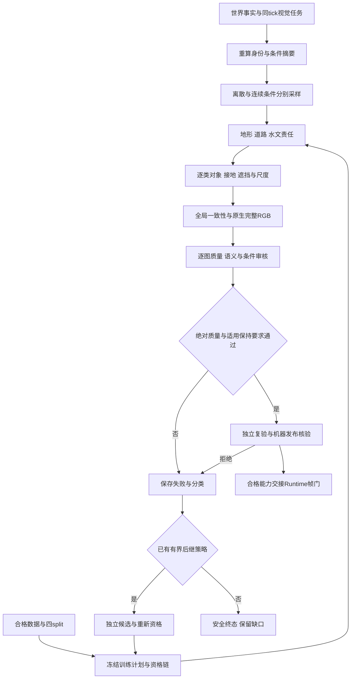

### 10.3 本地自研AI MVP确定流程迁移

**业务职责：**从固定登记配置自动准备新Run和精确包，发起端退出后本地完成受管执行、查询及安全停止；迁移流程与模型质量分别验收。

**责任边界：**

- 当前先迁移确定流程，不以通用代码模型/未知诊断/自然语言调度作为MVP额外前置。
- CPU内核、full-v2真实GPU/CP/审核、部署认证、实际断网/关闭Codex分别取证。
- 训练、部署和停止操作按对应生效合同及执行主体边界实施；本地自主权不授外部智能体额外动作。


**权威记录与状态：**

- entry：固定control-v2 prepare-and-start；v1精确包启动语义保持，不混协议。
- execution：preflight→execute→validate→review→adjudicate→finalize；原失败终态不可改写。
- acceptance：迁移§15及CTRL-LOCAL-001至009、DEP-AUTH-001至005；旧源成功不自动适用当前源。


#### 10.3.1 子组件输入、执行、输出与验收

##### ARCH-DETAIL-03-01 固定登记配置与输入路由

**输入：**登记candidateSelection；本地数据/依赖；认证与source bindings

**处理顺序：**

1. 拒绝任意脚本/未知能力/旧包重放
2. 服务端解析固定准备路由
3. 重算源码/合同/数据SHA

**输出：**新Run准备请求与精确源闭包

**验收与反例：**调用方不指定任意可执行路径或血缘；未知选择/源漂移/活动占用必须拒绝

**失败与恢复：**准备失败有限留档；不造训练成功；不自动换路线

**依赖：**登记配置/数据来源/官方认证

**条款依据：**[MIG 7.2 需求理解与任务规划](LOCAL_SELF_DEVELOPED_AI_CAPABILITY_AND_CODEX_MIGRATION_ARCHITECTURE.md)；[REVIEW 11.15 本地操作者入口与同调用安全停止](game-world-generation/REVIEW_AUTOMATION_AND_STORAGE_SPEC.md)

##### ARCH-DETAIL-03-02 受管CPU准备与新包物化

**输入：**批准配置/源身份；唯一输出目录；CPU/时间/内存/日志预算

**处理顺序：**

1. 建立全新run
2. 受管CPU实际准备
3. 按实际结果生成计划和精确包
4. 未知前序CP用同计划成功终态字段规则绑定

**输出：**包路径/SHA；CPU准备证据；后继输入规则

**验收与反例：**不能复用旧已消费包；不能以prepare存活代替完成；不能用latest/任意CP作父项

**失败与恢复：**首错停止后继；保留pre-lifecycle日志/nonce/creationId，不伪造后续身份

**依赖：**固定路由/原后台/数据可用

**条款依据：**[REVIEW 11.15 本地操作者入口与同调用安全停止](game-world-generation/REVIEW_AUTOMATION_AND_STORAGE_SPEC.md)；[MIG 7.5 模型训练](LOCAL_SELF_DEVELOPED_AI_CAPABILITY_AND_CODEX_MIGRATION_ARCHITECTURE.md)

##### ARCH-DETAIL-03-03 发起端退出后的独立交接

**输入：**精确包/SHA；保留descriptor/owner；源闭包和预算

**处理顺序：**

1. 既有后台接管
2. 发起端准备未完成时退出
3. 本地续接规定阶段到终态，不读聊天/外部AI/下载依赖

**输出：**真实接管回执与同包完整阶段链

**验收与反例：**至少两次独立新运行；真实终态及阶段身份一致；后台/心跳存活不是闭环

**失败与恢复：**缺可信终态的早退显示失败/不足；不重试旧包；输出有界

**依赖：**原生后台/guard/稳定配置加载

**条款依据：**[REVIEW 11.15 本地操作者入口与同调用安全停止](game-world-generation/REVIEW_AUTOMATION_AND_STORAGE_SPEC.md)；[MIG 15. 每项能力的迁移条件](LOCAL_SELF_DEVELOPED_AI_CAPABILITY_AND_CODEX_MIGRATION_ARCHITECTURE.md)

##### ARCH-DETAIL-03-04 六阶段连续执行与产物传递

**输入：**phase adapter源绑定；资源准入；真实父CP/RNG与固定验证规则

**处理顺序：**

1. preflight资源→execute训练→validate权重重载→review机器审核→adjudicate唯一裁决→finalize manifest/terminal

**输出：**训练/CP/验证/审核/裁决/终态及事件/SQLite

**验收与反例：**每阶段真实证据不跳跃；流程到审核失败终态可证明执行闭环，但不授画质或发布资格

**失败与恢复：**首失败停止后继；原审核失败不复活；新裁决独立任务；已有合法CP保留

**依赖：**模型/数据/冻结审核规则及adapter

**条款依据：**[MIG 7.5 模型训练](LOCAL_SELF_DEVELOPED_AI_CAPABILITY_AND_CODEX_MIGRATION_ARCHITECTURE.md)；[MIG 7.6 训练后验证](LOCAL_SELF_DEVELOPED_AI_CAPABILITY_AND_CODEX_MIGRATION_ARCHITECTURE.md)；[REVIEW 11.15 本地操作者入口与同调用安全停止](game-world-generation/REVIEW_AUTOMATION_AND_STORAGE_SPEC.md)

##### ARCH-DETAIL-03-05 正常失败与原生活跃清理

**输入：**自有受管CPU；原始错误；Job/流/guard与预算

**处理顺序：**

1. 保留同调用句柄
2. 分别执行正常/程序失败路径
3. 确认空Job和流关闭
4. 只释放本次guard

**输出：**分项真实终态/清理回执/首错

**验收与反例：**mock与实际CPU分别报告；终态/日志/SQLite一致；清理错误不覆盖原首错

**失败与恢复：**证据不完整保留guard；不按磁盘布尔/PID消失清理

**依赖：**原生执行器与资源合同

**条款依据：**[REVIEW 11.9 原生执行器启动前失败与遗留占用审计](game-world-generation/REVIEW_AUTOMATION_AND_STORAGE_SPEC.md)；[REVIEW 11.15 本地操作者入口与同调用安全停止](game-world-generation/REVIEW_AUTOMATION_AND_STORAGE_SPEC.md)

##### ARCH-DETAIL-03-06 认证stop与一次性理由

**输入：**session/CSRF/HMAC；run/packageSHA/PID创建身份/revision/deadline/幂等键

**处理顺序：**

1. 慢核验在快速计时器外
2. 同调用一次性已验证理由交接
3. 私有句柄停止
4. 分层保存结果

**输出：**accepted/consumed/delivered/stopped/cleaned/CP各自事实

**验收与反例：**请求接受不等于已停；停不等于CP落盘；跨调用/过期/源变化/无句柄拒绝；只停精确自有任务

**失败与恢复：**认证失败无业务副作用；保留原失败与guard；不打断无关训练

**依赖：**认证/原生owner/当前状态

**条款依据：**[REVIEW 11.13 有界停止流程的源码闭包一致性](game-world-generation/REVIEW_AUTOMATION_AND_STORAGE_SPEC.md)；[REVIEW 11.15 本地操作者入口与同调用安全停止](game-world-generation/REVIEW_AUTOMATION_AND_STORAGE_SPEC.md)

##### ARCH-DETAIL-03-07 幂等、防重与合法事务恢复

**输入：**消费标识/锁/事务记录/包身份/expectedRevision；既有终态

**处理顺序：**

1. 检查同请求身份
2. 仅恢复合法同事务/已过阶段
3. 重复请求读原事实
4. 相同key不同body拒绝

**输出：**唯一业务执行；追加恢复审计与一致状态

**验收与反例：**重启/重复不能重复训练；observer读取失败不重放业务；缺证据不能猜可继续

**失败与恢复：**并发冲突失败关闭；恢复预算耗尽停止；保留原状态

**依赖：**唯一消费DB/原子日志/source闭包

**条款依据：**[MIG 7.9 项目记录与恢复](LOCAL_SELF_DEVELOPED_AI_CAPABILITY_AND_CODEX_MIGRATION_ARCHITECTURE.md)；[REVIEW 11.3 唯一写入者与原子事务](game-world-generation/REVIEW_AUTOMATION_AND_STORAGE_SPEC.md)；[REVIEW 11.15 本地操作者入口与同调用安全停止](game-world-generation/REVIEW_AUTOMATION_AND_STORAGE_SPEC.md)

##### ARCH-DETAIL-03-08 独立本地只读status

**输入：**固定status命令；当前registry与精确终态；观察时间

**处理顺序：**

1. 官方读取器核身份/revision/hash/过期
2. 分开当前任务/活动执行/最近训练终态

**输出：**真实当前/失败/未知/陈旧及reason

**验收与反例：**不创建Run/进程/锁/DB；不扫历史；无Codex会话可读；不以GPU/PID替代状态

**失败与恢复：**读取错误保持unknown/not_connected；不触发恢复

**依赖：**官方registry及权限边界

**条款依据：**[MIG 7.10 当前任务身份管理](LOCAL_SELF_DEVELOPED_AI_CAPABILITY_AND_CODEX_MIGRATION_ARCHITECTURE.md)；[REVIEW 11.15 本地操作者入口与同调用安全停止](game-world-generation/REVIEW_AUTOMATION_AND_STORAGE_SPEC.md)

##### ARCH-DETAIL-03-09 稳定部署认证与实际一致采用

**输入：**既有部署配置/运行账户ACL/稳定operator secret；签发服务与独立进程

**处理顺序：**

1. 核安全熵/普通文件/链接/大小/身份
2. 有效值不轮换
3. 官方加载规则
4. 真实新session及独立HMAC/CSRF验证
5. 必要时仅精确项目服务受限重载

**输出：**非秘密权限/来源类别/服务创建身份/采用结果

**验收与反例：**写文件不等于服务采用；隔离凭据不算生产；秘密及派生摘要不进公开报告/CLI；不得改系统环境或别的node

**失败与恢复：**冲突/认证不一致失败关闭；重载失败保留可恢复配置；不无限重启

**依赖：**既有真实服务/官方加载规则；DEP-AUTH-001至005

**条款依据：**[REVIEW 11.15 本地操作者入口与同调用安全停止](game-world-generation/REVIEW_AUTOMATION_AND_STORAGE_SPEC.md)；[MIG 15. 每项能力的迁移条件](LOCAL_SELF_DEVELOPED_AI_CAPABILITY_AND_CODEX_MIGRATION_ARCHITECTURE.md)

##### ARCH-DETAIL-03-10 完整迁移与实际离线验收

**输入：**当前source身份；两次新Run；正常/失败/stop/恢复；真实认证/实际断网/关闭Codex证据

**处理顺序：**

1. 逐条核启动暂停停止恢复、权限、无聊天、幂等、回归、预算、回滚、来源、原子切换
2. 逐层报告适用性

**输出：**限定能力迁移报告；分项passed/failed/unverified

**验收与反例：**组件不能合成未经验证整链；断网/浏览器离开/关闭Codex互不替代；质量不作为确定流程额外前置也不因迁移获质量资格

**失败与恢复：**缺实际条件留unverified；失败真实保留；不宣称未知诊断/代码修复已迁移

**依赖：**MIG-A至I；模型资源与生产认证

**条款依据：**[MIG 15. 每项能力的迁移条件](LOCAL_SELF_DEVELOPED_AI_CAPABILITY_AND_CODEX_MIGRATION_ARCHITECTURE.md)；[REVIEW 11.15 本地操作者入口与同调用安全停止](game-world-generation/REVIEW_AUTOMATION_AND_STORAGE_SPEC.md)

#### 10.3.2 接口与交接条件

- entry：scripts/run-ai-painter-local-control-v2.mjs；operations：start、status、stop；binding：固定登记配置prepare-and-start；runLocalControlV2(command,body,root)
- entry：scripts/run-ai-painter-local-control-v1.mjs；binding：既有精确包启动协议保持原语义，不把v2准备参数混入
- entry：scripts/lib/ai-painter-local-prepare-v1.mjs；functions：startLocalPreparation、readLocalPreparationStatus、stopLocalPreparation、runLocalPreparationRequest；binding：候选登记/请求身份/源闭包/真实包
- entry：scripts/lib/ai-painter-autonomous-closed-loop-v1.mjs；functions：runAutonomousClosedLoop、readExecutionState；binding：phase adapter+包SHA+持久化执行身份；六阶段
- entry：DEP-AUTH-001至005 / CTRL-LOCAL-003至005；binding：secret值及其摘要不得公开；请求接受/消费/交接/停止/清理/CP分别记录

上述入口名称用于定位既有责任；实施时仍须核对当前注册版本、源码及正式机器合同，不从名称或本章文案推导运行资格。执行请求、实际执行、验证、审核、发布和部署采用分别记录。

#### 10.3.3 详细流程与异常分支

图表示正式目标及责任，不表示当前所有节点已经实现或验收。

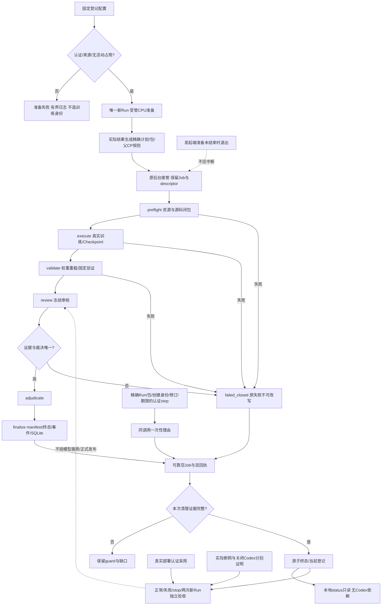

### 10.4 人物人格与初始外貌

**业务职责：**合法资料产生可追溯稳定人格及独立初始外貌；现实/平行人格模式与性别呈现分别记录；提供运行所需稳定派生档案。AI管家只是当前自主角色暂名。

**责任边界：**不从命理推断真实人的外貌健康或命运；不由Painter猜脸；不定义最终职业体系；不改变世界事实。

**适用阶段与依赖：**自然世界先行后的人格映射；人格最小行动与完整外貌能力分开验收。

#### 10.4.1 子组件输入、执行、输出与验收

##### ARCH-DETAIL-04-01 出生资料与用户选择入口

**责任组件：**世界创建／人格输入

**输入：**出生快照额外明确历法、时区、时辰完整度、映射模式、来源版本；只向下游传最小必要派生数据

**处理顺序：**

1. 校验申请与请求结构
2. 使用真实日历检查完整日期及规则覆盖范围
3. 分别保留未提供时辰和非法时间；选择模式与性别呈现分别记录

**输出：**合法出生快照或准确不可用原因；禁止日志展开原始出生资料

**正向验收：**合法完整与合法缺时辰输入均有稳定可区分结果

**反向验收：**缺年/月/日、非法日期/时辰、越界年份及无效选择拒绝；不填成健康或默认完整资料

**失败与恢复：**用户资料不足返回可修正原因，不写半个世界；程序错误独立报告，不能伪装资料缺失。

**依赖：**按本模块资料和来源合同准入，无额外后置模块前置。

**条款依据：**[BUSINESS_SPEC.md 2.1](BUSINESS_SPEC.md)；[ARCHITECTURE.md 4.1](ARCHITECTURE.md)；[AI_PAINTER_FORMAL_IMPLEMENTATION_SPEC.md 18.2](game-world-generation/AI_PAINTER_FORMAL_IMPLEMENTATION_SPEC.md)；[TRAINING_DATA_AND_SOURCE_POLICY.md 11.1 隐私边界](game-world-generation/TRAINING_DATA_AND_SOURCE_POLICY.md)

##### ARCH-DETAIL-04-02 历法、时区与规则覆盖标准化

**责任组件：**紫微／八字规则输入

**输入：**上游出生快照与算法标准化使用同一历法/时区/版本及明确支持范围

**处理顺序：**

1. 校验日期/时辰与规则适用范围
2. 将明确历法转换为算法用日期
3. 冻结跨午夜、节气、闰月和宿主时区差异的处理规则及测试

**输出：**带输入来源、时区与规则版本的可复现标准化结果

**正向验收：**同一快照/规则在声明运行环境下产生一致标准化值

**反向验收：**不支持历法明确拒绝；不得因宿主时区或被忽略的timezone改变人格而无版本记录

**失败与恢复：**不支持或转换失败停止对应人格/外貌链并保存错误；不改为缺时辰路由。

**依赖：**ARCH-DETAIL-04-01

**条款依据：**[BUSINESS_SPEC.md 2.1](BUSINESS_SPEC.md)；[ARCHITECTURE.md 4.1](ARCHITECTURE.md)；[AI_PAINTER_FORMAL_IMPLEMENTATION_SPEC.md 18.2](game-world-generation/AI_PAINTER_FORMAL_IMPLEMENTATION_SPEC.md)；[ALGORITHM_CONTRACTS.md 参数定义原则](ziwei/ALGORITHM_CONTRACTS.md)

##### ARCH-DETAIL-04-03 紫微／八字三路与精度

**责任组件：**人格算法路由

**输入：**合法日期+完整时辰、合法日期+无时辰、不可用日期三种明确输入资格

**处理顺序：**

1. 完整时辰且紫微规则适用时生成紫微人格并构建相关八字结果
2. 无时辰仅进入THREE_PILLARS，不编造时柱
3. 资料不可用拒绝；紫微计算异常向上报告

**输出：**来源模式、精度、缺失字段和失败原因可追溯

**正向验收：**完整路径与date_only路径的模式、精度、空时柱契合规则

**反向验收：**故障注入紫微错误必须传播，不能静默返回date_only成功档案

**失败与恢复：**保留算法首错与所选规则身份；修复后形成新执行证据，不篡改旧输出。

**依赖：**ARCH-DETAIL-04-02

**条款依据：**[BUSINESS_SPEC.md 2.1](BUSINESS_SPEC.md)；[ARCHITECTURE.md 4.1](ARCHITECTURE.md)；[AI_PAINTER_FORMAL_IMPLEMENTATION_SPEC.md 18.2](game-world-generation/AI_PAINTER_FORMAL_IMPLEMENTATION_SPEC.md)

##### ARCH-DETAIL-04-04 人格来源资格与稳定档案

**责任组件：**字典／人格映射

**输入：**性格数据来源/版本/完整度/置信信息，档案版本及规则身份；禁止候选资料直接升硬规则

**处理顺序：**

1. 引用唯一字典字段与项目算法硬规则
2. 附可复查来源、规则及输出身份
3. 生成稳定偏好/判断边界，将公开摘要与内部来源分离

**输出：**可恢复、可重算、来源充分的稳定人格档案

**正向验收：**相同输入/规则/seed重复生成档案一致且来源可定位

**反向验收：**改规则不覆盖旧档案；候选/仅索引资料不得改变硬规则或被写成已验证事实

**失败与恢复：**来源缺失或冲突进入受控复核/不可用，保留旧版本；不是新增日常Owner审批。

**依赖：**ARCH-DETAIL-04-03

**条款依据：**[BUSINESS_SPEC.md 2.1](BUSINESS_SPEC.md)；[ARCHITECTURE.md 4.1](ARCHITECTURE.md)；[AI_PAINTER_FORMAL_IMPLEMENTATION_SPEC.md 18.2](game-world-generation/AI_PAINTER_FORMAL_IMPLEMENTATION_SPEC.md)；[DATA_DICTIONARY_FIELDS.md 字段总原则/通用基础字段](ziwei/DATA_DICTIONARY_FIELDS.md)；[SOURCE_STORAGE_BOUNDARY.md 来源分层/可存储边界](ziwei/SOURCE_STORAGE_BOUNDARY.md)

##### ARCH-DETAIL-04-05 现实自我／平行自我与性别呈现

**责任组件：**人格映射模式

**输入：**用户选择进入可追溯人格映射；平行人格具体反向紫微映射有独立有效规则

**处理顺序：**

1. 接收并保留模式选择
2. 人格映射引用对应有效版本规则
3. 独立处理性别呈现，不把平行模式等同于性别反转

**输出：**模式适用性/来源及不可用原因；未知外貌变换不执行

**正向验收：**两种已定义模式各自可复现，性别呈现变更不会冒充模式变更

**反向验收：**规则缺失明确不可用；不能把若干bias数值翻转当完整反向紫微或外貌取反规则

**失败与恢复：**缺模式或规则阻断依赖部分，不默认替用户选择。

**依赖：**ARCH-DETAIL-04-04

**条款依据：**[BUSINESS_SPEC.md 2.1](BUSINESS_SPEC.md)；[ARCHITECTURE.md 4.1](ARCHITECTURE.md)；[AI_PAINTER_FORMAL_IMPLEMENTATION_SPEC.md 18.2](game-world-generation/AI_PAINTER_FORMAL_IMPLEMENTATION_SPEC.md)

##### ARCH-DETAIL-04-06 外貌来源研究与参数规则发布

**责任组件：**人格／外貌规则数据

**输入：**文本/规则来源、版本、权利、原文定位、游戏映射参数、单位/闭区间/精度/合法组合/缺失/冲突规则

**处理顺序：**

1. 将候选文献登记为research_candidate并核实使用资格
2. 把已合格来源转为独立版本的游戏参数规则
3. 冻结完整/缺时辰/模式冲突及参数边界正反测试

**输出：**可被档案构建器消费的合格外貌规则身份；未合格保留研究状态

**正向验收：**每一参数可追溯规则与单位范围，并有正反边界样例

**反向验收：**文献提名或人格标签不能直接生成脸型；无来源数值、未获图片权利及擅自取反拒绝

**失败与恢复：**资料不全只阻断依赖它的生命外貌能力，保留自然世界能力与原规则。

**依赖：**ARCH-DETAIL-04-03

**条款依据：**[BUSINESS_SPEC.md 2.1](BUSINESS_SPEC.md)；[ARCHITECTURE.md 4.1](ARCHITECTURE.md)；[AI_PAINTER_FORMAL_IMPLEMENTATION_SPEC.md 18.2](game-world-generation/AI_PAINTER_FORMAL_IMPLEMENTATION_SPEC.md)；[TRAINING_DATA_AND_SOURCE_POLICY.md 11.1](game-world-generation/TRAINING_DATA_AND_SOURCE_POLICY.md)；[AI_PAINTER_FORMAL_IMPLEMENTATION_SPEC.md 18.5](game-world-generation/AI_PAINTER_FORMAL_IMPLEMENTATION_SPEC.md)

##### ARCH-DETAIL-04-07 独立外貌档案与稳定实例

**责任组件：**外貌档案构建／创建

**输入：**合格规则、出生派生资料、映射模式、性别呈现、生成seed、实例entityId

**处理顺序：**

1. 从规则构建稳定形态参数
2. 单独生成CharacterAppearanceProfile并计算内容身份
3. 同出生资料不同世界仍分配独立实体，外貌规则升版不改旧档案

**输出：**entityId/profileVersion/mappingRuleVersion/来源模式/来源摘要hash/形态参数及单位/缺失项/seed/内容hash

**正向验收：**同输入/规则/seed产生同档案；实例身份不同；不同合法形态在声明参数上可区分

**反向验收：**缺失不是零、健康或默认脸；Painter不得凭人格标签补档案

**失败与恢复：**档案缺失或来源不合格时返回明确不可用，不发布生命候选。

**依赖：**ARCH-DETAIL-04-05；ARCH-DETAIL-04-06

**条款依据：**[BUSINESS_SPEC.md 2.1](BUSINESS_SPEC.md)；[ARCHITECTURE.md 4.1](ARCHITECTURE.md)；[AI_PAINTER_FORMAL_IMPLEMENTATION_SPEC.md 18.2](game-world-generation/AI_PAINTER_FORMAL_IMPLEMENTATION_SPEC.md)

##### ARCH-DETAIL-04-08 创建提交、保存恢复与下游派生边界

**责任组件：**创建API／Runtime Store

**输入：**同世界实例的人格/外貌/规则/初始状态/事件位置与随机状态

**处理顺序：**

1. 构建初始记录并通过既有Store协议提交
2. 写失败返回persisted=false及错误
3. 读取恢复同一身份档案后才供Runtime与视觉派生

**输出：**目标生命字段完整持久化、权限隔离和往返一致证据

**正向验收：**隔离Gateway协议正确传播实际Store返回值；完整用户创建另验真实写读及恢复

**反向验收：**写失败不返回成功；跨world/owner/版本读取拒绝；普通日志不暴露出生原值

**失败与恢复：**创建失败不初始化替代世界；原子提交/恢复由Store负责，失败证据保留。

**依赖：**ARCH-DETAIL-04-04；ARCH-DETAIL-04-07，仅当声称人物初始外貌能力时

**条款依据：**[BUSINESS_SPEC.md 2.1](BUSINESS_SPEC.md)；[ARCHITECTURE.md 4.1](ARCHITECTURE.md)；[AI_PAINTER_FORMAL_IMPLEMENTATION_SPEC.md 18.2](game-world-generation/AI_PAINTER_FORMAL_IMPLEMENTATION_SPEC.md)；[AI_PAINTER_FORMAL_IMPLEMENTATION_SPEC.md 18.6 / MVP-VIS-06/08](game-world-generation/AI_PAINTER_FORMAL_IMPLEMENTATION_SPEC.md)

#### 10.4.2 需要具体化的版本合同

以下内容必须在相应来源、数据、模型或Runtime合同中具体化并取得验证，才能执行依赖它的能力；不在总体架构中编造数值或替代算法。

- **历法/时区/规则覆盖与日期边界：**明确公共创建契约接受哪些历法/时区、默认是否可用、覆盖范围及跨午夜/节气/闰月规则；timezone字段实际参与计算的方式须定义和跨环境验证。
- **人格与外貌独立版本来源封套：**明确源规则版本/hash、profile/mapping规则版本、缺失/置信信息、内容规范化/摘要算法及旧档案迁移规则。
- **模式与呈现独立的有效算法：**明确上游选择接口、反向紫微映射规则及缺时辰平行映射适用性；未知模式/unspecified呈现不能由实现默认冒充用户选择。
- **合格外貌参数映射：**需要实际合格来源/文本版本/权利、可复现公式与参数表、单位范围精度/冲突/正反测试；不在本稿编造相术内容或数值。
- **生命状态事务及全量恢复：**现有Store机制与目标生命保存边界需适配；明确人格/外貌/规则/状态/事件游标/RNG的恢复与双事务引用/断电反例，不能凭隔离组件通过判生产资格。

#### 10.4.3 详细流程与异常分支

图表示正式目标及条件依赖，不表示当前所有节点已经实现或验收。

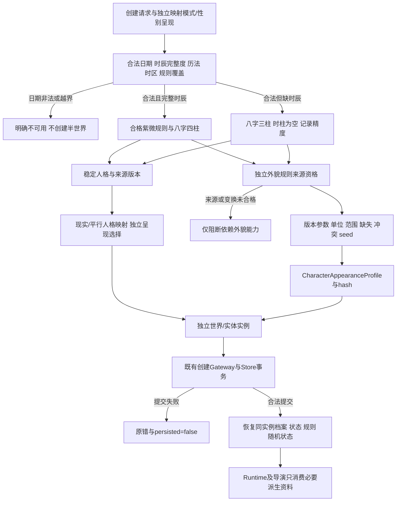

### 10.5 五类现实动物与生命数据

**业务职责：**来源合格、适合首区、恰五类型的版本化名录及真实物种实例；形态/状态/行为/数据资格可追溯。

**责任边界：**不预设具体名单，不以五物种/五图片/五模型替代五类型；不扩建动物后台；死亡繁殖完整食物网非当前必达全覆盖。

**适用阶段与依赖：**完整产品MVP必要；不阻塞不消费动物的自然世界或人物最小行动。

#### 10.5.1 子组件输入、执行、输出与验收

##### ARCH-DETAIL-05-01 五类动物分类名录

**责任组件：**生态数据与来源

**输入：**当前区域事实、来源资格、拟定分类层级；不得预猜具体动物名单

**处理顺序：**

1. 在单一版本AnimalRoster中确定恰好五个唯一animalTypeId
2. 每类关联至少一个真实speciesId/学名与来源
3. 冻结分类层级/别名判定及内容hash

**输出：**rosterVersion/five animalTypeIds/speciesId/来源/适用生境/支持状态/完整度/hash

**正向验收：**数量以唯一类型计且每类有真实物种与分类依据

**反向验收：**别名/颜色/图片/个体/模型数量不增加类型数；名录外生物拒绝

**失败与恢复：**名录未定标记不可用于正式生命能力，不从历史候选枚举凑足五类。

**依赖：**按本模块资料和来源合同准入，无额外后置模块前置。

**条款依据：**[BUSINESS_SPEC.md 3.1](BUSINESS_SPEC.md)；[ARCHITECTURE.md 4.1](ARCHITECTURE.md)；[AI_PAINTER_FORMAL_IMPLEMENTATION_SPEC.md 18.3](game-world-generation/AI_PAINTER_FORMAL_IMPLEMENTATION_SPEC.md)；[TRAINING_DATA_AND_SOURCE_POLICY.md 11.1](game-world-generation/TRAINING_DATA_AND_SOURCE_POLICY.md)

##### ARCH-DETAIL-05-02 真实物种来源与首区生境适用

**责任组件：**生态来源资格／区域事实

**输入：**speciesId、真实分布/生境/活动范围/尺度/来源版本与权利、当前首区事实

**处理顺序：**

1. 区分区域分布事实与游戏抽象
2. 核验物种与当前区域、环境条件兼容
3. 保留来源hash/采集时间/许可和派生关系

**输出：**可使用物种事实与生境准入条件；资料缺失清单

**正向验收：**每个发布物种在首区有合格来源和适用生境依据

**反向验收：**错误生境/范围外物种注入失败；文字许可不冒充图像训练权

**失败与恢复：**不合格来源只留元信息或研究候选；阻断依赖物种，不替换为相似图片。

**依赖：**ARCH-DETAIL-05-01

**条款依据：**[BUSINESS_SPEC.md 3.1](BUSINESS_SPEC.md)；[ARCHITECTURE.md 4.1](ARCHITECTURE.md)；[AI_PAINTER_FORMAL_IMPLEMENTATION_SPEC.md 18.3](game-world-generation/AI_PAINTER_FORMAL_IMPLEMENTATION_SPEC.md)；[TRAINING_DATA_AND_SOURCE_POLICY.md 11.1](game-world-generation/TRAINING_DATA_AND_SOURCE_POLICY.md)；[TRAINING_DATA_AND_SOURCE_POLICY.md 11.1 来源与事实边界](game-world-generation/TRAINING_DATA_AND_SOURCE_POLICY.md)

##### ARCH-DETAIL-05-03 物种形态、尺度与个体身份

**责任组件：**生命实体／物种档案

**输入：**合格物种、形态参数单位/范围、个体生成seed、世界实例身份

**处理顺序：**

1. 定义物种支持的稳定形态参数及有界个体差异
2. 分配稳定entityId并绑定档案hash
3. 将初始体型与之后营养等状态分开

**输出：**物种/个体档案及entityId/profileHash；空间占用/接地等派生依据

**正向验收：**同个体跨tick/恢复不换形态；不同合法个体可区分

**反向验收：**不同物种不套人类统一尺度；刷新/seed变化不重写既存身份

**失败与恢复：**参数无来源/单位或档案冲突时不可用，不用零值补齐。

**依赖：**ARCH-DETAIL-05-02

**条款依据：**[BUSINESS_SPEC.md 3.1](BUSINESS_SPEC.md)；[ARCHITECTURE.md 4.1](ARCHITECTURE.md)；[AI_PAINTER_FORMAL_IMPLEMENTATION_SPEC.md 18.3](game-world-generation/AI_PAINTER_FORMAL_IMPLEMENTATION_SPEC.md)；[TRAINING_DATA_AND_SOURCE_POLICY.md 11.1](game-world-generation/TRAINING_DATA_AND_SOURCE_POLICY.md)；[AI_PAINTER_FORMAL_IMPLEMENTATION_SPEC.md 18.4](game-world-generation/AI_PAINTER_FORMAL_IMPLEMENTATION_SPEC.md)

##### ARCH-DETAIL-05-04 物种生命状态、症状与合法转移

**责任组件：**生命规则数据

**输入：**物种/形态、健康/营养/疲劳/活动状态、原因事件、资源及环境约束

**处理顺序：**

1. 分离真实生物依据与游戏抽象规则
2. 为物种定义支持状态/动作/可见体征/不适用项
3. 定义有原因、合法范围和前态条件的状态转移

**输出：**版本化状态/体征/动作约束；健康→患病→恢复与活动→休息→活动适用路径

**正向验收：**覆盖已声明物种的合法序列及状态限制对行动的真实影响

**反向验收：**未知症状/非法跳变拒绝；不适用须有依据；不从出生资料推断患病

**失败与恢复：**无来源症状保持未定义，不任意加病种；死亡/繁殖/完整食物网不强制扩入当前五类全覆盖。

**依赖：**ARCH-DETAIL-05-03

**条款依据：**[BUSINESS_SPEC.md 3.1](BUSINESS_SPEC.md)；[ARCHITECTURE.md 4.1](ARCHITECTURE.md)；[AI_PAINTER_FORMAL_IMPLEMENTATION_SPEC.md 18.3](game-world-generation/AI_PAINTER_FORMAL_IMPLEMENTATION_SPEC.md)；[TRAINING_DATA_AND_SOURCE_POLICY.md 11.1](game-world-generation/TRAINING_DATA_AND_SOURCE_POLICY.md)；[AI_PAINTER_FORMAL_IMPLEMENTATION_SPEC.md 18.4](game-world-generation/AI_PAINTER_FORMAL_IMPLEMENTATION_SPEC.md)

##### ARCH-DETAIL-05-05 生态准入、实体创建与空间关系

**责任组件：**世界事实／实体适配

**输入：**AnimalRoster+物种/个体档案+当前区域环境与通行/碰撞事实

**处理顺序：**

1. 校验名录/生境/状态合法性后创建实体候选
2. 验证位置、尺度、占用/碰撞及可执行动作
3. 仅合法候选经Runtime事务进入世界事实

**输出：**WorldFacts生命实体及EntityStateSnapshot，拒绝证据保留

**正向验收：**合法实例可被状态/行动/视觉共同引用

**反向验收：**名录外、错误生境、越界位置/非法占用/跨世界引用拒绝且事实不变

**失败与恢复：**规则或适配缺失阻断动物接入，不把候选dictionary_only标记正式实体。

**依赖：**ARCH-DETAIL-05-01；ARCH-DETAIL-05-04；ARCH-DETAIL-06-05

**条款依据：**[BUSINESS_SPEC.md 3.1](BUSINESS_SPEC.md)；[ARCHITECTURE.md 4.1](ARCHITECTURE.md)；[AI_PAINTER_FORMAL_IMPLEMENTATION_SPEC.md 18.3](game-world-generation/AI_PAINTER_FORMAL_IMPLEMENTATION_SPEC.md)；[TRAINING_DATA_AND_SOURCE_POLICY.md 11.1](game-world-generation/TRAINING_DATA_AND_SOURCE_POLICY.md)；[AI_PAINTER_FORMAL_IMPLEMENTATION_SPEC.md 18.6 / MVP-VIS-06/08](game-world-generation/AI_PAINTER_FORMAL_IMPLEMENTATION_SPEC.md)

##### ARCH-DETAIL-05-06 生命图像与时序样本资格

**责任组件：**生命数据包

**输入：**个体/状态事实及其hash、姿态/位置/遮挡、来源合格完整RGB与权利

**处理顺序：**

1. 按既有正式目录建立独立packageId
2. 逐样本绑定实体/档案/状态/tick/帧hash及质量/语义结果
3. 时序记录sequenceId/前后状态/变化事实/间隔并拒绝非法跳变正样本

**输出：**可审核的生命静态/时序数据包及完整覆盖审计

**正向验收：**每个发布类型和支持状态有固定正反样例及跨场景覆盖

**反向验收：**64自然地图不证明生命数据充分；同角色背景变化不算独立个体；无图像许可拒绝

**失败与恢复：**缺资料保留缺口清单；不复制自然地图包或新建平行数据根。

**依赖：**ARCH-DETAIL-05-03；ARCH-DETAIL-05-04

**条款依据：**[TRAINING_DATA_AND_SOURCE_POLICY.md 11.1](game-world-generation/TRAINING_DATA_AND_SOURCE_POLICY.md)；[AI_PAINTER_FORMAL_IMPLEMENTATION_SPEC.md 18.5](game-world-generation/AI_PAINTER_FORMAL_IMPLEMENTATION_SPEC.md)

##### ARCH-DETAIL-05-07 身份／谱系／序列四split隔离

**责任组件：**数据分配与独立验收

**输入：**生命数据包、身份/个体/谱系/完整序列与历史暴露信息

**处理顺序：**

1. 在train/validation/challenge/regression分配前按身份/个体/同谱系/完整序列分组
2. 同时满足地图来源窗口隔离与权利约束
3. 冻结覆盖数量/状态组合/审核阈值及独立测试集合

**输出：**split manifest、泄漏/重复检查与覆盖报告，真实SHA

**正向验收：**四split分组互斥且所有声明状态/类型覆盖可追溯

**反向验收：**相邻帧/同角色换背景/裁切增强跨split与暴露challenge用于选择均拒绝

**失败与恢复：**发现泄漏形成新包/新资格，原失败与暴露记录保留；不为补数字跨组。

**依赖：**ARCH-DETAIL-05-06

**条款依据：**[TRAINING_DATA_AND_SOURCE_POLICY.md 11.1](game-world-generation/TRAINING_DATA_AND_SOURCE_POLICY.md)；[AI_PAINTER_FORMAL_IMPLEMENTATION_SPEC.md 18.5](game-world-generation/AI_PAINTER_FORMAL_IMPLEMENTATION_SPEC.md)

##### ARCH-DETAIL-05-08 动物状态输出与生命能力交接

**责任组件：**生态／Runtime／Painter边界

**输入：**合格名录/实体状态/档案及生命数据包；实体状态事实已合法提交

**处理顺序：**

1. 交给同一生命状态/视觉管线消费
2. 明确生态事实、Runtime状态、可见体征和RGB的责任
3. 按实际支持状态逐物种验收，不让动物资格阻断不消费动物的早期人物最小行动

**输出：**绑定同world/region/entity/tick及来源身份的生命视觉输入与验收覆盖

**正向验收：**完整MVP五类实际接入并逐类验证；早期自然/人物验收记录自身适用范围

**反向验收：**不以自然地图能力、历史生态候选或模型数量替代五类生命能力

**失败与恢复：**缺哪个物种/状态合同就阻断该依赖能力，保留其余已合格能力。

**依赖：**ARCH-DETAIL-05-05；ARCH-DETAIL-05-07；ARCH-DETAIL-06-07

**条款依据：**[BUSINESS_SPEC.md 3.1](BUSINESS_SPEC.md)；[ARCHITECTURE.md 4.1](ARCHITECTURE.md)；[AI_PAINTER_FORMAL_IMPLEMENTATION_SPEC.md 18.3](game-world-generation/AI_PAINTER_FORMAL_IMPLEMENTATION_SPEC.md)；[TRAINING_DATA_AND_SOURCE_POLICY.md 11.1](game-world-generation/TRAINING_DATA_AND_SOURCE_POLICY.md)；[AI_PAINTER_FORMAL_IMPLEMENTATION_SPEC.md 18.6 / MVP-VIS-06/08](game-world-generation/AI_PAINTER_FORMAL_IMPLEMENTATION_SPEC.md)

#### 10.5.2 需要具体化的版本合同

以下内容必须在相应来源、数据、模型或Runtime合同中具体化并取得验证，才能执行依赖它的能力；不在总体架构中编造数值或替代算法。

- **五类型分类名录：**需要版本化唯一名录、准确分类层级/五ID/真实代表物种学名、别名去重、来源与首区资格；本稿不指定名单。
- **物种—首区环境准入：**需要物种分布/生境/活动范围事实与区域当前条件的可执行匹配规则；来源事实与游戏抽象分开。
- **物种形态和量纲：**需要各物种形态/尺度/个体差异、单位范围精度/缺失/合法组合，明确稳定形态与营养变化的边界。
- **状态、症状、动作与转移：**需要每种适用状态/可见症状/原因事件/动作限制/N-A依据/资源环境约束及转移规则；不虚构病种、不统一套人类动作。
- **动物实体接入迁移：**明确闭集WorldEntity/lifecycle/visual适配及持久化版本迁移方案；沿既有入口，不能另建动物后台/平行存档。
- **生命数据数量、组合、隔离与审核阈值：**需要每个发布类型/状态/身份/场景/序列覆盖、具体张数、四split分组/谱系隔离与正反样例；缺值不能以64自然图替代。
- **生命条件与兼容版本：**需要明确生命输入通道/schema、稳定身份/状态/体征/遮挡接地/时序约束、责任映射/兼容与反例；不能偷自然物通道。

#### 10.5.3 详细流程与异常分支

图表示正式目标及条件依赖，不表示当前所有节点已经实现或验收。

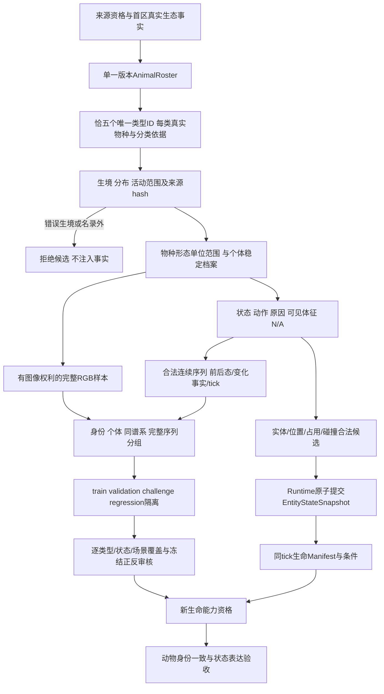

### 10.6 生命视觉与动态Runtime

**业务职责：**人格/记忆驱动合法行动、状态与资源变化、再决策；事实一致的生命时序视觉、严格审核及双事务发布恢复。

**责任边界：**Runtime决定事实，Painter表达事实；建设后置；固定脚本或空模型调用不冒称世界模型能力；不凭静态图宣称动态MVP。

**适用阶段与依赖：**先非建设人物行动反馈；动物/生命体征按各自资格接入；完整MVP另需所有适用环节。

#### 10.6.1 子组件输入、执行、输出与验收

##### ARCH-DETAIL-06-01 同世界同tick生命快照

**责任组件：**Runtime事实

**输入：**worldId/regionId/entityId/tick/stateVersion/profileHash/species/位置/朝向/动作/健康营养疲劳/原因/前态hash

**处理顺序：**

1. 恢复可信前态及规则版本
2. 读取当前环境与已提交事件
3. 形成候选状态计算所消费的一致快照，稳定档案不被状态改写

**输出：**EntityStateSnapshot与档案/事件/随机状态身份

**正向验收：**所有下游输入引用同一已验证世界/实体/状态与tick

**反向验收：**缺失不填0/健康/静止；跨tick/profileHash或断裂前态拒绝

**失败与恢复：**读取缺失或损坏不重置新世界，保存具体失败并停止依赖推进。

**依赖：**ARCH-DETAIL-04-04；ARCH-DETAIL-05-04，仅当快照包含动物时

**条款依据：**[BUSINESS_SPEC.md 3.1](BUSINESS_SPEC.md)；[ARCHITECTURE.md 4.1](ARCHITECTURE.md)；[AI_PAINTER_FORMAL_IMPLEMENTATION_SPEC.md 18.4](game-world-generation/AI_PAINTER_FORMAL_IMPLEMENTATION_SPEC.md)；[AI_PAINTER_FORMAL_IMPLEMENTATION_SPEC.md 18.6 / MVP-VIS-06/08](game-world-generation/AI_PAINTER_FORMAL_IMPLEMENTATION_SPEC.md)

##### ARCH-DETAIL-06-02 感知、目标与可解释候选决策

**责任组件：**角色自主／本地模型

**输入：**稳定人格+同tick世界事实+相关历史+当前生命状态+长期目标及受控随机身份

**处理顺序：**

1. 感知资源/环境与自身状态
2. 构建动机和可执行目标
3. 本地模型在声明责任内产候选决策，程序保留候选/理由/输入输出及模型身份

**输出：**可解释的合法行动候选，不直接写WorldFacts

**正向验收：**冻结同环境/受控随机重复场景证明人格倾向，非每次机械一致

**反向验收：**两次随机动作不同/空模型调用不证明性格或模型有效；无合格行动可等待并记录原因

**失败与恢复：**推理故障/资源不足按合同停止，不能以规则脚本冒称模型能力。

**依赖：**ARCH-DETAIL-06-01

**条款依据：**[BUSINESS_SPEC.md 3.2](BUSINESS_SPEC.md)；[AI_PAINTER_FORMAL_IMPLEMENTATION_SPEC.md 18.6 / MVP-VIS-05](game-world-generation/AI_PAINTER_FORMAL_IMPLEMENTATION_SPEC.md)；[LOCAL_SELF_DEVELOPED_AI_CAPABILITY_AND_CODEX_MIGRATION_ARCHITECTURE.md 0.8.1](LOCAL_SELF_DEVELOPED_AI_CAPABILITY_AND_CODEX_MIGRATION_ARCHITECTURE.md)；[BUSINESS_SPEC.md WORLD-AUTO-002](BUSINESS_SPEC.md)

##### ARCH-DETAIL-06-03 非建设最小行动与状态约束

**责任组件：**Runtime行动校验

**输入：**候选行动、物种/角色动作合同、当前位置/通行/碰撞、生命状态、资源与环境规则

**处理顺序：**

1. 先验证不消费房屋/动物的角色最小行动集合
2. 校验动作前提、状态限制、空间合法性、资源预算
3. 输出成功/受限/拒绝及状态/资源候选变化

**输出：**合法行动结果与原因，禁止模型或Painter越权决定成功

**正向验收：**合法行动确实改变声明状态；健康/疲劳等限制影响行动结果

**反向验收：**不合法动作、越界/碰撞/缺资源拒绝且不扣资源；不预留家园和人工道路

**失败与恢复：**无规则或状态不可用时拒绝依赖动作；不自动转施工以凑闭环。

**依赖：**ARCH-DETAIL-06-02；ARCH-DETAIL-05-04，仅当动物或物种生命状态动作时

**条款依据：**[BUSINESS_SPEC.md 3.2](BUSINESS_SPEC.md)；[AI_PAINTER_FORMAL_IMPLEMENTATION_SPEC.md 18.6 / MVP-VIS-05](game-world-generation/AI_PAINTER_FORMAL_IMPLEMENTATION_SPEC.md)；[LOCAL_SELF_DEVELOPED_AI_CAPABILITY_AND_CODEX_MIGRATION_ARCHITECTURE.md 0.8.1](LOCAL_SELF_DEVELOPED_AI_CAPABILITY_AND_CODEX_MIGRATION_ARCHITECTURE.md)；[BUSINESS_SPEC.md 3.1](BUSINESS_SPEC.md)；[ARCHITECTURE.md 4.1](ARCHITECTURE.md)；[AI_PAINTER_FORMAL_IMPLEMENTATION_SPEC.md 18.4](game-world-generation/AI_PAINTER_FORMAL_IMPLEMENTATION_SPEC.md)

##### ARCH-DETAIL-06-04 生命状态变化与连续因果

**责任组件：**Runtime状态转移

**输入：**同实体前态、合法行动/环境事件、版本化状态规则、时间跨度

**处理顺序：**

1. 按前态和原因产生状态候选
2. 保证健康/活动/营养变化与稳定形态区分
3. 逐tick关联事件与前态hash并给出可见变化事实

**输出：**至少3个合法连续tick的状态链，适用健康→患病→恢复和活动→休息→活动

**正向验收：**身份稳定、每次变化有合法原因，状态限制被真实执行

**反向验收：**非法跳变/无原因换体型/出生资料判现实疾病拒绝；未知症状不伪造

**失败与恢复：**状态规则缺失不以图片噪声或随机值补；停止依赖状态能力并保留原态。

**依赖：**ARCH-DETAIL-06-03；ARCH-DETAIL-05-04，仅当物种状态时

**条款依据：**[BUSINESS_SPEC.md 3.1](BUSINESS_SPEC.md)；[ARCHITECTURE.md 4.1](ARCHITECTURE.md)；[AI_PAINTER_FORMAL_IMPLEMENTATION_SPEC.md 18.4](game-world-generation/AI_PAINTER_FORMAL_IMPLEMENTATION_SPEC.md)

##### ARCH-DETAIL-06-05 状态、行动、资源、事件原子提交

**责任组件：**Runtime Store／幂等协议

**输入：**worldId+tick+expectedStateVersion及行动幂等身份/合法候选状态/资源/事件

**处理顺序：**

1. 检查身份/版本/前态和并发条件
2. 仅合法结果作为同一事务提交状态、行动、资源与事件
3. 持久化失败或冲突不得上报推进成功

**输出：**一次已提交状态与事件位置，重复请求不再扣资源

**正向验收：**相同幂等请求不重复行动/资源事务，恢复后仍成立

**反向验收：**tick/stateVersion冲突、半提交、读故障与并发拒绝；普通tick不得隐式初始化

**失败与恢复：**按事务journal完成同一合法修订或恢复上一完整状态；保留首错，不将Store失败伪装成功。

**依赖：**ARCH-DETAIL-06-03

**条款依据：**[ARCHITECTURE.md 4.1](ARCHITECTURE.md)；[AI_PAINTER_FORMAL_IMPLEMENTATION_SPEC.md 18.6 / MVP-VIS-06/08](game-world-generation/AI_PAINTER_FORMAL_IMPLEMENTATION_SPEC.md)；[BUSINESS_SPEC.md 3.2](BUSINESS_SPEC.md)；[AI_PAINTER_FORMAL_IMPLEMENTATION_SPEC.md 18.6 / MVP-VIS-05](game-world-generation/AI_PAINTER_FORMAL_IMPLEMENTATION_SPEC.md)；[LOCAL_SELF_DEVELOPED_AI_CAPABILITY_AND_CODEX_MIGRATION_ARCHITECTURE.md 0.8.1](LOCAL_SELF_DEVELOPED_AI_CAPABILITY_AND_CODEX_MIGRATION_ARCHITECTURE.md)

##### ARCH-DETAIL-06-06 记忆提交、相关历史读取与再决策

**责任组件：**角色记忆／世界历史

**输入：**已提交事实/原因/前后态、受控历史摘要、事件游标及下次计算相关历史

**处理顺序：**

1. 行动成功或失败后按合同生成记忆效果
2. 将可恢复记忆与事件位置保存
3. 在相关后继场景实际读取记忆参与再决策并冻结历史对照

**输出：**可恢复记忆及输入到后继决策的消费证据；不要求每次写模型权重

**正向验收：**历史相关场景的受控对照说明影响；历史不相关不强求不同结果

**反向验收：**只存日志/偏好函数不被调用不算闭环；重复事件不二次学习/扣资源

**失败与恢复：**缺记忆只报告对应机制和场景；不把单个旧存档失败扩大成全世界机制失败。

**依赖：**ARCH-DETAIL-06-05

**条款依据：**[BUSINESS_SPEC.md 3.2](BUSINESS_SPEC.md)；[AI_PAINTER_FORMAL_IMPLEMENTATION_SPEC.md 18.6 / MVP-VIS-05](game-world-generation/AI_PAINTER_FORMAL_IMPLEMENTATION_SPEC.md)；[LOCAL_SELF_DEVELOPED_AI_CAPABILITY_AND_CODEX_MIGRATION_ARCHITECTURE.md 0.8.1](LOCAL_SELF_DEVELOPED_AI_CAPABILITY_AND_CODEX_MIGRATION_ARCHITECTURE.md)；[BUSINESS_SPEC.md WORLD-AUTO-003/004](BUSINESS_SPEC.md)

##### ARCH-DETAIL-06-07 生命VisualFactManifest与条件编译

**责任组件：**世界导演／条件适配

**输入：**已提交同tick EntityStateSnapshot+档案hash+可见体征/遮挡/接地/变化事实/不可变身份

**处理顺序：**

1. 由事实派生生命视觉清单，不从RGB反推健康
2. 发布显式生命条件schema与版本、通道/兼容规则/责任映射
3. 拒绝跨世界/tick/实体或未知状态，保持null语义

**输出：**生命VisualFactManifest、条件hash及EntityVisualBinding所需身份

**正向验收：**清单逐对象与真实快照一致且缺失显式不可用

**反向验收：**禁止占用object_tree/rock/vegetation自然通道；缺状态不填零；不能由Painter补事实

**失败与恢复：**编译失败不启动依赖GPU，不更改已提交事实。

**依赖：**ARCH-DETAIL-06-01；ARCH-DETAIL-06-05；ARCH-DETAIL-04-07，仅当含人物初始外貌时；ARCH-DETAIL-05-05，仅当含动物时

**条款依据：**[BUSINESS_SPEC.md 3.1](BUSINESS_SPEC.md)；[ARCHITECTURE.md 4.1](ARCHITECTURE.md)；[AI_PAINTER_FORMAL_IMPLEMENTATION_SPEC.md 18.4](game-world-generation/AI_PAINTER_FORMAL_IMPLEMENTATION_SPEC.md)；[AI_PAINTER_FORMAL_IMPLEMENTATION_SPEC.md 18.6 / MVP-VIS-06/08](game-world-generation/AI_PAINTER_FORMAL_IMPLEMENTATION_SPEC.md)

##### ARCH-DETAIL-06-08 生命静态／时序能力资格与资源合同

**责任组件：**本地训练／验证／机器审核

**输入：**合格生命数据与四split、生命条件/模型/Loss/审核身份、基础资产谱系及资源合同

**处理顺序：**

1. 明确共享底座或隔离组件的实际版本责任，不预猜模型数量/架构
2. 完成CPU→只读GPU→受控Smoke→适用全数据筛查→Stage0/1/2→独立challenge/regression
3. 冻结tick与视觉采样频率、延迟/内存显存磁盘/超时/尝试次数与恢复策略

**输出：**真实成功终态、父Checkpoint实际加载hash、能力资格与资源证据

**正向验收：**按256×192→512×384→1024×768连续合格阶段与独立复验确认当前能力

**反向验收：**自然地图AE/旧成功不继承生命资格；失败权重不晋级；资源缺值不得消费

**失败与恢复：**保留失败并走合同内有界恢复/新能力身份；不能原样无限重跑或降低审核门。

**依赖：**ARCH-DETAIL-06-07；ARCH-DETAIL-05-07，仅当动物能力训练/发布时；ARCH-DETAIL-04-06，仅当人物外貌能力时

**条款依据：**[TRAINING_DATA_AND_SOURCE_POLICY.md 11.1](game-world-generation/TRAINING_DATA_AND_SOURCE_POLICY.md)；[AI_PAINTER_FORMAL_IMPLEMENTATION_SPEC.md 18.5](game-world-generation/AI_PAINTER_FORMAL_IMPLEMENTATION_SPEC.md)；[BUSINESS_SPEC.md 3.1](BUSINESS_SPEC.md)；[ARCHITECTURE.md 4.1](ARCHITECTURE.md)；[AI_PAINTER_FORMAL_IMPLEMENTATION_SPEC.md 18.4](game-world-generation/AI_PAINTER_FORMAL_IMPLEMENTATION_SPEC.md)

##### ARCH-DETAIL-06-09 同身份多态原生完整RGB与严格审核

**责任组件：**AI Painter／VisualJudge

**输入：**已合格能力、真实快照及条件/档案/实体身份、资源额度

**处理顺序：**

1. 按采样策略从同tick事实生成原生完整RGB
2. 产出EntityVisualBinding的候选/实体/轮廓占用/状态引用/审核引用
3. 审核身份、形态、健康可见性、空间/碰撞、语义和质量，保留所有拒绝候选

**输出：**合格或失败候选与独立审核证据；至少3tick的同实体连续表达

**正向验收：**形态稳定、支持体型可分、状态可辨且不凭空增物；正式分辨率1024×768

**反向验收：**逐帧换人/名录外动物/未知体征/局部贴图冒充新完整帧/错world或tick拒绝；像素相似不能替代身份健康审核

**失败与恢复：**视觉失败不回滚合法事实；没有合格当前帧时阻断当前展示，旧帧只作标明旧tick历史。

**依赖：**ARCH-DETAIL-06-08；ARCH-DETAIL-06-07

**条款依据：**[BUSINESS_SPEC.md 3.1](BUSINESS_SPEC.md)；[ARCHITECTURE.md 4.1](ARCHITECTURE.md)；[AI_PAINTER_FORMAL_IMPLEMENTATION_SPEC.md 18.4](game-world-generation/AI_PAINTER_FORMAL_IMPLEMENTATION_SPEC.md)；[AI_PAINTER_FORMAL_IMPLEMENTATION_SPEC.md 18.6 / MVP-VIS-06/08](game-world-generation/AI_PAINTER_FORMAL_IMPLEMENTATION_SPEC.md)；[AI_PAINTER_FORMAL_IMPLEMENTATION_SPEC.md 18.6 定量审核门槛](game-world-generation/AI_PAINTER_FORMAL_IMPLEMENTATION_SPEC.md)

##### ARCH-DETAIL-06-10 帧发布、保存重入与恢复

**责任组件：**Runtime发布／Store／展示闸门

**输入：**已提交事实事务与通过审核视觉候选的双向引用、当前world/tick/能力与持久存档

**处理顺序：**

1. 分别核对事实事务成功与候选审核，不混为一个成功布尔
2. 原子登记当前合格帧指针
3. 保存恢复同一实体/档案/规则/状态/事件位置/RNG，并继续合法推进

**输出：**同世界同tick合格发布、可恢复存档、拒绝/恢复证据

**正向验收：**关闭重入/服务器中断恢复后身份和状态一致且不重复行动/资源消耗

**反向验收：**半提交、跨能力/世界/tick注入、失败候选和旧图冒充新tick拒绝；当前无帧准确阻断

**失败与恢复：**保持上一有效发布身份及明确旧tick；恢复同一事务，不能用latest历史指针推断当前合法世界。

**依赖：**ARCH-DETAIL-06-05；ARCH-DETAIL-06-09；ARCH-DETAIL-06-06

**条款依据：**[ARCHITECTURE.md 4.1](ARCHITECTURE.md)；[AI_PAINTER_FORMAL_IMPLEMENTATION_SPEC.md 18.6 / MVP-VIS-06/08](game-world-generation/AI_PAINTER_FORMAL_IMPLEMENTATION_SPEC.md)

#### 10.6.2 需要具体化的版本合同

以下内容必须在相应来源、数据、模型或Runtime合同中具体化并取得验证，才能执行依赖它的能力；不在总体架构中编造数值或替代算法。

- **状态、症状、动作与转移：**需要每种适用状态/可见症状/原因事件/动作限制/N-A依据/资源环境约束及转移规则；不虚构病种、不统一套人类动作。
- **生命数据数量、组合、隔离与审核阈值：**需要每个发布类型/状态/身份/场景/序列覆盖、具体张数、四split分组/谱系隔离与正反样例；缺值不能以64自然图替代。
- **生命快照与运行字段：**目标字段已在架构§4.1列出；需要可执行schema、版本/范围/空值/组合与迁移合同及当前接口适配，不能将目标字段写成现有字段。
- **模型参与与人格倾向验证：**需要真实本地模型消费人格/环境/历史的输入输出与责任边界、冻结同环境/随机对照与重复试验定义；不预定模型数量架构。
- **前期非建设最小行动集合：**需要明确可检验的动作ID/前提/状态限制/空间资源影响/失败语义；建设不反向成为前期人格行动前提。
- **记忆机制的权威与实际消费：**角色偏好、空间痕迹等已声明记忆须分别明确权威状态、实际调用、保存恢复、消费与对照；单个实例失败的结论保持其证据适用范围。
- **生命条件与兼容版本：**需要明确生命输入通道/schema、稳定身份/状态/体征/遮挡接地/时序约束、责任映射/兼容与反例；不能偷自然物通道。
- **生命模型/Loss/审核资格：**需要版本化生命职责、实际模型配置/共享或隔离实现、Loss与审核映射、资产角色/父权重及资格门；本文不杜撰模型结构。
- **tick与采样及资源恢复预算：**具体更新间隔、采样频率、延迟预算、内存显存磁盘上限、超时/尝试次数/恢复策略须预先版本化；无值不消费资源。
- **身份/健康/时序语义审核：**需要可靠审核器、公式单位比较符范围阈值与标注正反例；像素相似不替代身份/健康，缺可靠审核不能发布。
- **生命状态事务及全量恢复：**现有Store机制与目标生命保存边界需适配；明确人格/外貌/规则/状态/事件游标/RNG的恢复与双事务引用/断电反例，不能凭隔离组件通过判生产资格。

#### 10.6.3 详细流程与异常分支

图表示正式目标及条件依赖，不表示当前所有节点已经实现或验收。

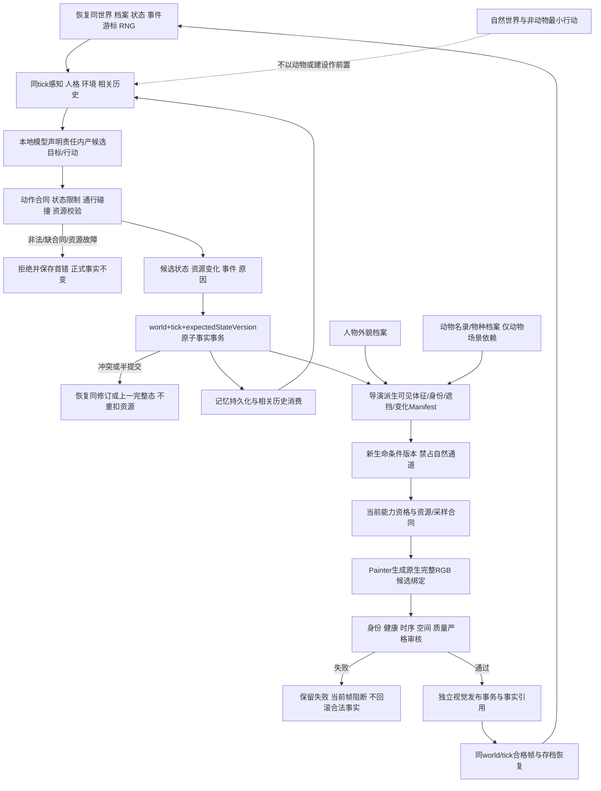

### 10.7 世界生成、持续演化、记忆与游戏集成

**业务职责与范围：**服务器持有世界身份、事实、当前状态和历史；本地模型计算合法边界内的候选演化，程序校验并持久提交，Painter表达已提交状态。用户客户端读画面并提交允许的交互；全体用户下线不暂停世界。先自然世界，再接人格行动、动物与建设。

**输入身份及字段：**

- 初创身份：ownerId、playerId、worldId、worldSeed、worldProfileId、regionId及ruleVersion；真实来源包的空间、时间、许可和内容摘要。
- 演化任务：同一世界已提交状态和事实摘要、逻辑时间/时间跨度、相关历史事件或有来源的摘要、能力/模型版本、资源与调度策略。
- 交互：经认证的主体、目标世界/实体、动作、预期版本与幂等身份；不能直接提交任意新WorldFacts。
- 视觉：同一世界状态派生的Manifest、导演和条件；只消费适用的正式能力和审核结果。


**交付输出：**

- 自然存档：natural-world-runtime-save-v1及facts/state封套，实际来源、RNG、eventCursor、tick/stateVersion和三类内容摘要。
- 演化候选及裁决、已提交状态与原因/历史链、独立保存恢复证据。
- 绑定world/owner/tick/stateVersion/事实与模型审核的RuntimeFrame，或具体未发布/陈旧/阻断信息。
- 自然世界和完整产品分范围的端到端验收；未接入模块不伪造角色、动物或默认家园。


**正式依据：**

- [BUSINESS_SPEC.md WORLD-AUTO-001至004、§3.2、§4—5、§9—10](BUSINESS_SPEC.md)
- [ARCHITECTURE.md §2.0.1、§3.2、§4.1—4.3、§7](ARCHITECTURE.md)
- [game-world-generation/AI_PAINTER_FORMAL_IMPLEMENTATION_SPEC.md §18](game-world-generation/AI_PAINTER_FORMAL_IMPLEMENTATION_SPEC.md)
- [game-world-generation/TRAINING_DATA_AND_SOURCE_POLICY.md §4](game-world-generation/TRAINING_DATA_AND_SOURCE_POLICY.md)

#### 10.7.1 子组件输入、执行、输出与验收

##### ARCH-DETAIL-07-01 来源与区域自然化

**输入：**适用于当前地域的测量/地形/水文/气候/生态来源

**处理：**核对地域、单位、时间、许可及自然化政策；气候均值作背景，模拟初始天气与实测天气分开。

**输出：**可追溯区域来源与可用/缺失事实

**验收与反例：**别的区域/时期均值不能静默替代；不从旧训练PNG或蓝图移植几何。

##### ARCH-DETAIL-07-02 固定世界与初次事实生成

**输入：**显式世界身份、seed、来源与规则

**处理：**生成匿名游戏几何、地形/对象/通行/碰撞事实；捕获实际随机状态，建立同tick视觉任务和23通道。

**输出：**初始事实/状态及完整来源侧车

**验收与反例：**所有产物同world/region/tick；无RGB也能成立事实，不依赖旧latest或人物homeMap。

##### ARCH-DETAIL-07-03 自然存档与基线恢复

**输入：**事实/状态、规则、RNG、游标和来源绑定

**处理：**按§4.2重算完整摘要；初创CAS为-1/-1/null，锁内写入并独立读回。

**输出：**同一世界已提交初态及恢复回执

**验收与反例：**错world/hash、并发、跨格式覆盖和损坏存档拒绝；保存不得改变地形。

##### ARCH-DETAIL-07-04 服务器有界调度

**输入：**已部署能力、已提交时间与资源策略

**处理：**服务器形成有界任务，不以客户端会话驱动；固定更新间隔、时长、尝试、恢复和维护后的时间处理。

**输出：**有身份、前态和预算的演化任务

**验收与反例：**无客户端仍可运行；服务存活和tick空增不是实际推进；策略缺失不臆造耗时与补算。

##### ARCH-DETAIL-07-05 历史选择与模型输入

**输入：**当前状态及有来源的历史链/摘要

**处理：**按任务选择有限相关历史，保留实际消费身份；区分逻辑时间、记录时间与数据时间，防止未来目标混入。

**输出：**可复现的状态/历史/时间跨度输入

**验收与反例：**日志写入但未被模型读取不能算记忆；历史可索引但不能丢失连续性来源。

##### ARCH-DETAIL-07-06 本地模型演化推理

**输入：**合法输入、版本化模型/权重及能力范围

**处理：**模型计算候选状态差量及原因关联；标记观测与预测，限定可改变字段。

**输出：**未提交的候选差量、真实模型输入/输出与随机状态

**验收与反例：**模型空调用、拷贝已知未来观测或手写全部变化公式不能算学习演化；共享/独立模型由版本实现决定。

##### ARCH-DETAIL-07-07 自然状态合法性校验

**输入：**候选、已提交前态、固定规则与事件身份

**处理：**核对身份、前态摘要、时间顺序、单位/范围、允许变更、事件防重与资源消耗；审核拒绝时不动正式状态。

**输出：**可执行变更或带原因拒绝

**验收与反例：**旧人物Validator不得不经适配就宣称覆盖自然变化；Schema有效不等于语义合法。

##### ARCH-DETAIL-07-08 原子提交与历史续接

**输入：**通过校验的变化、预期版本及新历史关联

**处理：**复用同一Store锁/事务/CAS；状态、事件和记忆按可恢复提交协议关联；更新版本并保持稳定身份。

**输出：**完整提交或保留失败的可恢复终态

**验收与反例：**不得重复消费/丢事件/制造半提交；rename后失败应核对实际提交而非再次扣资源。

##### ARCH-DETAIL-07-09 状态对应的画面发布

**输入：**已提交事实/状态与适用Painter

**处理：**派生Manifest/条件，生成审核后独立发布帧；绑定世界和tick，不让RGB反向改事实。

**输出：**合法当前帧或明确视觉失败/旧帧身份

**验收与反例：**动态状态不能套tick0初始化验证器；无合法当前帧遵守/world展示门，旧帧不冒充新tick。

##### ARCH-DETAIL-07-10 客户端交互与感知

**输入：**正式RuntimeFrame与允许动作

**处理：**读取真实通行/碰撞/交互层；动作进入服务器校验，客户端不能直接改正式状态。

**输出：**行动结果及新状态/画面引用

**验收与反例：**跨world、过期版本、重复动作和未发布帧拒绝；客户端断开不停止服务器。

##### ARCH-DETAIL-07-11 恢复与独立验收

**输入：**最后有效提交、事件游标/RNG/模型/规则版本

**处理：**恢复同一世界，核对中断步骤与已消费事件；按冻结条件验证历史作用、无会话推进和重启。

**输出：**可核验的同世界连续运行证据

**验收与反例：**同一状态/模型/随机性下做相关历史对照；无关历史不强求变化；自然闭环与完整产品分别裁决。

#### 10.7.2 接口、恢复与依赖

**接口合同：**

- 事实封套natural-world-facts-snapshot-v1包含terrainRegions/objectFootprints/walkableRegions/collisionRegions；状态封套natural-world-state-snapshot-v1包含environment/objects/resources，未知显式表达。
- 原Store的expectedTick、expectedStateVersion、expectedFileSha256共同防并发覆盖；stateVersion恰加1、tick不倒退并不自动保证每个领域的合法变化，领域Validator须额外约束。
- 演化输入/差量/事件/调度合同必须版本化并具备机器Schema；本章给出责任和必需语义，不把尚未注册的接口写成已部署API。
- worldFactsPayloadSha256、statePayloadSha256、recordContentSha256和实际fileSha256各有范围；绑定前态不能只用不含完整事实的状态摘要。


**失败与恢复：**

- 来源或初创失败：保留已经生成的侧车和实际写入结果，不发布半成品，不重新换种子掩盖失败。
- 前态/事件冲突：拒绝过期结果，重新读取需形成合同允许的新任务，不把旧结果强行覆盖。
- 模型非法输出或预算耗尽：安全停止当前任务、保存失败，已提交状态保持。
- 视觉失败与世界提交分开处理；维护或故障期间没有实际完成的计算不能补写成已执行。
- 存档不可读/事务未完成：明确invalid/阻断，不默认创建空世界。


**模块依赖：**

- 模块1提供身份/事务/资源可靠性，模块3提供本地受管执行与证据；模块2只负责画面。
- 自然世界先行不依赖模块4/5/6；接入人物动物时才增加相应档案、生命条件与独立验收。
- 模块8/9只观察和展示已记录事实，不能成为服务器运行或发布必要依赖。


**集成验收：**

- 固定同一个世界：身份、初始内容、条件、存档和独立恢复证据一致。
- 真实模型计算和合法状态推进成立；相关历史确实消费并通过冻结对照。
- 无客户端会话完成连续有效变化，服务重启后身份/时间/游标/RNG连续且不重复消费。
- 非法输出/失败/过期任务不污染状态；图像和Runtime事实一致，审核及正式发布独立成立。
- 完整产品另按MVP-VIS-01至08和WORLD-AUTO-001至004的全部适用范围验收，不能拿自然首区结果替代。


**执行前须具体化的合同：**

- 最小演化过程需有实际可用时序来源、单位/时间合同、独立划分及基线对照；气象序列不自动监督土壤、植物或全部生态。
- 模型家族、具体演化步长、历史窗口、调度/维护补算和领域数值上限需在对应版本合同冻结后才能执行；这里不捏造数值。
- 自然状态的领域Validator、历史读写与动态视觉条件须分别证明当前实现适用，不能只因存档JSON可容纳字段就认定已实现。


#### 10.7.3 详细流程与异常分支

图表示正式目标及责任，不表示当前所有节点已经实现或验收。

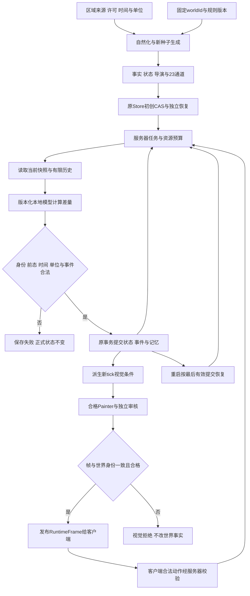

### 10.8 AI控制台与独立平台

**业务职责：**现行/ai-console展示真实任务/训练/审核/数据/Runtime/证据/资源，并提供明确受限登记控制；本地执行不依赖页面或Codex在线。

**责任边界：**

- 十个一级模块、52二级工作页、四业务Frame遵守正式catalog。
- 旧/ai-painter-progress仅永久无状态跳转；新API不得转发旧/api/ai-painter。
- 当前、历史、硬件观测三独立链，不互相补造事实。
- 七类登记执行器不授训练、Shell或游戏世界写权。


**权威记录与状态：**

- current：官方current registry→trusted bridge；四身份分离；不扫描旧目录补当前。
- history：固定来源→独立有界writer→派生history-index-v1.sqlite→只读查询；索引非资格机关。
- platform：data/ai-console固定schema/writer/revision/hash登记库；receipt/event/head/DB联合核对。
- connection：真实固定源空才0/[]；未连接null；partial/unknown_or_stale按覆盖和新鲜度。


#### 10.8.1 子组件输入、执行、输出与验收

##### ARCH-DETAIL-08-01 应用壳、工作页与Frame导航

**输入：**固定模块/工作页catalog；路由/选择/状态

**处理顺序：**

1. 唯一壳承载四业务Frame及ModuleFrame
2. 按页加载
3. 旧路由无状态永久跳转
4. 移动端/键盘保留选择

**输出：**一致标题/导航/分页与连接状态

**验收与反例：**52页对正式catalog验收；catalog不是执行状态；只请求当前页；旧异步响应不覆盖新选项

**失败与恢复：**未知路由明确；局部失败不打断后台

**依赖：**总纲→功能→架构→IA/UI→API→目录阅读链

**条款依据：**[CONPROD 4. 一级页面与路由](ai-console/AI_CONSOLE_FORMAL_PRODUCT_AND_INFORMATION_ARCHITECTURE_SPEC.md)；[CONARCH 3. 前端应用壳架构](ai-console/AI_CONSOLE_ARCHITECTURE_SPEC.md)；[CONUI 7. 二级页面标准](ai-console/AI_CONSOLE_INFORMATION_ARCHITECTURE_AND_UI_STANDARD.md)

##### ARCH-DETAIL-08-02 当前执行与审核可信投影

**输入：**GET /api/ai-console/observability/current-execution；精确registry/包/终态/审核SHA

**处理顺序：**

1. 拒绝run/path/source改当前参数
2. 核对任务/执行/最新训练终态
3. 重算绑定审核
4. 返回同快照原时间

**输出：**四身份独立快照与nextMachineAction投影

**验收与反例：**锁+进程+心跳一致才活动；无目录排序/历史fallback；GET零写；页面不生成下一动作

**失败与恢复：**损坏/过期/冲突unknown_or_stale，保持原因

**依赖：**官方registry读取器/路径安全

**条款依据：**[ARCH 0.5 当前执行身份与状态投影架构](ARCHITECTURE.md)；[CONAPI 3.2.2 AI Painter当前执行受信投影](ai-console/AI_CONSOLE_DATA_DICTIONARY_AND_API_CONTRACT.md)；[CONARCH 5. 依赖规则](ai-console/AI_CONSOLE_ARCHITECTURE_SPEC.md)

##### ARCH-DETAIL-08-03 通用训练进度与真实预览

**输入：**绑定run/plan/package/data/model；实际G/D更新/样本计数/epoch/指标/前向预览

**处理顺序：**

1. 按登记TRAIN-OBS版本适配
2. 分开实际counter与total来源
3. 读取真实前向捕获证据
4. 单项错误局部显示

**输出：**真实摘要/曲线/计数/预览及缺失状态

**验收与反例：**不从epoch猜steps；无总量不算百分比；预览不等于合格图；坏指标不隐藏终态；公共日志只安全代码/计数/源时间

**失败与恢复：**逐产物unsupported/over_limit/hash_conflict/unreadable，不自动猜字段

**依赖：**训练生产者协议/安全读取预算

**条款依据：**[CONAPI 3.2.2 AI Painter当前执行受信投影](ai-console/AI_CONSOLE_DATA_DICTIONARY_AND_API_CONTRACT.md)；[CONAPI 5. 空值与结果合同](ai-console/AI_CONSOLE_DATA_DICTIONARY_AND_API_CONTRACT.md)；[CONAPI 8. API验收](ai-console/AI_CONSOLE_DATA_DICTIONARY_AND_API_CONTRACT.md)

##### ARCH-DETAIL-08-04 历史发现、索引与覆盖

**输入：**固定registry/catalog/archive/runtime/generated来源；增量cursor

**处理顺序：**

1. 独立单writer有界扫描/落派生索引
2. 记录覆盖/水位/indexRevision
3. GET只读索引

**输出：**历史分页/来源状态/发现时间/覆盖缺口

**验收与反例：**不把历史导入新平台正式run；单源失败不隐藏其他；覆盖不全total=null；未知run的source-SHA非runId

**失败与恢复：**订阅/重启有界幂等补读；源不可读partial；GET不初始化/扫描/写

**依赖：**固定source schemas与runtime mapping

**条款依据：**[CONPROD 9. 数据源与投影](ai-console/AI_CONSOLE_FORMAL_PRODUCT_AND_INFORMATION_ARCHITECTURE_SPEC.md)；[CONARCH 5. 依赖规则](ai-console/AI_CONSOLE_ARCHITECTURE_SPEC.md)；[CONAPI 7. 隔离规则](ai-console/AI_CONSOLE_DATA_DICTIONARY_AND_API_CONTRACT.md)

##### ARCH-DETAIL-08-05 详情与安全证据读取

**输入：**登记recordId/artifact/schema/SHA；有限JSON/图/文本/CP元数据

**处理顺序：**

1. 固定adapter
2. 核普通文件/根边界/hash/前后身份
3. 按类型和总预算
4. 脱敏返回

**输出：**available/not_recorded/missing/unsupported_schema/over_limit/hash_conflict/unreadable

**验收与反例：**无任意path文件代理；CP仅元数据不下载反序列化；常规JSON8MiB/图16MiB/文本64KiB，专门例外不升级通用限额

**失败与恢复：**逐文件失败不吞整终态；大结果仅登记特殊流式协议；不输出secret/env/stderr原文

**依赖：**源schema与安全读取器

**条款依据：**[CONAPI 5. 空值与结果合同](ai-console/AI_CONSOLE_DATA_DICTIONARY_AND_API_CONTRACT.md)；[CONAPI 6. 错误合同](ai-console/AI_CONSOLE_DATA_DICTIONARY_AND_API_CONTRACT.md)；[CONAPI 7. 隔离规则](ai-console/AI_CONSOLE_DATA_DICTIONARY_AND_API_CONTRACT.md)

##### ARCH-DETAIL-08-06 硬件观测与前端请求生命周期

**输入：**probe原时间/进程硬件观测；当前/历史查询；选择与abort

**处理顺序：**

1. 硬件250ms/current约1000ms/history约2s按正式策略
2. 单inflight/取消/错误退避
3. 各源新鲜度独立显示

**输出：**probe与正式状态并列；稳定曲线/选择/错误

**验收与反例：**GPU/PID不生成正式Run/epoch/loss；旧响应不覆新选；无总量显示未知；轮询失败不变训练状态

**失败与恢复：**暂断陈旧并保留原时间；切页取消；平台离线不停止后台

**依赖：**本地probe权限/只读接口/UI生命周期

**条款依据：**[CONPROD 7. 统一数据字典](ai-console/AI_CONSOLE_FORMAL_PRODUCT_AND_INFORMATION_ARCHITECTURE_SPEC.md)；[CONUI 7. 二级页面标准](ai-console/AI_CONSOLE_INFORMATION_ARCHITECTURE_AND_UI_STANDARD.md)；[CONAPI 6. 错误合同](ai-console/AI_CONSOLE_DATA_DICTIONARY_AND_API_CONTRACT.md)

##### ARCH-DETAIL-08-07 鉴权命令、幂等及受限事务

**输入：**固定commandId/target/expectedRevision/idempotency；loopback会话/Host/origin/CSRF

**处理顺序：**

1. 固定catalog解析鉴权
2. 核executorIdentity
3. 未接执行器仅显示合同不enqueue
4. 有限SQLite事务登记

**输出：**receipt/event/head及DB真实修订

**验收与反例：**浏览器无Shell/SQL/任意path；重复同body回原结果；同key不同body拒绝；GET零写

**失败与恢复：**未知执行器not_connected；revision冲突拒绝；无替代进程启动

**依赖：**官方会话/固定store/schema/预算

**条款依据：**[CONPROD 8. 人工控制合同](ai-console/AI_CONSOLE_FORMAL_PRODUCT_AND_INFORMATION_ARCHITECTURE_SPEC.md)；[CONARCH 5. 依赖规则](ai-console/AI_CONSOLE_ARCHITECTURE_SPEC.md)；[CONAPI 7. 隔离规则](ai-console/AI_CONSOLE_DATA_DICTIONARY_AND_API_CONTRACT.md)

##### ARCH-DETAIL-08-08 任务、能力、设计与审核登记

**输入：**固定新平台注册字段与实际evidence；冻结门槛

**处理顺序：**

1. 各schema登记
2. 能力有序门不跳步
3. 训练设计仅登记
4. 服务端按冻结规则计算审核
5. 独立capsule/政策报告

**输出：**新平台注册身份、registered_inactive等真实状态、不可变审核

**验收与反例：**调用者不给pass/fail；不把旧历史搬成新正式任务；设计注册不等于训练启动/通过

**失败与恢复：**源冲突失败关闭；原终态不覆盖；不导入无资格旧数据补空

**依赖：**各注册store/正式证据索引

**条款依据：**[CONPROD 8. 人工控制合同](ai-console/AI_CONSOLE_FORMAL_PRODUCT_AND_INFORMATION_ARCHITECTURE_SPEC.md)；[CONARCH 5. 依赖规则](ai-console/AI_CONSOLE_ARCHITECTURE_SPEC.md)；[CONAPI 5. 空值与结果合同](ai-console/AI_CONSOLE_DATA_DICTIONARY_AND_API_CONTRACT.md)

##### ARCH-DETAIL-08-09 Runtime及世界控制权限边界

**输入：**V15平台Runtime发布库；V16控制状态revision；精确frame身份

**处理顺序：**

1. 只读新固定DB
2. 核引用/修订
3. 固定命令消费平台帧/更新控制登记
4. 禁止旧Runtime adapter fallback

**输出：**平台release/frame/control投影与连接状态

**验收与反例：**平台control不等于游戏Store/WorldFacts已变；缺合格帧不造成功；不直接读data/world-runtime兜底

**失败与恢复：**缺帧/冲突拒绝；保留上一记录；页面不补帧或写世界

**依赖：**模块7资格与帧集成/新平台库

**条款依据：**[CONPROD 8. 人工控制合同](ai-console/AI_CONSOLE_FORMAL_PRODUCT_AND_INFORMATION_ARCHITECTURE_SPEC.md)；[CONARCH 5. 依赖规则](ai-console/AI_CONSOLE_ARCHITECTURE_SPEC.md)；[CONAPI 7. 隔离规则](ai-console/AI_CONSOLE_DATA_DICTIONARY_AND_API_CONTRACT.md)

##### ARCH-DETAIL-08-10 四面证据一致性与状态失效

**输入：**receipt/event/head/DB实际字节SHA；固定writer/schema/revision

**处理顺序：**

1. writer保存原字节BLOB
2. 读方核command/目标/revision/事件/四面hash
3. 严格连接语义

**输出：**provenance；connected/partial/not_connected/unknown_or_stale

**验收与反例：**固定源真空才0；无连接records/total=null；任一面冲突不展示成功；派生索引不授资格

**失败与恢复：**缺面/冲突立即失效；不扫历史消除矛盾；不重写源

**依赖：**固定事务store与安全公开字段

**条款依据：**[CONARCH 5. 依赖规则](ai-console/AI_CONSOLE_ARCHITECTURE_SPEC.md)；[CONARCH 6. 状态与失败关闭](ai-console/AI_CONSOLE_ARCHITECTURE_SPEC.md)；[CONAPI 5. 空值与结果合同](ai-console/AI_CONSOLE_DATA_DICTIONARY_AND_API_CONTRACT.md)

#### 10.8.2 接口与交接条件

- route：GET /api/ai-console/observability/current-execution；input：无run/path/source重定向参数；authority：官方current registry受信bridge；mutations：无写入
- contract：TRAIN-OBS-001；input：登记源schema及包/计划/进度/指标/预览实际身份；output：计数/指标/产物状态/源时间；无caller自报资格
- contract：历史查询合同 CONAPI §3.2.3/3.2.4；input：有界分页/登记recordId及revision cursor；authority：独立派生索引，非current fallback；mutations：无写入
- contract：CONAPI §3.4 命令合同；input：固定command/target/expectedRevision/idempotency + 会话/CSRF；output：不可变receipt/event/head/DB，不授任意进程/世界写
- contract：V15/V16 Runtime/world-control；authority：新平台固定DB；prohibition：不以平台控制登记表示原游戏WorldFacts或Store已经改变

上述入口名称用于定位既有责任；实施时仍须核对当前注册版本、源码及正式机器合同，不从名称或本章文案推导运行资格。执行请求、实际执行、验证、审核、发布和部署采用分别记录。

#### 10.8.3 详细流程与异常分支

图表示正式目标及责任，不表示当前所有节点已经实现或验收。

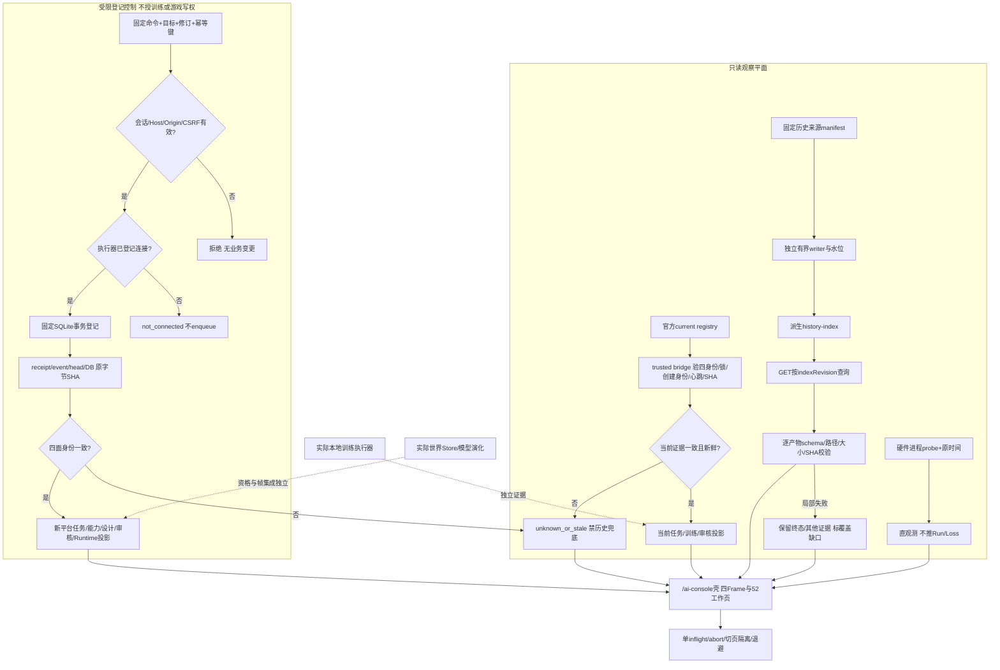

### 10.9 本地数据、备份、工作台账与详细计划工作台

**业务职责：**固定来源展示数据覆盖、手动读回校验备份、真实工作记录、唯一计划及关联文档/逻辑图；保持范围/时间/身份/失败/未知，不将测试次数当产品进度。

**责任边界：**

- 同应用独立/local-backup多页；不建新服务/任务系统。
- Git代码版本发布与全数据备份/真实恢复分开验收。
- 无镜像删除/源移动清理/真实恢复/自动同步排程；GET不盘点初始化复制写状态。
- 指南唯一134叶子、48产品检查点及本轮选定世界分别展示，不产生第二计划。


**权威记录与状态：**

- stores：固定.runtime/local-backup与不可变源终态/manifest；查询不改源。
- work：服务端可信producer+原UTC/receivedUTC；执行/验证/验收独立；事件事务成功后水位。
- progress：指南items+当前guide/specSHA绑定状态；currentDelivery只按选定world证据，不用通用组件升级。
- backup：manifest声明范围逐项读回，marker最后；coverage/verification/restorability/globalSnapshotConsistency独立。


#### 10.9.1 子组件输入、执行、输出与验收

##### ARCH-DETAIL-09-01 多页、鉴权与有限API

**输入：**既有loopback会话/Host/origin/CSRF；有限模块/date/window/cursor

**处理顺序：**

1. 固定物理root映射
2. 当前页按需查询
3. 参数白名单及body限制
4. 多页共享壳

**输出：**原时间/dataStatus/有限分页；稳定URL选择

**验收与反例：**GET不初始化DB/observer/复制；未连接明确503/null；旧异步不覆盖新页；无任意returnURL/path

**失败与恢复：**认证/映射失败not_connected或unknown_or_stale；局部错误不影响训练

**依赖：**既有认证；固定runtime mapping

**条款依据：**[LB 2. 职责与架构](LOCAL_BACKUP_AND_WORK_LEDGER_SPEC.md)；[LB LB-UI-001 多页面管理工作台](LOCAL_BACKUP_AND_WORK_LEDGER_SPEC.md)

##### ARCH-DETAIL-09-02 固定物理来源、库存和覆盖

**输入：**sourceRootId及实际物理根；workspace/hot/cold/catalog/migration；预算/cursor

**处理顺序：**

1. 显式分批盘点
2. 批准junction遍历一次
3. 内部symlink仅元数据
4. 记录起止/停止/未扫范围
5. 重叠来源不盲加

**输出：**库存快照/分类文件字节/物理身份/覆盖缺口

**验收与反例：**不全盘扫描/读secret正文；DB+WAL+SHM不是三个DB；没覆盖不是0；GET不重扫

**失败与恢复：**预算/权限/映射变化保留partial/cursor；未知链接拒绝

**依赖：**固定目录职责；显式盘点writer与预算

**条款依据：**[LB LB-DATA-001 来源及覆盖](LOCAL_BACKUP_AND_WORK_LEDGER_SPEC.md)；[LB LB-DATA-002 清点与查询](LOCAL_BACKUP_AND_WORK_LEDGER_SPEC.md)

##### ARCH-DETAIL-09-03 手动备份请求与新目标预检

**输入：**幂等键/预期模块修订；固定配置/源/UNC；空间时间输出并发预算

**处理顺序：**

1. 有限解析
2. 核配置SHA与物理边界
3. 本次全新目录不覆盖
4. 锁定一次运行
5. 预检空间权限

**输出：**backupId；created→preflight事件；范围/配置身份

**验收与反例：**客户端无任意source/target；重复请求不复制；不删源/覆盖旧目标；未连接adapter不假成功

**失败与恢复：**失败本地留档；网络未知留远端未完；无自动重试/清理

**依赖：**源覆盖/秘密策略/认证/固定adapter

**条款依据：**[LB LB-BACKUP-001 身份与非破坏性](LOCAL_BACKUP_AND_WORK_LEDGER_SPEC.md)；[LB LB-BACKUP-003 状态与结果](LOCAL_BACKUP_AND_WORK_LEDGER_SPEC.md)

##### ARCH-DETAIL-09-04 SQLite在线副本、文件与秘密边界

**输入：**声明普通文件；活跃DB/WAL；源稳定身份；明确secret策略

**处理顺序：**

1. 原生SQLite online backup
2. 副本integrity
3. 普通文件稳定复制/hash
4. secret按正式保护方案且不公开值/摘要

**输出：**独立副本/逐项manifest；DB检查/秘密覆盖缺口

**验收与反例：**不rawcopy活跃DB；不动源checkpoint/truncate/VACUUM；不能静默排secret声称全备份；无保护方案不明文复制secret到UNC

**失败与恢复：**源漂移/DB失败按阶段留档；源不动；片段保留

**依赖：**源权限/SQLite backup/安全配置

**条款依据：**[LB LB-BACKUP-002 一致性及秘密](LOCAL_BACKUP_AND_WORK_LEDGER_SPEC.md)；[LB LB-BACKUP-001 身份与非破坏性](LOCAL_BACKUP_AND_WORK_LEDGER_SPEC.md)

##### ARCH-DETAIL-09-05 读回校验、完成标记及恢复分层

**输入：**copied文件/manifest/size/SHA；实际网络或中断事实

**处理顺序：**

1. copying后逐项verifying
2. 声明项全一致才marker-last
3. 一次保存事件/manifest/terminal/投影
4. 持久化错不再复制

**输出：**completed/failed/interrupted或查询unknown；独立coverage/verification/restorability/global consistency

**验收与反例：**completed只限声明项读回，不是全项目/可恢复；原终态不改；复制成功而本地持久化失败另列真实事实

**失败与恢复：**中断/断网保留未完无marker；不清理重试；冲突unknown

**依赖：**backup storage事务与不可变manifest

**条款依据：**[LB LB-BACKUP-003 状态与结果](LOCAL_BACKUP_AND_WORK_LEDGER_SPEC.md)；[LB LB-BACKUP-002 一致性及秘密](LOCAL_BACKUP_AND_WORK_LEDGER_SPEC.md)

##### ARCH-DETAIL-09-06 可信事件、幂等归集和提交水位

**输入：**固定producer终态；eventId/sequence/module/task/run/三状态/SHA；原UTC与接收UTC

**处理顺序：**

1. 服务端确定producer
2. 核源字节身份
3. 事务幂等落事件
4. 成功后水位
5. 文件订阅与有界启动catchup

**输出：**local_program/codex/human区分事件；游标/延迟/覆盖

**验收与反例：**Codex报告不伪装localAI/acceptance；重复/迟到/乱序幂等；GET不写；观察失败不重训练

**失败与恢复：**落库失败保留源终态与旧水位；有界补读；未知协议留缺口

**依赖：**各业务adapter/原执行独立于工作台

**条款依据：**[LB LB-WORK-001 身份与来源](LOCAL_BACKUP_AND_WORK_LEDGER_SPEC.md)；[LB LB-WORK-003 程序与Codex记录接入](LOCAL_BACKUP_AND_WORK_LEDGER_SPEC.md)；[LB LB-WORK-005 训练终态公共接口与交付水位](LOCAL_BACKUP_AND_WORK_LEDGER_SPEC.md)

##### ARCH-DETAIL-09-07 北京时间归日、窗口报告与证据

**输入：**原UTC/monotonic elapsed；module/window/date/cursor；登记证据

**处理顺序：**

1. 按原UTC换北京时间归日含迟到
2. 功能窗口聚合
3. 执行/验证/验收分列
4. 固定源hash安全读取

**输出：**日报/窗口详细说明/checks/issues/nextSteps；实际耗时/安全图文

**验收与反例：**不以心跳/注册时间估耗时；没事件不等于没工作；人工备注非自动事实；失败未知不隐藏

**失败与恢复：**证据缺失/unsupported/过限逐项显示；有限分页

**依赖：**原时间/单调耗时；安全证据读取协议

**条款依据：**[LB LB-WORK-002 时间与汇总](LOCAL_BACKUP_AND_WORK_LEDGER_SPEC.md)；[LB LB-WORK-004 按窗口与日期的详细工作报告](LOCAL_BACKUP_AND_WORK_LEDGER_SPEC.md)；[LB LB-WORK-006 已登记图文证据的网页查看](LOCAL_BACKUP_AND_WORK_LEDGER_SPEC.md)

##### ARCH-DETAIL-09-08 134交付计划与开发比例真实性

**输入：**指南唯一items；现guide/specSHA；status与source/test/acceptance；可信事实

**处理顺序：**

1. 核定义绑定
2. 逐叶completed/not_completed/unverified
3. completedParts/remainingParts具体化
4. 主产物去重
5. 冲突撤销

**输出：**已确证完成/134和模块分布；未核验/缺口；48产品验收独立

**验收与反例：**partial不统一50%；测试/诊断次数不计完成；同产物不跨模块重复；source冲突完成降unverified保留旧事实；不以3/48当全进度

**失败与恢复：**状态失效仍读指南计划且比例null/未知；GET不修状态；事实先提交后水位

**依赖：**唯一指南结构/spec/可信证据核验

**条款依据：**[LB LB-PROGRESS-006 完整模块工作项展开与计划完成比例](LOCAL_BACKUP_AND_WORK_LEDGER_SPEC.md)；[LB LB-PROGRESS-003 验收结果自动归集与可信事实](LOCAL_BACKUP_AND_WORK_LEDGER_SPEC.md)；[LB LB-PROGRESS-004 顺序、持久化、查询与运行时采用](LOCAL_BACKUP_AND_WORK_LEDGER_SPEC.md)

##### ARCH-DETAIL-09-09 本轮选定世界的独立交付状态

**输入：**指南currentDelivery；world身份或unbound；事实/条件/模型/Runtime/Store实际证据

**处理顺序：**

1. 只读目标/步骤/依赖
2. 绑定worldId/version/前态和该world验收
3. 通用证据仅归组件

**输出：**本轮详细计划/关联文档图/world绑定；未绑定null

**验收与反例：**通用Store/CAS/Validator过不等于选定world过；静态图非演化；旧world不替当前；GET不bootstrap/改世界

**失败与恢复：**未选明确unbound；状态源失效仍看计划；不自动补证据

**依赖：**WORLD-AUTO001-004/架构2.0.1/模块2和7

**条款依据：**[LB LB-PROGRESS-007 当前交付的详细计划与文档图源联动](LOCAL_BACKUP_AND_WORK_LEDGER_SPEC.md)；[LB LB-PROGRESS-006 完整模块工作项展开与计划完成比例](LOCAL_BACKUP_AND_WORK_LEDGER_SPEC.md)

##### ARCH-DETAIL-09-10 正式文档原文与章节导航

**输入：**固定documentId；README/AGENTS/docs原字节；章节/版本/SHA/authority

**处理顺序：**

1. 白名单读取
2. 完整SHA
3. 登记链接
4. 安全Markdown剥rawHTML/script/远程图
5. 按章节定位

**输出：**唯一原文视图/实际SHA/相关文档；缺失未知明确

**验收与反例：**无任意path/网络代理；不读.env/src/data/runtime；正文≤512KiB/meta8KiB/每次64按合同；不存第二正文

**失败与恢复：**过限/未知登记/漂移失败关闭；保持导航；不全量载入视觉字典

**依赖：**正式文档职责与安全渲染

**条款依据：**[LB LB-DOC-001 文档目录与受限读取](LOCAL_BACKUP_AND_WORK_LEDGER_SPEC.md)；[LB LB-UI-001 多页面管理工作台](LOCAL_BACKUP_AND_WORK_LEDGER_SPEC.md)

##### ARCH-DETAIL-09-11 正式详细图提取与交互浏览

**输入：**官方登记Mermaid/文本树；diagramId/docId/section/line/SHA/authority/conformance/viewlevel/module

**处理顺序：**

1. 从原文提取有界图块
2. 稳定索引0..3兼容后追加
3. 本地锁版Mermaid严格安全/按需渲染
4. 缩放平移适配全屏键盘移动端

**输出：**源一致图及元数据；设计目标与程序符合分列

**验收与反例：**渲染失败非成功；无click/链接/config/远程脚本；源≤64KiB/每文档≤64；缺图非已实现

**失败与恢复：**失败显示原因及源；不以框图混淆state/frame/client责任

**依赖：**总控正式图/本地锁版renderer/目录注册

**条款依据：**[LB LB-DOC-002 已有设计图与来源](LOCAL_BACKUP_AND_WORK_LEDGER_SPEC.md)；[LB LB-UI-001 多页面管理工作台](LOCAL_BACKUP_AND_WORK_LEDGER_SPEC.md)

##### ARCH-DETAIL-09-12 精确Git预览、提交与普通推送

**输入：**POST /api/local-backup/git/preview精确选择；publish预览身份/修订/幂等键/有界说明；固定repo/branch/remote

**处理顺序：**

1. 默认空选
2. 绑定HEAD/index/字面路径/内容/属性转换
3. 原生锁和精确pathspec提交
4. 复核父/全树
5. 固定摘要pre-push守卫验广告非零remoteOID后普通push

**输出：**operationId及阶段身份/真实耗时；commit与push结果分开

**验收与反例：**无add全量/force/rebase/造分支/改远端凭据/PR；保留未选；漂移重预览；不绕过未知hook；远端核验后删除不能被重建

**失败与恢复：**树复核失败禁push但保留commit不reset/amend；timeout为push_unknown不自动重推；不清未知锁

**依赖：**既有鉴权/固定argv和守卫/预算

**条款依据：**[LB LB-GIT-001 仓库及文件范围](LOCAL_BACKUP_AND_WORK_LEDGER_SPEC.md)；[LB LB-GIT-002 预览、提交及推送](LOCAL_BACKUP_AND_WORK_LEDGER_SPEC.md)；[LB LB-GIT-003 结果、错误与重复请求](LOCAL_BACKUP_AND_WORK_LEDGER_SPEC.md)；[LB LB-GIT-004 接口与验收](LOCAL_BACKUP_AND_WORK_LEDGER_SPEC.md)

#### 10.9.2 接口与交接条件

- routes：GET /api/local-backup/summary、GET /api/local-backup/runs、POST /api/local-backup/runs、GET /api/local-backup/runs/[backupId]、GET /api/local-backup/runs/[backupId]/entries；binding：固定配置、scopeId、幂等/预期revision；GET不复制
- routes：GET /api/local-backup/journal、PUT /api/local-backup/journal、GET /api/local-backup/work-summary、GET /api/local-backup/work-events、GET /api/local-backup/work-records、GET /api/local-backup/work-events/[eventId]；binding：人工记录与机器来源分离；日期/模块/窗口/分页有界
- routes：GET /api/local-backup/work-events/[eventId]/evidence/[evidenceIndex]、GET /api/local-backup/work-events/[eventId]/evidence/[evidenceIndex]/images/[imageIndex]；binding：仅精确台账绑定引用，JSON≤1MiB/图≤16项、每项≤8MiB及1600万像素；PNG边≤8192；无任意文件代理
- routes：GET /api/local-backup/project-progress；binding：只读guide/specSHA绑定状态及currentDelivery；不得创建快照/扫历史/写DB/训练
- routes：GET /api/local-backup/documents、GET /api/local-backup/documents/[documentId]、GET /api/local-backup/diagrams、GET /api/local-backup/diagrams/[diagramId]；binding：固定登记ID与源章节/实际hash；安全阅读/本地渲染
- routes：POST /api/local-backup/git/preview、POST /api/local-backup/git/publish、GET /api/local-backup/git/operations/[operationId]；binding：精确文件预览、既有分支、幂等和修订；不接入503

上述入口名称用于定位既有责任；实施时仍须核对当前注册版本、源码及正式机器合同，不从名称或本章文案推导运行资格。执行请求、实际执行、验证、审核、发布和部署采用分别记录。

#### 10.9.3 详细流程与异常分支

图表示正式目标及责任，不表示当前所有节点已经实现或验收。

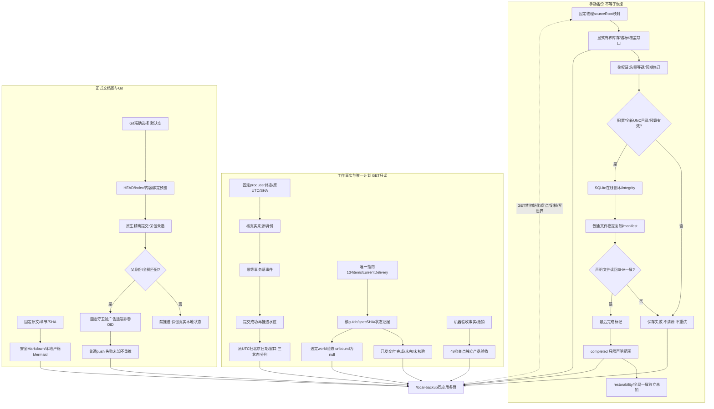

## 11. 业务需求、技术合同与原计划的追踪

本节将业务文档的要求逐项对应到既有架构责任、专用合同、原计划及正反验收。连续编号“X至Y”包括两端及中间全部编号。这里只定义承接关系，不复制工作状态、不增加计划项或统计分母；当前实现和验收证据仍通过唯一计划所引用的机器记录读取。

业务目标、旅程和质量要求以[产品业务需求文档](BUSINESS_SPEC.md)为唯一内容来源；执行条目以[唯一模块计划表](game-world-generation/CURRENT_EXECUTION_GUIDE_20260710.md)为准。旧计划中的明确版本引用保留原追踪身份，语义不变的条款由本节映射到当前规范；不得由文档升版推导旧模型或旧程序已符合。

### 11.1 文档治理与可靠性

| 对应层次 | 要求及定位 |
|---|---|
| 业务要求 | BIZ-01、QUAL-01、QUAL-04、QUAL-06、BIZ-ACC-11至BIZ-ACC-12 |
| 架构责任 | ARCH-DETAIL-01-01至ARCH-DETAIL-01-03、ARCH-DETAIL-01-09 |
| 专用合同 | [DOCUMENTATION_POLICY](DOCUMENTATION_POLICY.md) §3.1、§7.1—7.2；[REVIEW_AUTOMATION_AND_STORAGE_SPEC](game-world-generation/REVIEW_AUTOMATION_AND_STORAGE_SPEC.md) §11.2—11.8；[AI_PAINTER_FORMAL_IMPLEMENTATION_SPEC](game-world-generation/AI_PAINTER_FORMAL_IMPLEMENTATION_SPEC.md) §12.2、§17.3—17.4 |
| 原计划项 | PLAN-01-001至PLAN-01-004 |
| 正向验收 | 现行三项文档检查独立通过；机器符合另有实际正反证据 |
| 反向验收 | 历史字节变化、跨身份、重复消费、只凭文档宣告程序符合均拒绝 |

### 11.2 世界视觉生产、学习与审核

| 对应层次 | 要求及定位 |
|---|---|
| 业务要求 | BIZ-02、GOAL-05、QUAL-08、AIP-001至AIP-009、VJ-001至VJ-006、SUCCESS-001至SUCCESS-005 |
| 架构责任 | ARCH-DETAIL-02-01至ARCH-DETAIL-02-10 |
| 专用合同 | [AI_PAINTER_FORMAL_IMPLEMENTATION_SPEC](game-world-generation/AI_PAINTER_FORMAL_IMPLEMENTATION_SPEC.md) §3—6、§8—10、§12.2—14、§18.5—18.6；[TRAINING_DATA_AND_SOURCE_POLICY](game-world-generation/TRAINING_DATA_AND_SOURCE_POLICY.md) §7—11、§14；[REVIEW_AUTOMATION_AND_STORAGE_SPEC](game-world-generation/REVIEW_AUTOMATION_AND_STORAGE_SPEC.md) §2—6、§9；[REVIEW_AUTOMATION_AND_STORAGE_SPEC](game-world-generation/REVIEW_AUTOMATION_AND_STORAGE_SPEC.md) §5.2、§8.2 |
| 原计划项 | PLAN-02-001至PLAN-02-014 |
| 正向验收 | 当前条件/父权重/数据绑定真实原生完整图，独立审核与机器发布分别成立 |
| 反向验收 | split泄漏、伪造来源、放大/拼贴、参考图复用、事实错位、不合格发布及无限修复均拒绝 |

### 11.3 本地工作能力迁移

| 对应层次 | 要求及定位 |
|---|---|
| 业务要求 | BIZ-03、GOAL-06、QUAL-04、BIZ-ACC-10 |
| 架构责任 | ARCH-DETAIL-03-01至ARCH-DETAIL-03-10 |
| 专用合同 | [LOCAL_SELF_DEVELOPED_AI_CAPABILITY_AND_CODEX_MIGRATION_ARCHITECTURE](LOCAL_SELF_DEVELOPED_AI_CAPABILITY_AND_CODEX_MIGRATION_ARCHITECTURE.md) §0.9、§7.5—7.10、§15；[REVIEW_AUTOMATION_AND_STORAGE_SPEC](game-world-generation/REVIEW_AUTOMATION_AND_STORAGE_SPEC.md) §11.9—11.15 |
| 原计划项 | PLAN-03-001至PLAN-03-011 |
| 正向验收 | 当前真实生产链在发起端退出后完成准备至终态，实际离线证据单列 |
| 反向验收 | 只用心跳/孤立组件/模拟关窗冒充整链，认证不一致、首错后续跑、重复启动拒绝 |

### 11.4 人格与初始外貌

| 对应层次 | 要求及定位 |
|---|---|
| 业务要求 | BIZ-04、GOAL-04、JOURNEY-02、QUAL-05、BIZ-ACC-06 |
| 架构责任 | ARCH-DETAIL-04-01至ARCH-DETAIL-04-08 |
| 专用合同 | [ziwei/ALGORITHM_CONTRACTS](ziwei/ALGORITHM_CONTRACTS.md) 参数定义原则（架构既有条款引用）；[AI_PAINTER_FORMAL_IMPLEMENTATION_SPEC](game-world-generation/AI_PAINTER_FORMAL_IMPLEMENTATION_SPEC.md) §18.2、§18.6 MVP-VIS-02、§18.7；[TRAINING_DATA_AND_SOURCE_POLICY](game-world-generation/TRAINING_DATA_AND_SOURCE_POLICY.md) §11.2 |
| 原计划项 | PLAN-04-001至PLAN-04-015 |
| 正向验收 | 完整时辰/缺时辰合法分流，同档案复现，不同实例隔离，独立外貌保存恢复 |
| 反向验收 | 非法日期拒绝；缺时辰不伪造；无外貌映射来源不猜脸；模式不决定性别；隐私不越界 |

### 11.5 五类动物与生命数据

| 对应层次 | 要求及定位 |
|---|---|
| 业务要求 | BIZ-05、JOURNEY-05、BIZ-ACC-08 |
| 架构责任 | ARCH-DETAIL-05-01至ARCH-DETAIL-05-08 |
| 专用合同 | [AI_PAINTER_FORMAL_IMPLEMENTATION_SPEC](game-world-generation/AI_PAINTER_FORMAL_IMPLEMENTATION_SPEC.md) §18.3、§18.6 MVP-VIS-03；[TRAINING_DATA_AND_SOURCE_POLICY](game-world-generation/TRAINING_DATA_AND_SOURCE_POLICY.md) §11.1；[TRAINING_DATA_AND_SOURCE_POLICY](game-world-generation/TRAINING_DATA_AND_SOURCE_POLICY.md) §11.2 |
| 原计划项 | PLAN-05-001至PLAN-05-012 |
| 正向验收 | 五个类型各有真实物种、生境、形态状态及个体来源，名录发布与创建读回 |
| 反向验收 | 同物异名重计、错误生境、未知症状、名录外实体和序列泄漏拒绝 |

### 11.6 角色行动与动态Runtime

| 对应层次 | 要求及定位 |
|---|---|
| 业务要求 | BIZ-06、GOAL-04、JOURNEY-03、JOURNEY-05、QUAL-01、QUAL-08、BIZ-ACC-07、BIZ-ACC-09 |
| 架构责任 | ARCH-DETAIL-06-01至ARCH-DETAIL-06-10 |
| 专用合同 | [AI_PAINTER_FORMAL_IMPLEMENTATION_SPEC](game-world-generation/AI_PAINTER_FORMAL_IMPLEMENTATION_SPEC.md) §18.4—18.6 MVP-VIS-04—06；[TRAINING_DATA_AND_SOURCE_POLICY](game-world-generation/TRAINING_DATA_AND_SOURCE_POLICY.md) §11.1；[REVIEW_AUTOMATION_AND_STORAGE_SPEC](game-world-generation/REVIEW_AUTOMATION_AND_STORAGE_SPEC.md) §15.1；[TRAINING_DATA_AND_SOURCE_POLICY](game-world-generation/TRAINING_DATA_AND_SOURCE_POLICY.md) §11.2；[AI_PAINTER_FORMAL_IMPLEMENTATION_SPEC](game-world-generation/AI_PAINTER_FORMAL_IMPLEMENTATION_SPEC.md) §18.8 |
| 原计划项 | PLAN-06-001至PLAN-06-024 |
| 正向验收 | 有/无玩家建议下真实感知→目标→非建设行动→反馈→记忆→再决策；连续至少3合法tick保持身份 |
| 反向验收 | 状态禁止行动确实拒绝，重复提交不重扣，未知体征不编造，换皮不代替状态转移 |

### 11.7 世界生成、演化与记忆

| 对应层次 | 要求及定位 |
|---|---|
| 业务要求 | BIZ-07、GOAL-01至GOAL-03、JOURNEY-01、JOURNEY-04、JOURNEY-06、QUAL-01至QUAL-03、QUAL-07、WF-001至WF-005、MAP-001至MAP-024、WORLD-001至WORLD-010、WORLD-AUTO-001至WORLD-AUTO-004、SUCCESS-006、BIZ-ACC-01至BIZ-ACC-05、BIZ-ACC-11 |
| 架构责任 | §2.0.1、§3.2、§4.2—4.3、§7、ARCH-DETAIL-07-01至ARCH-DETAIL-07-11 |
| 专用合同 | [TRAINING_DATA_AND_SOURCE_POLICY](game-world-generation/TRAINING_DATA_AND_SOURCE_POLICY.md) §4、§8.2、§9.1、§10；[AI_PAINTER_FORMAL_IMPLEMENTATION_SPEC](game-world-generation/AI_PAINTER_FORMAL_IMPLEMENTATION_SPEC.md) §3—5、§13.1、§18.6 MVP-VIS-01、06、08；[REVIEW_AUTOMATION_AND_STORAGE_SPEC](game-world-generation/REVIEW_AUTOMATION_AND_STORAGE_SPEC.md) §13.1；本文件 §4.4；[REVIEW_AUTOMATION_AND_STORAGE_SPEC](game-world-generation/REVIEW_AUTOMATION_AND_STORAGE_SPEC.md) §5.2、§8.2 |
| 原计划项 | PLAN-07-001至PLAN-07-018 |
| 正向验收 | 同一身份生成与独立恢复；模型实际消费有限历史；无会话推进；原子状态与同tick原生正式帧；重启续接 |
| 反向验收 | 跨世界/过期前态/非法差量/重复事件拒绝；服务器停机不伪造执行；旧帧不冒充新状态；自然先行不宣称完整产品 |

### 11.8 AI控制台

| 对应层次 | 要求及定位 |
|---|---|
| 业务要求 | BIZ-08、JOURNEY-07、GOAL-06、QUAL-05至QUAL-06、BIZ-ACC-12 |
| 架构责任 | ARCH-DETAIL-08-01至ARCH-DETAIL-08-10 |
| 专用合同 | [ai-console/AI_CONSOLE_DATA_DICTIONARY_AND_API_CONTRACT](ai-console/AI_CONSOLE_DATA_DICTIONARY_AND_API_CONTRACT.md) §3.2.2—3.2.4、§4—8；[REVIEW_AUTOMATION_AND_STORAGE_SPEC](game-world-generation/REVIEW_AUTOMATION_AND_STORAGE_SPEC.md) §11.1—11.8 |
| 原计划项 | PLAN-08-001至PLAN-08-012 |
| 正向验收 | 同接口当前/历史/精确制品/真实时间资源读回，真实浏览器联验 |
| 反向验收 | 历史冒充当前、源冲突、路径越界、未接入伪装空列表、陈旧仍称实时拒绝 |

### 11.9 数据、备份与工作台账

| 对应层次 | 要求及定位 |
|---|---|
| 业务要求 | BIZ-09、JOURNEY-07、GOAL-06、QUAL-05至QUAL-07、BIZ-ACC-12 |
| 架构责任 | ARCH-DETAIL-09-01至ARCH-DETAIL-09-12 |
| 专用合同 | [LOCAL_BACKUP_AND_WORK_LEDGER_SPEC](LOCAL_BACKUP_AND_WORK_LEDGER_SPEC.md) LB-DATA-001—002、LB-BACKUP-001—003、LB-WORK-001—006、LB-DOC-001—003、LB-PROGRESS-001—007、LB-GIT-001—004 |
| 原计划项 | PLAN-09-001至PLAN-09-024 |
| 正向验收 | 固定来源备份独立校验恢复；原程序事件可信归集；文档原文和134计划逐项按证据独立重算 |
| 反向验收 | 在线数据库不一致、秘密泄露、未知补造、来源SHA变仍沿用通过、GET触发执行、48资格与134交付混算拒绝 |

### 11.10 范围与变更验收

一个需求只有同时具有业务定义、负责组件、可实现合同、原计划承接和正反验收，才算文档追踪闭合。实现或验收证据缺失时保留实际缺口，不能把本文的映射当成程序通过。变更须核对生产者与消费者、数据来源、存档兼容和测试范围；旧状态和失败证据不原地改写。

自然世界先行不反向依赖人物、动物和建设。MAP-021至024涉及的全历史创作唯一性，仍按数据规格§9.1在单一自然世界作用域后置；保持数据隔离及当前集内去重，后置项不算通过。角色自主必须覆盖有玩家建议和无新建议两路，不能用聊天应答替代自主行动。

具体模型家族、时序来源、物种参数、外貌规则和硬件预算由对应注册合同形成有证据的实例；本文件定义字段、约束与拒绝条件，不编造尚无依据的科学或性能数值。规范有定义、实例资料合格、程序实现、实际机器验收是四种不同结论。
