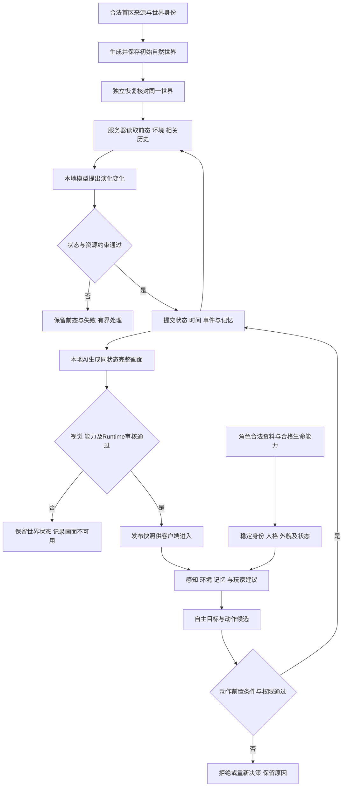

# AI-PET-WORLD 产品业务需求文档

更新时间：2026-10-29 12:08:21 +08:00

状态：long-term-business-reference

文档版本：`AI-PET-WORLD-BUSINESS-1.9`

生效日期：`2026-10-29`

替代版本：`AI-PET-WORLD-BUSINESS-1.8`

文档状态：`active_normative_target`

程序符合状态：`program_adoption_pending`

治理依据：[执行治理](../AGENTS.md)、[主体职责与权威顺序](DOCUMENT_AUTHORITY_INDEX.md#gov-owner-001owner不进入本地ai正常运行状态机)（`GOV-OWNER-001`）。

## 0. 文档目的、使用对象与边界

本文定义AI-PET-WORLD要为用户提供的游戏体验、产品范围、参与者、业务对象、用户旅程、功能需求、正常与异常流程、质量要求和验收依据。产品、开发、测试与运营人员据此判断“做什么、为什么做、何时算成功”。本文是正式业务需求基线，不能作为当前实现已经完成的声明。

### 0.1 本地自研AI原生业务闭环

本地系统依据生效业务要求读取世界与能力，生成或训练候选，完成固定验证与机器审核，对失败作有界处理，再发布、回退或安全结束，并保存实际记录。执行、验证、审核、发布分别给出结果，用户无需逐轮批准，已迁移流程不依赖外部聊天在线。

该条款承担产品执行主体与闭环原则；具体业务见第7—9节，详细流程见第12节。能力版本变化与正式世界运行分别记录，任何历史批准、代码合并或调用方自报都不能替代本轮机器资格。

### 0.2 文档使用和职责分离

| 阅读者／用途 | 优先阅读 | 应得到的结论 |
|---|---|---|
| 项目所有者与产品人员 | 第1—3节、第9节 | 用户价值、目标体验、MVP范围与完整旅程 |
| 业务与设计人员 | 第4—9节、第12—13节 | 业务对象、交互、流程、异常和跨模块交接 |
| 开发人员 | 业务需求编号及其第11节实现依据 | 目标和边界，继续进入架构及专用规格实现 |
| 验收人员 | 第10节、第13.3节 | 正向结果、必须拒绝的反例和适用证据 |
| 运营与维护人员 | 第7—9节、第10.2节、第12.8—12.9节 | 可观察状态、恢复边界、记录与备份要求 |

业务文档规定用户结果与责任；[总体架构](ARCHITECTURE.md)规定组件和数据流；专用规格规定接口、字段、算法约束和技术验收。页面布局不是业务真值，数据字段不是用户需求的替代品。[唯一模块计划表](game-world-generation/CURRENT_EXECUTION_GUIDE_20260710.md)负责实施计划，真实工作和运行证据负责完成状态，本文不设置第二张计划表或完成率。

### 0.3 表述与变更原则

“必须”表示验收必要条件；“允许”表示满足前置条件后的可选行为；“后续扩展”不构成本次MVP必要项；“不适用”必须有场景和依据，不等于未实现或自动通过。既有WF、MAP、AIP、WORLD、SUCCESS及WORLD-AUTO编号保留，编号用于追踪业务要求，不表示独立工程任务数量。

本地系统与外部执行者的权限采用GOV-OWNER-001，不在本文另设日常审批。产品目标、范围或验收改变时必须按文档权威与版本规则处理；不能为了使某次结果通过而反向改写业务标准。

## 1. 产品背景、定位与目标

### 1.1 产品定位

AI-PET-WORLD是一款像素风格的自主世界游戏。玩家通过客户端进入服务器上的持续世界，与具有稳定人格、记忆和自主行为的角色共同经历环境变化。当前“AI管家”是自主角色的暂称，不固定其最终名称、职业或服务身份。

产品由两项相互作用的核心业务组成：自主角色与类地球自主世界。只有聊天、只有地图图片、只有生态脚本或只有人物动画，均不构成完整产品。

### 1.2 用户价值与业务目标

| 目标编号 | 用户价值 | 成功的业务表现 | 验收定位 |
|---|---|---|---|
| GOAL-01 持续世界 | 用户离开后仍有一个连续存在的世界 | 再次进入保持同一身份，能追溯离线期间实际发生的变化 | WORLD-AUTO-001、004；BIZ-ACC-01、04 |
| GOAL-02 自主演化 | 世界根据环境和历史产生符合约束的变化 | 本地模型实际参与变化计算，结果通过校验并保存 | WORLD-AUTO-002；BIZ-ACC-02 |
| GOAL-03 记忆与因果 | 世界和角色能够利用相关经历 | 历史进入后续计算且在适用场景中产生可验证影响 | WORLD-AUTO-003；BIZ-ACC-03 |
| GOAL-04 自主角色 | 角色有稳定人格与自己的判断 | 玩家建议被理解但不强制执行；角色合法行动反馈到世界 | BIZ-ACC-06、07 |
| GOAL-05 可读、可玩的表达 | 用户看到并交互的是同一个实际世界 | 地图、角色、动物、状态和交互一致，画面达到正式游戏标准 | SUCCESS-001至006；BIZ-ACC-05、08、09 |
| GOAL-06 持续与可信运营 | 故障可解释，资料可恢复，进度可信 | 本地流程独立运行，失败不污染状态，记录和备份可复核 | BIZ-ACC-10至12 |

本文不虚构留存率、收入、并发人数、上线日期或训练收敛时间等商业与性能承诺。正式性能服务水平须按第10.2节形成有测量依据的部署验收档案；在缺少证据时不能宣布达标。

### 1.3 参与者与权限边界

| 参与者 | 可以做什么 | 不能据此取得什么权限 |
|---|---|---|
| 玩家 | 查看自己有权访问的世界、通过游戏内手机沟通、发起已开放交互 | 直接修改世界事实、发布候选或干预训练证据 |
| 自主角色 | 依据人格、目标、感知和记忆作决策，提出合法动作 | 绕过通行、资源、状态或安全条件 |
| 本地自研AI模型 | 进行学习、世界与角色推理、视觉生成 | 直接提交不受校验的世界变化 |
| 本地程序 | 调度、确定性校验、执行、保存、审核流程和查询 | 把固定脚本声称为已实现的模型能力 |
| 项目所有者 | 设定业务目标、观察、主动暂停与紧急停止 | 不承担本地日常逐轮训练、逐帧发布审批 |
| 外部执行者 | 在当前委托范围建设和验证系统 | 成为世界运行必要依赖，或以外部自报替代本地机器执行与审核证据 |

具体权限校验及受保护资料管理由架构和专用规格实现。用户出生资料用于虚构角色的游戏映射，不证明现实人的外貌、健康或命运。


## 2. 核心业务与目标体验

### 2.1 核心业务一：AI 管家人格与角色自主

当前以“AI管家”暂称用户创建的自主角色，该称呼不是最终产品名称、职业或服务身份的固定定义。本文及其他现行文档中的AI管家、管家或butler沿用同一自主角色能力指代；人格、动机、记忆、感知、自主决策、行动与世界反馈要求保持。命名澄清不自动新增角色数量、职业体系、能力或运行资格，也不要求改名既有代码目录及机器身份。该业务由三层组成：

| 层级 | 正式定义 |
|---|---|
| 性格数据 | 保存紫微斗数、八字及其结构化解释结果、来源、版本、完整度和置信信息。命理数据用于虚构角色的人格及初始外貌映射，不证明现实人的外貌、健康或命运。 |
| 性格映射 | 用户可以选择“映射现实中的自己”或“平行世界的自己”。现实自我模式按用户人格来源进行正向映射；平行世界模式使用反向紫微斗数映射生成另一条人格结构。紫微条件不足时进入八字映射链，具体出生资料不足条件必须由专门规则锁定，不得由实现自行猜测。 |
| 角色自主 | 映射结果形成管家的稳定人格、动机、偏好、判断边界和行为倾向。管家结合记忆、当前世界事实和长期目标自主决策，不是只复述用户指令的聊天机器人。 |

该业务的固定链路是：

```text
用户申请 AI 管家
-> 选择现实自我映射 / 平行世界自我映射
-> 读取紫微斗数或八字结构化性格数据
-> 生成人格映射档案
-> 建立管家稳定人格与自主决策核心
-> 在类地球世界中感知、判断、行动和积累记忆
```

人物初始外貌也走同一可追溯的紫微／八字来源链，但人格档案和外貌档案是不同输出，不允许由Painter根据人格标签自由猜脸。完整出生资料且紫微规则可用时优先使用紫微斗数；有合法出生年月日而没有时辰时使用八字三柱模式，明确记录缺时辰及精度限制，不伪造时柱。出生日期本身缺失、非法或超出规则覆盖范围时返回资料不可用；紫微计算错误不能冒充“用户未提供时辰”而静默降级。

《麻衣神相》等资料仅列为候选研究来源，不是已生效外貌公式。只有来源、文本版本、使用资格、结构化规则、参数边界及正反测试完备的游戏映射规则才可进入能力版本。映射模式与性别呈现分别记录，不能把“平行世界”解释为性别反转；已有平行世界人格方向不自动授权对脸型、体型逐数值取反。

### 2.2 核心业务二：类地球世界自主运行与生长

世界以当前地球可观察的自然规律和参数体系为第一基准，建立一个类地球、持续存在、能够自主运行和生长的游戏世界。它不是一张静态地图，也不是一次性生成图片。

| 层级 | 正式定义 |
|---|---|
| 世界基础数据 | 地形、水体、土壤、气候、时间、资源、生态对象和空间关系均以结构化世界事实保存。 |
| 世界运行 | 服务器持续调度世界时间与模型演化；客户端下线不暂停世界，具体边界见WORLD-AUTO-001至004。 |
| 世界生长 | 植被、资源和后续生命系统根据环境条件、生命周期、竞争与消耗发生变化，不依赖人工逐项摆放。 |
| 世界反馈 | 管家行为可以改变世界事实；世界环境、资源和事件也会反过来影响管家的判断和行为。 |
| 世界视觉 | AI Painter 只把已经存在的世界事实表达为专业游戏画面，不能用画面取代世界数据。 |

### 2.2.1 WORLD-AUTO-001 服务器常驻与客户端边界

用户通过客户端访问服务器上的游戏；本地自研AI模型、世界Runtime、世界状态与记忆运行或保存在受控服务器端。“本地”表示本项目自研和受控部署，不表示必须在玩家设备上执行。玩家下线、关闭客户端、断开网络或所有玩家均不在线，不得成为暂停、销毁或重新初始化世界的触发条件。服务器在生效资源、安全及运行合同内持续调度世界时间与演化，客户端只读取已发布状态并提交合同允许的交互。Owner主动暂停、服务器维护及真实故障按运行策略处理并保留证据；不得承诺故障期间仍完成实际计算。

### 2.2.2 WORLD-AUTO-002 模型计算演化与固定约束

本地自研AI模型必须承担世界演化的学习、预测或状态推理：消费同一世界当前事实和状态、环境条件、时间跨度与相关历史记忆，输出有身份及原因关联的候选状态变化。程序负责服务器时间调度、模型调用、确定性约束校验、合法变更执行、持久化和安全停止；AI Painter负责表达已经合法提交的事实。模型输出不得未经校验直接写入WorldFacts。

固定边界包括身份连续、时间次序、参数单位和合法范围、来源及许可、安全和资源约束；它们不等于把全部降雨、湿度、植被及资源变化写成人工固定结果表或公式。规则算法可以承担合同明确的约束与辅助计算，但不能以规则脚本或随机模板替代已声明由模型承担的世界演化，再宣称该模型能力已经完成。模型应学习并遵守世界规律，不得自行废除长期业务与安全边界；具体模型数量和共享方式须由版本化能力实现确定，不预设必须新建一个独立模型。

### 2.2.3 WORLD-AUTO-003 持久记忆与历史因果

世界记忆至少包含可恢复的当前状态、相关历史事件或受控历史摘要、状态原因及前后态关联。相关记忆必须作为世界演化计算的实际输入；仅保存日志但从不参与后续计算，不能宣称已具备世界记忆。记忆可以外部持久化，不要求每个世界的经历写入模型权重；记录事件也不自动意味着已训练或更新模型。保存恢复须保持同一worldId、对象身份、逻辑时间、事件位置及随机状态，防止重复演化或丢失已提交变化。

### 2.2.4 WORLD-AUTO-004 自主世界独立验收

世界运行能力必须分别提供：无客户端会话时服务器仍完成连续有效状态推进；模型真实参与候选状态计算及其输入输出证据；在声明依赖历史的场景中，读取相关记忆并通过冻结的历史对照验证其影响；保存及服务器重启后恢复同一世界且不重复消费事件；非法输出或资源故障不污染正式状态。服务存活、模型被空调用、日志增长、tick计数单独增加、静态图片展示均不能代替上述验收。历史不相关时不强求结果不同，不凭两次随机输出差异证明记忆有效。

上述为长期业务要求，程序采用状态仍为待核验。自然世界先行、人格行动和完整产品范围继续按第3.2节及唯一模块计划表分段安排，不因新增条款把人物、动物、房屋或完整地球模拟倒置为当前前置条件。

世界身份与生成关系固定为：

```text
playerId
-> worldId
-> worldSeed
-> worldProfileId
-> 类地球参数、气候、水文、生态与空间结构
-> 持续世界事实
```

长期产品中，不同玩家 ID 对应不同 `worldId`、世界种子和世界参数组合，因此可以形成不同的类地球世界。MVP 不删除该架构，但暂时固定使用同一套参考生态档案 `mainland-southeast-asia-tropical-monsoon-natural-home-v1` 完成第一版家园的数据、视觉、审核和 Runtime 闭环；不得把 MVP 固定档案误写成长期所有玩家只能拥有同一个世界。

长期世界的地形、气候、水文、土壤、生态和区域连接必须以对应真实地球地区的地图与权威地理测量为事实来源。当前泰国Sakaerat / Wang Nam Khiao数据包只是第一版MVP的首个区域样本，不是整个游戏未来唯一的数据源。世界扩展到其他国家或地区时，必须读取该地区自己的真实地球区域数据包，不得复制泰国的地貌、水系、连接方向或生态内容。

每份真实地球区域数据包至少需要：

| 数据层 | 长期要求 |
|---|---|
| 区域身份 | 国家/地区、真实空间范围、坐标参考、数据时间与版本 |
| 地形 | 高程、坡度、地貌与自然汇流依据 |
| 地表覆盖 | 植被、湿地、裸地及人类开发识别/移除依据 |
| 气候与季节 | 温度、降雨、湿度、风和当地季节状态 |
| 土壤与水分 | 土壤类型、质地、酸碱度、含水与排水条件 |
| 水文 | 河流、湖泊、湿地、流域、流向及跨区域连续性事实 |
| 生态 | 区域生态系统、现实物种与环境适应关系 |
| 大世界连接 | 相邻区域、自然通行、道路、水文、生态与海拔过渡 |
| 来源谱系 | 提供者、产品、版本、许可、URL/对象身份、采集时间、SHA-256和派生过程 |

真实地图数据是世界事实来源，不等于把外部地图图片直接当作训练图。外部卫星RGB、地图瓦片、照片或导航地图画面不得直接成为AI Painter正式RGB目标；程序必须先把合法地理数据转成可审核WorldFacts和结构条件，再由本地视觉系统生成游戏画面。

#### 长期、MVP与后续扩展的明确边界

| 问题 | 正式答案 |
|---|---|
| 游戏长期是否只使用泰国数据？ | 否。长期是基于真实地球不同地区数据的多区域自主世界。 |
| 当前MVP使用什么数据？ | 只使用已经批准的泰国Sakaerat / Wang Nam Khiao区域数据包。 |
| 当前是否允许自动加入其他国家？ | 仅在长期区域来源政策、许可、预算和RegionGraph合同内允许本地系统自主登记与构建；超出这些边界时失败关闭并报告。 |
| MVP完成后怎样增加地区？ | 为目标地区建立独立`RealEarthRegionSourcePackage`，完成来源、许可、版本、范围、hash、自然化、WorldFacts和连接审核。 |
| 新地区能否继续使用泰国地形或水文？ | 不能。只能复用通用数据结构、算法和游戏视觉语言，不能复用泰国区域事实。 |
| 真实地图是否直接成为游戏画面？ | 不是。真实地图与测量提供事实；游戏画面由本地AI根据WorldFacts和结构条件生成。 |
| 不同区域是否互相独立？ | 内容与结构独立，但全部属于同一个连通大世界RegionGraph。 |

#### 可复用与不可复用

| 可以跨地区复用 | 不得跨地区复用 |
|---|---|
| WorldFacts Schema、RegionGraph Schema、来源审计流程、自然化算法、条件通道定义、统一像素风、相机、对象比例、光照和材质语言 | 真实区域范围、高程形态、水系与流向、土壤统计、气候值、生态系统、物种组合、道路/自然通行、边界连接、主题架构和实例细节 |

国家或行政边界不自动等于游戏区域边界。本地系统可以在来源政策、许可和资源预算允许的真实地球范围内按自然地貌、流域、生态和大世界连接划分游戏区域，但每个划分必须保留真实地区身份、来源范围和派生记录；AI Painter本身不能脱离WorldFacts自行切分或发明。

该业务的固定链路是：

```text
类地球基础参数与世界数据字典
-> 世界生成与空间结构
-> 时间 / 环境 / 生态 Runtime
-> 世界自主运行与生长
-> 世界事实变化记录
-> 游戏地图与状态层更新
-> AI Painter 视觉表达
-> 审核后进入 /world
```

### 2.3 两大业务的闭环关系

```text
性格数据 -> 性格映射 -> AI 管家自主决策
                              |
                              v
类地球世界事实 <-> 管家行为产生的世界变化
       |
       v
世界自主运行 / 自主生长 -> 新的环境与事件 -> 管家下一轮决策
```

两条核心业务缺一不可。只有人格而没有世界，产品会退化为聊天机器人；只有世界而没有自主角色，产品会退化为自动地图或生态模拟器。

| 主题 | 定义 |
|---|---|
| 自主角色（AI管家，暂名） | 世界中的自主主体，拥有性格、动机、偏好、记忆和判断；最终名称及职业不由暂称固定。 |
| 管家人格来源 | 紫微斗数与八字是管家性格数据和人格映射的正式来源；用户可选择现实自我映射或使用反向紫微斗数的平行世界自我映射。 |
| 玩家关系 | 玩家通过游戏内手机与管家沟通；玩家给建议，管家不必完全听从。 |
| 自主世界 | 世界由事实、规则、资源、生态、事件和管家行为持续生成。 |
| 自主建设 | 未来管家会自主建设房屋、道路、设施、小镇和城市。 |
| 多玩家未来 | 多个玩家的管家未来可以共同建设公共世界。 |
| 视觉表达 | AI Painter 把世界事实表达成画面，但不能决定世界事实。 |

### 2.4 自主世界的区域差异

世界自主生成不等于在同一固定地图骨架上替换植被、颜色或季节。不同`worldId`、`worldSeed`和`regionId`必须能够产生不同但符合事实的地形、水文、道路、区域连接与生态空间组织；AI Painter只能表达这些差异，不能把它们收敛为一个共同模板。

大世界连接契约分为两个层级：

| 层级 | 业务含义 |
|---|---|
| 连接模式契约 | 规定RegionGraph、边界连接口、道路、水文、可走和邻接事实必须结构化、可配对、可追溯、可审核 |
| 具体区域连接实例 | 规定某一个`regionId`实际连接哪些方向、哪些相邻区域、是否存在跨区域水系及道路从何处进入或离开 |

`mainland-southeast-asia-earth-reference-natural-home-region-0001-v1`只属于第二层。它的北入南出、东侧相邻水系、南侧道路连接不得成为其他区域或训练样本的默认结构。长期自主世界必须由每个区域自己的世界事实决定连接实例；没有主要水体、只有内部湿地、封闭池塘或不同流向的区域不得被强制改造成`region-0001`。

所有区域共同组成同一个持续存在的大世界，而不是一批彼此无关的完整地图。每个区域都必须作为RegionGraph节点与至少一个相邻区域形成经过配对的边界连接，并保留可验证的自然通行或道路/可走关系；生态、海拔和水文在事实存在时也必须跨边界连续。区域结构可以不同，但不能孤立、悬空或仅靠图片看起来相连。

自主世界差异必须深入到主题架构和实例细节两层。主题架构不得复用同一连接拓扑、水文/道路关系、空间分区和整体阅读层级；实例细节不得复用同一河岸、道路轨迹、湿地或分区轮廓、对象实例位置、对象簇、密度节奏和局部过渡。相同生态类型、季节状态或统一美术风格可以再次出现，但必须形成新的世界事实和新的空间实例，不能成为旧图的换皮版本。

## 3. 产品范围与分段交付

完整产品MVP必须覆盖“AI管家人格与自主行为 + 类地球自然世界自主运行 + 双向反馈”，包括人物视觉、五个类型的现实动物及动态状态。AI Painter是其中的视觉子系统，单张地图训练成功不等于完整MVP完成。

“完整产品MVP”“静态自然地图视觉里程碑”“当前候选资格”是三个不同范围。当前Stage4仍先验证静态自然地图；人物、动物和动态帧在完整MVP范围内按依赖接入，不能未经新数据、条件及能力合同直接塞入现有64份地图训练包。模块状态只由唯一计划表记录。

当前第一版家园生态档案固定为：

| 字段 | MVP 定义 |
|---|---|
| `worldProfileId` | `mainland-southeast-asia-tropical-monsoon-natural-home-v1` |
| `biomeType` | `tropical_monsoon_lowland_foothill_natural_home` |
| 区域基准 | 兼容档案仍为东南亚大陆热带季风包络；当前MVP新增数据以泰国Sakaerat / Wang Nam Khiao为具体参照。允许使用有明确许可、版本和来源的高程、土地覆盖、气候与土壤测量派生自然世界事实与自然拓扑，但必须剔除人类开发痕迹并归一化到游戏坐标；禁止把外部RGB、地图瓦片视觉或现实导航地图作为训练图或画面参考。 |
| 气候基准 | 类地球热带季风；实际温度、降雨、湿度和水文数值必须由版本化地球数据快照提供 |
| 水文基准 | 淡水河流、池塘、短溪、洪泛地和连续自然水岸；海岸系统暂不进入本档案 |
| 植被范围 | 热带常绿林、季节性常绿/半常绿林、湿润落叶林、疏林、竹林、草地、河岸林、淡水湿地及现实物种 |
| 季节框架 | 雨季、雨转旱、旱季、旱转雨必须进入长期状态字段和原图覆盖框架；不得继续套用温带春夏秋冬 |
| 明确排除 | 雪、冰川、高山苔原、荒漠、寒温带白桦/针叶林身份及未经批准的海岸红树林子档案 |
| 静态地图视觉里程碑 | 单张完整地图视觉；此里程碑不要求多tick动画，不能代表完整MVP验收 |
| 完整MVP生命范围 | AI管家人物、五个类型的现实动物，具有稳定身份、形态差异、健康变化、行动和连续状态；不是五张固定动物贴图 |
| 第一版正式画风 | 2D 高分辨率像素风完整游戏地图；像素风是统一的美术语言，不改变世界事实、地图结构或 Runtime 分层 |
| 模型原生分辨率 | `1024×768`；模型直接生成完整地图，不从低分辨率图或局部素材放大、拼接得到 |
| 显示规则 | 以原生 `1024×768` 为质量基准；响应式显示不得改变画面事实，导出和审核始终读取原生文件 |
| 专业一致性 | 固定观察视角、世界尺度、对象比例、纹理颗粒、轮廓、光照、接地、遮挡和地图可读性；高分辨率像素风不能退化为普通数字插画 |

与现行数据字典不一致的旧生态值不得作为 MVP 原图和视觉任务依据；迁移必须由正式世界数据迁移程序执行并保存证据。

静态自然地图视觉里程碑的内容：

| 内容 | 是否允许 | 说明 |
|---|---:|---|
| 草地 | 允许 | 自然家园基础地形。 |
| 水体 | 允许 | 河流、池塘、水域。 |
| 水岸 | 允许 | 水体和陆地之间的过渡。 |
| 自然通行 | 允许 | 依据WorldFacts提供可走关系；不要求预建人工道路、主支路网或建设平台。已有合法道路事实的样本仍须保持图与条件一致。 |
| 树木 | 允许 | 自然边界、生态层次、遮挡关系。 |
| 石头 | 允许 | 地形变化、自然障碍。 |
| 花草细节 | 允许 | 丰富画面，不改变世界事实。 |
| 空间深度 | 允许 | 前景、中景、背景、边界、遮挡层级。 |
| 自然空间层次 | 允许 | 由地形、生态、通行关系自然形成，不预设家园或建设位置。 |

初始自然地图不得包含固定家园中心、建筑候选地、施工空地、规则中央留白或为未来建设预留的道路汇聚平台。AI 管家未来在哪里建立家园、怎样修路，属于人格、记忆、当前目标和世界事实共同驱动的自主行为；只有自主决策通过世界规则形成正式 WorldFact 后，视觉系统才可以表现对应结果。当前地图阶段不得用视觉构图替管家提前作出选址决定。

完整MVP与后续扩展的接入边界：

| 内容 | 状态 | 原因 |
|---|---:|---|
| 管家人物视觉 | 完整MVP必需 | 初始外貌来自版本化紫微／八字游戏映射；静态地图资格不能替代人物能力资格。 |
| 角色动作与动态状态 | 完整MVP必需 | 位置、朝向、姿态和健康等变化由Runtime事实驱动，同一人物不能逐帧换身份。 |
| 五个类型的现实动物 | 完整MVP必需 | 有真实地球生物依据，并符合当前区域生境；具体分类和代表物种由版本化名录明确，不在资料不足时虚构名单。 |
| 最小世界交互 | 完整MVP必需 | 管家至少形成感知、目标、合法行动、资源或环境变化、记忆反馈闭环；先验证非建设行动，房屋及自主建设按第3.2节后置，不预留家园位置。 |
| 建筑内部、完整设施体系 | 不属于本次MVP必需项 | 不因保留建设接口就扩展成完整建造游戏。 |
| 全动物谱系、小镇、城市、多国并行生产 | 后续扩展 | 不扩大首个泰国自然世界的有限样本范围。 |

### 3.1 生命状态与完整MVP验收边界

人物和动物必须区分稳定形态与可变生命状态。高矮属于有单位和物种边界的形态参数；胖瘦可包含初始体型与后续营养状态；生病、健康、恢复、疲劳和行为限制属于有原因事件的Runtime状态。Painter只表达清单中明确且可见的体征，不从出生数据判定现实疾病，也不从游戏RGB反推健康事实。

最低动态验收包含健康→患病→恢复、活动→休息→恢复活动，以及行动受到状态限制的路径。不存在来源支持的症状用“不适用／未定义”表示，不凭空增加病种。动物按物种定义可用状态，不强制所有动物套用人的体型和动作。死亡、繁殖及完整食物网保留扩展能力，不作为本次五类动物的必达全覆盖项。

完整MVP必须同时证明：合法资料创建及稳定世界身份、可追溯人格和初始外貌、合格自然地图、五类动物名录与实体、连续tick生命状态、至少一条人物—世界反馈闭环、保存恢复后身份与状态一致，以及失败不污染正式世界。少一项不能称完整MVP完成；具体责任、数据缺口和验收用例见AI Painter主体规格第18节。

### 3.2 分段交付与前期最小范围

交付顺序固定为：原始自然世界先行里程碑 → 紫微／八字人格映射 → 性格驱动的角色行动与反馈 → 后续房屋视觉训练及自主修路、种植、基建、社区建设。前期不要求房屋、预建人工路网或精细景观；不能把未来建设内容反向设为自然世界训练的前置条件。五类动物和生命状态仍保留在第3.1节完整产品MVP范围，但不阻塞不消费它们的自然世界与人物最小行动验收；本文没有取消这些完整产品要求。

原始自然世界先行里程碑必须同时具备：泰国首区合格事实来源、结构化地形／对象／通行／碰撞／状态、本地AI真实生成、适用的语义审核与Runtime发布，以及关闭后重新进入仍保持身份和世界状态。只展示PNG、后台进程存活或完成一次训练都不构成该里程碑通过。

人格与角色行动先验证合法资料形成稳定人格、不同人格在同一环境及受控随机条件下产生可解释的决策倾向、合法行动改变状态、记忆反馈及保存恢复；不要求人格标签机械决定每一次行动。人格差异须通过冻结场景和重复试验验证，不能凭两次随机动作不同宣称性格有效。初始外貌仍遵守第2.1节，不由Painter猜测；角色建设能力不进入前期行动集合。

前期视觉验收优先地形、水体（事实存在时）、主要自然对象和通行关系可读、位置与事实一致、无破坏可读性的崩坏。花草纹理、道路边缘装饰及非关键光影精修后置；延期的是精修工作，不是容许已声明的事实错位、漏画或伪造。无人工道路不等于没有WalkableGraph，已有道路／水文事实也不因范围收缩而消失。

学习质量与本地自主运行是并列交付要求：模型负责学习与推理；本地程序负责有界调度、检查、保存、裁决和安全停止。前期不要求本地通用代码模型或建设NPC，也不得把Codex在线设为已迁移流程的必要条件。

分段交付不改变现行64份及48／8／4／4、来源许可、历史暴露隔离、正式Stage0→1→2和原生1024×768发布要求。256×192是训练阶段，不是正式世界画面的替代品。适用审核项及定量阈值须在新候选运行前按新版本冻结并测试；不修改旧失败裁决、不以本节直接签发数据或模型资格。当前推进范围与未实现状态只在唯一模块计划表记录。

当前单一原始自然世界先行MVP对MAP-023／MAP-024中的“与全部历史比较结构及实例细节的创作唯一性”实行阶段隔离，具体边界见数据与来源规格第9.1节。这不是删除、退役或判定通过；原规则、实现与历史证据保留，后续扩展前恢复验收。当前数据集内部去重、来源与派生依赖、训练／验证／挑战／回归用途隔离及适用模型谱系的历史暴露核验不在隔离范围内。该阶段例外只改变创作唯一性的适用范围，不豁免事实一致性、安全、真实训练或正式发布资格。

## 4. 业务对象、状态与事实责任

### 4.1 业务对象

| 业务对象 | 用户或业务含义 | 关键连续性要求 |
|---|---|---|
| 玩家与访问关系 | 谁能够进入哪个世界、向哪个角色提出建议 | 不能跨用户读写未经允许的对象 |
| 世界与区域 | 一个持续存在的自然空间及其局部连接 | 世界身份、种子、区域来源和连接不因刷新改变 |
| 自然对象与资源 | 世界中的树、石头、水体、植被及可消费资源 | 独立身份和合法状态，不能由图片猜测或创造 |
| 自主角色与动物 | 有身份、形态、状态和适用行为的生命实体 | 状态变化不更换实体身份 |
| 建议、目标与动作 | 玩家表达、角色意图和实际执行分别记录 | 收到建议不等于采纳，采纳不等于执行成功 |
| 世界事件与记忆 | 已发生的事实、原因及相关历史 | 不重复消费，不把未发生行为记成成功经历 |
| 视觉候选与正式画面 | 待审表达与已通过发布条件的游戏表达 | 画面绑定具体世界和时刻，候选不等于正式结果 |
| 能力与工作结果 | 适用模型能力、训练审核或其他项目产物 | 执行成功、审核通过和发布资格分别判定 |

具体存储字段和接口不在本节定义，见总体架构和相应模块规格。

### 4.2 世界事实责任

世界事实是游戏内容和交互的权威来源。模型可提出合法变化，由程序核验提交；AI Painter只表达已经存在的事实。

| 编号 | 业务要求 | 具体约束 |
|---|---|---|
| WF-001 | 世界事实先存在 | 地形、资源、对象、事件、状态必须先成为世界事实。 |
| WF-002 | AI 不新增事实 | AI Painter 不能凭空新增建筑、人物、动物、设施、宝箱、怪物等内容。 |
| WF-003 | 事实必须可追踪 | 每个视觉输出必须绑定 `worldId`、`tick`、`sourceFactIds`。 |
| WF-004 | 事实变化来自 Runtime | 地图变化来自世界 tick、世界规则、管家行为或事件系统。 |
| WF-005 | 视觉修正不改事实 | 画面不合格时只能修视觉表达，不能篡改世界事实。 |

### 4.3 业务状态与结果层次

| 对象／阶段 | 业务上的可区分状态 | 转换依据与失败后保留内容 |
|---|---|---|
| 世界建立 | 未查询、确认不存在、创建处理中、状态已保存、恢复可用、失败 | 未查询不能当不存在；确认存在时恢复原世界，损坏时保留原件 |
| 世界演化 | 等待合法输入、计算候选、校验、提交成功、拒绝或停止 | 只有合法提交推进已完成状态；失败保留前态和原因 |
| 角色建议与动作 | 收到、接受／拒绝／暂缓、动作候选、执行成功／失败 | 动作成功以实际世界提交为准，不能由回复文本推导 |
| 视觉交付 | 未生成、候选、审核通过／失败、已发布／回退 | 通过对应完整条件才发布，失败不破坏已提交世界 |
| 观察结果 | 未接入、查询中、有效记录、查无记录、失败、陈旧或冲突 | 页面明确表示区别，未知不显示为零或未登记 |

本表定义业务结果差异，不新增与总体架构冲突的机器状态枚举；实现使用现行状态机并保持这些语义差别。


## 5. 游戏地图与空间交互需求

正式游戏地图不是一张 PNG。游戏地图必须由结构化数据、多层地图、视觉单元、交互层和 Runtime 状态组成。

| 编号 | 规则 | 说明 |
|---|---|---|
| MAP-001 | 地图必须结构化 | 至少包含地形层、对象层、视觉层、可走层、碰撞层、交互层、状态层。 |
| MAP-002 | 地图必须可进入 | 玩家未来要能在地图内移动、查看、互动。 |
| MAP-003 | 地图必须有入口 | 玩家进入世界需要明确入口点。 |
| MAP-004 | 地图必须有自然阅读层级 | 通过多个生态空间、通行路径和自然地标形成可读结构，不预设家园中心或建设位置。 |
| MAP-005 | 跨区域通行必须连通 | 已批准入口与出口之间的主路径必须可走，不能被水体、石头、树木或边界阻断。 |
| MAP-006 | 水岸必须连续 | 水体边界不能出现断裂、悬空、硬切。 |
| MAP-007 | 对象层独立存在 | 树、石头、草丛、花等对象必须有对象记录。 |
| MAP-008 | 可走层独立存在 | 玩家和管家未来是否能走，不能靠图片猜。 |
| MAP-009 | 碰撞层独立存在 | 不可穿越区域必须由数据定义。 |
| MAP-010 | 交互层独立存在 | 可点击、可查看、可建设、可采集对象必须有交互定义。 |
| MAP-011 | 视觉层可替换 | 同一世界事实可以有不同视觉表达，但不能改变可玩结构。 |
| MAP-012 | MVP 是未来大世界的第一个连接区域 | 第一版自然家园不是最终世界全貌，也不是脱离世界坐标的孤立图片。 |
| MAP-013 | 区域必须有稳定身份 | 每个区域必须绑定 `regionId`、`worldId`、`worldSeed`、`worldProfileId`、全局范围、版本和内容 hash。 |
| MAP-014 | 跨区域连接必须结构化 | 道路、水系、生态与海拔过渡必须通过经过批准的边界连接口和区域邻接关系表达，不能靠两张图片看起来相连。 |
| MAP-015 | 道路必须跨区域连续 | 当前区域已批准入口、出口和实际通行目标必须属于可验证的路径与可走图；道路不得进入水体或碰撞区。 |
| MAP-016 | 水文必须跨区域连续 | 河流和溪流必须有上游、下游、流向、海拔及配对边界口；封闭池塘不得冒充跨区域水系。 |
| MAP-017 | 区域过渡必须符合世界档案 | 相邻区域的生态、地形和海拔变化必须符合当前类地球档案，不能随机跳变。 |
| MAP-018 | 对象身份必须跨 tick 保持 | 树、石头和后续世界对象必须使用稳定对象 ID；视觉变化不得新建、删除或替换世界对象身份。 |
| MAP-019 | 图片不能定义连接事实 | AI Painter 只能表达已批准的区域拓扑、道路、水文、可走和碰撞事实，不能从 RGB 反推或创造大世界连接。 |
| MAP-020 | 连接实例不得跨区域复用 | `region-0001`等具体蓝图只约束对应`regionId`；其他区域必须绑定自己的连接实例，不能复制固定方向、端口或道路/水体关系。 |
| MAP-021 | 自主生成必须保持结构差异 | 不同区域的地形、水文、道路和空间组织必须由各自世界事实产生；只更换植被、颜色、天气或局部弯曲的共享主体骨架不属于不同自主世界。 |
| MAP-022 | 所有区域必须属于连通世界 | 每个区域必须加入同一世界RegionGraph，并通过至少一组已配对的跨区域通行连接与相邻区域连通；独立构图不得退化为孤立地图。 |
| MAP-023 | 每张地图主题架构必须唯一 | 对全部历史比较区域连接、水文、道路、分区、边界和阅读层级；同一主题骨架不得再次出现。 |
| MAP-024 | 每张地图实例细节必须唯一 | 对全部历史比较轨迹、轮廓、对象实例与对象簇、密度、空隙和过渡；表面换色或少量移动不得冒充新世界。 |

上述规则的机器模式契约固定为 `natural-home-large-world-connectivity-v1`，位置为 `data/world-samples/world-connectivity/world-connectivity-contract-v1.json`。具体运行区域使用独立连接实例登记；任何具体实例都不得被解释为所有训练槽位或未来区域的默认连接。实际 tick、邻居、端口、迁移与审核只保存在机器证据中。长期大世界拓扑和其他区域实例必须由各自世界事实与正式程序建立，程序和智能体不得自行补齐未有事实支持的决定。

## 6. 世界视觉生产需求

AI Painter 是完整世界视觉生产系统。它不决定地图事实、游戏规则、碰撞或 Runtime，但必须在世界事实、世界导演和地图结构约束下生产完整地图视觉、局部变化视觉和持续视觉更新。局部材料生成只是其内部能力之一，不能代表完整 AI Painter。

### 6.1 原图库的业务身份

第一版原图库的 `complete-maps`、`terrain`、`vegetation`、`natural-objects` 和 `transitions` 是同一个完整世界视觉业务的五类并行知识来源。目录名表示记录的主要视觉知识和审核责任，不表示产品功能、执行阶段、Runtime 图层或独立模型。

| 并行分类 | 为完整世界模型提供的业务知识 |
|---|---|
| `complete-maps` | 完整构图、空间阅读、全局光照、风格一致性和专业游戏地图整体标准 |
| `terrain` | 草地、道路、水体、水岸、土壤及其季节、湿度和使用状态 |
| `vegetation` | 现实物种、生命周期、季节、健康、资源状态和空间形态 |
| `natural-objects` | 石头等自然对象的形态、尺度、材质和环境关系 |
| `transitions` | 地形过渡、对象接地、阴影、遮挡和边缘连续性 |

五类数据可以并行获取和审核。20 张完整地图正样本是完整地图类别的最低数据门槛，不是整个原图库的全部内容，也不是必须先完成或最后完成的单独阶段。所有分类最终服务同一完整世界视觉系统；正式业务结果始终是绑定世界事实和结构的完整地图候选，不是目录中的单张原图，也不是程序拼图。

| 编号 | 规则 | 说明 |
|---|---|---|
| AIP-001 | AI 负责完整世界视觉表达 | AI Painter 的正式输出目标是受世界事实、世界导演和地图结构约束的完整地图视觉候选；地图块、视觉单元、区域纹理和对象贴图只是内部训练或局部更新能力，不能替代完整地图输出。 |
| AIP-002 | AI 不直接输出 `/world` | AI 输出必须进入候选区、审核区或合成器，不能直接进 `/world`。 |
| AIP-003 | 输入必须是结构条件 | 输入包括世界事实、结构坐标、Mask、深度、可走区、对象槽位。 |
| AIP-004 | 输出必须可绑定 | 输出必须绑定 VisualFactManifest、sourceFactIds、worldId、tick、dictionaryVersion、任务包、hash、时间戳、模型版本、checkpoint、seed 和质量报告。 |
| AIP-005 | 世界变化仍发布完整画幅 | 后期世界变化可以在模型内部聚焦变化区域计算，但每次正式候选仍必须重新形成并审核一张原生`1024×768`完整RGB；禁止发布patch、tile或局部拼接结果。 |
| AIP-006 | 禁止第三方在线绘图 API | 正式视觉链路不接入外部在线绘图服务。 |
| AIP-007 | 本地训练必须归档 | 成功图、失败图、候选图、耗时、时间戳、GPU 信息、来源、审核结果都必须保存。 |
| AIP-008 | 第一版使用高分辨率像素风完整画布 | 完整地图模型必须原生输出 `1024×768` 高分辨率像素风完整地图；禁止从 `256×192`、局部图、tile 或 sprite 放大、拼接冒充完整地图。 |
| AIP-009 | 像素风不等于机械拼图 | 原图库分类、图块、对象素材和局部像素知识只能作为统一模型知识输入；正式候选仍必须由当前完整任务包驱动生成一张新完整地图。 |

### 6.2 游戏画面与学习目标的一致性

AI Painter 的完整地图原图同时承担三种身份：本地 AI 的正向训练目标、未来游戏实际画面基线、未来持续动态世界的视觉基线。它不是地图卡片、悬浮沙盘、孤立切片或一次性静态插画。每个像素都必须属于游戏世界，矩形画幅必须由世界内容铺满到四边；自然边界只能表示世界内部的密集边缘生态，不能表示画幅外的深绿背景、纯色遮罩、透明空洞或装饰性多边形边缘。

当前先生成静态完整世界画面，但条件包必须同时保存地表、可行走/碰撞、对象实例、水文、道路连接、生态季节及未来运动状态所需身份。RGB 负责表达世界事实，不能代替结构化 WorldFacts 和 23 通道。64 张容量样本的共同画风可以一致，但大体骨架、构图框架、构造语法、道路、水文、生态分区和对象组织不得复制、镜像、旋转或轻微变形复用。

机器可读长期合同为 `data/ai-painter/system-governance/complete-map-world-business-contract-v3.json`。任何违反完整画幅、边界连接、动态准备或 64 组唯一性的 RGB 直接进入未通过，只能保留为负向学习证据，不得计入正样本容量。合同的具体版本哈希由机器注册表保存，不复制进本文。

## 7. 业务职责与跨模块协作

### 7.1 模型、程序和玩家的职责

本地自研AI系统由模型与确定性程序共同组成。世界模型计算候选演化，角色模型形成决策，视觉能力表达已提交事实；是否共享模型由能力实现版本确定，不预设新建模型数量。程序负责时间调度、约束校验、动作执行、持久化、查询和安全停止。

程序可以构建结构化地图、可走／碰撞／交互关系、管理区域连接、形成视觉条件、校验和发布RuntimeFrame。禁止把程序绘制的几何图形、Canvas、SVG或CSS占位图当正式玩家画面；这不禁止程序参与世界生成和运行。

玩家通过游戏内手机提出建议，角色可以接受、拒绝或暂缓。玩家不直接提交世界事实；界面必须区分“已收到”“角色决定”和“实际结果”。客户端只访问获准对象，全部客户端退出不触发世界重置或停机。

### 7.2 本地自主工作与失败处理

本地系统读取业务要求与实际证据，在已生效能力、工具、来源、安全和资源合同内完成任务规划、执行、验证、机器审核、发布或回退，并保存可追溯记录。内部票据只用于幂等、防重和证据关联，不构成日常人工审批。

模型、损失、数据选择、训练计划、审核或发布实现改变时形成独立版本；新版本必须经过适用验证及旧能力保持检查。预算用尽、证据不完整、许可不足或真实错误时安全结束受影响路线，保留失败及可恢复状态。不能为了“直到通过”为同一路线设置无限重试。

尚未迁移给本地系统的诊断、代码建设或修复明确记录执行来源。外部执行者按AGENTS的当前委托工作，不继承本地系统常驻运行权；已迁移流程不能依赖外部聊天在线。

### 7.3 模块交接

| 发出方 → 接收方 | 交付的业务结果 | 接收方必须核对 |
|---|---|---|
| 来源与世界初始化 → 世界运行 | 真实来源支持的初始自然世界 | 世界身份、范围、事实、状态与恢复结果 |
| 世界模型 → 世界执行器 | 有原因和前态依据的候选变化 | 合法性、时间连续、资源、对象、重复与冲突 |
| 玩家沟通 → 角色决策 | 有身份的建议及上下文 | 访问资格、适用目标、建议与命令的区别 |
| 人格／外貌 → 角色运行和视觉 | 可追溯且适用的角色档案 | 来源、完整度、模式、稳定身份与变化边界 |
| 动物资料 → 生命运行和视觉 | 适地名录、个体及状态定义 | 五类覆盖、生境、形态、状态与证据 |
| 已提交世界 → 视觉生产 | 某一世界时刻需要表达的内容 | 内容存在性、位置、可见状态、观察要求 |
| 视觉审核 → 发布与客户端 | 合格完整画面及所属状态 | 能力资格、Runtime绑定、交互与时效 |
| 执行及审核 → 控制台和工作台账 | 实际结果、时间、原因和证据 | 来源身份、当前／历史区别，不自行写回事实 |
| 存档与备份 → 恢复 | 可核对的状态和恢复材料 | 完整性、身份、事件位置、不重复执行 |

每个交接失败都有明确受影响范围；不可由接收方编造缺失输入。实现责任对应总体架构第10节，详细业务流程见第12节。


## 8. 审核、问题反馈与改进流程

### 8.1 业务审核要求

审核检查的是候选是否满足其实际用途。画面审核、状态合法性、模型资格、流程迁移和完整产品验收分别作出结论。视觉审核沿用VJ-0、VJ-1、VJ-2及composite quality等适用合同，不以图像能打开、平均分改善或程序退出成功替代。

问题记录必须包含实际现象、违反的要求、受影响对象、证据、原因判断及其把握程度、已经尝试的处理和结果。证据不足时可以确定失败现象而保留未知根因，不强行归到模型架构、数据量或某个权重。

既有审核需求编号保留如下，供业务到审核证据逐项追踪：

| 编号 | 审核需求 | 业务要求 |
|---|---|---|
| VJ-001 | 未审核不展示 | 没过 VisualJudge 的内容不能进入玩家视野。 |
| VJ-002 | VJ-0 检查来源和绑定 | 检查 worldId、tick、sourceFactIds、hash、尺寸、来源。 |
| VJ-003 | VJ-1 检查视觉质量 | 清晰度、边缘、色彩、破图、压缩、局部残缺。 |
| VJ-004 | VJ-2 检查语义和游戏地图 | 是否符合世界事实，是否是完整游戏地图，是否可进入 `/world`。 |
| VJ-005 | 局部图不能冒充世界地图 | crop、patch、tile、sprite 即使好看也不能进 `/world`。 |
| VJ-006 | 失败必须归档 | 失败图、失败原因、指标、时间、耗时都要保存。 |

### 8.2 完整处理路径

1. 产生候选并保存输入和结果身份。
2. 按冻结标准完成审核，记录逐项通过、失败或不可判断。
3. 失败按来源、条件、模型、执行、审核或发布责任分类；回到相应负责方处理。
4. 在原资源与动作边界内进行有依据的修正；涉及数据、模型、损失或规则变化时建立新版本。
5. 对新结果重新审核，并验证既有能力和依赖没有不允许的退化。
6. 满足完整发布要求才采用；否则保留失败、回退适用版本或安全结束该路线。

审核器无相应能力时不得给出虚假通过。预算或策略用尽时停止是合法终态；停止不能抹除失败，后续版本不能继承未取得的资格。具体失败类型和反例见第13.2节。


## 9. 用户旅程、访问与发布体验

### 9.1 关键用户旅程

| 场景编号 | 用户目标与前置 | 正常过程 | 用户应得到的结果 | 异常及恢复 |
|---|---|---|---|---|
| JOURNEY-01 首次进入 | 用户有访问资格，首区来源及能力适用 | 提交创建意图→确认身份→生成保存世界→审核发布→进入 | 可查看并按开放能力交互的同一个自然世界 | 缺资料／能力或画面失败，准确说明阶段，保留已生成状态，不以坏图顶替 |
| JOURNEY-02 建立角色 | 世界适用，用户提交资料并选择映射模式 | 校验资料→人格映射→独立外貌映射→身份和出生位置→审核 | 有稳定人格、外貌和身份的自主角色 | 资料不足与计算错误分开，缺映射规则不随机补脸 |
| JOURNEY-03 沟通与行动 | 用户和角色处于允许交互的关系 | 手机建议→角色判断→合法动作→世界结果→反馈与记忆 | 能知道建议是否被采纳及实际发生什么 | 拒绝／暂缓有原因；不可达、资源不足或状态过期不执行副作用 |
| JOURNEY-04 离线后返回 | 世界已建立且服务器可运行 | 用户退出→服务器继续实际演化→重新连接→读取同世界 | 身份、历史和新状态连续，能区分实际变化与故障 | 服务器维护和故障如实记录，不伪造停机期间事件 |
| JOURNEY-05 观察生命变化 | 已接入合格人物／动物能力 | 查看状态→运行合法变化和行动→视觉更新→再观察 | 同一实体的形态、状态、动作与原因一致 | 不适用症状说明依据；不能靠换贴图代替生命状态 |
| JOURNEY-06 故障与恢复 | 存在已提交状态和恢复材料 | 发现失败→保留状态及原因→恢复核对→继续合法运行 | 不丢失已确认结果，不重复动作或重新创建身份 | 损坏存档不能按不存在处理，无法恢复范围明确报告 |
| JOURNEY-07 查看项目情况 | 运营者有查询资格 | 查看计划→展开工作项→读结果及原件→查看文档 | 知道计划、实际完成与失败的区别 | 未接入、陈旧、查询失败和查无记录分别显示 |

这些是目标业务旅程，不代表页面和后台已经全部接通。可见控件、文案、视觉布局和接口分别由产品界面及技术规格定义。

### 9.2 正式世界访问条件

| 编号 | 用户体验与发布要求 | 具体约束 |
|---|---|---|
| WORLD-001 | `/world` 只读 RuntimeFrame | 不直接读训练目录、Candidate、单张 ApprovedFrame。 |
| WORLD-002 | RuntimeFrame 必须完整 | 必须包含地图结构、视觉层、可走层、碰撞层、交互层、状态层。 |
| WORLD-003 | RuntimeFrame 必须通过 VisualJudge | VJ-0、VJ-1、VJ-2 和 composite quality 必须通过。 |
| WORLD-004 | 单张 AI 图不展示 | 单张图片不是游戏地图。 |
| WORLD-005 | 程序占位图不展示 | fallback 不是玩家画面。 |
| WORLD-006 | 局部图不展示 | 局部贴图、区域纹理、对象素材不能直接进入主页面。 |
| WORLD-007 | 不合格时显示阻断说明 | 可以说明“世界画面被阻断”，不能拿坏图占位。 |
| WORLD-008 | 机器审核是正式运行闸门 | 候选只有通过 VisualJudge、composite quality、能力版本机器发布门和 RuntimeFrame gate 才能自主发布；首次能力与后续能力使用同一机器证据规则，不设置人工首发特例。 |
| WORLD-009 | 否决与回退必须留证 | 机器审核或机器能力发布门否决的 RuntimeFrame 必须记录为失败样本，禁止进入 `/world`，并保持上一正式版本。 |
| WORLD-010 | `/world` 必须达到正式游戏画面标准 | 画面必须像玩家可进入的游戏地图，而不是训练结果、调试图、模型纹理拼贴、噪声图或技术演示图。 |

### 9.3 更新和异常的用户表达

世界状态已保存但画面尚未可用时，界面明确说明这两个结果；不能说世界不存在，也不能把候选画面当正式画面。旧画面仅可作为明确标注原时刻的历史阅读，不承载当前世界动作。当前时刻没有合格画面时按展示闸门阻断当前游戏交互；恢复后，新的动作必须基于当前正式可交互画面及对应状态并重新核验。

刷新、关闭页面或重复点击不重复创建世界、不重复执行同一动作。当前系统没有查询某项数据时显示“未接入／尚未查询”；只有实际完成查询且无记录时才能显示“无记录”。


## 10. 产品质量与业务验收

### 10.1 正式地图的必需验收条件

第一张正式地图必须满足以下条件；它仍只是完整产品中的一个交付范围。

| 编号 | 成功条件 | 验证要求 |
|---|---|---|
| SUCCESS-001 | 本地小模型生成本轮完整地图新候选 | 候选必须来自当前任务包的真实本地模型推理，绑定模型、checkpoint、seed、图片 hash；禁止复用旧图或用局部材料图冒充。 |
| SUCCESS-002 | 完整视觉候选及内部材料证据有效 | 完整候选必须绑定当前 VisualFactManifest 和任务包；如果内部使用材料槽或 Approved Material Pack，它们也必须绑定当前版本并通过材料质量检查，但材料包通过不等于完整地图通过。 |
| SUCCESS-003 | RuntimeFrame 完整 | 必须包含地图结构、视觉层、可走层、碰撞层、交互层、状态层和审计记录。 |
| SUCCESS-004 | 机器审核全部通过 | VJ-0、VJ-1、VJ-2、composite quality、RuntimeFrame gate 必须全部通过。 |
| SUCCESS-005 | 能力版本机器发布门通过 | 第一版与后续能力均由本地系统按冻结的训练、验证、审核、来源、资源和Runtime合同形成不可变发布身份，不需要Owner逐版本验收。 |
| SUCCESS-006 | `/world` 展示正式游戏地图 | 页面展示的是完整、可进入、可交互的游戏地图 RuntimeFrame，不是训练展示页、候选图、局部图或程序图。 |

玩家必须能识别地形、水体（事实存在时）和主要对象，通行与碰撞可信，画面不出现破坏可读性的网格、拼贴、噪声、模糊或错位。风格、对象比例、光照、接地和遮挡一致。画面虽能显示但不像正式游戏地图、指标虽通过但违反明确视觉要求，均不得验收。

### 10.2 质量要求及测量责任

| 编号 | 质量要求 | 测量与验收方法 | 失败判定 |
|---|---|---|---|
| QUAL-01 一致性 | 世界事实、角色状态、事件与发布画面有确定关联 | 对指定世界和状态核对全部结果，并验证过期和并发请求 | 任意跨世界、跨状态误用或重复副作用 |
| QUAL-02 连续性 | 无客户端会话仍运行，重启后恢复同一世界 | 实际断线运行与独立恢复，核对状态、时间、事件和随机性 | 仅进程存活、只增tick或恢复后换世界 |
| QUAL-03 可用性与时效 | 请求、查询、演化、画面生产和故障恢复有明确边界 | 每个部署版本先登记场景、硬件、负载、超时、调度间隔、画面陈旧上限及恢复目标，再以实测分布验收 | 任一必需项未定义、超限未反馈或事后调整指标放行 |
| QUAL-04 资源有界 | 长时间工作不会无上限消耗资源 | 合同登记CPU/GPU/存储/任务数量与重试上限，实测耗尽及安全停止 | 静默超额、无限重试或挤掉必要失败证据 |
| QUAL-05 访问与资料保护 | 玩家只访问获准世界，敏感资料按用途保护 | 越权、重放和非法命令反例；核对日志与备份不泄露受保护字段 | 越权读取／写入、客户端直接改事实或秘密泄露 |
| QUAL-06 可追溯 | 每个结果有真实来源、版本、时间及原件 | 从页面或记录回查不可变输入和结果；异常值与缺失可区分 | 虚构时间、覆盖失败、调用方自报当机器审核 |
| QUAL-07 可恢复 | 备份与存档能证明声明的恢复范围 | 独立恢复并对照身份和内容，区分文件副本、数据库一致性和世界恢复 | 只复制文件就宣称完整可恢复 |
| QUAL-08 视觉质量 | 原生完整画面及动态表达达到适用游戏要求 | 原生文件、对象与状态专项审核；固定视角及受控显示缩放 | 放大拼接替代原生输出、改变事实或身份漂移 |

具体性能数字不能由业务文档无依据估计。它们是部署版本必须提交且在测试前冻结的验收输入；缺少任何影响实际业务的数值定义时，该部署不能声明满足QUAL-03或QUAL-04。参数改变须说明适用范围并重新验证，不能修改已失败运行的原判据。

### 10.3 分层验收与完整产品判定

| 验收层次 | 所证明的范围 | 不能替代的结果 |
|---|---|---|
| 文档与合同 | 目标、流程、接口边界和验收条件一致 | 程序已实现或模型有效 |
| 程序组件与流程 | 特定代码路径、状态处理及记录满足合同 | 真实训练、画质或完整世界 |
| 数据与模型能力 | 适用数据、真实训练／推理和固定审核通过 | 完整游戏集成 |
| 单一自然世界闭环 | 同一世界生成、发布、演化、记忆、离线与恢复 | 人格、动物和完整产品 |
| 完整产品MVP | 第3节全部范围及第13.3节适用业务场景同时成立 | 后续建设、完整生态或多国扩展 |

完整MVP必须同时取得合法资料与稳定身份、人格和初始外貌、合格自然世界、五类动物、连续生命状态、人物—世界反馈、持久记忆、保存恢复和失败隔离证据。任一必需范围缺失都不能以另一部分成功补足；定量阈值和审核口径不得因当前候选失败而降低。

### 10.4 验收材料

每个用例至少记录需求编号、实际环境和版本、前置状态、输入与操作、预期结果、实际结果、原件位置、结论和失败原因。正向用例与越权、非法、过期、缺失、重复、重启、资源耗尽等反例并列。模型及产品资格由本地受信程序从真实证据裁决，文档通过、代码提交或外部报告不直接授予资格。


## 11. 需求追踪、依赖与变更管理

### 11.1 业务到实现的对应

| 业务范围／编号 | 详细业务流程 | 实现依据 | 主要验收 |
|---|---|---|---|
| 正确执行与可靠恢复 | BIZ-01 | 总体架构§10.1、文档治理 | BIZ-ACC-11、12 |
| 视觉生产；AIP、MAP、SUCCESS | BIZ-02 | 总体架构§10.2、AI Painter主体与数据／审核规格 | BIZ-ACC-05、SUCCESS-001至006 |
| 本地工作能力 | BIZ-03 | 本地AI能力迁移架构、总体架构§10.3 | BIZ-ACC-10 |
| 人格与初始外貌 | BIZ-04 | 总体架构§10.4、紫微算法合同、AI Painter§18.2 | BIZ-ACC-06 |
| 五类现实动物 | BIZ-05 | 总体架构§10.5、AI Painter§18、数据规格§11.1 | BIZ-ACC-08 |
| 自主行动与生命状态 | BIZ-06 | 总体架构§10.6、AI Painter§18 | BIZ-ACC-07、09 |
| 世界与记忆；WF、WORLD-AUTO | BIZ-07 | 总体架构§2.0.1、§10.7 | BIZ-ACC-01至04、11 |
| 控制台观察及有界控制 | BIZ-08 | 总体架构§10.8、AI控制台正式规格 | BIZ-ACC-12及访问反例 |
| 数据、备份和工作记录 | BIZ-09 | 总体架构§10.9、本地备份与台账规格 | BIZ-ACC-12、QUAL-06、07 |
| 玩家世界访问；WORLD | JOURNEY-01至06 | 总体架构§7、Runtime与发布合同 | BIZ-ACC-05、WORLD-001至010 |

实现、测试和机器合同应引用稳定业务编号及适用版本，进一步映射到唯一计划中的原工作项。表内的业务场景不是新增项目任务或进度分母。具体源码和当前符合性从机器记录读取，不把动态结果长期抄入本文。

### 11.2 依赖与变更控制

自然世界先行不依赖人物和动物能力；人物最小非建设行动不被完整建设体系阻塞；完整MVP仍必须补齐第3节全部要求。业务变化需先核对受影响用户旅程、数据、模型、审核和恢复范围，再更新对应权威规格与版本。不能通过改变章节名称、验收统计或宣传口径取消未完成需求。

来源、科学参数和具体能力选择按第14节处理。无依据的规则不能以专业文档名义写成事实；尚未确定的实现实验不妨碍固定业务目标，但会阻断依赖该实现的能力资格。


## 12. 完整产品的详细业务流程

本节是业务执行和验收依据，说明谁在什么条件下做什么、产生什么结果、失败后怎么办。技术组件和接口见总体架构第10节，具体数据、模型和审核合同见对应正式规格；这里不记录开发完成率、运行状态或工期，也不另建模块计划。文中的“成功”均指满足列明条件后的目标结果，不表示程序已经实现。

### 12.0 使用者、业务对象和交接规则

| 主体或对象 | 业务职责与含义 |
|---|---|
| 玩家 | 从客户端进入自己的世界、查看角色和环境、通过游戏内手机提出建议；其连接状态不决定服务器世界是否运行。 |
| 自主角色 | 具有稳定人格、外貌、记忆与目标，结合当前环境选择合法行动；可以拒绝不合适的建议并留下原因。 |
| 本地自研AI系统 | 承担已发布范围内的世界演化、角色决策、视觉生产和本地工作流程；各能力分别验收。 |
| 确定性程序 | 管理时间、资源、身份、数据合法性、动作执行、保存恢复与查询，不伪称模型学习。 |
| 项目运营与观察者 | 查看真实工作和世界结果；控制权限按GOV-OWNER-001及专用控制合同执行。 |
| 世界 | 持续存在的身份、自然事实、状态、对象、相关历史和逻辑时间；图片是它在某时刻的表达。 |
| 候选 | 尚未通过对应检查的状态变化、画面或能力版本，不能直接成为玩家世界。 |
| 已提交状态 | 经合法性核验并持久保存的世界结果；与画面是否生成、是否发布分别记录。 |
| 已发布画面 | 绑定指定世界和状态、通过审核及发布条件的完整游戏表达。 |

跨模块交接同时携带对象身份、适用版本、结果及证据。接收方必须验证它是否属于当前对象和用途；缺少依赖时说明具体缺项，不从另一个世界、历史运行或默认值借用成功。任何失败均保留原因和原始证据。已经提交的合法状态不因画面失败被暗中回退；禁止把过期画面配上当前交互层。

### 12.1 BIZ-01 文档治理与运行可靠性

**业务目的：** 每个任务按一致的业务要求执行，重试、重启或多个执行者同时工作时不重复操作、不覆盖正确结果。

**触发与前置：** 新任务、返修、规则版本变化或进程恢复触发核对；须能确定任务目标、适用文档、实际输入、资源边界和验收要求。

**主流程：**

1. 确认该任务服务哪个业务场景，区分图像改善、程序迁移、世界运行和完整产品验收。
2. 对照权威文档及实际版本，定位输入条件、负责组件、禁止行为与交付标准。
3. 检查是否已有同一动作在执行或已被消费；有效执行继续归原执行者，重复请求返回原结果。
4. 执行期间记录真实阶段、资源、失败与产物。恢复时结合锁、进程和提交记录判断，不只看聊天或心跳。
5. 按原验收条件核对结果，登记成功、失败或证据不足；能力发布仍须独立机器裁决。

**异常与恢复：** 文档矛盾阻断依赖动作并记录冲突；来源、身份或结果摘要不一致拒绝使用；资源耗尽按原边界结束，不自动扩容；提交中断按事务记录恢复，不重复训练或重复世界动作。外部执行者的任务范围遵守AGENTS，本地系统的日常权限遵守GOV-OWNER-001。

**交付与验收：** 同一动作重复请求不会产生第二次副作用；重启能解释此前动作；证据可定位原件；不同验收层次没有互相冒充。对应总体架构§10.1及本地AI迁移架构。

### 12.2 BIZ-02 世界视觉生产、学习与审核

**业务目的：** 玩家看见的地形、对象、位置和状态与真实世界一致，画面具有统一且可读的像素风格。

**触发与前置：** 首次世界表达、已提交状态变化或合格视觉能力更新触发视觉任务。必须有同一世界的事实、对象、状态、观察规则、适用能力与审核合同。

**主流程：**

1. 从世界读取需要表现的内容，明确哪些对象存在、在哪里、哪些状态可见；缺失事实不能交给画师猜测。
2. 形成完整画面任务。本地模型根据条件生成本轮候选，记录实际输入和输出身份。
3. 审核完整性、地形水体和对象可读性、位置、遮挡、接地、通行、风格以及适用定量指标。
4. 画质失败时区分条件不一致、数据问题、生成能力不足、审核失效或执行错误，保存问题及责任证据。
5. 在生效预算内选择对应处理：输入错误重建同源条件；数据错误形成新数据版本；模型或损失变更形成新能力版本。已有事实错误必须返回事实责任链，不能让画师改事实来配图。
6. 新版本重新做固定验证、旧能力保持和适用回归。通过审核仍须满足能力发布与Runtime绑定要求，之后才能进入玩家画面。

**学习与防退化：** 单图拟合仅证明该样本的学习能力。改变训练安排必须从可比较起点记录预算、样本曝光及优化条件；同时观察目标样本、其他训练样本和固定验证样本。回放、减少更新或冻结组件是需验证的候选策略，不预设其中某种必然修好。新图改善但旧图出现不允许的退化时，不发布该能力。

**异常与恢复：** 审核不通过不能通过调低阈值或换掉失败证据结案；未知问题或预算用尽保留结果并结束受影响路线。审核器没有实际观测能力时返回明确不可用，不能把程序执行成功当画质成功。

**交付与验收：** 实际本地推理的新完整RGB、结构化条件、逐项审核、版本血缘和Runtime绑定可查；正式输出遵守原生1024×768和固定观察规则。网页缩放不改变模型输出分辨率，不产生新视角能力。新分辨率、镜头或动态内容必须有对应能力合同与验收。对应总体架构§10.2、AI Painter主体规格及数据、审核存储规格。

### 12.3 BIZ-03 本地AI工作能力迁移

**业务目的：** 本地系统能够持续处理已经迁移的项目工作，外部聊天断开不影响这部分流程。

**触发与前置：** 项目任务或真实失败触发本地规划；只能选择已经登记的工具、数据和能力边界，不能自授未实现能力。

**主流程：** 读取任务和证据 → 定位业务条款与适用能力 → 分解有界动作和依赖 → 核对资源及风险 → 执行 → 独立验证 → 保存问题与结果 → 发布、回退或安全结束。

**问题反馈：** 每个问题须包含实际现象、预期条件、受影响对象、证据、已尝试动作和结果。能够确定的同类问题可调用合同内策略；不能判断原因时保留未知原因，不把相似失败码当成相同根因。

**异常与恢复：** 缺少代码生成、诊断或修复能力时，记录该能力未迁移；外部人员当前提供的修复要单独署明来源。工具失败、证据冲突或边界外任务不得无限循环、猜测成功或扩大权限。

**交付与验收：** 在外部智能体离线的场景下，由本地进程实际完成所声明工作、失败恢复和记录，且结果符合对应业务标准；只有自动调用脚本不等于全部研发能力已经迁移。对应总体架构§10.3和本地AI能力迁移架构。

### 12.4 BIZ-04 人格、初始外貌与角色建立

**业务目的：** 玩家获得具有连续身份、可追溯人格和初始外貌的自主角色，后续行为受到人格影响。

**触发与前置：** 玩家申请角色并明确现实自我／平行世界模式；出生资料、模式和可用规则分别校验，玩家资料按受保护数据处理。

**主流程：**

1. 校验出生日期等输入是否合法和在规则覆盖范围内；没有合法日期返回资料不可用。
2. 日期和时辰完整且规则适用时走紫微链；合法日期而缺时辰时使用已定义的八字三柱链，保留缺失信息。不把计算错误伪装成资料缺失。
3. 按所选模式生成版本化人格档案，记录来源、稳定倾向和适用限制；平行世界模式不等于性别反转。
4. 另行生成初始外貌档案。只有已登记且验证合格的游戏映射规则才能确定形态；人格标签不能替代外貌规则。
5. 为角色分配稳定身份并绑定所属世界、人格、外貌及初始状态，准备可见表达。
6. 人格和外貌各自通过校验、视觉能力通过审核、出生位置符合世界条件后，角色才进入对应发布场景。

**异常与恢复：** 缺外貌来源或映射规则时明确角色创建的哪部分未完成；可保存合法的人格结果，但不能用随机脸宣称整个创建成功。修改模式或输入产生新档案版本，不能暗改已存角色历史。

**交付与验收：** 同一角色在多次读取和恢复后身份、人格与稳定外貌一致；缺时辰、非法日期、计算错误和不支持模式分别处理；人格影响需通过同环境受控重复场景检验，不由两次随机行为差异证明。对应总体架构§10.4、紫微算法合同及AI Painter§18.2。

### 12.5 BIZ-05 五类现实动物与生命数据

**业务目的：** 首区存在有真实依据、形态可区分、符合当地生境且能够活动的五类动物，能够参与后续生命状态与世界反馈。

**触发与前置：** 生命能力包建立或世界生成请求需要动物时，读取适用名录、来源、区域环境及数据资格。自然世界先行阶段不消费动物能力，不以该阶段通过替代动物验收。

**主流程：**

1. 本地系统根据已许可资料形成版本化名录，明确五个互不混淆的业务类型、各类型的现实代表物种、分类依据、来源及首区生境资格；禁止同物种改名凑数。
2. 每个物种分别定义稳定形态、可变状态、可见体征和合法动作；记录真实资料与游戏抽象之间的关系。
3. 为训练资料建立身份、来源、状态、视角与连续序列标签，隔离训练和各类验证用途；相邻帧和同一个体的派生图不能跨划分泄漏。
4. 模型学习形态和状态表达，审核物种可分辨性、同一个体稳定性和状态变化；按每个类型给出结果，不能只报总体均值。
5. 通过能力与环境准入后，在世界中建立稳定个体身份及初始状态；模型提出行为，程序按合法条件执行。

**异常与恢复：** 无生境证据的物种不进入首区；无依据的症状不编造。允许单个不适用体征明确标注N/A及理由，但不能把五类动物、基本连续身份和必要动态能力全部标成N/A后宣布完整MVP通过。名录或来源改变形成新版本并重验受影响能力。

**交付与验收：** 五类均有真实依据、合格数据、个体状态和可读视觉；同物种不同个体可保持身份，生病与恢复等适用状态有前因后果；死亡、繁殖、完整食物网按原范围后置。具体名录选择和参数登记条件见AI Painter§18及数据规格§11.1，不能由本文虚构科学数值。

### 12.6 BIZ-06 角色行动、生命状态与玩家反馈

**业务目的：** 角色能够感知环境、形成目标、采取行动、受到结果影响并记住经历，玩家建议参与而不替代角色决策。

**触发与前置：** 世界运行调度、感知到相关事件、内部状态变化或玩家建议触发决策。角色身份、当前世界状态、人格、可用动作和相关记忆必须一致。

**主流程：**

1. 有玩家建议时，系统接收并校验发送者、目标角色、所属世界和请求身份；重复发送不能重复执行动作。没有新建议时，角色仍按服务器调度、相关事件或内部目标进入感知和决策，不等待玩家发话。
2. 角色读取当前感知、人格、动机和相关历史，判断接受、拒绝、暂缓或选择其他合法目标；记录与输入相关的理由。
3. 形成有前置条件的动作候选，例如移动到可达位置、休息或合同支持的非建设交互，不把自然世界先行阶段扩成建设游戏。
4. 执行器检查位置、路径、碰撞、目标是否仍存在、角色状态及资源是否允许。条件变化时拒绝过期动作，再基于新状态决策。
5. 合法动作形成世界与角色状态变化及原因事件，原子保存；动作未成功不能扣资源或记录为已完成。
6. 新状态形成相应姿态、朝向和可见体征，经视觉审核发布；结果和相关经历进入下一轮决策输入。

**生命变化：** 健康→患病→恢复、活动→休息→恢复活动以及状态限制行动的路径均需以已定义原因和适用规则驱动。体型、营养、健康不能混作一个分数；不同物种的动作与可见症状分别判定。单纯播放动画不证明状态变化，单纯改状态字段不证明画面表达正确。

**异常与恢复：** 玩家断线不清空角色目标；建议未送达、尚未处理或推理失败不得报成角色主动拒绝。暂缓应说明可理解的再评估条件；采纳后执行受阻须单独回报实际执行结果。无效建议返回明确结果，不直接写世界事实；找不到目标、不可达或资源不足不执行副作用。行为失败可进入后续记忆，但不得虚构已完成经验。恢复后动作身份与事件位置连续，不重复消费。

**交付与验收：** 至少一条没有新玩家建议的自主非建设行动链，从感知到合法世界变化，再到记忆影响下一次决策；另验证有建议的接受、拒绝与暂缓分支；同一身份在移动和状态变化中连续；拒绝无效行为、重复请求和重启场景均不污染状态。对应总体架构§10.6、§10.7以及AI Painter§18。

### 12.7 BIZ-07 一个世界从生成到持续运行

**业务目的：** 交付同一个能够生成、保存、进入、演化和恢复的自然世界；用户离线期间由服务器继续运行。

#### BIZ-07-A 首次生成和再次进入

1. 首次创建请求确定玩家／所有者与世界身份、种子和首区档案，核对是否已有该世界，防止刷新或重试生成第二个世界。
2. 读取首区的合法真实来源，形成自然地形、水体、植被、对象、可走与碰撞事实，保留来源范围和缺失项，不从训练PNG抄世界。
3. 建立初始状态和时间、历史起点及可恢复随机状态，保存到原Store；独立读取核对同一世界身份和内容。
4. 依据已提交事实生成完整地图，经过视觉、能力和Runtime审核后提供玩家入口。
5. 再次进入时读取同一世界的已发布结果和当前状态，不因刷新、断线或缺画面重新换种子创建世界。

没有足够来源不能编造自然事实；画面未通过时保留已生成世界及失败原因，客户端显示画面不可用，禁止拿候选或占位图冒充正式世界。单一首区只证明适用范围；相邻区域的连接事实仍须验证，不把占位邻区当已生成区域。

#### BIZ-07-B 世界时间和演化

1. 服务器根据生效运行策略选取同一世界的一段待处理逻辑时间，读取实际前态、环境输入和相关历史。
2. 本地模型计算这段时间内候选变化，例如适用范围内的环境、资源或植被状态。模型不能修改世界身份、绕过物理约束或直接提交结果。
3. 程序检查前态是否仍有效、时间是否连续、对象是否合法、量纲和变化是否符合适用规则、历史与来源是否可用。
4. 校验通过后，同一事务提交状态变化、原因事件、时间和恢复信息；失败则保留前态及失败记录，不增加已完成步数。
5. 从已提交结果触发所需视觉更新和后续决策，进入下一次有界调度。实际运行策略必须定义频率、每步时间跨度、资源配额与失败上限。

| 业务时间 | 含义与规则 |
|---|---|
| 现实时间 | 服务器观察和执行的实际时间，记录开始、结束及耗时。 |
| 世界逻辑时间 | 世界状态对应的模拟时间；按已核验的时间跨度推进，不能直接拿网页刷新次数代替。 |
| tick | 世界逻辑推进的序号；与画面帧数、训练步数和一秒钟没有默认等号。是否允许无状态变化的合法时间推进须由运行合同明确，不能以空tick证明模型有效。 |
| 玩家离线 | 客户端无连接，服务器仍按同一运行合同执行，不跳过记录与审核。 |
| 服务停机 | 没有执行实际计算；恢复时按合同分段追赶或保持暂停，不补造停机期间已执行的事件。 |

#### BIZ-07-C 记忆、保存恢复与画面一致

相关历史既要保存，也要在后续演化或角色决策中实际读取并记录使用范围。保存至少覆盖身份、当前事实与状态、时间、事件位置、规则和能力版本、随机状态。独立恢复后基于同一前态继续运行，不能重复已提交事件。

画面更新慢于状态更新时，当前游戏交互按展示闸门阻断，客户端显示同步／不可用状态；旧快照仅供标明原时刻的历史阅读，不能配当前交互，也不得称为最新状态。真实世界运行与视觉生产分别记录，画面失败不等于世界历史消失。

**交付与验收：** 固定同一世界，分别完成初始生成与恢复、真实模型状态推进、相关历史作用验证、无客户端会话持续推进、进程重启连续恢复、非法候选拒绝与正式画面交互一致。WORLD-AUTO-001至004逐条有证据；基础世界通过不替代人物、动物和完整产品验收。对应总体架构§10.7及§2.0.1。

### 12.8 BIZ-08 AI控制台与独立平台

**业务目的：** 运营者看清系统正在做什么、结果来自哪里、失败在哪，并在明确权限内暂停或操作，而不把控制台变成世界或训练真值来源。

**触发与前置：** 打开页面、选择历史记录或提交有权限的控制请求；必须确定查询身份与适用接口。

**主流程：** 读取当前任务与活动执行 → 展示真实阶段和产物 → 点击原图／候选／审核／日志查看来源 → 将失败定位到对应责任 → 对有执行器的合法命令返回真实回执 → 等待机器事件更新结果。

**异常与恢复：** 没有接入查询显示“未接入”；完成查询且无记录才显示“无记录”；查询失败、陈旧、冲突分别显示原因。历史记录选择只影响阅读，不改当前任务。命令接口未接执行器时不得显示已启动；重复命令、权限不符或版本过期拒绝。页面关闭不停止后台已获准任务。

**交付与验收：** 当前任务、历史任务、实际进程及产物可分别定位；刷新和返回保持阅读身份；未接入、失败、空值和真实零有不同语义；后台、接口、页面与证据四面一致。对应总体架构§10.8及ai-console正式规格。

### 12.9 BIZ-09 数据、备份、工作记录与项目进度

**业务目的：** 项目资料可找到、可追溯、可恢复，计划与完成情况真实可查。

**主流程：**

1. 数据总汇只扫描已登记物理根，分类展示容量与覆盖；未扫描或扫描失败不计为零，重复路径不重复累计。
2. 手动备份请求先校验目标范围、空间、秘密保护和恢复边界，再备份文件及SQLite一致性副本，读回核验并保存清单；复制完成不等于完整恢复通过。
3. 本地程序产生自己的工作事件，外部执行者产生明确署名的建设报告；两种来源并列保存，不伪装成同一种机器审核。
4. 唯一计划定义交付工作项，进度读取当前证据逐项判断；来源变更或证据不足时失效或标明缺口，不能靠自动刷新提高比例。
5. 当前选定世界另行读取身份、执行和验收结果；查询没接入、查无记录、结果过期和真实未通过分别表达，不能借用通用组件比例。
6. 正式文档和详细图读取原件、版本和定位；业务内容、架构、实际工作记录可以互相导航，但互不替代。

**异常与恢复：** 备份失败保留已复制清单与错误，不删除源数据；无法恢复的范围明确报告；记录落库失败可按幂等事件补读，不能修改旧事件。Git提交与推送按独立精确差异和安全合同执行，不能把一次备份或提交当MVP完成。

**交付与验收：** 文件和数据可追溯到来源；备份有读回结果与适用恢复证明；每个进度结论可展开依据和未完成条件；文档新增、静态页面或任务数量不自动增加产品验收比例。对应总体架构§10.9和本地数据总汇、备份与工作台账规格。

## 13. 跨模块业务闭环与失败处理

### 13.1 从世界到角色反馈的业务总流程



图中持续回路受服务器资源和恢复合同约束；箭头表示责任与交接，不表示所有功能已实现。自然世界先行可独立验收，完整产品必须再取得角色和五类动物等全部适用证据。

### 13.2 失败如何反馈到正确责任

| 失败类别 | 先判断什么 | 允许的处理与停止条件 | 不允许的替代 |
|---|---|---|---|
| 来源或资料不够 | 缺字段、许可、适用区域还是映射规则 | 保留缺项；在既有来源和预算内补齐，无法满足则停止依赖能力 | 猜测自然事实、脸型或疾病 |
| 模型候选不合法 | 输入前态与版本是否正确、是否违反约束 | 拒绝候选，保存输入输出；合同内有限重试或新版本修复 | 把非法值截断后隐藏问题并宣布模型通过 |
| 对象或地图画不好 | 条件、参考、模型、审核与实际输出的对应 | 有判别力的实验和逐对象复审，兼查旧能力保持 | 只看整图均值、只训练目标图便宣称全面提升 |
| 过期动作或并发提交 | 是否基于当前状态，是否已经消费 | 返回冲突或原回执，读取新状态重新决策 | 强行覆盖或重复扣资源 |
| 执行或资源失败 | 实际终态、活动进程、保存是否完整 | 按原配额安全停止或有界恢复，保留部分产物 | 无限重试、擅自扩大预算、删除失败 |
| 查询与展示错误 | 未接入、查无记录、查询失败、陈旧或冲突 | 明确具体状态并恢复读取能力 | 固定“未登记”、默认0%、拿旧成功顶替 |
| 能力升级退化 | 目标改善与既有能力变化、完整资格 | 候选不发布或按受信版本回退；受影响范围重新验证 | 以进程成功、图更漂亮代替整体验收 |

“审核—反馈—处理—复审”必须同时具备问题记录、策略依据、执行预算和终止分支。持续改进不等于同一失败路线无限运行；预算内没有合格结果时正确结果就是保留失败并结束该路线。

### 13.3 业务验收与证据的对应

| 稳定验收项 | 实际操作 | 必须看到的结果 | 反例 |
|---|---|---|---|
| BIZ-ACC-01 同一世界 | 创建、断线、重新进入、独立恢复 | 身份、种子、事实、已提交状态和历史连续 | 刷新重新生成新世界或只恢复图片 |
| BIZ-ACC-02 模型演化 | 固定前态和输入调用真实本地模型并提交合法结果 | 模型输入输出、验证及前后态可关联 | 空调用模型后由脚本写死全部变化 |
| BIZ-ACC-03 历史作用 | 在声明依赖历史的冻结场景中比较相关历史条件 | 同一随机条件下有符合业务预期的可复查影响 | 只保存日志、凭随机差异证明记忆 |
| BIZ-ACC-04 无会话运行 | 客户端全部离线后继续有界运行，再连接 | 离线期间实际有效推进及原因记录 | 只有心跳、时间数字或tick计数增长 |
| BIZ-ACC-05 状态与画面 | 检查同世界同状态的结构、完整画面及交互 | 位置、对象、状态、通行与发布版本一致 | 旧图叠新碰撞或候选绕过发布 |
| BIZ-ACC-06 人格与外貌 | 以完整、缺时辰、非法资料及不同模式创建 | 合法分支可追溯、稳定身份；非法分支明确拒绝 | 猜脸、伪造出生时辰、把错误降级 |
| BIZ-ACC-07 自主行动反馈 | 分别运行有玩家建议及无新建议的感知、目标、非建设动作、结果和后续决策 | 人格参与、动作合法、世界有实际反馈、相关记忆被使用 | 玩家建议直接写WorldFacts或播放无状态动画 |
| BIZ-ACC-08 五类动物 | 逐类验证来源、适地性、身份、形态与动态状态 | 五类各自满足适用条款 | 重复物种凑数、五张固定贴图、全部N/A |
| BIZ-ACC-09 生命连续性 | 健康变化、休息恢复、受限动作并保存恢复 | 原因、合法转移和可见体征一致；身份不变 | 逐帧换人、只改颜色或状态字段 |
| BIZ-ACC-10 本地独立执行 | 外部智能体离线后完成声明已迁移的流程 | 本地进程、结果与失败处理可验证 | 聊天自报或外部人工续办冒充自主 |
| BIZ-ACC-11 失败隔离 | 输入非法候选、重复事件、过期前态、资源失败 | 原状态保持，失败留证，适用回退或停止 | 污染正式世界、重复动作、丢证据 |
| BIZ-ACC-12 观察与恢复 | 查当前/历史、读取文档、执行备份并验证恢复范围 | 状态、来源、时间和结果准确，备份恢复边界明确 | 未查询却宣称无记录、复制成功冒充恢复 |

此矩阵细化原WORLD-AUTO和完整MVP验收场景，不新增计划分母，不替代AI Painter§18.6的逐项判定。试验输入、重复次数、适用阈值和预算必须在看到候选结果前冻结在版本化机器合同中；不能边看结果边改验收条件。

## 14. 业务要求、实现选择与文档闭合边界

业务规格确定必须达到的产品行为和禁止行为；实现规格确定字段、状态机、算法边界和验证方法；某个能力版本确定具体模型、训练安排、资源数值及适用参数。三者有引用链，不能用“由版本决定”留下没有责任、字段或校验办法的空白。

对于依赖真实资料的物种、形态、症状或来源测量，先定义选择、资格和注册合同，再由本地系统基于合格资料形成具体版本。没有相应资料时，该能力返回明确不可用；不得为了宣称文档闭合而编造科学参数。模型实验结果、最优损失权重和训练时长属于需要实际实验的实现决策，不由业务文档凭空保证。

每个实现版本进入执行前至少明确：适用业务条款、输入输出和身份、参数及单位、资料与许可、缺失与非法值、状态转移和重复处理、资源与恢复策略、正反测试及冻结验收方法。凡缺一项而影响该能力正确性，拒绝该版本进入依赖流程；该拒绝是机器检查结果，不新增人工逐次审批。

文档闭合须同时满足：九模块有完整业务流程；跨模块前后条件和失败归属一致；每个必需输出有负责方和可验证消费方；专用规格覆盖接口和版本注册要求；引用、元数据和文档检查通过；没有以“将来再说”代替必需规则。满足这些文档条件仍不能证明程序、训练、世界或产品已经通过，实际符合性只按独立证据判定。
