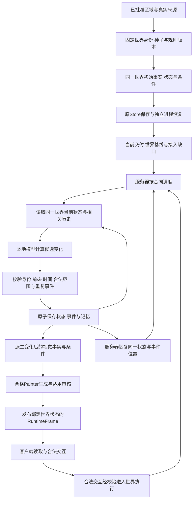

# AI-PET-WORLD 唯一模块计划表

更新时间：2026-11-10 23:39:29 +08:00

状态：active-module-plan

治理依据：[执行治理](../../AGENTS.md)、[主体职责与权威顺序](../DOCUMENT_AUTHORITY_INDEX.md#gov-owner-001owner不进入本地ai正常运行状态机)（`GOV-OWNER-001`）。

## 1. 用途与状态来源

本文是全项目唯一模块计划表，只记录模块级目标、边界、验收条件和阶段状态。业务规则、架构和机器合同由对应正式规格定义；逐次运行、命令、Checkpoint、失败现场和资源账本保存于机器记录。

表中状态不构成聊天授权。本地系统按生效合同运行；外部执行工作以当前明确委托为边界。动态执行状态由当前执行登记、事务、受管进程、锁、心跳和实际产物共同核验，不从本文或旧目录时间推断。

## 2. 当前模块计划

当前优先交付业务第3.2节规定的原始自然世界先行闭环：同一世界的真实来源、事实和条件，本地模型完整地图，适用机器审核，Runtime发布、保存重入及服务器持续运行。人物、五类动物和建设按下表及各自前置条件衔接，不以自然地图完成替代完整产品MVP。

下表定义模块范围、缺口和完成条件。CPU组件、GPU准入、训练、固定验证、画质审核、能力发布与世界验收分别判断；不从历史训练、诊断或部分通过继承当前资格。活动任务、原始失败、逐次结果及实际源码身份只查询当前执行登记和机器证据。

历史执行叙述已按原字节保存到[既有整改机器记录](../../.runtime/ai-painter/controller-repair-reviews/codebase-governance-repair-20261110/project-structure-20261110-2314/plan-historical-narratives.json)，原运行及合同保持。该记录只用于历史复核，不是当前执行计划或恢复授权。

| 顺序 | 模块 | 目标与当前范围 | 当前状态及缺口 | 完成条件 |
|---:|---|---|---|---|
| 1 | 平台可靠性与文档治理修复 | 权威链、正式文档结构、机器合同与实现一致 | 已修正存档与RuntimeFrame写入保护、行为连续性、工程检查器及发布身份／MVP适用范围冲突，文档基线采用主体规格1.68及审核存储规格1.20；旧执行规程仍按冻结1.60原字节复核。完整观察分支已核验实际CPU超时格式并完成占用隔离；训练系统中断分支已完成真实登记、SQLite一致读回与旧占用原字节隔离。旧规格、原执行及原guard字节保留。类型、lint及定向联合回归通过，环境阻断与未验收项分别记录；不以文档或局部通过签发模型资格 | 文档结构、链接、版本与检查器一致；恢复程序独立验收，文档通过与模型资格分开 |
| 2 | AI Painter R5／Stage4静态自然地图 | WorldFacts与23通道驱动完整RGB；256×192为训练阶段，正式发布须原生1024×768；现行64份及48/8/4/4用途不变 | 同父多图及边界监督对照已完成，边界监督改善部分道路但候选仍拒绝；参考表示对照已完成，多数模型失败不能归为缩放必然损失 | 保留已关闭对照及原裁决，依据事实对齐与绝对画质继续模型路线；取得适用正式原生整图资格后接自然世界Runtime，不以训练或诊断替代发布资格 |
| 3 | 本地自研AI MVP能力迁移 | 本地从登记配置自动准备新Run、受管CPU、精确计划及执行包，连续完成GPU准入、训练、Checkpoint、验证、审核、裁决和终态；提供本地状态查询及安全停止，仅迁移确定流程 | 原control-v2真实执行已覆盖发起端退出后的准备、包物化、完整GPU准入、24轮训练、Checkpoint重载、验证、审核拒绝及终态登记，不依赖Codex逐阶段接包。当前源码的既有CPU原生正常／故意失败／自有停止及v1发起端退出夹具已各单次通过，受管Job、流、私有guard和退出后六阶段／SQLite证据见`.runtime/ai-painter/controller-repair-reviews/local-native-acceptance-003-20261022/`；使用隔离认证，不代替full-v2准备、生产认证、物理断网、实际关闭Codex、生产式原生登记终态或正式发布验收。既有失败登记与控制台联验保持各自证据；未知诊断、代码修复、自然语言任务调度及下一候选规划未迁移，不宣称全能力脱离Codex | DEP-AUTH-001至005和CTRL-LOCAL-001至009按各自真实证据验收。共用原后台、登记及guard；部署、组件、真实认证、当前整链终态、停止与物理离线分别验收。画质通过不是确定流程迁移前置，也不能以后台进程存活替代真实闭环 |
| 4 | 人物人格与初始外貌 | 紫微优先，缺时辰按八字三柱；人格与外貌、映射模式与性别呈现分离 | 已有部分映射代码；外貌资料与完整视觉链待建设。纳入完整MVP衔接范围，尚无本轮实现及验收证据 | MVP-VIS-02通过；规则、来源、参数、精度及降级可追溯 |
| 5 | 五类现实动物与生命数据 | 泰国首区有限现实生物集、生境与健康／活动状态 | 分类、代表物种和版本化名录待研究。纳入完整MVP衔接范围，尚无合格名录及生命数据版本 | MVP-VIS-03通过；五类逐项具备合格来源、生境、状态与用途资格 |
| 6 | 生命视觉与动态Runtime | 人格驱动行动与反馈先行，动物生命能力及房屋／社区建设后置 | 新生命条件、时序数据、模型责任与审核待实现；随自然地图与生命输入前置条件衔接，不把静态地图训练当成本模块完成 | 人物子范围依赖模块4及自然世界视觉基础，动物子范围另依赖模块5；按独立能力身份完成行动、状态、记忆及存档验收 |
| 7 | 正式世界接入与整体MVP验收 | 服务器持续运行；模型结合状态、环境及历史计算演化，Runtime校验执行、更新记忆并绑定视觉与保存恢复 | 自然存档组件已限定验收；模型演化、记忆实际消费、无客户端会话连续推进及原生语义审核／发布整链未取得完整合格证据。复用既有Runtime／Store，不以初始化或静态图替代 | 自然先行范围分别核验WORLD-AUTO-001至004、适用原生资格、RuntimeFrame与保存重入；完整产品另按MVP-VIS-01至08，均不依赖Codex |
| 8 | 控制台真实训练观察接入 | 当前登记到实时摘要、历史详情及精确制品的统一只读接口，沿用现行控制台架构及AI-CONSOLE-DATA-API-1.27 | 已接入受信阶段、计数、终态、失败、已存图像与预览，保留原轮询、分页及历史选择。本轮worker开始、结束及单调耗时已接到当前／最近执行和历史详情；列表仅在自身已提供可用计时时展开，不逐卡增加详情请求。实际HTTP、原文件SHA和组件渲染及专项回归已联验，计时范围不冒称纯GPU或完整Run。后续采用同一计时协议的运行由本地程序记录，旧记录不回填，缺证据保持未知；本次没有改数据库、后端或训练执行器。证据见`.runtime/ai-painter/controller-repair-reviews/interface-contract-unification-20261019/namespace-v2/controller-timing-display-acceptance.json`。本次真实浏览器hydration未测；全量历史覆盖、冷层未来查询性能、部分索引验证函数的生产采用及symlink环境反例仍未完整验收，不将这些后置项追加为训练前置 | 相同接口自动呈现真实运行与已核验制品；起止时间、耗时与登记时间各守原范围，未知值不补造，身份、摘要、新鲜度及错误原因准确。训练完成、审核与发布资格分别呈现，不以局部展示改造宣称全历史或完整MVP已通过 |
| 9 | 本地数据总汇、备份、工作台账与代码提交 | 复用既有工作台形成总计划、真实成果、验收证据、受信归集及页面读回闭环，遵循[独立模块规格](../LOCAL_BACKUP_AND_WORK_LEDGER_SPEC.md) | 文档、图源、工作列表／详情及进度展示已有组件验证；全48项已有成果核对、完整来源覆盖及常驻自动归集仍待独立核验。缺口显示未知，不用有限固定证据的3/48冒充真实整体进度；真实全量备份／恢复和Git生产资格仍分别未验 | LB-ACCEPT-001至010、LB-PROGRESS-001至006及LB-GIT-001至004分项验收；文档计划、实际实现、验收状态、源事件／核验／读取时间与覆盖各守范围；只读页面不扩大世界训练权限 |

模块2与3是并列主线。完整MVP衔接范围覆盖模块4至7，按各自数据、合同、实现和验收前置条件推进；范围纳入不等于模块已实施或已通过。模块1承担必要的文档与可靠性收口；已明确委托的模块8接口及模块9数据管理保持各自边界。外部执行期限、资源和实际交付只记录在机器任务证据，不由本计划表或长期规划推导新的外部授权；模块9不作为训练、审核或能力迁移的新增前置条件。

候选状态按能力身份区分：主体规格第17.2节明确绑定Stage4 V2父合同、`stage4_semantic_transport_v2.py`及冻结Autoencoder的条目，描述该实现的符合性，不是本表decode_1精度候选的运行结论；二者不得互相继承CPU、GPU、训练或审核资格。第17.3节的原Smoke缺口也不能自动解释为后继隔离训练仍采用相同更新路径。单项未建立新候选的明确对应及四层证据前，保持原未认证状态，不用新候选训练尝试替旧实现补记通过。

证据读取使用现有唯一登记及其`terminalEvidence`路径—SHA绑定、事务和SQLite，以及控制台`/api/ai-console/training/history/<runId>`的精确历史查询。先核对能力、包、Run、程序与数据范围，再读取对应记录；历史选择不改写当前执行。追踪表的“CPU检查输出”“回归已通过”等泛称不是唯一证据身份；不能核验的历史支持声明已从现行符合依据撤下，并在`.runtime/ai-painter/controller-repair-reviews/fix-a69-20261014/documentation-evidence-ledger-v1.json`逐需求登记处置。D-02以纠正声明及明确查询责任收口，37条需求本身不因此通过；后续能力自身的真实证据缺口仍分别管理，不将其混成文档整改的无限待办。

本轮世界目标同时遵循业务规格WORLD-AUTO-001至004与总体架构第2.0.1节：用户仅通过客户端访问，世界模型、状态、历史记忆和执行器在服务器；客户端下线不暂停世界。本地模型计算演化，程序校验执行并保存，相关历史实际参与后续计算。模块2的绘图验证、模块3的确定流程迁移与模块7的世界演化／发布／存档必须分别推进和验收，不以静态地图交付替代世界业务。

上述是当前目标及责任澄清，不是已实现声明。世界演化模型、时序学习资料、历史记忆输入、服务器无会话执行及真实连续状态推进尚缺本轮合格证据，按模块7既有Runtime复用范围建设和独立验证；不得以现有初始化、状态字段、存档通过或Painter训练补记完成。基础约束不等于全部手写演化，新增模型实现须经版本化能力合同。人物、动物和建设仍按原依赖后置，不扩大为完整地球模拟或第二后台。

## 3. 当前自然世界切片

当前首个交付为基于已批准泰国首区真实来源、独立世界身份与种子的原始自然世界。模型读取该世界实际生成的事实与23通道；训练数据发布只承担学习知识来源，不能将某份train或validation样本的PNG、身份或审核直接充作新世界。道路、水体、岸线及对象审核适用性由实际事实和冻结合同确定；未覆盖能力明确保留未验证。此前slot-189与256×192只作为历史先行诊断范围，不作为当前正式世界来源或展示资格。train及其他划分保留原用途，验证失败像素不参与权重优化。

本节自然世界先行切片不预建房屋或人工路网，不消费人格、动物或角色动作能力；这不是对第2节完整MVP衔接范围的排除。人物、五类动物、生命状态和人物—世界闭环按模块4至7及其各自前置条件推进，尚未验收的能力保持未通过。世界扩展及完整建设体系仍按业务规格后置。自然物可读性、事实一致性及既有定量审核继续适用；装饰性纹理、道路边缘和非关键光影精修后置。

分段交付采用业务规格第3.2节：原始自然世界，随后人格映射与性格驱动行动，最后房屋视觉及角色自主修路、种植、基建和社区建设。本切片成功仅证明所验场景，不等于正式Stage0、完整Stage4或整体MVP验收。

### 3.1 固定一个世界的交付基线

当前先固定一个自然世界，作为从生成到持续运行的贯穿交付对象。本步骤是模块7既有工作的聚合视图，不增加第二套计划或统计分母；详细结构为第9节同一JSON中的currentDelivery，引用原叶子工作项。具体worldId、候选路径、运行时间、状态和证据保存到机器记录，不能在正式计划内补写为已完成。

1. **固定身份**：绑定实际worldId、regionId、种子、世界配置、规则版本及初始tick/stateVersion，核对所有者／玩家关联、来源、事实、状态和条件的真实摘要。优先复用适用的既有候选，不为重新统计而重建世界。
2. **确认初始内容**：核对地形、水体、植被与环境，区分来源事实、气候背景、模拟场景和缺失项；确认视觉条件对应同一世界、同一状态，不能以训练样本PNG或聊天说明替代。
3. **确认保存恢复**：复用原Store，在隔离候选范围保存并由独立进程读取；比较身份、事实与状态、规则、时间／版本、事件游标和随机状态。通用组件通过不等于本轮选定世界已完成这一验证。
4. **列清接入缺口**：将绘图、模型演化、记忆实际消费、审核／RuntimeFrame及服务器持续运行映射至原计划项，逐项注明实际实现、缺口、证据与下一交付。基线通过不等于持续运行或完整MVP通过。

交付为同一世界身份及产物绑定、初始内容对照、独立保存恢复结果和接入缺口。当前步骤不要求先训练、改变模型路线、增加人物动物建设，亦不把完整产品的后置模块倒置成基线前置。只有当前世界证据足够时才判断本步通过；没有绑定时明确显示“本轮世界基线尚未登记”，不得用已有组件完成率推算本轮完成率。

### 3.2 同一世界交付与持续运行关系图

此图按业务WORLD-AUTO-001至004和总体架构第2.0.1节展示目标关系，图上节点不表示已经实现。当前步骤为固定世界、核对初始状态及独立保存恢复；其余为后续接入。状态提交与画面发布分别验收，客户端连接不控制服务器世界生命周期。



## 4. 历史阶段计数与当前进度

旧程序的`progress()`在`scripts/lib/ai-painter-stage4-direct-clean-latent-cpu-support-v1.mjs`及`scripts/lib/ai-painter-stage4-direct-clean-latent-readonly-gpu-v1.mjs`固定返回`completedStages=3`、`totalStages=5`、`percent=60`。这证明数值的代码来源，不证明五个阶段的业务名称、前三项成功验收或跨候选继承。机器原字段与历史记录保留，不通过文档重写旧计数。

历史五项名称已从Git版本`c48d77a7`的原指南第26至30行定位，原文分别为：

1. 失败证据与修复方向。
2. 候选、训练器支持与隔离配置。
3. 固定GPU资格。
4. Stage0→Stage1→Stage2完整训练、固定复现与机器审核。
5. 不参与权重更新和Checkpoint选择的独立严格复验。

该列表只解释旧字段，不是当前候选的第二张计划表。原指南的前三项“已完成”没有直接绑定可复核的唯一验收终态和摘要，不能仅凭文字认证。`542c1c05`原指南第28行及`8eba77b0`第47至53行已明确：后继候选须自己的合同、行为测试及真实GPU证据，旧计数不能迁移成V2或其他候选已通过。

据此，3/5（60%）退出当前候选完成率、产品完成率、剩余工作量及估时依据，只保留为历史投影。D-06的文档缺陷以“定义来源已定位、完成声明未认证、不适用于当前进度”收口，不为维持历史百分比补跑旧阶段，不改旧机器字段或失败证据，也不宣称旧前三项已得到机器认证。

当前进度按第2节模块的实际交付和证据缺口报告：代码检查、CPU/GPU准入、训练、Checkpoint、固定审核、发布及Runtime各自独立。候选更换后，模型、数值、数据及程序资格由新候选重新取得；通用实现只有在实际绑定、范围和复用规则核验后才能复用。训练结束、失败留档或诊断完成不自动形成阶段晋级。

Stage0／1／2适用分辨率、完整审核及独立严格复验仍按对应合同执行。512×384与1024×768保留但暂不启动；四段生成责任、训练分辨率和生命能力资格分别管理。

## 5. 实现、资产与恢复边界

WorldFacts是世界事实权威。条件、模型RGB、审核与Runtime的职责不互相替代；PNG是视觉产物，不单独证明可运行世界。现行V2与失败V1隔离，旧Denoiser、失败权重及已消费执行仅供历史复核。

基础Autoencoder与来源数据是不同依赖；按精确身份、内容摘要、冻结状态和用途核验，文件日期或旧版本字段不构成停用依据。原图、数据划分、历史包、失败证据与审核结论保持；未开展新的外部改图或扩充数据。人物／动物需要独立条件扩展及能力身份，不占用既有自然物通道。

遗留占用分为启动前和已启动两类，分别适用审核／存储规格第11.9与11.11节。已启动的匿名Windows Job缺少可靠原活跃清理回执时，PID消失或磁盘空Job观察不能证明清理。新恢复分支只允许在同一主机的真实新内核开机周期、完整身份及登记核验通过后，按同一事务保留原字节隔离；不认证历史清理，也不允许旧任务重放。

## 6. 模块接续与历史边界

1. 接续前核对当前入口、实际源码、数据、能力身份及对应合同，不能从旧章节号、旧预算或聊天结论恢复已关闭运行。
2. 工程结构调整先保护正常行为；源码身份改变后，涉及的执行资格按适用合同重新验证，不改历史摘要或降低门限。
3. 原失败现场、冻结规程、Checkpoint及清理回执保持。缺少原始现场的诊断，不补造重放或根因结论。
4. 正式进度来自同一世界和同一候选的可核验证据。先行组件通过不替代模型资格、原生语义审核、RuntimeFrame或完整产品验收。
5. 具体运行状态与后继条件保存到当前执行登记、工作记录和机器证据；本计划不记录逐次命令、训练流水或重复诊断过程。

## 7. 整体MVP验收边界

整体MVP仍以业务规格两大核心及反馈闭环为准，沿用东南亚兼容档案和泰国首区事实包。人格、外貌、五类动物、生命状态、行动反馈及保存恢复分别按主体规格第18节验收；像素统计不能代替VJ-2真实语义审核。

正式画面必须通过能力发布及RuntimeFrame门。规范要求、实现状态、测试结果和运行事实分开；文档整编与孤立组件测试不构成模型、发布或MVP通过。

## 8. 正式依据

- [文档权威索引](../DOCUMENT_AUTHORITY_INDEX.md)
- [业务规格](../BUSINESS_SPEC.md)
- [总体架构](../ARCHITECTURE.md)
- [本地AI能力与迁移架构](../LOCAL_SELF_DEVELOPED_AI_CAPABILITY_AND_CODEX_MIGRATION_ARCHITECTURE.md)
- [AI Painter正式主体规格](AI_PAINTER_FORMAL_IMPLEMENTATION_SPEC.md)
- [审核自动化与存储规格](REVIEW_AUTOMATION_AND_STORAGE_SPEC.md)

## 9. 模块计划的可核验工作项展开

以下是本表九模块目标的完整叶子展开，按LB-PROGRESS-006计数。只有叶子交付项进入分母，父模块、重复依赖、诊断尝试和测试数量不另计；此处不保存完成状态或运行日志。当前自然世界先行、人物与动物后置的实施边界不因全产品计划展开而改变。

每项的组件、生产采用、质量或整链范围以deliverable和doneWhen为准；共有能力按主归属交付，其他模块依赖引用。条件依赖写于requirementRefs，只在对应人物／动物／疾病子范围适用，不反向阻塞自然先行或人物最小行动。生命模型训练归模块6，不从模块2静态地图质量继承。

工作项版本：`work-plan-141-v1`。这段机器展开是唯一计划的一部分，不是第二计划源；实时完成、剩余、证据及比例由受限状态投影给出。

```json
{"schemaVersion":"whole-product-work-plan-v1","version":"work-plan-141-v1","items":[
{"id":"PLAN-01-001","moduleId":"1","title":"权威文档与执行职责","deliverable":"有效文档权威链及本地AI／外部执行职责边界。","doneWhen":"必读链、唯一计划、文档唯一修改职责及本地日常自主边界在现行正式文件一致定义并经核对。","dependsOn":[],"requirementRefs":["AGENTS.md §1/3/6","DOCUMENT-AUTHORITY GOV-OWNER-001"]},
{"id":"PLAN-01-002","moduleId":"1","title":"全量文档检查通过","deliverable":"正式文档的版本、链接、元数据及编码检查。","doneWhen":"现行文档治理、文档策略和源码编码检查全部通过，无遗留违反项。","dependsOn":["PLAN-01-001"],"requirementRefs":["AGENTS.md §4","CURRENT_EXECUTION_GUIDE module1"]},
{"id":"PLAN-01-003","moduleId":"1","title":"历史规范不可变读取","deliverable":"历史规范按原始字节和用途读取，与现行规范隔离。","doneWhen":"精确SHA／大小绑定、缺原件不回退、篡改和读取竞态拒绝等既有读取器测试通过；环境未执行反例单独保留。","dependsOn":["PLAN-01-001"],"requirementRefs":["AI-PAINTER-SPEC §17","DIRECTORY_STRUCTURE document-baselines"]},
{"id":"PLAN-01-004","moduleId":"1","title":"现行合同全量程序符合","deliverable":"当前正式规范适用要求与程序、测试、运行证据的完整对应。","doneWhen":"全部适用要求有同基线机器符合证明，整份符合汇总无未满足或未判定项。","dependsOn":["PLAN-01-001","PLAN-01-002","PLAN-01-003"],"requirementRefs":["AI-PAINTER-SPEC §17.2/17.3"]},
{"id":"PLAN-02-001","moduleId":"2","title":"合法64图训练发布与用途身份","deliverable":"真实64张发布身份、逐文件来源与许可可复算；48/8/4/4用途和顺序冻结；不得把116条来源总索引当64发布样本","doneWhen":"按现行来源策略重算批准基础发布的64图成员、逐文件摘要、来源身份及48/8/4/4用途顺序；后继活动选择和模型画质另验。","dependsOn":[],"requirementRefs":["AI-PAINTER-SPEC-1.158§8","AI-PAINTER-SPEC-1.158AP-TRAIN-002","来源规格§2"]},
{"id":"PLAN-02-002","moduleId":"2","title":"训练与独立评估隔离","deliverable":"固定validation/challenge/regression不更新或选择训练权重；同源序列与实体分组隔离；污染或篡改拒绝","doneWhen":"固定validation/challenge/regression不更新或选择训练权重；同源序列与实体分组隔离；污染或篡改拒绝","dependsOn":["PLAN-02-001"],"requirementRefs":["AI-PAINTER-SPEC-1.158AP-TRAIN-002/004","AI-PAINTER-SPEC-1.158§18.6 MVP-VIS-07"]},
{"id":"PLAN-02-003","moduleId":"2","title":"训练条件与逐责任接口","deliverable":"23通道身份及几何、对象和最终RGB责任映射明确；逐类条件反事实响应和梯度可达；不改变WorldFacts","doneWhen":"23通道身份及几何、对象和最终RGB责任映射明确；逐类条件反事实响应和梯度可达；不改变WorldFacts","dependsOn":["PLAN-02-001"],"requirementRefs":["AI-PAINTER-SPEC-1.158§6四段接口","AI-PAINTER-SPEC-1.158AP-PHASE-001/002.a/003.a/004.a"]},
{"id":"PLAN-02-004","moduleId":"2","title":"原生完整RGB技术输出","deliverable":"本地模型从真实新世界条件直接产1024×768完整RGB；无放大拼接；绑定输入、模型与实际图像SHA","doneWhen":"本地模型从真实新世界条件直接产1024×768完整RGB；无放大拼接；绑定输入、模型与实际图像SHA","dependsOn":["PLAN-02-003"],"requirementRefs":["AI-PAINTER-SPEC-1.158AP-OUT-001","AI-PAINTER-SPEC-1.158§18.5"]},
{"id":"PLAN-02-005","moduleId":"2","title":"完整原生训练的资源与数值准入","deliverable":"完整模型规定的全部前向和五梯度在预算内完成；原门全部核验；资源停止/随机状态/清理证据真实","doneWhen":"完整模型规定的全部前向和五梯度在预算内完成；原门全部核验；资源停止/随机状态/清理证据真实","dependsOn":["PLAN-02-003"],"requirementRefs":["AI-PAINTER-SPEC-1.158§9.25-9.27","AI-PAINTER-SPEC-1.158§18.5 只读GPU资格"]},
{"id":"PLAN-02-006","moduleId":"2","title":"正式256训练阶段与成功父权重","deliverable":"当前能力完成256×192正式训练；保存成功终态、严格重载、固定验证及审核；形成合法下一阶段父权重","doneWhen":"当前能力完成256×192正式训练；保存成功终态、严格重载、固定验证及审核；形成合法下一阶段父权重","dependsOn":["PLAN-02-002","PLAN-02-005"],"requirementRefs":["AI-PAINTER-SPEC-1.158AP-TRAIN-003/004","AI-PAINTER-SPEC-1.158§18.5 Stage0"]},
{"id":"PLAN-02-007","moduleId":"2","title":"正式512训练阶段","deliverable":"只从同正式链256成功父权重加载；完成512×384训练/验证/审核；逐文件身份真实","doneWhen":"只从同正式链256成功父权重加载；完成512×384训练/验证/审核；逐文件身份真实","dependsOn":["PLAN-02-006"],"requirementRefs":["AI-PAINTER-SPEC-1.158AP-TRAIN-004","AI-PAINTER-SPEC-1.158§18.5 Stage1"]},
{"id":"PLAN-02-008","moduleId":"2","title":"正式1024训练阶段","deliverable":"只从同正式链512成功父权重加载；原生1024×768训练、严格重载、固定验证和审核全部通过","doneWhen":"只从同正式链512成功父权重加载；原生1024×768训练、严格重载、固定验证和审核全部通过","dependsOn":["PLAN-02-007"],"requirementRefs":["AI-PAINTER-SPEC-1.158AP-TRAIN-004","AI-PAINTER-SPEC-1.158§18.5 Stage2"]},
{"id":"PLAN-02-009","moduleId":"2","title":"地形道路水文事实对齐质量","deliverable":"地形、自然通行、适用道路、水文和岸线达到冻结质量门；条件冲突明确拒绝；不以道路后置免除已有事实","doneWhen":"地形、自然通行、适用道路、水文和岸线达到冻结质量门；条件冲突明确拒绝；不以道路后置免除已有事实","dependsOn":["PLAN-02-003","PLAN-02-008"],"requirementRefs":["AI-PAINTER-SPEC-1.158AP-PHASE-002.a","AI-PAINTER-SPEC-1.158§10","BUSINESS1.8§3.2"]},
{"id":"PLAN-02-010","moduleId":"2","title":"自然对象逐类可辨识质量","deliverable":"tree/rock/vegetation/footprints逐类可辨并对齐；适用位置、遮挡、尺寸和碰撞一致；逐类证据不能被整图Loss取代","doneWhen":"tree/rock/vegetation/footprints逐类可辨并对齐；适用位置、遮挡、尺寸和碰撞一致；逐类证据不能被整图Loss取代","dependsOn":["PLAN-02-003","PLAN-02-008"],"requirementRefs":["AI-PAINTER-SPEC-1.158AP-PHASE-003.a","AI-PAINTER-SPEC-1.158§18.6 MVP-VIS-08"]},
{"id":"PLAN-02-011","moduleId":"2","title":"适用语义审核器与冻结评判合同","deliverable":"完整地图VJ0/VJ1/VJ2适用性冻结；真实有来源正反标注/公式阈值与独立验证；未知审核器失败关闭","doneWhen":"完整地图VJ0/VJ1/VJ2适用性冻结；真实有来源正反标注/公式阈值与独立验证；未知审核器失败关闭","dependsOn":["PLAN-02-009","PLAN-02-010"],"requirementRefs":["AI-PAINTER-SPEC-1.158§10","AI-PAINTER-SPEC-1.158§18.6","AI-PAINTER-REVIEW-STORAGE-1.31§15.1"]},
{"id":"PLAN-02-012","moduleId":"2","title":"独立严格复验与能力泛化","deliverable":"challenge/regression未参与训练与选择；冻结候选在独立集通过语义/质量/条件审核；暴露集合与后继候选隔离","doneWhen":"challenge/regression未参与训练与选择；冻结候选在独立集通过语义/质量/条件审核；暴露集合与后继候选隔离","dependsOn":["PLAN-02-008","PLAN-02-011"],"requirementRefs":["AI-PAINTER-SPEC-1.158§18.5 独立严格复验","AI-PAINTER-SPEC-1.158AP-TRAIN-002"]},
{"id":"PLAN-02-013","moduleId":"2","title":"Painter机器能力发布与回退","deliverable":"重算数据/模型/条件/审核/测试/Runtime与源码血缘；受信注册表原子登记；失败保持上一有效能力或明确不可用","doneWhen":"重算数据/模型/条件/审核/测试/Runtime与源码血缘；受信注册表原子登记；失败保持上一有效能力或明确不可用","dependsOn":["PLAN-02-012"],"requirementRefs":["AI-PAINTER-SPEC-1.158§12/17.1","AI-PAINTER-SPEC-1.158§18.5 能力发布","AI-PAINTER-REVIEW-STORAGE-1.31§7/13"]},
{"id":"PLAN-02-014","moduleId":"2","title":"不合格候选隔离及可追溯失败反馈","deliverable":"失败权重/图片不晋级；真实失败、输入与审核保持；修正形成独立能力身份且有新测试，不改原门","doneWhen":"失败权重/图片不晋级；真实失败、输入与审核保持；修正形成独立能力身份且有新测试，不改原门","dependsOn":["PLAN-02-001"],"requirementRefs":["AI-PAINTER-SPEC-1.158§11","AI-PAINTER-REVIEW-STORAGE-1.31§6"]},
{"id":"PLAN-03-001","moduleId":"3","title":"固定登记配置自动准备新运行","deliverable":"本地从固定注册配置建立新Run；重算真实源码/数据/规范身份；受管CPU及精确执行包由程序生成；禁止任意脚本/旧包重放","doneWhen":"本地从固定注册配置建立新Run；重算真实源码/数据/规范身份；受管CPU及精确执行包由程序生成；禁止任意脚本/旧包重放","dependsOn":[],"requirementRefs":["AI-PAINTER-REVIEW-STORAGE-1.31CTRL-LOCAL-007","MIGRATION1.8§0.9"]},
{"id":"PLAN-03-002","moduleId":"3","title":"发起端退出后的连续执行内核","deliverable":"发起端在准备未完成时退出；本地连续推进规定阶段并持久化终态；不读取聊天或等待外部继续；至少两次独立新运行","doneWhen":"发起端在准备未完成时退出；本地连续推进规定阶段并持久化终态；不读取聊天或等待外部继续；至少两次独立新运行","dependsOn":["PLAN-03-001"],"requirementRefs":["AI-PAINTER-REVIEW-STORAGE-1.31CTRL-LOCAL-001/002/009","MIGRATION1.8§0.9"]},
{"id":"PLAN-03-003","moduleId":"3","title":"受管正常执行与可靠原生清理","deliverable":"同调用保留descriptor/Job句柄；正常执行后取得可靠空Job与流关闭；只释放自身guard","doneWhen":"既有受管CPU控制内核的受管正常执行与可靠原生清理由隔离实际执行及原生清理回执核验；生产完整链与真实部署分别由PLAN-03-009／008验收。","dependsOn":[],"requirementRefs":["AI-PAINTER-REVIEW-STORAGE-1.31CTRL-LOCAL-004/006"]},
{"id":"PLAN-03-004","moduleId":"3","title":"首错失败关闭与终态一致性","deliverable":"准备/运行错误停止后继阶段；原首错优先；日志、终态、事件和SQLite身份一致；观察错误不得重放业务","doneWhen":"既有受管CPU控制内核的首错失败关闭与终态一致性由隔离实际执行及原生清理回执核验；生产完整链与真实部署分别由PLAN-03-009／008验收。","dependsOn":["PLAN-03-001"],"requirementRefs":["AI-PAINTER-REVIEW-STORAGE-1.31CTRL-LOCAL-005/008","MIGRATION1.8§7.8"]},
{"id":"PLAN-03-005","moduleId":"3","title":"认证停止与理由的安全传递","deliverable":"核验Run/包/创建身份/修订/期限/防重；请求接受、消费、理由交接、真实停止及清理分别证明；不停止无关任务","doneWhen":"既有受管CPU控制内核的认证停止与理由的安全传递由隔离实际执行及原生清理回执核验；生产完整链与真实部署分别由PLAN-03-009／008验收。","dependsOn":["PLAN-03-003"],"requirementRefs":["AI-PAINTER-REVIEW-STORAGE-1.31CTRL-LOCAL-003/004/005"]},
{"id":"PLAN-03-006","moduleId":"3","title":"重放拒绝与幂等运行恢复","deliverable":"消费标识/锁/事务防重复；重启或重复请求不重复训练；只恢复同一合法事务或失败关闭","doneWhen":"消费标识/锁/事务防重复；重启或重复请求不重复训练；只恢复同一合法事务或失败关闭","dependsOn":["PLAN-03-004"],"requirementRefs":["AI-PAINTER-REVIEW-STORAGE-1.31CTRL-LOCAL-007/009","AI-PAINTER-REVIEW-STORAGE-1.31§11.3"]},
{"id":"PLAN-03-007","moduleId":"3","title":"本地只读状态查询","deliverable":"无需Codex会话读取真实当前登记及精确终态；身份/过期/失败明确；查询不启动进程或改状态","doneWhen":"无需Codex会话读取真实当前登记及精确终态；身份/过期/失败明确；查询不启动进程或改状态","dependsOn":["PLAN-03-004"],"requirementRefs":["AI-PAINTER-REVIEW-STORAGE-1.31CTRL-LOCAL-002/008","MIGRATION1.8§7.10"]},
{"id":"PLAN-03-008","moduleId":"3","title":"真实部署认证一致采用","deliverable":"稳定部署配置/ACL/秘密保护；签发服务和独立进程实际采用同一配置；生产HMAC/CSRF验证；只记录安全元数据","doneWhen":"稳定部署配置/ACL/秘密保护；签发服务和独立进程实际采用同一配置；生产HMAC/CSRF验证；只记录安全元数据","dependsOn":[],"requirementRefs":["AI-PAINTER-REVIEW-STORAGE-1.31DEP-AUTH-001至005"]},
{"id":"PLAN-03-009","moduleId":"3","title":"当前生产控制链完整运行与终态","deliverable":"当前固定候选从配置到GPU准入/训练/重载/验证/审核/裁决/终态真实接续；正常、失败、停止分别验收；不以画质通过为流程前提","doneWhen":"当前固定候选从配置到GPU准入/训练/重载/验证/审核/裁决/终态真实接续；正常、失败、停止分别验收；不以画质通过为流程前提","dependsOn":["PLAN-03-002","PLAN-03-008"],"requirementRefs":["AI-PAINTER-REVIEW-STORAGE-1.31CTRL-LOCAL-006/009","MIGRATION1.8§0.6.1/0.9"]},
{"id":"PLAN-03-010","moduleId":"3","title":"实际离线与Codex退出边界验收","deliverable":"在本地依赖和认证齐备时实际关闭发起会话/Codex并按声明网络隔离；流程继续形成有效终态；无外部AI调用/下载","doneWhen":"在本地依赖和认证齐备时实际关闭发起会话/Codex并按声明网络隔离；流程继续形成有效终态；无外部AI调用/下载","dependsOn":["PLAN-03-008","PLAN-03-009"],"requirementRefs":["AI-PAINTER-REVIEW-STORAGE-1.31CTRL-LOCAL-009","MIGRATION1.8§0.6.1/0.9"]},
{"id":"PLAN-03-011","moduleId":"3","title":"当前程序采用及迁移范围登记","deliverable":"逐项登记真实执行方/版本/证据/回退；已迁移确定流程不再等待Codex；未迁移诊断/修复/下一候选规划明确外部承担","doneWhen":"逐项登记真实执行方/版本/证据/回退；已迁移确定流程不再等待Codex；未迁移诊断/修复/下一候选规划明确外部承担","dependsOn":["PLAN-03-009","PLAN-03-010"],"requirementRefs":["MIGRATION1.8§13/15","AI-PAINTER-REVIEW-STORAGE-1.31§15"]},
{"id":"PLAN-04-001","moduleId":"4","title":"人格来源与游戏映射规则版本包","deliverable":"合格紫微/八字规则包及来源版本清单","doneWhen":"来源与适用范围可追溯；人格规则、模式及缺失语义可固定复现；候选研究不冒充生效规则。","dependsOn":[],"requirementRefs":["2.1 @ BUSINESS_SPEC.md","11.1 @ game-world-generation/TRAINING_DATA_AND_SOURCE_POLICY.md"]},
{"id":"PLAN-04-002","moduleId":"4","title":"受限出生资料精度快照","deliverable":"出生资料快照Schema及受限持久记录","doneWhen":"历法/时区/合法日期/时辰完整度/映射模式/来源版本明确；原始敏感值不进入普通预览或Painter。","dependsOn":["PLAN-04-001"],"requirementRefs":["4.1 @ ARCHITECTURE.md","11.1 @ game-world-generation/TRAINING_DATA_AND_SOURCE_POLICY.md"]},
{"id":"PLAN-04-003","moduleId":"4","title":"合法出生资料入口","deliverable":"严格日期与资料边界校验入口","doneWhen":"合法日期接受；缺失/非法/范围外日期返回资料不可用；正反边界结果绑定当前入口。","dependsOn":["PLAN-04-002"],"requirementRefs":["18.2 @ game-world-generation/AI_PAINTER_FORMAL_IMPLEMENTATION_SPEC.md","18.6 @ game-world-generation/AI_PAINTER_FORMAL_IMPLEMENTATION_SPEC.md"]},
{"id":"PLAN-04-004","moduleId":"4","title":"出生资料三路分流","deliverable":"完整时辰/缺时辰/不可用三路路由组件","doneWhen":"完整时辰且规则可用优先紫微；缺时辰为THREE_PILLARS并标精度；计算错误不静默伪装资料不足。","dependsOn":["PLAN-04-001","PLAN-04-003"],"requirementRefs":["18.2 @ game-world-generation/AI_PAINTER_FORMAL_IMPLEMENTATION_SPEC.md","18.6 @ game-world-generation/AI_PAINTER_FORMAL_IMPLEMENTATION_SPEC.md"]},
{"id":"PLAN-04-005","moduleId":"4","title":"映射模式和性别呈现独立选择","deliverable":"用户选择到人格入口的独立模式参数","doneWhen":"现实/平行模式与性别呈现分离；禁止固定self_projection/默认男性冒充选择；无有效平行外貌规则明确不可用。","dependsOn":["PLAN-04-001","PLAN-04-002"],"requirementRefs":["2.1 @ BUSINESS_SPEC.md","18.2 @ game-world-generation/AI_PAINTER_FORMAL_IMPLEMENTATION_SPEC.md"]},
{"id":"PLAN-04-006","moduleId":"4","title":"当前人格计算与稳定输出组件","deliverable":"现有合法资料到确定性人格结果的计算组件","doneWhen":"在当前代码及固定已提供映射参数下，完整时辰和缺时辰都产生人格结果；同输入输出一致，sourceType/algorithm、模式及birthTimeMode保留。","dependsOn":["PLAN-04-003","PLAN-04-004"],"requirementRefs":["2.1 @ BUSINESS_SPEC.md","18.2 @ game-world-generation/AI_PAINTER_FORMAL_IMPLEMENTATION_SPEC.md","4.1 @ ARCHITECTURE.md"]},
{"id":"PLAN-04-007","moduleId":"4","title":"人格档案来源资格与版本封套","deliverable":"包含合格来源和规则版本身份的稳定人格档案","doneWhen":"在已完成计算结果外提供正式合格规则版本、来源摘要、模式/精度、稳定档案身份与可追溯版本封套，不能仅以sourceType和algorithm冒充来源版本。","dependsOn":["PLAN-04-001","PLAN-04-005","PLAN-04-006"],"requirementRefs":["2.1 @ BUSINESS_SPEC.md","18.2 @ game-world-generation/AI_PAINTER_FORMAL_IMPLEMENTATION_SPEC.md","4.1 @ ARCHITECTURE.md"]},
{"id":"PLAN-04-008","moduleId":"4","title":"人物实例身份与人格隔离","deliverable":"实例绑定的人物人格实体身份","doneWhen":"同出生资料不同实例有独立人物entityId；复现档案不共用世界存储；人格复现及实例隔离成对验证。","dependsOn":["PLAN-04-007"],"requirementRefs":["4.1 @ ARCHITECTURE.md","18.2 @ game-world-generation/AI_PAINTER_FORMAL_IMPLEMENTATION_SPEC.md","18.6 @ game-world-generation/AI_PAINTER_FORMAL_IMPLEMENTATION_SPEC.md"]},
{"id":"PLAN-04-009","moduleId":"4","title":"合格初始外貌映射规则","deliverable":"有使用资格的版本化游戏外貌规则表","doneWhen":"文本/规则来源及版本、使用权、原文定位、参数单位/范围、缺失与冲突处理和正反边界齐全；候选相术不直接生效。","dependsOn":["PLAN-04-001","PLAN-04-004"],"requirementRefs":["18.2 @ game-world-generation/AI_PAINTER_FORMAL_IMPLEMENTATION_SPEC.md","11.1 @ game-world-generation/TRAINING_DATA_AND_SOURCE_POLICY.md"]},
{"id":"PLAN-04-010","moduleId":"4","title":"独立初始外貌档案","deliverable":"CharacterAppearanceProfile产出组件","doneWhen":"entityId/profileVersion/mappingRuleVersion/来源hash/参数单位/缺失项/seed/内容hash齐全；与人格分离，不由Painter猜脸。","dependsOn":["PLAN-04-008","PLAN-04-009"],"requirementRefs":["4.1 @ ARCHITECTURE.md","18.2 @ game-world-generation/AI_PAINTER_FORMAL_IMPLEMENTATION_SPEC.md"]},
{"id":"PLAN-04-011","moduleId":"4","title":"外貌复现与档案版本保持","deliverable":"可复现且升级不覆盖旧档案的外貌生成器","doneWhen":"同输入规则seed同档案；不同实例身份隔离；规则升版重验，旧档案原字节不覆盖。","dependsOn":["PLAN-04-010"],"requirementRefs":["18.2 @ game-world-generation/AI_PAINTER_FORMAL_IMPLEMENTATION_SPEC.md","4.1 @ ARCHITECTURE.md"]},
{"id":"PLAN-04-012","moduleId":"4","title":"隐私最小化派生接口","deliverable":"人格/外貌到世界视觉的受控派生档案接口","doneWhen":"下游只接派生游戏档案与受限来源引用；公开日志、样本、预览不展开原始出生资料。","dependsOn":["PLAN-04-007","PLAN-04-010"],"requirementRefs":["4.1 @ ARCHITECTURE.md","11.1 @ game-world-generation/TRAINING_DATA_AND_SOURCE_POLICY.md"]},
{"id":"PLAN-04-013","moduleId":"4","title":"既有创建Gateway的保存调用协议","deliverable":"创建Gateway到既有Store适配协议的连接组件","doneWhen":"当前Gateway创建tick0记录后将同一记录交给Store协议；Store成功则报告persisted=true，Store失败则false。只核验调用及返回语义，不宣称落盘。","dependsOn":[],"requirementRefs":["18.6 @ game-world-generation/AI_PAINTER_FORMAL_IMPLEMENTATION_SPEC.md","4.1 @ ARCHITECTURE.md"]},
{"id":"PLAN-04-014","moduleId":"4","title":"完整人物档案保存及读回接线","deliverable":"人物档案和外貌hash完整保存读回的创建流程","doneWhen":"create API把模式/精度/人格/人物身份/外貌档案接到同世界；真实保存读回保持档案hash和实体身份。","dependsOn":["PLAN-04-011","PLAN-04-012","PLAN-04-013","PLAN-07-003"],"requirementRefs":["18.6 @ game-world-generation/AI_PAINTER_FORMAL_IMPLEMENTATION_SPEC.md","4.1 @ ARCHITECTURE.md"]},
{"id":"PLAN-04-015","moduleId":"4","title":"人物创建适用闭环","deliverable":"MVP-VIS-02完整适用验收记录","doneWhen":"三路资料、模式/规则缺失拒绝、同档案复现、实例隔离、外貌及保存链均按真实当前版本验收；组件通过不代替整链。","dependsOn":["PLAN-04-014","PLAN-06-015","PLAN-07-013"],"requirementRefs":["18.6 @ game-world-generation/AI_PAINTER_FORMAL_IMPLEMENTATION_SPEC.md","18.2 @ game-world-generation/AI_PAINTER_FORMAL_IMPLEMENTATION_SPEC.md"]},
{"id":"PLAN-05-001","moduleId":"5","title":"五类动物分类合同","deliverable":"显式五个animalTypeId的名录结构","doneWhen":"固定数量单位及分类层级；类型不是图片/颜色/个体/模型数；具体类型经合格资料确定，不在此建议臆造名称。","dependsOn":[],"requirementRefs":["18.3 @ game-world-generation/AI_PAINTER_FORMAL_IMPLEMENTATION_SPEC.md","11.1 @ game-world-generation/TRAINING_DATA_AND_SOURCE_POLICY.md"]},
{"id":"PLAN-05-002","moduleId":"5","title":"真实物种来源条目","deliverable":"每类型至少一个真实speciesId来源条目集","doneWhen":"学名/稳定物种ID/区域分布/来源版本/使用资格齐全；别名不增加类型计数。","dependsOn":["PLAN-05-001"],"requirementRefs":["18.3 @ game-world-generation/AI_PAINTER_FORMAL_IMPLEMENTATION_SPEC.md","11.1 @ game-world-generation/TRAINING_DATA_AND_SOURCE_POLICY.md"]},
{"id":"PLAN-05-003","moduleId":"5","title":"首区生境适用数据","deliverable":"物种至首区生境的来源绑定表","doneWhen":"每物种有适用生境、来源依据及不可用边界；候选allowedBiomes字段不等同已验证区域事实。","dependsOn":["PLAN-05-002","PLAN-07-001"],"requirementRefs":["11.1 @ game-world-generation/TRAINING_DATA_AND_SOURCE_POLICY.md","18.3 @ game-world-generation/AI_PAINTER_FORMAL_IMPLEMENTATION_SPEC.md"]},
{"id":"PLAN-05-004","moduleId":"5","title":"动物形态与尺度档案","deliverable":"有单位和界限的物种/个体稳定形态参数","doneWhen":"外形可识别、尺度和有界个体差异明确；稳定形态不随刷新漂移，不伪造生物数值。","dependsOn":["PLAN-05-002"],"requirementRefs":["18.3 @ game-world-generation/AI_PAINTER_FORMAL_IMPLEMENTATION_SPEC.md","4.1 @ ARCHITECTURE.md","11.1 @ game-world-generation/TRAINING_DATA_AND_SOURCE_POLICY.md"]},
{"id":"PLAN-05-005","moduleId":"5","title":"物种状态与可见体征规则","deliverable":"每物种健康/活动/症状及不适用项规则表","doneWhen":"健康/患病/恢复、活动/休息及适用体征有依据；真实事实与游戏抽象分离；不强套人类症状。","dependsOn":["PLAN-05-002"],"requirementRefs":["3.1 @ BUSINESS_SPEC.md","18.4 @ game-world-generation/AI_PAINTER_FORMAL_IMPLEMENTATION_SPEC.md","11.1 @ game-world-generation/TRAINING_DATA_AND_SOURCE_POLICY.md"]},
{"id":"PLAN-05-006","moduleId":"5","title":"动物动作和环境约束数据","deliverable":"物种动作/活动范围/资源环境限制定义","doneWhen":"可执行动作、活动范围、营养/疲劳与环境资源约束按物种定义，未定义明确不可用。","dependsOn":["PLAN-05-003","PLAN-05-005"],"requirementRefs":["18.3 @ game-world-generation/AI_PAINTER_FORMAL_IMPLEMENTATION_SPEC.md","4.1 @ ARCHITECTURE.md","11.1 @ game-world-generation/TRAINING_DATA_AND_SOURCE_POLICY.md"]},
{"id":"PLAN-05-007","moduleId":"5","title":"五类名录发布","deliverable":"版本化AnimalRoster发布件","doneWhen":"五个唯一类型、真实物种、来源/生境/状态/完整度/hash已验并登记；候选计划不得直接发布。","dependsOn":["PLAN-05-003","PLAN-05-004","PLAN-05-005","PLAN-05-006"],"requirementRefs":["4.1 @ ARCHITECTURE.md","18.3 @ game-world-generation/AI_PAINTER_FORMAL_IMPLEMENTATION_SPEC.md","11.1 @ game-world-generation/TRAINING_DATA_AND_SOURCE_POLICY.md"]},
{"id":"PLAN-05-008","moduleId":"5","title":"动物实体运行合同","deliverable":"WorldEntity兼容的动物实体适配","doneWhen":"动物接入现有实体/空间/碰撞/交互合同，含稳定entityId/物种/profileHash/状态版本；不新建动物后台或平行存档。","dependsOn":["PLAN-05-007","PLAN-06-001"],"requirementRefs":["4.1 @ ARCHITECTURE.md","18.3 @ game-world-generation/AI_PAINTER_FORMAL_IMPLEMENTATION_SPEC.md"]},
{"id":"PLAN-05-009","moduleId":"5","title":"动物创建与别名去重","deliverable":"合法名录动物的独立实例创建器","doneWhen":"同物种别名规范化不重复计类型；不同个体有独立ID；位置/活动/初始状态合法。","dependsOn":["PLAN-05-008"],"requirementRefs":["18.6 @ game-world-generation/AI_PAINTER_FORMAL_IMPLEMENTATION_SPEC.md","18.3 @ game-world-generation/AI_PAINTER_FORMAL_IMPLEMENTATION_SPEC.md"]},
{"id":"PLAN-05-010","moduleId":"5","title":"动物名录与生境入口约束","deliverable":"动物创建/注入的资格验证入口","doneWhen":"名录外物种、重复计数及错误生境注入明确拒绝，拒绝前后正式世界不变。","dependsOn":["PLAN-05-003","PLAN-05-009"],"requirementRefs":["18.6 @ game-world-generation/AI_PAINTER_FORMAL_IMPLEMENTATION_SPEC.md","18.3 @ game-world-generation/AI_PAINTER_FORMAL_IMPLEMENTATION_SPEC.md"]},
{"id":"PLAN-05-011","moduleId":"5","title":"动物状态与用途覆盖审计","deliverable":"五类型及支持状态的覆盖矩阵","doneWhen":"每已发布类型和支持状态有固定正反样本、来源与用途资格；张数/组合/阈值由新合同预先登记，64自然地图不补生命覆盖。","dependsOn":["PLAN-05-007","PLAN-06-016"],"requirementRefs":["11.1 @ game-world-generation/TRAINING_DATA_AND_SOURCE_POLICY.md","18.3 @ game-world-generation/AI_PAINTER_FORMAL_IMPLEMENTATION_SPEC.md"]},
{"id":"PLAN-05-012","moduleId":"5","title":"五类动物创建适用闭环","deliverable":"MVP-VIS-03完整适用验收记录","doneWhen":"五类型真实来源/生境、独立实体/去重及错误注入拒绝均由当前名录/代码/运行证据验收；不以三个dictionary候选替代。","dependsOn":["PLAN-05-010","PLAN-05-011"],"requirementRefs":["18.6 @ game-world-generation/AI_PAINTER_FORMAL_IMPLEMENTATION_SPEC.md","11.1 @ game-world-generation/TRAINING_DATA_AND_SOURCE_POLICY.md"]},
{"id":"PLAN-06-001","moduleId":"6","title":"生命状态快照","deliverable":"EntityStateSnapshot运行Schema与适配","doneWhen":"world/region/entity/tick/stateVersion/profileHash/物种/姿向/动作/健康营养疲劳/原因/前态hash完整；null与0/健康/静止不混写。","dependsOn":[],"requirementRefs":["4.1 @ ARCHITECTURE.md","18.4 @ game-world-generation/AI_PAINTER_FORMAL_IMPLEMENTATION_SPEC.md","条件依赖：character instance state → PLAN-04-008","条件依赖：animal instance state → PLAN-05-004"]},
{"id":"PLAN-06-002","moduleId":"6","title":"生命合法状态转移","deliverable":"带原因和前态校验的生命状态转移器","doneWhen":"支持适用健康→患病→恢复和活动→休息→活动，非法跳转拒绝；不改变稳定身份。","dependsOn":["PLAN-06-001"],"requirementRefs":["3.1 @ BUSINESS_SPEC.md","18.4 @ game-world-generation/AI_PAINTER_FORMAL_IMPLEMENTATION_SPEC.md","条件依赖：animal-specific health/activity → PLAN-05-005"]},
{"id":"PLAN-06-003","moduleId":"6","title":"状态限制与行动规则","deliverable":"生命状态对动作/结果的约束适配","doneWhen":"适用健康/疲劳/资源限制真实影响合法行动结果；同环境受控对照可解释，不用建设失败恢复压力冒充疾病。","dependsOn":["PLAN-06-001"],"requirementRefs":["3.1 @ BUSINESS_SPEC.md","18.4 @ game-world-generation/AI_PAINTER_FORMAL_IMPLEMENTATION_SPEC.md","18.6 @ game-world-generation/AI_PAINTER_FORMAL_IMPLEMENTATION_SPEC.md","条件依赖：health/illness action restrictions → PLAN-06-002"]},
{"id":"PLAN-06-004","moduleId":"6","title":"人物感知事实输入","deliverable":"本地角色模型实际读取的世界感知接口","doneWhen":"位置、环境、资源、时间和事件等实际输入有身份；沿现有Runtime，不能由Painter决定事实。","dependsOn":["PLAN-04-007","PLAN-07-003"],"requirementRefs":["2.1 @ BUSINESS_SPEC.md","3.2 @ BUSINESS_SPEC.md","18.6 @ game-world-generation/AI_PAINTER_FORMAL_IMPLEMENTATION_SPEC.md"]},
{"id":"PLAN-06-005","moduleId":"6","title":"人格记忆驱动目标决策","deliverable":"实际本地模型到合法意图的接线","doneWhen":"稳定人格、相关记忆与当前事实形成目标和合法意图；规则门负责约束，确定性评分不冒充已迁移学习模型。","dependsOn":["PLAN-06-004"],"requirementRefs":["2.1 @ BUSINESS_SPEC.md","3.2 @ BUSINESS_SPEC.md","18.6 @ game-world-generation/AI_PAINTER_FORMAL_IMPLEMENTATION_SPEC.md"]},
{"id":"PLAN-06-006","moduleId":"6","title":"性格差异的受控倾向","deliverable":"冻结环境下可解释人格倾向验收","doneWhen":"同环境/受控随机重复试验验证不同人格的决策倾向；不以两次随机输出差异或机械标签决定证明人格有效。","dependsOn":["PLAN-06-005"],"requirementRefs":["3.2 @ BUSINESS_SPEC.md","18.6 @ game-world-generation/AI_PAINTER_FORMAL_IMPLEMENTATION_SPEC.md"]},
{"id":"PLAN-06-007","moduleId":"6","title":"前期合法角色行动","deliverable":"不含建设的最小行动执行器","doneWhen":"当前合法行动通过规则执行后真实改变资源/状态；行动及前后态/原因可追溯，不用后置建设链代替。","dependsOn":["PLAN-06-005","PLAN-06-003"],"requirementRefs":["3.2 @ BUSINESS_SPEC.md","18.6 @ game-world-generation/AI_PAINTER_FORMAL_IMPLEMENTATION_SPEC.md"]},
{"id":"PLAN-06-008","moduleId":"6","title":"角色行动结果原子提交","deliverable":"状态/资源/事件在同世界状态版本的提交适配","doneWhen":"以worldId+tick+expectedStateVersion提交角色结果、资源及事件；失败不污染，正式写入与视觉发布分别记录。","dependsOn":["PLAN-06-007","PLAN-07-003"],"requirementRefs":["4.1 @ ARCHITECTURE.md","18.6 @ game-world-generation/AI_PAINTER_FORMAL_IMPLEMENTATION_SPEC.md"]},
{"id":"PLAN-06-009","moduleId":"6","title":"持久人物记忆更新","deliverable":"真实行动结果进入人物事件和偏好记录","doneWhen":"应用实际memory-state偏好/事件更新并持久化；与已有traceMemorySeed派生/评分机制区分，不能以mock当完成。","dependsOn":["PLAN-06-008"],"requirementRefs":["2.1 @ BUSINESS_SPEC.md","3.2 @ BUSINESS_SPEC.md","18.6 @ game-world-generation/AI_PAINTER_FORMAL_IMPLEMENTATION_SPEC.md"]},
{"id":"PLAN-06-010","moduleId":"6","title":"记忆进入再决策","deliverable":"下一轮模型实际消费已提交人物经历","doneWhen":"记录真实记忆输入与本轮输出身份；受控相关历史对照证明作用；无关历史不强求输出不同。","dependsOn":["PLAN-06-009","PLAN-06-005"],"requirementRefs":["3.2 @ BUSINESS_SPEC.md","18.6 @ game-world-generation/AI_PAINTER_FORMAL_IMPLEMENTATION_SPEC.md"]},
{"id":"PLAN-06-011","moduleId":"6","title":"既有角色Runtime安全写入门","deliverable":"真实Gateway/API的存档前置与审核写入门组件","doneWhen":"空/损坏/失败/缺记录不得默建或写tick；合法tick沿原身份及expectedTick；审核失败不提交。此项仅现有Gateway确定性安全组件。","dependsOn":[],"requirementRefs":["18.5 @ game-world-generation/AI_PAINTER_FORMAL_IMPLEMENTATION_SPEC.md","18.6 @ game-world-generation/AI_PAINTER_FORMAL_IMPLEMENTATION_SPEC.md"]},
{"id":"PLAN-06-012","moduleId":"6","title":"重复行动安全裁决","deliverable":"重复动作/diff/placement/资源事务阻断组件","doneWhen":"近三次行为规范化识别、duplicate diff/placement/transaction阻断；该组件输出blocking结果，生产提交幂等另由module6.13验收。","dependsOn":[],"requirementRefs":["18.6 @ game-world-generation/AI_PAINTER_FORMAL_IMPLEMENTATION_SPEC.md","4.1 @ ARCHITECTURE.md"]},
{"id":"PLAN-06-013","moduleId":"6","title":"角色行动持久幂等","deliverable":"行动重试/重复提交不重复消费的正式提交链","doneWhen":"行动幂等身份与状态版本/资源事务原子保存；并发/重启/重复通知不重复扣资源；不以纯audit规则替代整链。","dependsOn":["PLAN-06-008","PLAN-06-011","PLAN-06-012"],"requirementRefs":["4.1 @ ARCHITECTURE.md","18.6 @ game-world-generation/AI_PAINTER_FORMAL_IMPLEMENTATION_SPEC.md"]},
{"id":"PLAN-06-014","moduleId":"6","title":"生命与角色经历恢复适配","deliverable":"档案/实体状态/记忆游标/随机状态恢复闭包","doneWhen":"沿既有Store保存恢复同一人物及动物身份、规则/事件位置/随机状态；已提交行动不重放，不建立新存档系统。","dependsOn":["PLAN-06-001","PLAN-06-009","PLAN-06-013","PLAN-07-003"],"requirementRefs":["4.1 @ ARCHITECTURE.md","18.6 @ game-world-generation/AI_PAINTER_FORMAL_IMPLEMENTATION_SPEC.md"]},
{"id":"PLAN-06-015","moduleId":"6","title":"生命视觉事实条件扩展","deliverable":"独立生命Manifest和条件适配","doneWhen":"实体档案/状态hash、可见体征、姿态位置/遮挡接地、变化事实与不变特征完整；显式新版本，不偷占既有自然23通道。","dependsOn":["PLAN-04-010","PLAN-06-001"],"requirementRefs":["4.1 @ ARCHITECTURE.md","18.4 @ game-world-generation/AI_PAINTER_FORMAL_IMPLEMENTATION_SPEC.md"]},
{"id":"PLAN-06-016","moduleId":"6","title":"合格生命与时序数据发布","deliverable":"有身份分组隔离的生命数据包","doneWhen":"档案/状态hash/实体/seq/world/region/tick/前后态/时间间隔/帧hash与RGB来源权利齐全；同人物/动物个体/生成谱系/相邻序列不得跨四split；沿既有包根独立发布。","dependsOn":["PLAN-06-015","PLAN-02-001"],"requirementRefs":["11.1 @ game-world-generation/TRAINING_DATA_AND_SOURCE_POLICY.md","18.4 @ game-world-generation/AI_PAINTER_FORMAL_IMPLEMENTATION_SPEC.md","18.5 @ game-world-generation/AI_PAINTER_FORMAL_IMPLEMENTATION_SPEC.md","条件依赖：animal visual/sequence subset → PLAN-05-004,PLAN-05-005"]},
{"id":"PLAN-06-017","moduleId":"6","title":"生命能力输入输出及责任合同","deliverable":"新生命能力版本的模型/时序/Loss/审核映射合同","doneWhen":"新增生命输入、时序约束、责任输出、Loss、审核与资产角色可追溯；自然地图模型/Autoencoder资格不自动继承。","dependsOn":["PLAN-06-015","PLAN-06-016"],"requirementRefs":["18.4 @ game-world-generation/AI_PAINTER_FORMAL_IMPLEMENTATION_SPEC.md","18.5 @ game-world-generation/AI_PAINTER_FORMAL_IMPLEMENTATION_SPEC.md"]},
{"id":"PLAN-06-018","moduleId":"6","title":"合格生命视觉能力接入","deliverable":"生命视觉模型的训练、独立审核及版本接入。","doneWhen":"合格生命时序数据和条件驱动本地生命模型，形成适用能力版本与独立质量／身份审核，不借静态地图资格继承。","dependsOn":["PLAN-06-017","PLAN-02-013"],"requirementRefs":["18.4 @ game-world-generation/AI_PAINTER_FORMAL_IMPLEMENTATION_SPEC.md","18.5 @ game-world-generation/AI_PAINTER_FORMAL_IMPLEMENTATION_SPEC.md","生命视觉训练和资格属于本项交付，不由静态自然Painter资格继承。"]},
{"id":"PLAN-06-019","moduleId":"6","title":"实体视觉绑定","deliverable":"EntityVisualBinding输出和状态一致适配","doneWhen":"候选、实体、轮廓占用范围、状态引用、原生完整RGB及审核引用正确绑定；Painter不得新造健康或碰撞事实。","dependsOn":["PLAN-06-018","PLAN-06-015"],"requirementRefs":["4.1 @ ARCHITECTURE.md","18.4 @ game-world-generation/AI_PAINTER_FORMAL_IMPLEMENTATION_SPEC.md"]},
{"id":"PLAN-06-020","moduleId":"6","title":"生命语义与身份审核","deliverable":"冻结的形态/身份/健康时序审核器","doneWhen":"公式/单位/比较符/适用范围/阈值和正反样本预先登记；身份漂移、未知症状和状态错帧可拒绝，不用像素相似度代替语义。","dependsOn":["PLAN-06-016","PLAN-06-019"],"requirementRefs":["18.4 @ game-world-generation/AI_PAINTER_FORMAL_IMPLEMENTATION_SPEC.md","18.6 @ game-world-generation/AI_PAINTER_FORMAL_IMPLEMENTATION_SPEC.md"]},
{"id":"PLAN-06-021","moduleId":"6","title":"连续生命三tick闭环","deliverable":"MVP-VIS-04的适用连续生命运行证据","doneWhen":"同实体至少3合法tick，健康/患病/恢复及活动休息适用路径可追溯；体型样本可区分，形态身份稳定且未知症状不造假。","dependsOn":["PLAN-06-002","PLAN-06-003","PLAN-06-020","PLAN-05-012"],"requirementRefs":["3.1 @ BUSINESS_SPEC.md","18.6 @ game-world-generation/AI_PAINTER_FORMAL_IMPLEMENTATION_SPEC.md"]},
{"id":"PLAN-06-022","moduleId":"6","title":"生命状态与正式帧边界","deliverable":"生命状态到现有RuntimeFrame的一致性适配","doneWhen":"帧与同world/tick/profile/state绑定，碰撞/实体状态一致；跨身份/旧帧/失败候选拒绝；发布原子机制归模块7。","dependsOn":["PLAN-06-019","PLAN-06-020","PLAN-07-013"],"requirementRefs":["4.1 @ ARCHITECTURE.md","18.6 @ game-world-generation/AI_PAINTER_FORMAL_IMPLEMENTATION_SPEC.md"]},
{"id":"PLAN-06-023","moduleId":"6","title":"生命tick与采样资源合同","deliverable":"登记的更新/采样/延迟与资源恢复合同","doneWhen":"tick与视觉采样频率分别定义；间隔/延迟/内存显存磁盘/超时/尝试恢复上限齐全；缺帧陈旧与阻断真实报告。","dependsOn":["PLAN-06-017","PLAN-03-003"],"requirementRefs":["18.4 @ game-world-generation/AI_PAINTER_FORMAL_IMPLEMENTATION_SPEC.md","18.5 @ game-world-generation/AI_PAINTER_FORMAL_IMPLEMENTATION_SPEC.md"]},
{"id":"PLAN-06-024","moduleId":"6","title":"人物世界反馈适用闭环","deliverable":"MVP-VIS-05真实角色-世界-记忆闭环证据","doneWhen":"感知→目标→合法行动→资源/状态→持久记忆→再决策；状态限制及持久幂等成立，保存恢复后持续；不以规则测试或默认旧存档前提失败代替本闭环。","dependsOn":["PLAN-06-006","PLAN-06-010","PLAN-06-013","PLAN-06-014"],"requirementRefs":["3.2 @ BUSINESS_SPEC.md","18.6 @ game-world-generation/AI_PAINTER_FORMAL_IMPLEMENTATION_SPEC.md"]},
{"id":"PLAN-07-001","moduleId":"7","title":"真实新世界自然事实生产","deliverable":"来源许可/测量/新seed/六项身份形成新几何WorldFacts；不挪用旧样本或虚构天气","doneWhen":"来源许可/测量/新seed/六项身份形成新几何WorldFacts；不挪用旧样本或虚构天气","dependsOn":[],"requirementRefs":["BUSINESS1.8§3.2","ARCHITECTURE1.14§4.3"]},
{"id":"PLAN-07-002","moduleId":"7","title":"新世界23条件与模型实际输入","deliverable":"同一世界factHash→导演/条件/对象表→真实23通道模型输入；用途身份不冒充训练样本","doneWhen":"同一世界factHash→导演/条件/对象表→真实23通道模型输入；用途身份不冒充训练样本","dependsOn":["PLAN-07-001"],"requirementRefs":["ARCHITECTURE1.14§4.3","AI-PAINTER-SPEC-1.158MVP-VIS-01"]},
{"id":"PLAN-07-003","moduleId":"7","title":"自然事实状态与随机状态持久化","deliverable":"完整身份/事实/状态/规则/游标/RNG恢复；CAS/事务/路径反例拒绝；两个既有适配器","doneWhen":"完整身份/事实/状态/规则/游标/RNG恢复；CAS/事务/路径反例拒绝；两个既有适配器","dependsOn":["PLAN-07-001"],"requirementRefs":["ARCHITECTURE1.14§4.2","AI-PAINTER-SPEC-1.158MVP-VIS-06"]},
{"id":"PLAN-07-004","moduleId":"7","title":"服务器世界执行器部署与生命周期","deliverable":"复用既有服务器入口/锁/资源合同；登记真实世界调度/维护/故障生命周期；不依赖浏览器","doneWhen":"复用既有服务器入口/锁/资源合同；登记真实世界调度/维护/故障生命周期；不依赖浏览器","dependsOn":["PLAN-07-003"],"requirementRefs":["BUSINESS1.8WORLD-AUTO-001","ARCHITECTURE1.14§2.0.1"]},
{"id":"PLAN-07-005","moduleId":"7","title":"世界演化模型数据与差量合同","deliverable":"合格时序数据；状态/环境/跨度/历史输入与候选差量/原因输出合同；模型能力身份明确","doneWhen":"合格时序数据；状态/环境/跨度/历史输入与候选差量/原因输出合同；模型能力身份明确","dependsOn":["PLAN-07-001"],"requirementRefs":["BUSINESS1.8WORLD-AUTO-002","ARCHITECTURE1.14§2.0.1"]},
{"id":"PLAN-07-006","moduleId":"7","title":"相关事件和历史摘要身份链","deliverable":"有界事件/摘要绑定原因、前后态、逻辑时间和原始来源；查询范围可复现","doneWhen":"有界事件/摘要绑定原因、前后态、逻辑时间和原始来源；查询范围可复现","dependsOn":["PLAN-07-003","PLAN-07-005"],"requirementRefs":["BUSINESS1.8WORLD-AUTO-003","ARCHITECTURE1.14§2.0.1"]},
{"id":"PLAN-07-007","moduleId":"7","title":"演化模型实际输入与合法候选推理","deliverable":"同一世界当前状态+环境+时间跨度+相关历史实际进入模型；真实推理产生有限合法候选差量及原因","doneWhen":"同一世界当前状态+环境+时间跨度+相关历史实际进入模型；真实推理产生有限合法候选差量及原因","dependsOn":["PLAN-07-005","PLAN-07-006"],"requirementRefs":["BUSINESS1.8WORLD-AUTO-002"]},
{"id":"PLAN-07-008","moduleId":"7","title":"候选约束校验与正式状态事务","deliverable":"校验世界/前态/时间/单位范围/重复消费；SafeApply原子提交状态+事件+记忆；非法候选不污染","doneWhen":"校验世界/前态/时间/单位范围/重复消费；SafeApply原子提交状态+事件+记忆；非法候选不污染","dependsOn":["PLAN-07-007","PLAN-07-003"],"requirementRefs":["BUSINESS1.8WORLD-AUTO-002/004","ARCHITECTURE1.14§2.0.1"]},
{"id":"PLAN-07-009","moduleId":"7","title":"无客户端会话持续推进","deliverable":"全部客户端退出后服务器完成连续有效世界变化；不暂停/重建世界；不以tick空加代替","doneWhen":"全部客户端退出后服务器完成连续有效世界变化；不暂停/重建世界；不以tick空加代替","dependsOn":["PLAN-07-004","PLAN-07-008"],"requirementRefs":["BUSINESS1.8WORLD-AUTO-001/004"]},
{"id":"PLAN-07-010","moduleId":"7","title":"历史记忆的冻结因果对照","deliverable":"在声明依赖历史场景固定状态/模型/随机性；相关历史改变影响结果；无关历史不强求不同","doneWhen":"在声明依赖历史场景固定状态/模型/随机性；相关历史改变影响结果；无关历史不强求不同","dependsOn":["PLAN-07-007"],"requirementRefs":["BUSINESS1.8WORLD-AUTO-003/004"]},
{"id":"PLAN-07-011","moduleId":"7","title":"演化事件游标与RNG续接防重","deliverable":"恢复已提交事件位置/记忆/RNG；不重复消费不丢已提交变化；未完成步骤安全恢复或停止","doneWhen":"恢复已提交事件位置/记忆/RNG；不重复消费不丢已提交变化；未完成步骤安全恢复或停止","dependsOn":["PLAN-07-006","PLAN-07-008"],"requirementRefs":["BUSINESS1.8WORLD-AUTO-003"]},
{"id":"PLAN-07-012","moduleId":"7","title":"自然原生帧的资格证明读门","deliverable":"真实已发布Painter、同一快照/条件/模型/图像/审核身份；拒绝缺证/伪passed/跨能力候选","doneWhen":"真实已发布Painter、同一快照/条件/模型/图像/审核身份；拒绝缺证/伪passed/跨能力候选","dependsOn":["PLAN-02-013","PLAN-07-002"],"requirementRefs":["AI-PAINTER-SPEC-1.158MVP-VIS-08","ARCHITECTURE1.14§4"]},
{"id":"PLAN-07-013","moduleId":"7","title":"自然RuntimeFrame原子发布和当前读回","deliverable":"owner/world/tick/stateVersion/事实状态摘要绑定；原子指针/事务/CAS；跨world/tick/能力和失败候选拒绝","doneWhen":"owner/world/tick/stateVersion/事实状态摘要绑定；原子指针/事务/CAS；跨world/tick/能力和失败候选拒绝","dependsOn":["PLAN-07-012","PLAN-07-008"],"requirementRefs":["AI-PAINTER-SPEC-1.158MVP-VIS-06/08","ARCHITECTURE1.14§4.1"]},
{"id":"PLAN-07-014","moduleId":"7","title":"正式/world与图像入口一致展示","deliverable":"页面和两个图片入口共享真实当前自然读门；原生图像内容SHA重算；旧帧明确陈旧或阻断","doneWhen":"页面和两个图片入口共享真实当前自然读门；原生图像内容SHA重算；旧帧明确陈旧或阻断","dependsOn":["PLAN-07-013"],"requirementRefs":["AI-PAINTER-SPEC-1.158MVP-VIS-08","ARCHITECTURE1.14§4"]},
{"id":"PLAN-07-015","moduleId":"7","title":"主动暂停维护与资源故障隔离","deliverable":"声明暂停/维护/恢复时间语义；资源故障/非法输出留证停止；不伪造停机计算或污染状态","doneWhen":"声明暂停/维护/恢复时间语义；资源故障/非法输出留证停止；不伪造停机计算或污染状态","dependsOn":["PLAN-07-004","PLAN-07-008"],"requirementRefs":["BUSINESS1.8WORLD-AUTO-001/004"]},
{"id":"PLAN-07-016","moduleId":"7","title":"服务器重启与同世界存档重入","deliverable":"实际中断/重启恢复最后有效同世界提交；事件/RNG/时间/身份不重复；重新绑定合法帧","doneWhen":"实际中断/重启恢复最后有效同世界提交；事件/RNG/时间/身份不重复；重新绑定合法帧","dependsOn":["PLAN-07-011","PLAN-07-013","PLAN-07-015"],"requirementRefs":["BUSINESS1.8WORLD-AUTO-004","AI-PAINTER-SPEC-1.158MVP-VIS-06"]},
{"id":"PLAN-07-017","moduleId":"7","title":"自然世界先行端到端验收","deliverable":"真实来源→新事实→模型→适用审核→正式帧→无会话运行→保存重入完整通过；自然阶段不倒置生命为前置","doneWhen":"真实来源→新事实→模型→适用审核→正式帧→无会话运行→保存重入完整通过；自然阶段不倒置生命为前置","dependsOn":["PLAN-07-009","PLAN-07-010","PLAN-07-014","PLAN-07-016"],"requirementRefs":["BUSINESS1.8§3.2","AI-PAINTER-SPEC-1.158§18.1/18.6"]},
{"id":"PLAN-07-018","moduleId":"7","title":"完整产品MVP集成验收","deliverable":"自然世界+人格/外貌+五类动物+连续生命状态+行动记忆反馈+保存恢复+失败隔离均有独立与集成证据","doneWhen":"自然世界+人格/外貌+五类动物+连续生命状态+行动记忆反馈+保存恢复+失败隔离均有独立与集成证据","dependsOn":["PLAN-07-017","PLAN-04-015","PLAN-05-012","PLAN-06-024"],"requirementRefs":["BUSINESS1.8§3.1","AI-PAINTER-SPEC-1.158§18.6"]},
{"id":"PLAN-08-001","moduleId":"8","title":"受信当前身份与历史选择隔离","deliverable":"受信当前身份与历史选择隔离","doneWhen":"当前任务、活动执行、最近终态与所选历史Run分别投影，切换历史不改当前身份","dependsOn":[],"requirementRefs":["AI-CONSOLE current identity"]},
{"id":"PLAN-08-002","moduleId":"8","title":"真实阶段、计数与失败摘要","deliverable":"真实阶段、计数与失败摘要","doneWhen":"阶段及G/D计数绑定当前源；无值显示未知；失败不被GPU活跃或SQLite健康覆盖","dependsOn":[],"requirementRefs":["AI-CONSOLE observation"]},
{"id":"PLAN-08-003","moduleId":"8","title":"资源与遥测身份校验","deliverable":"资源与遥测身份校验","doneWhen":"遥测仅在Run/PID/时间匹配时展示，不以设备活动推定执行成功","dependsOn":[],"requirementRefs":["AP-03"]},
{"id":"PLAN-08-004","moduleId":"8","title":"实际执行起止及单调耗时","deliverable":"实际执行起止及单调耗时","doneWhen":"worker原始计时在摘要和历史一致展示；旧数据不补造时间","dependsOn":[],"requirementRefs":["Guide module8 timing"]},
{"id":"PLAN-08-005","moduleId":"8","title":"精确历史详情查询","deliverable":"精确历史详情查询","doneWhen":"按固定runId读真实终态，保持当前身份和历史查询独立","dependsOn":[],"requirementRefs":["Guide module8 history"]},
{"id":"PLAN-08-006","moduleId":"8","title":"图像及预览与制品身份绑定","deliverable":"图像及预览与制品身份绑定","doneWhen":"已保存图像按注册制品读取且摘要/身份一致，不拿空预览当模型产物","dependsOn":[],"requirementRefs":["Guide module8 artifacts"]},
{"id":"PLAN-08-007","moduleId":"8","title":"历史列表筛选和有限分页","deliverable":"历史列表筛选和有限分页","doneWhen":"筛选/分页/选择保持独立，不逐卡发详情请求并保留游标修订","dependsOn":[],"requirementRefs":["Guide module8 history"]},
{"id":"PLAN-08-008","moduleId":"8","title":"真实浏览器训练观察联验","deliverable":"真实浏览器训练观察联验","doneWhen":"实际摘要/历史/图像/时间可读，前台刷新与hydration无错误，截图可复查","dependsOn":[],"requirementRefs":["Guide module8 browser"]},
{"id":"PLAN-08-009","moduleId":"8","title":"全量历史覆盖核验","deliverable":"全量历史覆盖核验","doneWhen":"索引完整覆盖明确冻结的历史来源范围，缺档逐项列出而非以最新Run替代","dependsOn":[],"requirementRefs":["Guide module8 full-history"]},
{"id":"PLAN-08-010","moduleId":"8","title":"冷层查询路径及性能验证","deliverable":"冷层查询路径及性能验证","doneWhen":"冷层明确范围可查询且有实际有界性能与错误证据，不将热层夹具替代","dependsOn":[],"requirementRefs":["Guide module8 cold-history"]},
{"id":"PLAN-08-011","moduleId":"8","title":"索引验证生产采用","deliverable":"索引验证生产采用","doneWhen":"实际生产宿主采用既有验证函数，并有版本/来源/错误拒绝读回","dependsOn":[],"requirementRefs":["Guide module8 adoption"]},
{"id":"PLAN-08-012","moduleId":"8","title":"源冲突、路径越界和陈旧拒绝","deliverable":"源冲突、路径越界和陈旧拒绝","doneWhen":"真实源冲突/软链越界/缺失/过时按限定范围拒绝，不静默回退旧Run","dependsOn":[],"requirementRefs":["Guide module8 boundary"]},
{"id":"PLAN-09-001","moduleId":"9","title":"独立功能路由与工作台导航","deliverable":"独立功能路由与工作台导航","doneWhen":"8类顶层业务及工作详情可直达/刷新/返回；各页仅加载职责内查询","dependsOn":[],"requirementRefs":["LB-UI-001"]},
{"id":"PLAN-09-002","moduleId":"9","title":"固定数据来源清单与覆盖","deliverable":"固定数据来源清单与覆盖","doneWhen":"7类来源与真实根、连接关系和观察时间可追溯；未知不推算全量","dependsOn":[],"requirementRefs":["LB-DATA-001/002"]},
{"id":"PLAN-09-003","moduleId":"9","title":"有界只读查询与认证","deliverable":"有界只读查询与认证","doneWhen":"查询有限分页且GET不建库/扫描/复制；认证同源/CSRF及冲突拒绝","dependsOn":[],"requirementRefs":["LB-ACCEPT-002/003"]},
{"id":"PLAN-09-004","moduleId":"9","title":"固定范围复制与完整性清单","deliverable":"固定范围复制与完整性清单","doneWhen":"新备份只创建不覆盖，每条实际复制/摘要验证，完整标记最后写","dependsOn":[],"requirementRefs":["LB-BACKUP-001/003"]},
{"id":"PLAN-09-005","moduleId":"9","title":"在线数据库与活动文件一致性保护","deliverable":"在线数据库与活动文件一致性保护","doneWhen":"SQLite在线快照及活动/秘密文件缺口被准确记录，不伪装可恢复","dependsOn":[],"requirementRefs":["LB-BACKUP-002/LB-ACCEPT-006"]},
{"id":"PLAN-09-006","moduleId":"9","title":"真实全范围备份运行验证","deliverable":"真实全范围备份运行验证","doneWhen":"正式配置目标/范围的一次真实复制、Manifest和结果均可核对；夹具不代替","dependsOn":[],"requirementRefs":["LB-ACCEPT-005/006"]},
{"id":"PLAN-09-007","moduleId":"9","title":"独立恢复可验证性检查","deliverable":"独立恢复可验证性检查","doneWhen":"在独立隔离目标按同一备份Manifest重读身份/内容；不覆盖生产源；无证据不称完整可恢复","dependsOn":[],"requirementRefs":["LB-BACKUP-002/003"]},
{"id":"PLAN-09-008","moduleId":"9","title":"固定生产者与不可伪造工作事件","deliverable":"固定生产者与不可伪造工作事件","doneWhen":"本地结果/Codex来源分开；幂等/跨日/乱序/重复及验收分层正确","dependsOn":[],"requirementRefs":["LB-WORK-001/003"]},
{"id":"PLAN-09-009","moduleId":"9","title":"原单观察器归集与重启恢复","deliverable":"原单观察器归集与重启恢复","doneWhen":"正式来源有界补齐和幂等持久化，事件提交先于游标，失败不重复业务","dependsOn":[],"requirementRefs":["LB-WORK-003"]},
{"id":"PLAN-09-010","moduleId":"9","title":"按日期功能窗口的工作列表及详情","deliverable":"按日期功能窗口的工作列表及详情","doneWhen":"摘要有限分页、完整报告独立详情、URL筛选返回上下文正确","dependsOn":[],"requirementRefs":["LB-WORK-004/LB-ACCEPT-008/009"]},
{"id":"PLAN-09-011","moduleId":"9","title":"训练终态公共接口接入","deliverable":"训练终态公共接口接入","doneWhen":"当前/历史终态按原Run和source绑定进入台账，展示原失败而非重复训练","dependsOn":[],"requirementRefs":["LB-WORK-005"]},
{"id":"PLAN-09-012","moduleId":"9","title":"文档目录正文与章节导航","deliverable":"文档目录正文与章节导航","doneWhen":"固定ID安全读正文/章节，来源版本与SHA一致，完整视觉字典受限不展开","dependsOn":[],"requirementRefs":["LB-DOC-001"]},
{"id":"PLAN-09-013","moduleId":"9","title":"分层设计图目录与单图操作","deliverable":"分层设计图目录与单图操作","doneWhen":"已有图按层级过滤、来源绑定、缩放/平移/适配/全屏且键盘退出恢复","dependsOn":[],"requirementRefs":["LB-DOC-002"]},
{"id":"PLAN-09-014","moduleId":"9","title":"业务全景正式单图","deliverable":"业务全景正式单图","doneWhen":"只读取正式架构固定总图，缩放/平移/窄屏可操作，不另造业务图","dependsOn":[],"requirementRefs":["LB-DOC-002"]},
{"id":"PLAN-09-015","moduleId":"9","title":"已登记图文证据查看","deliverable":"已登记图文证据查看","doneWhen":"精确事件证据受限显示，路径/HTML/远程/秘密/超限等拒绝","dependsOn":[],"requirementRefs":["LB-WORK-006"]},
{"id":"PLAN-09-016","moduleId":"9","title":"选择性Git预览与安全提交实现","deliverable":"选择性Git预览与安全提交实现","doneWhen":"仅明确选择文件提交，保留原staged/未选修改，竞态/秘密/钩子等拒绝","dependsOn":[],"requirementRefs":["LB-GIT-001/002"]},
{"id":"PLAN-09-017","moduleId":"9","title":"Git原生推送与结果留证实现","deliverable":"Git原生推送与结果留证实现","doneWhen":"精确远程/分支/提交身份，拒绝/超时保留原事实，重复请求不重放","dependsOn":[],"requirementRefs":["LB-GIT-003/004"]},
{"id":"PLAN-09-018","moduleId":"9","title":"Git真实生产发布资格","deliverable":"Git真实生产发布资格","doneWhen":"实际生产选择/预览/提交/推送按合同核验并读回；私有仓库测试不能替代","dependsOn":[],"requirementRefs":["LB-GIT-004"]},
{"id":"PLAN-09-019","moduleId":"9","title":"产品48项验收来源核查投影","deliverable":"产品48项验收来源核查投影","doneWhen":"固定真值逐行保留实现/验收/范围/原时间/SHA，变化仅降相关行","dependsOn":[],"requirementRefs":["LB-PROGRESS-001/005"]},
{"id":"PLAN-09-020","moduleId":"9","title":"受支持验收事实可信归集","deliverable":"受信限定来源的验收核验、不可变事实及幂等派生索引组件。","doneWhen":"固定来源按实际摘要核验，事实幂等持久化并能重建索引，冲突／撤销／未知不伪通过；现行规范采用适用性另列PLAN-09-024。","dependsOn":[],"requirementRefs":["LB-PROGRESS-003/004"]},
{"id":"PLAN-09-021","moduleId":"9","title":"完整生产验收来源适配","deliverable":"完整生产验收来源适配","doneWhen":"48项所需真实生产协议逐项注册并通过，历史兼容不替代生产适配","dependsOn":[],"requirementRefs":["LB-PROGRESS-003/004"]},
{"id":"PLAN-09-022","moduleId":"9","title":"总计划工作项展开与比例计算","deliverable":"总计划工作项展开与比例计算","doneWhen":"9模块固定原子交付完整分解，实际证据核验后重算总/模块比例并保留版本","dependsOn":[],"requirementRefs":["Owner139 pending LB-PROGRESS006"]},
{"id":"PLAN-09-023","moduleId":"9","title":"分层交互和里程碑进度呈现","deliverable":"分层交互和里程碑进度呈现","doneWhen":"默认总图9摘要，模块/单项/证据逐层展开，具体已完成和剩余分列，真实时点不造工期","dependsOn":[],"requirementRefs":["Owner139 UX"]},
{"id":"PLAN-09-024","moduleId":"9","title":"现行规范的兼容事实适用与常驻读回","deliverable":"旧兼容事实在现行规格／清单版本的有效适用与常驻归集读回。","doneWhen":"本地核验器按当前规范重新核对兼容来源，原件保持不可变，现行事实适用身份无冲突，独立读回宿主／闭包和真实归集水位。","dependsOn":["PLAN-09-020"],"requirementRefs":["LB-PROGRESS-004","LB-PROGRESS-005","LB-PROGRESS-006"]}
],
"currentDelivery":{
  "id": "WORLD-BASELINE-001",
  "title": "固定一个世界：从生成到持续运行的交付基线",
  "objective": "先固定一个可追溯、可保存恢复的自然世界；后续绘图、模型演化、历史记忆和服务器持续运行都围绕同一世界验证。",
  "scope": [
    "采用已批准泰国首区，复用已有真实来源、初始化、条件和存档组件。",
    "固定身份、核对初始内容、验证独立进程恢复，并列明后续接入缺口。"
  ],
  "nonGoals": [
    "本步不启动训练或宣告模型画质通过。",
    "不把初始化和存档通过当作世界已经持续自主运行。",
    "不扩展人物、动物、建设、第二后台或第二套计划。"
  ],
  "steps": [
    {
      "id": "WORLD-BASELINE-001-IDENTITY",
      "title": "固定世界身份",
      "actions": [
        "核对可复用候选的实际来源和适用范围。",
        "绑定同一worldId、regionId、worldSeed、worldProfileId、ruleVersion与初始tick/stateVersion；保留实际owner/player关联。",
        "将身份和原始产物摘要写入可追溯的基线记录，不从聊天或展示文案推测。"
      ],
      "deliverable": "固定世界身份及来源/事实/状态/条件的精确产物绑定。",
      "doneWhen": "实际身份字段、产物和摘要一致；后继任务能明确选择这一世界，不误取其他样本或旧Run。",
      "planItemIds": [
        "PLAN-07-001",
        "PLAN-07-002"
      ]
    },
    {
      "id": "WORLD-BASELINE-001-FACTS",
      "title": "确认初始自然内容",
      "actions": [
        "逐项核对地形、水体、植被和环境的真实来源及已生成状态。",
        "区分实际事实、来源背景、模拟初始场景和缺失项。",
        "确认视觉事实及23通道属于同一世界和同一初始状态。"
      ],
      "deliverable": "初始自然事实、环境状态与条件对应清单，包含缺口和来源。",
      "doneWhen": "所列内容可由实际产物读回；缺失内容明确保留，未把参考图或训练图当作新世界事实。",
      "planItemIds": [
        "PLAN-07-001",
        "PLAN-07-002"
      ]
    },
    {
      "id": "WORLD-BASELINE-001-RESTORE",
      "title": "验证同一世界保存恢复",
      "actions": [
        "复用原Store和隔离的候选存档，不覆盖正式世界。",
        "保存后用独立进程读取，比较身份、事实/状态摘要、规则、tick、stateVersion、事件游标和随机状态。",
        "确认失败、错世界、过期前态和重复写入不会伪装成功。"
      ],
      "deliverable": "同一固定世界的保存/独立恢复回执及一致性结果。",
      "doneWhen": "真实独立进程恢复与基线一致，证据绑定本轮世界；已有通用组件测试只作为复用依据。",
      "planItemIds": [
        "PLAN-07-003"
      ]
    },
    {
      "id": "WORLD-BASELINE-001-GAPS",
      "title": "列清后续闭环接入缺口",
      "actions": [
        "分别列出绘图、模型演化、历史记忆、审核/帧发布和无客户端持续运行的已实现与缺失部分。",
        "每个缺口引用现有工作项、实际代码或证据，以及下一项可检查的交付。",
        "区分当前基线验收、自然世界闭环和完整产品MVP。"
      ],
      "deliverable": "从同一世界基线到持续运行的缺口与依赖对照。",
      "doneWhen": "各环节具有具体结论和依据；未知/未实现不写成通过，不新建第二张计划表。",
      "planItemIds": [
        "PLAN-07-004",
        "PLAN-07-005",
        "PLAN-07-006",
        "PLAN-07-007",
        "PLAN-07-008",
        "PLAN-07-009",
        "PLAN-07-010",
        "PLAN-07-011",
        "PLAN-07-012",
        "PLAN-07-013",
        "PLAN-07-014",
        "PLAN-07-015",
        "PLAN-07-016",
        "PLAN-07-017"
      ]
    }
  ],
  "documents": [
    {
      "path": "docs/BUSINESS_SPEC.md",
      "section": "2.2.1—2.2.4、3.2",
      "label": "业务目标：服务器世界、模型演化、记忆及自然世界先行"
    },
    {
      "path": "docs/ARCHITECTURE.md",
      "section": "2.0.1",
      "label": "业务架构：状态、模型、校验、保存与画面责任"
    },
    {
      "path": "docs/LOCAL_SELF_DEVELOPED_AI_CAPABILITY_AND_CODEX_MIGRATION_ARCHITECTURE.md",
      "section": "0.8.1",
      "label": "本地模型与程序执行边界"
    },
    {
      "path": "docs/game-world-generation/CURRENT_EXECUTION_GUIDE_20260710.md",
      "section": "3.1",
      "label": "当前详细交付与完成标准"
    },
    {
      "path": "docs/LOCAL_BACKUP_AND_WORK_LEDGER_SPEC.md",
      "section": "LB-PROGRESS-007",
      "label": "平台计划、进度、文档和图的展示合同"
    }
  ],
  "diagram": {
    "path": "docs/game-world-generation/CURRENT_EXECUTION_GUIDE_20260710.md",
    "section": "3.2 同一世界交付与持续运行关系图"
  },
  "next": [
    "完成固定世界基线后，分别推进适用绘图资格与最小模型演化。",
    "通过原Runtime校验提交状态和历史，再生成对应合法画面。",
    "独立验证无客户端持续运行、服务器重启和同世界重入。"
  ]
}
}
```
